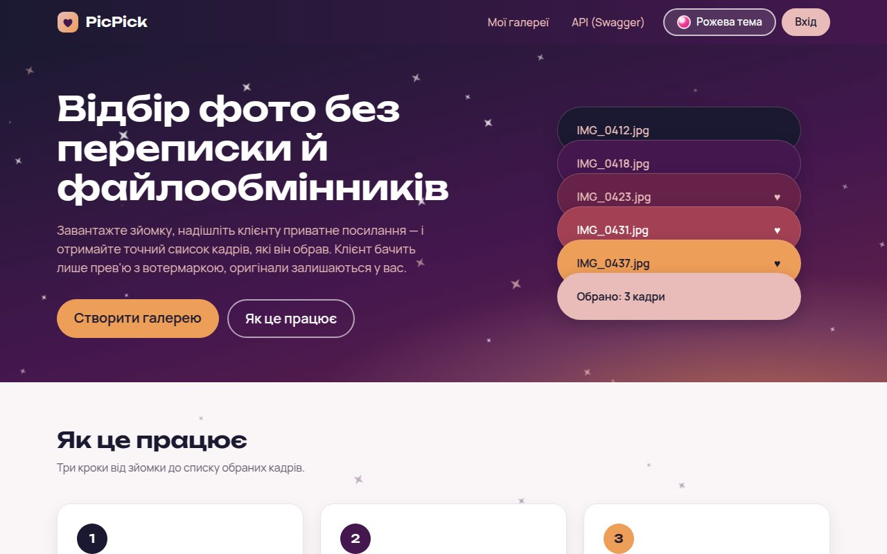
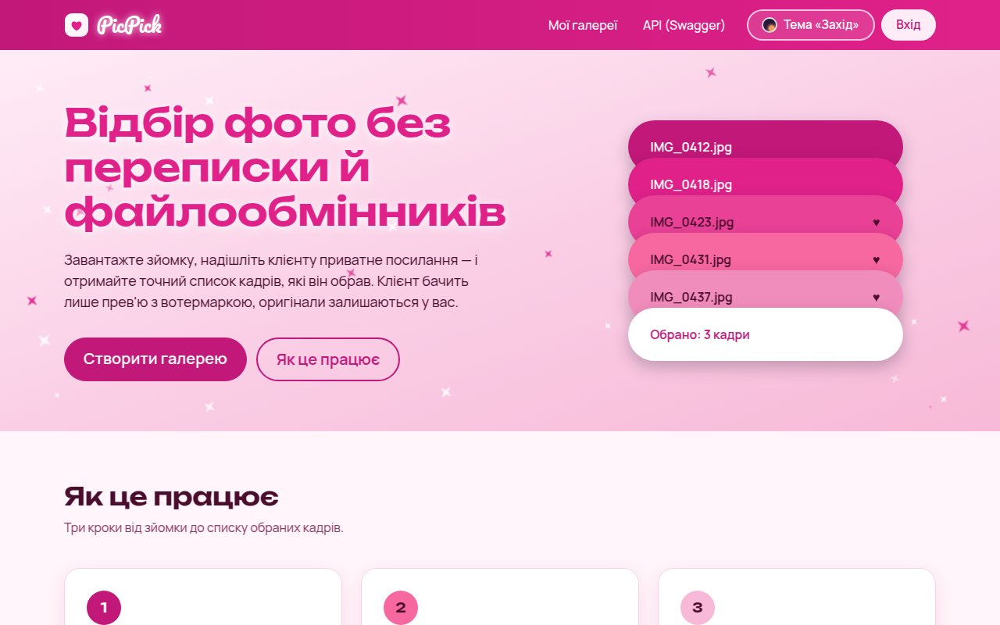
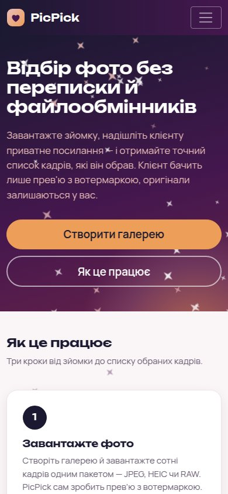
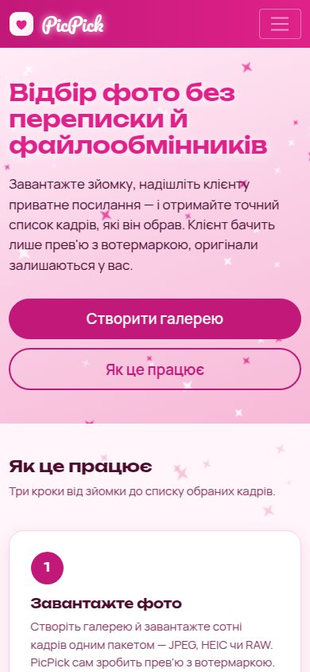
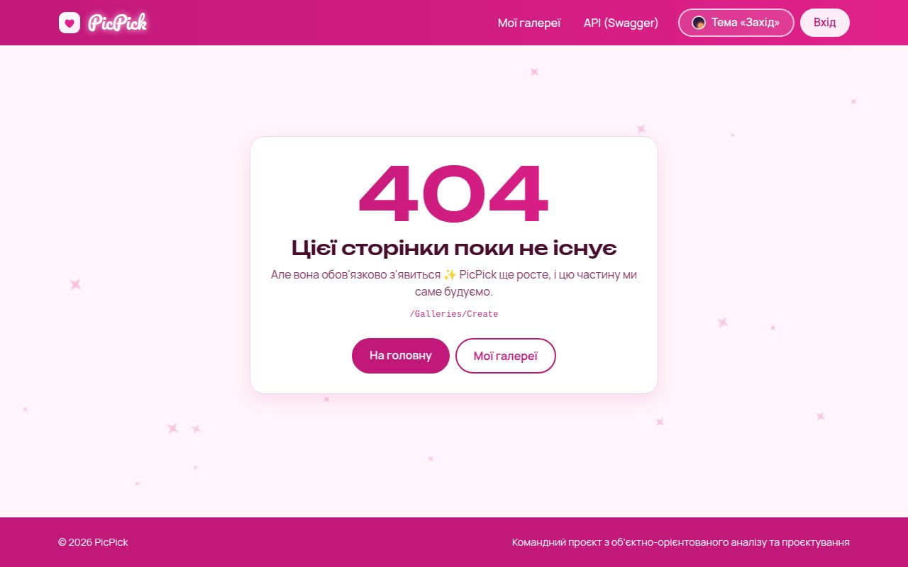

# PicPick

A web service that helps photographers and their clients choose photos together.

The photographer uploads a folder of raw shots. The system generates watermarked previews in the background. The client opens a private link, browses the previews and likes the ones they want. The photographer then gets the list of selected shots for final editing.

Team project for the **Object-Oriented Analysis and Design** course.

## Tech stack

| Layer | Technology |
|---|---|
| UI + API | ASP.NET Core 8 (Razor Pages, Web API, Swagger) |
| Photo processing | Python 3.12 (Pillow, pika, boto3) |
| Message broker | RabbitMQ |
| Database | PostgreSQL |
| File storage | MinIO (S3-compatible) |
| Local run | Podman or Docker Compose (`compose.yaml`: PostgreSQL, RabbitMQ, MinIO) |

## Repository structure

```
docs/          project documentation, one folder per course task
src/webapp/    ASP.NET Core app: UI, REST API
src/worker/    Python worker: watermarks and previews
tests/         Web App error-handling checks and Worker tests
```

## Getting started

### Infrastructure (PostgreSQL, RabbitMQ, MinIO)

`compose.yaml` starts the three infrastructure services from the [High-level Architecture](docs/03-srs/high-level-architecture.md). The Web App and the Worker still run locally (see below) and connect to them via `localhost`. The same file works with Podman and Docker.

1. Install Podman (Ubuntu 24.04) or use Docker:

   ```bash
   sudo apt install podman podman-compose
   ```

2. Create `.env` from the example and change the passwords. `.env` is in `.gitignore` and must never be committed:

   ```bash
   cp .env.example .env
   ```

   If a port is already taken on your machine (for example, by a local PostgreSQL on 5432), change it in `.env`, e.g. `POSTGRES_PORT=5433`.

3. Start everything:

   ```bash
   podman-compose up -d
   ```

   or with Docker:

   ```bash
   docker compose up -d
   ```

4. Check that all services are `healthy`:

   ```bash
   podman ps -a
   ```

   (with Docker: `docker compose ps -a`). `podman-compose` may exit with code 0 even if a container failed to start, so always check this list. The one-off `minio-init` container creates the `originals` and `previews` buckets and then shows `Exited (0)`; this is expected.

| Service | Address | Login |
|---|---|---|
| PostgreSQL | `localhost:5432`, database `picpick` | `POSTGRES_USER` / `POSTGRES_PASSWORD` from `.env` |
| RabbitMQ (AMQP) | `localhost:5672` | `RABBITMQ_USER` / `RABBITMQ_PASSWORD` |
| RabbitMQ Management UI | http://localhost:15672 | same as RabbitMQ |
| MinIO S3 API | http://localhost:9000 | `MINIO_ROOT_USER` / `MINIO_ROOT_PASSWORD` |
| MinIO Console | http://localhost:9001 | same as MinIO |

All ports are bound to `127.0.0.1` only, so the services are not reachable from other machines. In the target system they live in a private network, and only the Web App is public (see the [security model](docs/09-security/README.md)).

**About the MinIO image.** Official MinIO images are no longer freely published (`quay.io/minio` requires authorisation, `minio/minio` was removed from Docker Hub). The prototype uses the frozen `bitnamilegacy/minio` image, pinned to the last version that still has the web console. It gets no updates, which is acceptable for a local prototype bound to `localhost`, but not for production.

Stop the services, keeping the data:

```bash
podman-compose down
```

Stop and delete all data (database, queues, files):

```bash
podman-compose down -v
```

With Docker, use `docker compose down` and `docker compose down -v`.

### Web App

Requires the .NET 8 SDK.

```bash
dotnet run --project src/webapp
```

Then open the URL printed in the console:
- `/` shows the main page;
- `/swagger` shows the API documentation;
- `/health` shows the health check.

### Worker

Requires Python 3.10+.

```bash
python3 -m venv src/worker/.venv
source src/worker/.venv/bin/activate
pip install -r src/worker/requirements.txt
python src/worker/main.py
```

Create a watermarked preview from any photo (FR-203):

```bash
python src/worker/preview.py photo.jpg preview.jpg
```

Run the Worker tests:

```bash
pip install -r src/worker/requirements-dev.txt
pytest tests/worker
```

## Design

The UI has two colour themes. Visitors switch between them with the button in the header; the choice is remembered in the browser.

| Sunset (default) | Barbie |
|---|---|
|  |  |
|  |  |

| Theme | Palette | Feel |
|---|---|---|
| **Sunset** | `#1B1931` `#44174E` `#662249` `#A34054` `#ED9E59` `#E9BCB9` | Night sky from navy to plum with a soft apricot glow, blush text, apricot call-to-action |
| **Barbie** | `#E0218A` `#E94196` `#ED5C9B` `#F768A0` `#F18DBC` `#F7B9D7` `#FACDE5` `#FFECF6` | Hot-pink header, pearl gradient, script logo in Pacifico |

**How it works.**
- All colours are CSS variables in [`site.css`](src/webapp/wwwroot/css/site.css): the default theme lives in `:root`, the Barbie theme overrides the same variables under `[data-theme="pink"]`. Components only use variables, so a new theme is one more block of values.
- A couple of derived shades (for example `#C2187A` for Barbie buttons) are added where a palette colour does not reach WCAG AA contrast for text.
- Fonts: **Unbounded** for headings, **Manrope** for text, **Pacifico** for the Barbie logo — all from Google Fonts with Cyrillic support.
- Animated sparkles twinkle in the background of key sections; they are decorative, ignore clicks and stay still when the system asks to reduce motion.
- The layout is responsive: the menu collapses below 768 px, and every page fits a 375 px phone screen without horizontal scrolling.
- Pages that are not built yet (for example `/Galleries/Create` or `/Account/Login`) show a friendly 404 page; API routes keep their JSON errors.



## Documentation

All design documents live in [`docs/`](docs/). Start with the [glossary](docs/glossary.md).

## Team

| Member | Area |
|---|---|
| Yuliia | Zone A: accounts and galleries |
| Alona | Zone B: upload and photo processing |
| Uliana | Zone C: client access and selection |
