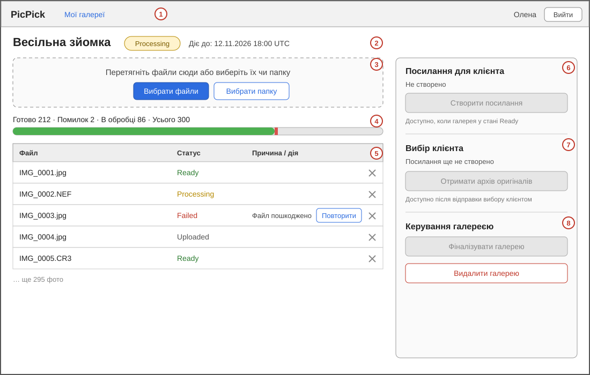
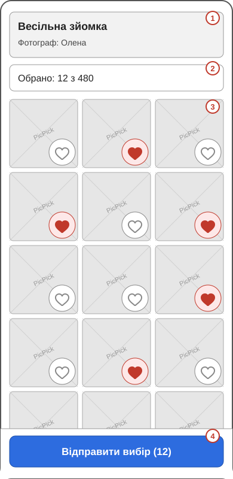

# 3.1 External Interfaces

Розділ описує, як PicPick взаємодіє із людьми (сторінки Razor Pages), апаратною частиною і програмними системами. Назви сутностей, статусів і компонентів узято з [глосарія](../glossary.md); вимоги — з файлів зон: [A](zone-a-accounts.md), [B](zone-b-processing.md), [C](zone-c-client.md).

## 3.1.1 User Interfaces

### Загальні принципи

- **Технологія.** Усі сторінки є серверними Razor Pages у складі Web App; окремого SPA немає. Невеликий скрипт на vanilla JS відповідає за те, чого не зробить звичайна форма: пакетне завантаження файлів, автоматичне оновлення прогресу, лайки без перезавантаження, підвантаження прев'ю під час прокручування й копіювання в буфер. Скрипти викликають REST API того самого Web App.
- **Дві аудиторії, два режими.** Сторінки фотографа розраховані на настільний браузер (персона Олена працює з ноутбука). Сторінки клієнта розраховані насамперед на смартфон (персона Марія, екран близько 390 px) і за NFR-302 працюють на ширині 360, 390, 768 і 1280 px.
- **Мова інтерфейсу — українська.** Повідомлення про помилки зрозумілі користувачу й не містять стектрейсів, внутрішніх шляхів, назв бакетів MinIO чи кодів на кшталт «помилка 404» (FR-202, FR-205, FR-307).
- **Єдиний вигляд відмов.** Для недійсного посилання клієнта і для чужої чи неіснуючої галереї фотографа сторінка й відповідь API не розрізняють причин (FR-105, FR-307, NFR-102).
- **Безпека на рівні інтерфейсу.** Усі сторінки працюють лише через HTTPS. Форми фотографа, що змінюють дані, захищені від підроблених міжсайтових запитів (Identity Management). Тексти з даних користувачів (назва галереї, нікнейм, імена файлів) показуються як текст без виконання HTML. На сторінках клієнта немає форм входу, банера cookie й нічого, що блокує перегляд (NFR-302 п.6).
- **Доступність.** За орієнтир взято WCAG 2.2. У прототипі виконуються базові практики: достатній контраст тексту, керування основними діями з клавіатури, текстові підписи кнопок і полів, інформація про стан (наприклад, лайк або помилка) передається не лише кольором. Розмір цілі для дотику 44 × 44 CSS px з NFR-302 відповідає критерію 2.5.5. Повний аудит на відповідність рівню не проводиться.
- **Підтримувані браузери.** Дві останні мажорні версії Safari (iOS), Chrome (Android і настільний), Firefox та Edge (NFR-302 п.6). Для сторінок фотографа припускаємо ті самі браузери на настільних системах (припущення команди, окремої вимоги немає).

### Сторінки фотографа

Доступ до сторінок UI-P04–UI-P08 потребує входу; без нього відбувається перехід на сторінку входу, а захищені запити API відхиляються (FR-102 п.3).

| ID | Сторінка | Що на ній є | Доступні дії | Вимоги |
|---|---|---|---|---|
| UI-P01 | Реєстрація | Поля: нікнейм (1–50 символів), email, пароль (мінімум 12 символів), повторення пароля. Повідомлення про невиконані умови поруч із полями | Зареєструватися; перейти до входу | FR-101, NFR-101 |
| UI-P02 | Підтвердження email | Результат переходу за листом: підтверджено, посилання прострочено чи змінено, адресу вже підтверджено. Форма повторного надсилання листа (поле email) | Повторно запросити лист на збережену адресу; перейти до входу. Відповідь на повторний запит однакова для будь-якого email | FR-110 |
| UI-P03 | Вхід | Поля email і пароль; позначка «Запам'ятати мене» (вимкнена за замовчуванням, з підказкою про власний пристрій). Єдине повідомлення відмови для будь-якої причини; повідомлення «Забагато спроб. Повторіть пізніше» при 429. Примітка, що відновлення пароля в прототипі недоступне | Увійти; перейти до реєстрації | FR-102, Identity Management |
| UI-P04 | Мої галереї | Список власних галерей від найновішої: назва, `Gallery.Status`, `ExpiresAt`. Порожній стан із запрошенням створити галерею. Верхня панель: нікнейм, «Вийти» | Створити галерею; відкрити деталі; вийти; перейти до акаунта | FR-104 |
| UI-P05 | Нова галерея | Поля: назва (1–100 символів), `ExpiresAt` (пізніше за поточний час, не більше ніж за 30 діб). Повідомлення про некоректні дані | Створити галерею (після успіху відкриваються її деталі, статус `Draft`); скасувати | FR-103 |
| UI-P06 | Деталі галереї | Назва, `Gallery.Status`, `ExpiresAt`, кількість фото. Завантаження: вибір файлів або папки, список відхилених файлів із причинами, скільки фото ще можна додати. Прогрес: готово / помилок / в обробці / усього. Список фото: ім'я файлу, `Photo.Status`, причина для `Failed`. Блок посилання для клієнта. Блок вибору клієнта. Керування галереєю. Для `Expired` показуються лише метадані | Завантажити файли; повторити обробку `Failed`-фото; видалити фото; створити або замінити, скопіювати чи відкликати посилання; перейти до вибору клієнта; фіналізувати галерею; видалити галерею (через діалог підтвердження). Кнопки недоступні, якщо стан галереї не дозволяє дію (наприклад, створити посилання можна лише в `Ready` чи `Shared`) | FR-105–107, FR-201, FR-202, FR-204–207, FR-301, FR-302 |
| UI-P07 | Вибір клієнта | `Selection.Status`, кількість обраних кадрів, `submittedAt`. Для `Open`: лише «Клієнт ще обирає» і кількість лайків. Для `Submitted`: імена файлів оригіналів у порядку завантаження (як текст). «Клієнт ще нічого не обрав», якщо лайків нема | Скопіювати список одним натиском (одне ім'я на рядок); отримати архів оригіналів (лише для `Submitted`, у `Shared` або `Finalized`) | FR-306, FR-208 |
| UI-P08 | Акаунт | Нікнейм і email фотографа | Вийти; видалити акаунт із повторним введенням пароля й підтвердженням незворотності | Identity Management, NFR-102 |

Деталі UI-P06 показано на каркасі нижче. Посилання на клієнтську галерею після створення відображається лише один раз, у відповіді на створення: система зберігає тільки хеш токена (FR-301 п.1), тому після виходу з цього екрана повторно показати його не можна. Блок посилання тоді відображає стан (`Active`, `Expired`, `Revoked`), `ExpiresAt` і кнопки «Відкликати» та «Створити нове».

| № | Елемент каркаса |
|---|---|
| 1 | Верхня панель: перехід до списку галерей, нікнейм, «Вийти» |
| 2 | Назва галереї, її статус і термін дії |
| 3 | Завантаження файлів: перетягування, вибір файлів або папки |
| 4 | Прогрес обробки, оновлюється автоматично не рідше ніж раз на 5 секунд (FR-204) |
| 5 | Список фото зі статусами; для `Failed` — причина й «Повторити»; хрестик видаляє фото (FR-207) |
| 6 | Посилання для клієнта: кнопка недоступна, поки галерея не в стані `Ready` (FR-301) |
| 7 | Вибір клієнта й архів оригіналів: доступні після відправки вибору (FR-306, FR-208) |
| 8 | Фіналізація й видалення галереї (FR-106, FR-107) |

### Сторінки клієнта

Клієнт не входить в акаунт: усі сторінки відкриваються за `Token` у посиланні (Identity Management, розділ «Клієнт»).

| ID | Сторінка | Що на ній є | Доступні дії | Вимоги |
|---|---|---|---|---|
| UI-C01 | Галерея за посиланням | Назва галереї й нікнейм фотографа (email не показується). Лічильник «Обрано: N з M». Сітка прев'ю з вотермаркою, підвантажується порціями під час прокручування. Для `Finalized` повідомлення «Галерею закрито фотографом». Для галереї без `Ready`-фото: «У галереї поки немає кадрів». Кнопка «Відправити вибір» закріплена внизу екрана | Поставити або зняти лайк одним дотиком; відкрити прев'ю у збільшеному вигляді (UI-C02); відправити вибір. У `Finalized`, після `Submitted` чи після відкликання посилання дії недоступні | FR-303, FR-304, FR-305, NFR-302 |
| UI-C02 | Збільшений перегляд кадру | Прев'ю на весь екран, кнопка лайка, стан лайка | Перейти до наступного або попереднього кадру; поставити або зняти лайк; закрити | FR-303, FR-304 |
| UI-C03 | Підтвердження відправки (діалог) | Кількість обраних кадрів і текст, що змінити вибір після відправки не можна | Підтвердити; скасувати (вибір лишається `Open`). Після підтвердження показується «Вибір надіслано» з кількістю кадрів | FR-305 |
| UI-C04 | Посилання не діє | Одне повідомлення: «Це посилання більше не діє. Зверніться до вашого фотографа по нове». Без назви галереї, нікнейма, прев'ю й причини | Немає (підказка звернутися до фотографа) | FR-307, NFR-301 |
| UI-C05 | Забагато спроб | «Забагато спроб, спробуйте за хвилину» | Повторити пізніше | FR-307 п.3, NFR-301 п.4 |

Окремі повідомлення на UI-C01: якщо лайк не вдалося зберегти (обрив мережі), лічильник і кадр повертаються до стану сервера й показується «Не вдалося зберегти, спробуйте ще раз» (NFR-302 п.5). Сторінка, відкрита до відкликання посилання чи фіналізації галереї, при першій дії показує UI-C04 або повідомлення про закриту галерею (FR-304 п.3, FR-307 п.2).

Основний сценарій клієнта проходить через сторінку UI-C01 і займає не більше двох дій до першого лайка (відкрити посилання, торкнутися кадру).

| № | Елемент каркаса |
|---|---|
| 1 | Назва галереї й нікнейм фотографа |
| 2 | Лічильник обраних кадрів, оновлюється одразу після лайка |
| 3 | Сітка прев'ю; ціль для лайка не менша за 44 × 44 CSS px, відстань між цілями не менша за 8 px (NFR-302 п.2) |
| 4 | «Відправити вибір» із кількістю обраних кадрів; відкриває діалог підтвердження (UI-C03) |

### Спільні сторінки

| ID | Сторінка | Призначення |
|---|---|---|
| UI-S01 | Загальна сторінка помилки | Для непередбачених збоїв: зрозуміле повідомлення без технічних подробиць. Для чужої чи неіснуючої галереї фотографа сторінка однакова (FR-105) |

## 3.1.2 Hardware Interfaces

**N/A.** PicPick є веб-сервісом і не взаємодіє з апаратним забезпеченням напряму:

- Користувачі працюють через браузер на власних пристроях (ноутбук, смартфон); доступ до камери, геолокації, принтерів, сканерів чи інших пристроїв продукт не використовує. Фото потрапляють у систему лише як файли, вибрані фотографом у файловому діалозі браузера.
- Серверна частина працює в контейнерах Docker (у прототипі за допомогою Docker Compose на одній машині), тому взаємодія із серверним обладнанням ховається за ОС і середовищем контейнерів. У цільовій системі це хмарна інфраструктура, апаратні інтерфейси якої в межах продукту не керуються.
- Вимоги до потужності (наприклад, еталонне середовище 4 ядра CPU і 8 ГБ RAM для вимірювань) є частиною нефункціональних вимог зони B (NFR-201, NFR-202), а не апаратним інтерфейсом.

## 3.1.3 Software Interfaces

Нижче оглядово подано системи, з якими взаємодіє продукт. Деталі REST API й коди помилок наведено в документі API (п.5), формати повідомлень між Web App і Worker (зокрема поля подій) — у [флоу зони B](../04-architecture/flow-zone-b.md), діаграми компонентів — у розділі High-level Architecture.

| ID | З'єднання | Протокол і формат | Призначення | Прототип / цільова система |
|---|---|---|---|---|
| SI-01 | Браузер ↔ Web App | HTTPS. HTML (Razor Pages) для сторінок; JSON для REST API; `multipart/form-data` для завантаження файлів; потік `application/zip` для архіву; `image/jpeg` для прев'ю з `ETag` і `Cache-Control`. Помилки API: `application/problem+json` (ProblemDetails) із полем `errorCode`. Автентифікація фотографа: захищений cookie; доступ клієнта: `Token` у шляху посилання | Інтерфейс обох акторів | Прототип: HTTPS налаштовано в Web App. Цільова система: завершення TLS на балансувальнику навантаження |
| SI-02 | Web App ↔ PostgreSQL 16 | SQL через EF Core (драйвер Npgsql), TCP. Параметри підключення з конфігурації | Галереї, фото, посилання, вибір, акаунти Identity. Стан `ShareLink` і галереї читається на кожному запиті (NFR-301 п.5) | Прототип: контейнер у Docker Compose. Цільова система: керована БД із резервним копіюванням |
| SI-03 | Web App ↔ MinIO | S3 API (S3-клієнт для .NET), HTTP(S) | Запис оригіналів, читання прев'ю та оригіналів, видалення файлів. Файли клієнту й фотографу віддає лише Web App після перевірки доступу; прямих адрес MinIO вони не отримують (NFR-301 п.6, FR-208) | Прототип: контейнер MinIO. Цільова система: хмарне S3-сумісне сховище |
| SI-04 | Web App ↔ RabbitMQ 3 | AMQP 0-9-1. Публікація в Чергу задач; споживання з Черги подій. Повідомлення JSON містять ідентифікатори й ключ оригіналу, а не сам файл | Асинхронна передача фото на обробку й отримання результату (FR-201, FR-203). Мета надійності — NFR-202; механізми описано в п.6 | Прототип: один брокер. Цільова система: кластер брокера |
| SI-05 | Worker ↔ RabbitMQ | AMQP 0-9-1 (бібліотека `pika`). Споживання з Черги задач; публікація в Чергу подій | Отримання задач і повідомлення про результат; кілька екземплярів Worker читають одну чергу | Прототип: один або кілька контейнерів Worker. Цільова система: масштабування за довжиною черги |
| SI-06 | Worker ↔ MinIO | S3 API (бібліотека `boto3`) | Читання оригіналу, запис прев'ю (JPEG до 1600 px з вотермаркою) | Як SI-03 |
| SI-07 | Web App ↔ поштовий сервіс | SMTP | Лист підтвердження email фотографа (FR-110, входить до прототипу). У цільовій системі також сповіщення про відправку вибору (FR-109) і відновлення пароля (Identity Management) | Прототип: налаштований SMTP-сервіс або ізольована тестова скринька. Цільова система: надійний поштовий провайдер |
| SI-08 | Розробник ↔ Web App (Swagger) | HTTP. OpenAPI-специфікація (Swashbuckle) і Swagger UI | Документація й ручна перевірка REST API (п.5) | Прототип: увімкнено. Цільова система: доступ обмежується |
| SI-09 | Розробник ↔ RabbitMQ Management UI | HTTP | Перегляд черг під час демо та розробки | Лише прототип; у цільовій системі доступ закрито |

Примітки:

1. Worker **не підключається до PostgreSQL**: він працює лише з RabbitMQ і MinIO (технологічна основа проєкту), а результат передає через Чергу подій, і його записує в базу Web App. Тому прямого з'єднання «Worker ↔ PostgreSQL» у таблиці немає.
2. Бібліотеки обробки зображень Worker (`Pillow`, `pillow-heif`, `rawpy`) є внутрішніми залежностями, а не зовнішніми системами, тому їх тут не розглянуто; формати й обмеження подано в зоні B.
3. Docker і Docker Compose є середовищем розгортання, а не програмним інтерфейсом продукту; їх описує розділ про Deployment model (п.10).

## Узгодженість із вимогами

| Вимога | Де відображена в інтерфейсах |
|---|---|
| FR-101, FR-102, FR-110, NFR-101 | UI-P01–UI-P03 |
| FR-103–107 | UI-P04–UI-P06 |
| FR-201, FR-202, FR-204–207 | UI-P06 (завантаження, прогрес, повтор, видалення фото) |
| FR-208, FR-306 | UI-P07 |
| FR-301, FR-302 | UI-P06 (блок посилання) |
| FR-303–305, NFR-302 | UI-C01–UI-C03 |
| FR-307, NFR-301 | UI-C04, UI-C05 |
| NFR-102 | UI-P06, UI-P07, UI-C01, UI-S01 (єдині відмови без даних) |
| NFR-201, NFR-202 | SI-04–SI-06, 3.1.2 |