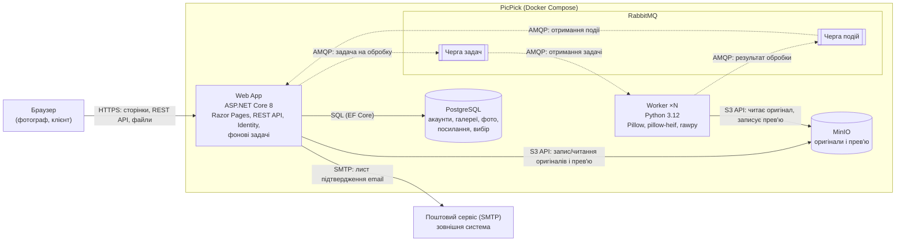

# 2.7 High-level Architecture

PicPick складається з двох сервісів різних стеків — **Web App** (ASP.NET Core) і **Worker** (Python), — які спілкуються асинхронно через брокер повідомлень **RabbitMQ**. Дані зберігаються в **PostgreSQL**, файли — у **MinIO**. Користувачі працюють лише через **Браузер**. Назви компонентів відповідають [глосарію](../glossary.md); цей розділ є основою для діаграм і ADR п.4.

## Компонентна діаграма

Суцільні стрілки — синхронні виклики (запит чекає на відповідь), пунктирні — асинхронні повідомлення через чергу. Підпис на стрілці — протокол і призначення.

Браузер звертається лише до Web App. PostgreSQL, MinIO і RabbitMQ не доступні ззовні: файли й дані користувач отримує тільки через Web App після перевірки доступу (NFR-102, FR-208).

## Компоненти

| Компонент | Відповідальність | Технологія | З ким спілкується |
|---|---|---|---|
| **Браузер** | Інтерфейс фотографа й клієнта: сторінки, завантаження файлів, лайки, автоматичне оновлення прогресу (FR-204) | Будь-який сучасний браузер; Razor Pages + vanilla JavaScript ([ADR-001](../04-architecture/adr/001-ui-razor-pages.md)) | Web App (HTTPS) |
| **Web App** | Єдина точка входу: сторінки й REST API, вхід фотографа (Identity, cookie), доступ клієнта за `Token`, перевірка файлів і власника, запис у PostgreSQL, збереження оригіналів у MinIO, постановка задач у Чергу задач. Фонові задачі: публікація відкладених задач, обробка подій від Worker, видалення прострочених галерей (FR-108) | ASP.NET Core 8: Razor Pages, Web API, Identity, Swashbuckle, EF Core | Браузер (HTTPS), PostgreSQL (SQL), MinIO (S3 API), RabbitMQ (AMQP), поштовий сервіс (SMTP) |
| **Worker** | Створення прев'ю з вотермаркою (FR-203), автоматичні повтори (FR-205). Не зберігає стану між задачами й не приймає запитів від Браузера; кількість копій змінюється без змін у коді (NFR-201) | Python 3.12: Pillow, pillow-heif, rawpy, pika, boto3 | RabbitMQ (AMQP), MinIO (S3 API) |
| **RabbitMQ** | Брокер повідомлень. **Черга задач:** Web App → Worker, «обробити фото». **Черга подій:** Worker → Web App, «фото оброблено / не вдалося». Зберігає повідомлення, доки їх не підтверджено (NFR-202) | RabbitMQ 3, протокол AMQP | Web App, Worker |
| **PostgreSQL** | Основна база даних: `Photographer`, `Gallery`, `Photo`, `PhotoPreview`, `ShareLink`, `Selection`, а також статуси (`Gallery.Status`, `Photo.Status`). Єдиний власник — Web App | PostgreSQL 16 | Web App (SQL) |
| **MinIO** | Сховище файлів: оригінали та прев'ю. Ззовні недоступне | MinIO (S3-сумісне сховище) | Web App, Worker (S3 API) |

Поштовий сервіс (SMTP) — зовнішня система, а не компонент PicPick (див. [2.1 Product Perspective](02-product-overview.md)).

## Ключові архітектурні принципи

1. **У черзі передається посилання, а не файл.** Web App кладе оригінал у MinIO, а в Чергу задач — лише ідентифікатор фото і ключ файлу. Повідомлення залишаються маленькими, а брокер не зберігає гігабайти RAW-файлів.
2. **Єдиний власник бази даних.** У PostgreSQL пише лише Web App. Worker повідомляє про результат через Чергу подій, і статуси оновлює Web App (FR-203). Так правила переходів статусів живуть в одному місці.
3. **Worker не має стану.** Усе, що потрібно для задачі, є в повідомленні й у MinIO. Тому кілька Worker можуть брати задачі з однієї черги, а падіння одного не втрачає роботи (NFR-201, NFR-202).
4. **Доступ перевіряє лише Web App.** Worker, RabbitMQ, PostgreSQL і MinIO недоступні з Браузера. Перевірки власника, `ShareLink` і `ExpiresAt` виконуються в одному місці на кожному запиті (FR-108, NFR-102).

Механізми запобігання втраті задач та ідемпотентної обробки повторних доставок без дублювання `PhotoPreview` і файлів прев'ю буде описано в сценаріях concurrency п.6.

## Головний потік: завантаження й обробка

1. Фотограф завантажує фото → Браузер надсилає файли до Web App (HTTPS).
2. Web App перевіряє файли, зберігає оригінали в MinIO, створює `Photo` зі статусом `Uploaded` у PostgreSQL і ставить задачу в Чергу задач. Відповідь Браузеру повертається одразу, не чекаючи обробки (FR-201).
3. Вільний Worker бере задачу, читає оригінал із MinIO, записує прев'ю в MinIO і публікує подію в Чергу подій.
4. Web App отримує подію й оновлює `Photo.Status` і `Gallery.Status`. Браузер бачить прогрес, періодично опитуючи Web App (FR-204).

Детальна sequence-діаграма цього потоку — у п.4 (`docs/04-architecture/flow-zone-b.md`).

## Чому така архітектура

Обробка фото — найважча частина системи: створення прев'ю з 300 RAW займає десятки хвилин процесорного часу (NFR-201). Якщо виконувати її в процесі Web App (**моноліт**), сайт сповільнюється для всіх користувачів, а збій під час обробки зачіпає і сторінки. Тому обробку винесено в окремий сервіс. Черга між сервісами дає три речі, яких не дає прямий HTTP-виклик від Web App до Worker: Web App не чекає завершення обробки, задачі не губляться, поки Worker недоступний, а навантаження розподіляється між кількома Worker. Worker написано на Python, бо в ньому є зрілі бібліотеки для зображень і RAW (Pillow, LibRaw); плата за це — два стеки й складніше налагодження розподіленої системи. **Serverless-обробка** (наприклад, функція на кожен новий файл у сховищі) прибрала б потребу керувати Worker, але має обмеження за часом виконання й пам'яттю та холодний старт. Крім того, локальне відтворення хмарних тригерів і керованих сервісів потребує додаткових інструментів і конфігурації, тому для прототипу обрано звичайний Worker у Docker Compose.

| Варіант | Плюси | Мінуси |
|---|---|---|
| **Моноліт:** один ASP.NET-застосунок, обробка у фоновому потоці | Один проєкт і один стек; простіше запускати й налагоджувати; немає мережевих викликів між сервісами | Обробка конкурує із сайтом за CPU і пам'ять; масштабувати можна лише весь застосунок; падіння обробки зачіпає сайт; обробка RAW у .NET складніша, ніж у Python |
| **Два сервіси + черга** *(обрано)* | Сайт відповідає швидко під час обробки; Worker масштабується окремо; задачі переживають збої; для кожної частини обрано зручний стек | Більше компонентів; потрібна узгодженість між базою й чергою; складніше налагоджувати й тестувати |
| **Serverless:** функція в хмарі на кожен файл | Не треба керувати серверами; автоматичне масштабування; оплата за фактичне використання | Обмеження часу виконання й пам'яті для великих RAW; холодний старт; залежність від хмарного провайдера; локальне відтворення хмарних тригерів і керованих сервісів потребує додаткових інструментів та конфігурації |

Розгорнуте обґрунтування — у ADR-002 «Мікросервіси замість моноліту» та ADR-003 «Хмарне розгортання і serverless» (п.4).

## Прототип і цільова архітектура

| | Прототип | Цільова архітектура |
|---|---|---|
| Розгортання | Docker Compose на одній машині | Хмара з контейнерами й керованими сервісами (ADR-003, п.10) |
| Web App | Одна копія | Кілька копій за балансувальником навантаження |
| Worker | Одна або кілька копій у Docker Compose | Автоматичне масштабування за довжиною Черги задач |
| PostgreSQL, RabbitMQ, MinIO | Окремі контейнери | Керовані хмарні сервіси (база даних, черга, об'єктне сховище) |

Компоненти, протоколи й межі відповідальності в обох варіантах однакові, змінюється лише спосіб розгортання.
