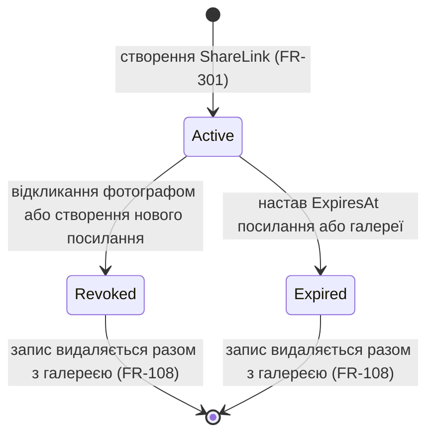
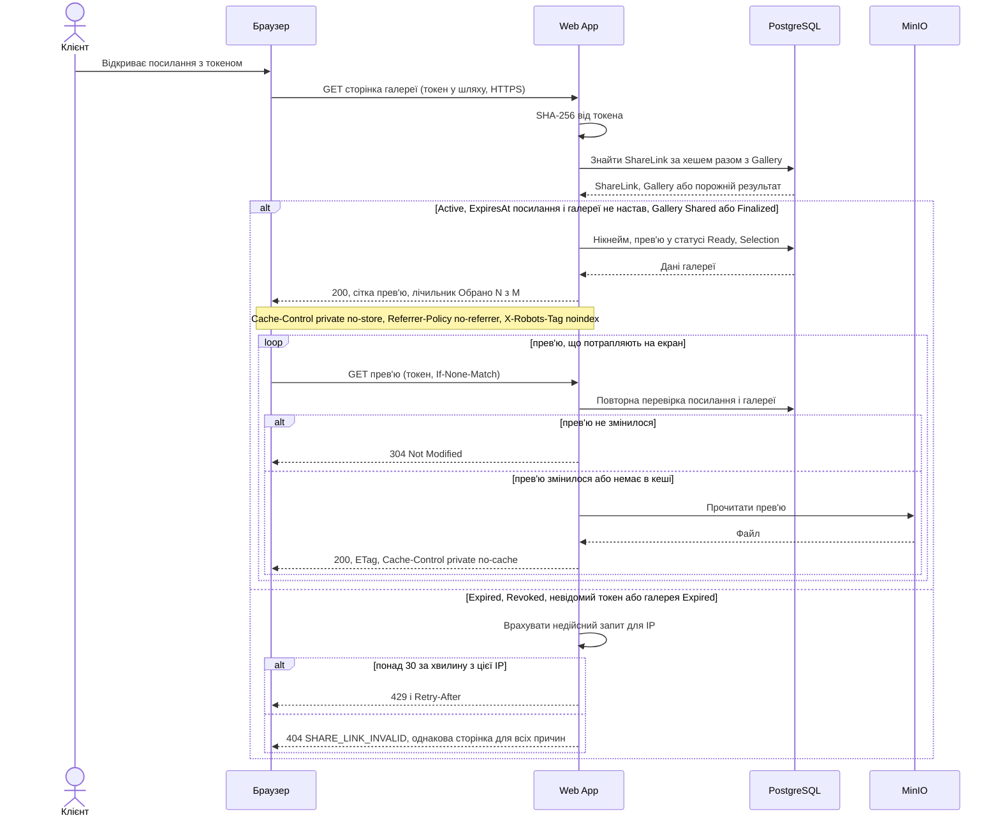

# Identity Management

## Фотограф

### Реєстрація

Фотограф (`Photographer`) створює акаунт із трьома обов'язковими полями: нікнейм, email і пароль. Нікнейм містить 1–50 символів після видалення пробілів на початку й у кінці, зберігається та показується власнику в акаунті й клієнту на сторінці доступної галереї як відображуване ім'я. Порожнє значення або лише пробіли не приймаються; однакові нікнейми дозволені, для входу використовується email. Значення обробляється як текст, без виконання HTML. Нікнейм є персональними даними з дозволеним публічним показом у галереї, захищається за NFR-102 та видаляється разом з акаунтом. Термін визначено в [глосарії](../glossary.md). Форма також містить повторення пароля для перевірки введення; це значення не зберігається.

Email має бути коректним та унікальним без урахування регістру літер. Пароль має містити щонайменше **12 символів** відповідно до NFR-101. Додаткових вимог до цифр, регістру чи спеціальних символів не вводимо: відповідні стандартні перевірки Identity потрібно налаштувати явно. Некоректні дані або повторний email не створюють акаунта; успішна реєстрація створює один `Photographer`, який може ввійти після підтвердження email.

**Підтвердження email обов'язкове до першого входу**, включно з мінімальним прототипом (`RequireConfirmedEmail = true`). Після реєстрації лист із посиланням підтвердження надсилається лише на збережену адресу; посилання діє **24 години** та підтверджує конкретний акаунт і email. Прострочене або змінене посилання не підтверджує адресу; після успіху повторне відкриття лише повідомляє, що її вже підтверджено. Службовий код підтвердження не є `Token` із `ShareLink`.

Фотограф може повторно запросити лист на збережений email. Для невідомого email, уже підтвердженої та непідтвердженої адреси повертається однакове повідомлення: «Якщо email очікує підтвердження, лист надіслано»; лист надсилається лише для непідтвердженої адреси. Повторне надсилання обмежується за частотою запитів, як і вхід. Зміна непідтвердженого email не передбачена: якщо адресу введено помилково, фотограф повторює реєстрацію з правильною адресою.

**Мінімальний прототип має включати реєстрацію, доставку листа підтвердження й вхід після підтвердження.** Web App використовує Identity для створення та перевірки посилання й налаштований поштовий сервіс для доставки листа на вказану адресу; для демо можна використовувати ізольовану тестову поштову скриньку. Якщо доставка не вдалася, акаунт залишається непідтвердженим і можна повторно запросити лист. Публічної дії «підтвердити без листа» немає. Відновлення пароля й email-сповіщення про вибір у прототип не входять.

### Вхід, сесія та вихід

Фотограф вводить email **і** пароль у Web App: для успішного входу потрібні обидва правильні значення та підтверджений email. Невідомий email **або** неправильний пароль спричиняють однакову відмову; непідтверджений акаунт також не отримує доступу. Повідомлення для всіх цих випадків: «Не вдалося ввійти. Перевірте email або пароль; якщо ви щойно зареєструвалися — підтвердьте email». REST API повертає однаковий статус 401 і загальне повідомлення без ознаки існування чи стану акаунта. Після успішної перевірки Identity Web App видає захищений cookie та відкриває список власних галерей.

Для PicPick встановлюються такі параметри сесії:

| Умова | Поведінка |
|---|---|
| Звичайний вхід | Без позначки «Запам'ятати мене» cookie сесійний (`IsPersistent = false`), строк входу — не більше **8 годин**. Відновлення вкладок браузером не обходить серверний строк. |
| «Запам'ятати мене» | Позначка вимкнена за замовчуванням. За явного вибору фотографа видається постійний cookie (`IsPersistent = true`), який зберігає вхід після закриття браузера не довше **14 діб** від успішного входу. Біля позначки зазначено, що її слід використовувати на власному пристрої. |
| Продовження строку | В обох режимах строк фіксований, активність його не продовжує (`SlidingExpiration = false`); після 8 годин або 14 діб відповідно потрібен новий вхід. |
| Захист cookie | `HttpOnly`, `Secure`, `SameSite=Lax`; cookie не містить пароля. Дії зі зміною даних додатково перевіряють захист від підроблених міжсайтових запитів. |
| Обмеження спроб | До перевірки наявності акаунта діють ковзні вікна: **5 запитів за 15 хвилин** для пари нормалізований email + IP та **20 запитів за хвилину** з однієї IP-адреси. Враховуються всі спроби, включно з невідомими email та успішними входами; перевищення будь-якого ліміту повертає 429. Форма й REST API використовують спільні лічильники. |
| Вихід | Дія «Вийти» припиняє вхід у поточному браузері та видаляє його cookie; інші браузери зберігають свої сесії до завершення строку або їх відкликання. |

Після завершення сесії захищені сторінки вимагають повторного входу, а REST API відхиляє запит без повернення приватних даних. Реєстрація, вхід та інші дії з паролем виконуються лише через HTTPS; HTTP-запит з обліковими даними не обробляється.

**Глобального блокування акаунта лише за кількістю неправильних паролів немає:** використовується обмеження частоти запитів, а не блокування Identity за email. Тому спроби з однієї IP не блокують правильний вхід з іншої; розподілений перебір залишається ризиком для подальшого threat model. Після п'яти дозволених запитів шостий для тієї самої пари email + IP отримує 429 незалежно від того, чи існує акаунт; після завершення відповідного вікна запити знову дозволені. Повідомлення «акаунт заблоковано» не показується.

429 повертається у форматі ProblemDetails із заголовком `Retry-After`, який указує час до наступної дозволеної спроби; він залежить від вікна ліміту, а не від стану акаунта. Сторінка показує «Забагато спроб. Повторіть пізніше». Політика застосовується і до форми входу, і до REST API, а також до повторного надсилання підтвердження. Реалізація й документація 429 узгоджуються з [таскою «Rate limiting: відповідь 429»](https://github.com/alonasaienko/picpick/issues/25).

Ці строки й обмеження — параметри PicPick, які потрібно налаштувати, а не стандартні значення Identity. Можливості налаштування паролів, блокування та cookie описано в [документації Identity](https://learn.microsoft.com/en-us/aspnet/core/security/authentication/identity-configuration?view=aspnetcore-8.0); відмінність сесійного cookie від постійного — у [документації cookie authentication](https://learn.microsoft.com/en-us/aspnet/core/security/authentication/cookie?view=aspnetcore-8.0#persistent-cookies).

### Якщо фотограф забув пароль

У цільовій системі фотограф запитує відновлення за email. Відповідь однакова для наявного, ненаявного й непідтвердженого акаунта: «Якщо акаунт існує та email підтверджено, інструкцію надіслано на email». Посилання для скидання пароля надсилається лише на раніше підтверджену збережену адресу; довільну іншу адресу для отримання листа ввести не можна. Для непідтвердженого акаунта можна повторно запросити підтвердження на збережену адресу. Запити відновлення мають ті самі ліміти за IP та парою email + IP і той самий загальний формат 429; пароль у листі не передається.

Посилання для скидання пароля діє **1 годину**. Після успішного скидання воно стає непридатним для повторного використання; прострочене або змінене посилання не змінює пароль. Новий пароль проходить ту саму перевірку мінімуму 12 символів. Успішне скидання скасовує попередні сесії: наступний захищений запит із будь-якого браузера вимагає нового входу. Перевірка актуальності сесій має забезпечити це явно, без очікування стандартного періодичного інтервалу Identity.

Скидання виконується засобами ASP.NET Core Identity. Його службовий код відновлення не є `Token` із глосарія: `Token` використовується в посиланні для клієнта (`ShareLink`) і не може скидати пароль фотографа. Механізм відновлення та налаштування строку дії описано в [офіційному матеріалі Microsoft](https://github.com/dotnet/AspNetCore.Docs/blob/main/aspnetcore/security/authentication/accconfirm.md).

**У мінімальному прототипі відновлення пароля не реалізується**: доставка листа підтвердження не означає наявності сценарію відновлення. Інтерфейс прямо повідомляє про недоступність відновлення. Прототип не показує посилання для скидання пароля на загальнодоступній сторінці та не видає його за введеним email. Без доступу до пошти відновлення акаунта в цільовій системі не передбачене; ручне скидання пароля іншою роллю не вводиться.

### Ролі й дозволи

Фотограф (`Photographer`) входить за підтвердженим email і паролем, надалі використовує cookie. Клієнт (`Client`) не має акаунта: його доступ визначає `Token` у чинному `ShareLink`. Система (`System`) — внутрішній актор для автоматичних операцій; увійти як Система через форму фотографа неможливо.

Матриця дозволів: «—» означає відсутність дозволу; права фотографа після входу обмежені його власними даними, а клієнта — галереєю з чинного посилання та її станом.

| Дія | Фотограф | Клієнт | Система |
|---|---|---|---|
| Зареєструвати й підтвердити акаунт | Свій акаунт, до входу | — | — |
| Увійти або вийти | Свій акаунт | — | — |
| Створити галерею, переглянути список і деталі | Власні галереї | — | — |
| Завантажити або переглянути оригінали | Власна галерея до терміну дії; завантаження лише до фіналізації | — | — |
| Переглянути прев'ю й нікнейм фотографа | Власна доступна галерея | Доступна галерея з чинного ShareLink | — |
| Переглянути email фотографа | Лише власний | — | — |
| Створити чи відкликати ShareLink | Власна галерея з урахуванням стану | — | — |
| Додати/зняти лайк, відправити вибір | — | Доступна нефіналізована галерея, Selection.Status = Open | — |
| Переглянути список обраних кадрів | Власна галерея до терміну дії | — | — |
| Отримати архів оригіналів обраних кадрів (FR-208) | Власна галерея до терміну дії, Gallery.Status = Shared або Finalized, Selection.Status = Submitted | — | — |
| Фіналізувати або видалити галерею | Власна галерея за FR-106–107 | — | — |
| Видалити акаунт і всі його дані | Свій акаунт із повторною перевіркою пароля | — | — |
| Відновити пароль (лише цільова система) | Свій акаунт через підтверджений email | — | — |
| Надіслати лист підтвердження email | — | — | Так, після реєстрації чи повторного запиту |
| Створити прев'ю у фоні | — | — | Так |
| Закрити доступ і видалити прострочену галерею | — | — | Так, за FR-108 |
| Надіслати email-сповіщення про вибір (лише цільова система) | — | — | Так, за FR-109 |

Матриця описує, хто ініціює дозволені дії; виконання запиту сервером не надає користувачу прав Системи. Гостьовий доступ деталізується в [тасці «Identity Management: гостьовий доступ клієнта»](https://github.com/alonasaienko/picpick/issues/12).

Окрема роль адміністратора для погодженого обсягу не потрібна. Реєстрація завжди створює фотографа й не дозволяє обрати підвищені права. Роль `Photographer` не дає доступу до всіх галерей: Web App для кожного запиту звіряє власника з ідентичністю поточного фотографа, а не з ідентифікатором власника, переданим браузером.

Можливий напрямок розширення — скарги на галереї та роль адміністратора для розгляду скарг і блокування акаунтів фотографів. Це майбутній обсяг: перед реалізацією потрібно окремо узгодити вимоги, дозволи, аудит і термін у глосарії; у поточній матриці дозволів та прототипі такого доступу немає.

Для чужої та неіснуючої галереї запит зони A повертає однакові HTTP-статус і загальне повідомлення без назви, нікнейма й email власника, імен файлів, `Token` або адрес файлів. Нікнейм є публічним відображуваним ім'ям у галереї: кожен, хто має доступ за чинним `ShareLink`, бачить його без входу в акаунт фотографа. Email при цьому не розкривається; нечинне посилання не дає доступу ні до нікнейма, ні до інших даних галереї. Перевірки діють і для сторінок, і для REST API. Стан галереї додатково обмежує дії навіть її власника: вхід не обходить `Finalized` або `Expired`.

### Зберігання паролів

Створення акаунта, хешування та перевірку пароля виконує ASP.NET Core Identity. Використовується штатний `PasswordHasher` у режимі `IdentityV3` з індивідуальною випадковою сіллю; власний алгоритм хешування не створюється. Реалізація .NET 8 використовує PBKDF2; однакові паролі різних фотографів мають різні збережені хеші завдяки солі. Це видно у [вихідному коді PasswordHasher для .NET 8](https://github.com/dotnet/aspnetcore/blob/v8.0.0/src/Identity/Extensions.Core/src/PasswordHasher.cs).

У PostgreSQL зберігається хеш, а не відкритий чи оборотно зашифрований пароль. Пароль, повторення пароля, cookie та службові коди відновлення не записуються у журнали Web App і не повертаються у відповідях. Сам пароль сервер отримує лише під час відповідної захищеної дії, наприклад входу, та не зберігає після її обробки.

### Видалення акаунта

Фотограф обирає «Видалити акаунт», повторно вводить поточний пароль і підтверджує незворотність видалення акаунта та всіх його галерей. Скасування або неправильний пароль не змінюють даних. Ідентичність для видалення береться з поточної сесії: передавання ідентифікатора іншого фотографа не дозволяє видалити його акаунт.

Після прийняття підтвердженого запиту:

1. Система припиняє доступ до акаунта з усіх його сесій та забороняє новий вхід. Усі `ShareLink` його галерей перестають надавати доступ клієнту, а оригінали й прев'ю стають недоступними. Старий cookie відхиляється вже на наступному захищеному запиті.
2. Система видаляє всі його `Gallery` разом із `Photo`, `PhotoPreview`, `ShareLink`, `Selection` та файлами в MinIO, а після очищення — дані акаунта `Photographer`, включно з нікнеймом, email, хешем пароля, станом підтвердження email і даними чинних сесій. Видалення охоплює галереї в усіх статусах; дані інших фотографів зберігаються. Відкликання сесій поширюється і на режим «Запам'ятати мене».
3. Якщо очищення частково не вдалося, доступ залишається закритим, а система повторює незавершені операції. Задача Worker, яка завершилася після початку видалення, не відновлює акаунт, галерею чи доступ до файлів; створені нею файли також очищуються. Повідомлення про повне видалення надається лише після успішного завершення очищення.

Механізм повторів і узгодження з Worker деталізується в concurrency та error handling, а строки фізичного очищення й правила щодо резервних копій — у data retention policy з п.7. Цей розділ визначає припинення доступу та склад даних для видалення і не вводить нових статусів `Gallery`.

### Узгодженість із вимогами зони A

Вимоги зони A подано у файлі [zone-a-accounts.md](zone-a-accounts.md).

| Вимога | Як врахована в Identity Management |
|---|---|
| FR-101–102, FR-110 | Обов'язковий неунікальний нікнейм 1–50 символів, унікальний email, підтвердження email до входу, email і пароль для входу; однакові відмови й незалежні від наявності акаунта ліміти. |
| NFR-101 | Мінімум 12 символів, HTTPS, хеші з індивідуальною сіллю через Identity, відсутність відкритих паролів у базі, відповідях і журналах. |
| NFR-102 | Нікнейм — відображуване ім'я в акаунті й доступній клієнту галереї; email приватний. Обидва видаляються з акаунтом; запити зони A перевіряють власника, відмови не розкривають даних. |
| FR-106–107 | Сесія не скасовує обмежень фіналізації; видалення акаунта враховує очищення його галерей і незавершену обробку фото. |

## Клієнт

### Як система розуміє, що це клієнт

Клієнт (`Client`) не має акаунта, пароля чи профілю. Система ідентифікує не людину, а **власника посилання**: хто пред'явив чинний `Token` у `ShareLink`, той і діє як клієнт цієї галереї. `Token` виконує роль логіна й пароля одночасно, тому весь захист гостьового доступу зводиться до того, щоб токен було неможливо вгадати, викрасти з бази чи використати після закінчення дії. Це свідомий компроміс: клієнт відкриває галерею одним дотиком (NFR-302 п.6), а система не знає, **хто саме** тримає посилання, і не намагається це з'ясувати.

Дозволи клієнта обмежені одним `ShareLink`, а отже однією галереєю: перегляд прев'ю й нікнейма фотографа (FR-303), лайк (FR-304) і відправка вибору (FR-305). Оригінали, email фотографа, список імен файлів та інші галереї для нього недоступні. Токен однієї галереї не відкриває ні фото, ні `Selection` іншої: підміна `photoId` чи `galleryId` дає ту саму відповідь, що й для неіснуючого ресурсу (NFR-301 п.6).

### Токен у посиланні

Токен створює криптографічно стійкий генератор випадкових чисел: щонайменше **128 біт** ентропії, не менше **22 символів** base64url. Він ніяк не будується з `galleryId`, часу створення чи лічильника, тому за одним токеном не можна вгадати сусідній (NFR-301 п.1).

Чому його не вгадати. Простір значень становить 2^128 ≈ 3,4·10^38. Навіть якщо зловмисник має мільйон IP-адрес і з кожної надсилає по 30 запитів за хвилину (ліміт з NFR-301 п.4), на перебір піде порядку 10^25 років. Ліміт запитів у цьому розрахунку є додатковим рівнем захисту й обмежує навантаження на базу; основний захист дає розмір простору значень.

Як токен зберігається. У PostgreSQL лежить лише **SHA-256-хеш** токена; сам токен показується фотографу один раз, у відповіді на створення посилання (FR-301). Окрема сіль чи повільний алгоритм (на відміну від паролів фотографів, розділ «Фотограф») тут не потрібні: токен випадковий і має 128 біт, тому словникового перебору не існує, а швидкий хеш потрібен, щоб шукати запис за індексом на кожному запиті. Витік дампа бази не дає жодного чинного посилання. Токен також не потрапляє у журнали (шлях запиту маскується) і не передається в `Referer` (`Referrer-Policy: no-referrer`), а відповіді мають `X-Robots-Tag: noindex, nofollow` (NFR-301 п.2–3). `Token` із `ShareLink` не пов'язаний зі службовими кодами Identity для підтвердження email чи скидання пароля: це різні механізми, і один не підміняє інший.

### Чи потрібен додатковий захист (PIN)

Розглядався другий секрет, наприклад PIN із 4–6 цифр, який фотограф передає клієнту іншим каналом.

| | Плюси | Мінуси |
|---|---|---|
| PIN до галереї | Саме посилання, яке випадково потрапило в чужі руки (скриншот листування, прев'ю в месенджері, історія браузера), не відкриває галерею | Порушує NFR-302 п.6 («не більше 2 дій, без форм і входу») і суперечить персоні Марії, якій потрібен вхід одним дотиком |
| | Другий фактор, незалежний від каналу, яким пересилали посилання | Фотограф майже напевно надішле PIN у тому самому месенджері, тому реальний виграш малий |
| | | PIN із 4–6 цифр підбирається за секунди без обмежень, тож потрібен лічильник спроб на посилання; ліміт дає зловмиснику змогу заблокувати чужого клієнта |
| | | Додатковий секрет потребує зберігання (хеш із сіллю), показу фотографу, відновлення при втраті: нові сценарії й помилки |

**Рішення: PIN не вводимо ні в прототипі, ні в першій версії цільової системи.** Ризик випадкового витоку посилання зменшується іншими засобами: один `Active` ShareLink на галерею, миттєве відкликання (NFR-301 п.5), типовий термін 14 діб замість 30, `noindex` і `no-referrer`, а також обмеження наслідків витоку (див. нижче: лише прев'ю з вотермаркою, без оригіналів і email). Залишковий ризик визнаємо відкрито: хто бачить посилання, той отримує доступ. Опційний PIN на рівні галереї можна розглянути пізніше як розширення; до реалізації знадобиться окрема вимога, поле в `ShareLink` або `Gallery` і узгодження з глосарієм.

### Якщо клієнт переслав посилання комусь іншому

Система не відрізняє людей: **другий отримувач має ті самі права, що й перший**, поки посилання `Active`. Наслідки:

- **Приватність.** Сторонній побачить прев'ю з вотермаркою, назву галереї й нікнейм фотографа, але не оригінали, не email і не прямі адреси файлів у MinIO (FR-303, NFR-102). Для оригіналів вотермарка робить прев'ю малопридатними до використання без оплати.
- **Спільний вибір.** Усі, хто має посилання, працюють з одним `Selection` галереї. Лайки з двох пристроїв зберігаються обидва (FR-304 п.1); якщо один зніме лайк, який поставив інший, він зникне в обох. Для Марії й нареченого, які разом обирають кадри, це бажана поведінка.
- **Відправка вибору.** Будь-хто з посиланням може відправити вибір, а після `Submitted` змінити його не може ніхто (FR-305). Захист від випадкового натискання один: підтвердження з кількістю обраних кадрів. Якщо вибір відправила не та людина чи передчасно, фотограф у першій версії не може його «відкрити»: повторне відкриття вибору не входить до обсягу. Це відомий недолік, його варто врахувати в threat model (п.9) й, за потреби, у цільовій системі.
- **Реакція.** Фотограф не бачить, скільки людей відкривали посилання, бо система не веде обліку відвідувачів. Якщо він підозрює витік, він створює нове посилання: старе стає `Revoked`, усі переслані копії перестають працювати, а `Selection` зберігається (FR-301 п.3).

### Скільки діє посилання і що буде після завершення

`ExpiresAt` посилання задається в UTC; за замовчуванням воно дорівнює меншому з «+14 діб від створення» й `ExpiresAt` галереї, а вручну може бути не пізніше `ExpiresAt` галереї (FR-301 п.2). Оскільки галерея живе до 30 діб (FR-103), посилання теж не триватиме довше. У галереї одночасно діє не більше одного посилання.

`Revoked` і `Expired` кінцеві: повернути їх у `Active` неможливо, а продовжити роботу можна лише створенням нового `ShareLink`. Відкликати можна тільки `Active`; повторне відкликання `Revoked` завершується успіхом без змін, відкликання `Expired` відхиляється (FR-302 п.1). Стан `Expired` не залежить від фонових задач: сервер порівнює поточний час в UTC з `ExpiresAt` посилання й галереї на кожному запиті. Коли галерея набуває стану `Expired` (FR-108), усі її посилання недійсні, навіть якщо власний термін ще не вийшов.

Що бачить клієнт після `Expired` чи `Revoked`, і що відбувається з даними:

| Ситуація | Клієнт | Фотограф і дані |
|---|---|---|
| Посилання `Expired` або `Revoked`, галерея ще існує | Одна сторінка «Це посилання більше не діє. Зверніться до вашого фотографа по нове», HTTP 404, `SHARE_LINK_INVALID`. Ні назви, ні нікнейма, ні прев'ю | `Selection` не змінюється й не видаляється; відправлений вибір фотограф бачить за FR-306 |
| Сторінка була відкрита до відкликання | Будь-яка дія (лайк, відправка, догрузка прев'ю) отримує ту саму відповідь і сторінку | Зміни не зберігаються (FR-307 п.2) |
| Невідомий, пошкоджений токен або галерея `Expired` | Та сама відповідь: причину не розрізнити | Невдалі запити лічаться до ліміту |
| Понад 30 недійсних запитів за хвилину з однієї IP | 429 з `Retry-After`, «Забагато спроб, спробуйте за хвилину» | Запити з чинним токеном не обмежуються |
| Настав `ExpiresAt` галереї | Як для недійсного посилання | Не пізніше ніж за 24 години система видаляє `Gallery`, `ShareLink`, `Selection` і файли (FR-108) |

Один HTTP-статус і один код для всіх причин свідомо: клієнт, колишній клієнт і зловмисник не можуть з'ясувати, чи існувало посилання, і не отримують нічого про галерею. Це зменшує ризик перебору токенів.

### Чи «пам'ятає» система клієнта між візитами

Так, але не клієнта, а **галерею**. Лайки належать `Selection`, який прив'язаний до галереї, а не до браузера, пристрою чи людини. Після закриття вкладки, перезавантаження чи відкриття з іншого пристрою клієнт бачить усі збережені лайки (FR-304 п.1). Система не ставить cookie й не зберігає ідентифікатор клієнта в браузері: єдине, що потрібно для повернення, це те саме посилання. Нове посилання, створене після втрати старого, продовжує той самий `Selection` (FR-301 п.3).

**Варіант з іменем («назвіться, а при поверненні питати, чи це ви») не вводимо.** Причини:

1. Це не автентифікація. Ім'я без пароля може ввести будь-хто; відповідь «це я» нічим не перевіряється, тому безпеки варіант не додає, а лише імітує її.
2. Він змінює модель даних: `Selection` у глосарії означає «сукупність лайків клієнта в галереї», тобто один вибір на галерею. Іменований вибір потребує нової сутності чи поля (відвідувач, `ClientName`), кількох вибірів на галерею й нової логіки того, чий вибір вважається відправленим. Це зачепило б FR-304–306, FR-208, ER-діаграму (п.7) і зони A та B.
3. Він додає форму, а NFR-302 п.6 вимагає ≤ 2 дії від відкриття посилання до першого лайка без форм.
4. Це нові персональні дані клієнта, які довелося б класифікувати й видаляти за політикою зберігання (п.7).
5. Поточна модель добре підходить сценарію персони: Марія й наречений отримують спільний вибір, а не два паралельні.

Оскільки варіант відхилено, змін для зон A і B немає: нових сутностей, полів чи статусів не з'являється, глосарій без змін.

### Відкриття посилання

### Узгодженість із вимогами зони C

Вимоги зони C подано у файлі [zone-c-client.md](zone-c-client.md).

| Вимога | Як врахована в Identity Management |
|---|---|
| FR-301 | Токен показується один раз, у базі лише хеш; нове посилання відкликає попереднє й продовжує той самий `Selection`. |
| FR-302 | Життєвий цикл `Active` → `Expired` / `Revoked`; термін перевіряється на кожному запиті без фонових задач. |
| FR-303 | Клієнт без входу бачить лише прев'ю з вотермаркою й нікнейм; email і оригінали недоступні. |
| FR-304–305 | Лайки зберігаються на сервері й належать галереї; відправка незворотна, а переслане посилання дає ті самі права. |
| FR-306 | Фотограф бачить вибір незалежно від стану посилання, доки існує галерея. |
| FR-307 | Один статус 404 і код `SHARE_LINK_INVALID` для всіх причин; недійсні запити лічаться до ліміту. |
| NFR-301 | 128 біт ентропії, 22 символи base64url, лише SHA-256-хеш у базі, HTTPS, `no-referrer`, `noindex`, ліміт 30 недійсних запитів на хвилину з IP, миттєве відкликання. |
| NFR-302 | Без акаунта, форм і PIN: від відкриття до першого лайка не більше 2 дій; перегляд зі смартфона. |
| Зона A: FR-103, FR-108, NFR-102 | Термін посилання не перевищує термін галереї; прострочена галерея закриває всі посилання; email не розкривається. |