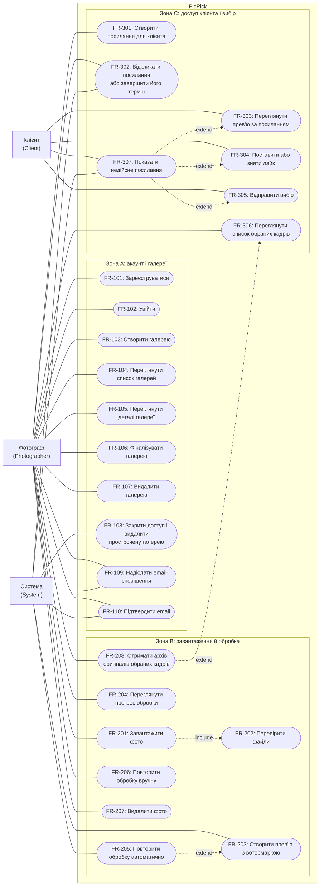
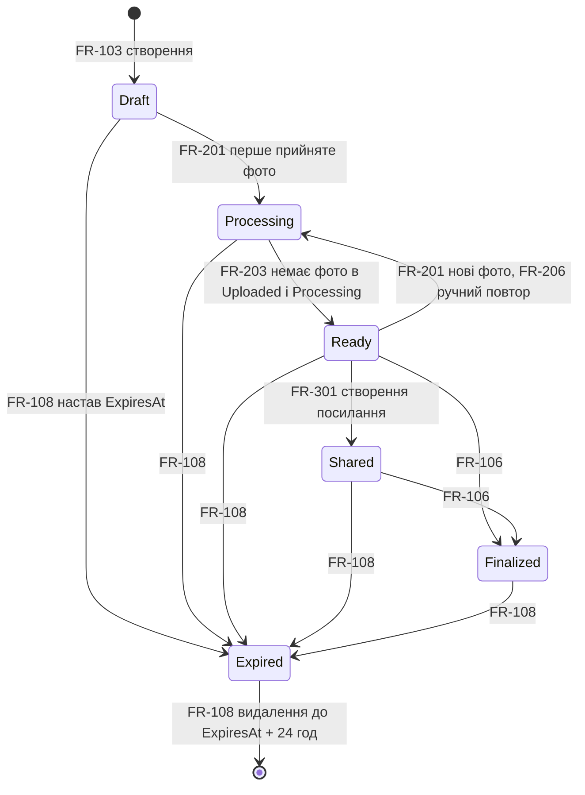

# Software Requirements Specification

## For PicPick

Специфікація зібрана за шаблоном [jam01/SRS-Template](https://github.com/jam01/SRS-Template/blob/3965e951fa5ea1c1dd1bbc7a66b7f35f7e85c006/srs-template.md). Розділи, які писали окремо, підключені посиланнями на їхні файли, щоб текст не дублювався; тут зібрано загальну картину, зведені таблиці й розділи, яких немає в окремих файлах.

## Table of Contents

- [Revision History](#revision-history)
- [1. Introduction](#1-introduction)
- [2. Product Overview](#2-product-overview)
  - [2.1–2.3 Product Perspective, Functions, Constraints](#21-product-perspective)
  - [2.4 User Characteristics](#24-user-characteristics)
  - [2.5–2.6 Assumptions and Dependencies, Apportioning of Requirements](#25-assumptions-and-dependencies)
  - [2.7 High-level Architecture](#27-high-level-architecture)
- [3. Requirements](#3-requirements)
  - [3.1 External Interfaces](#31-external-interfaces)
  - [3.2 Functions](#32-functions)
  - [3.3 Quality of Service](#33-quality-of-service)
  - [3.4 Compliance](#34-compliance)
  - [3.5 Design and Implementation](#35-design-and-implementation)
  - [3.6 AI/ML](#36-aiml)
- [4. Verification](#4-verification)
- [5. Appendixes](#5-appendixes)

## Revision History

| Версія | Дата | Автор | Зміни |
|---|---|---|---|
| 0.1 | 19.10.2026 | Yuliia | Розділ 1 Introduction; вимоги зони A; Identity Management фотографа |
| 0.2 | 20.10.2026 | Alona | Вимоги зони B, FR-208; розділ 2 Product Overview |
| 0.3 | 21.10.2026 | Alona | 2.7 High-level Architecture |
| 0.4 | 25.10.2026 | Uliana | Вимоги зони C; Identity Management клієнта; 3.1 External Interfaces |
| 1.0 | 25.10.2026 | Alona | Зведення SRS: 2.4, зведені таблиці FR і NFR, загальна use case-діаграма, розділи 3.4–3.6, 4, 5 |

Детальна історія — у комітах Git і обговореннях PR за [CONTRIBUTING.md](../../.github/CONTRIBUTING.md).

## 1. Introduction

Розділ 1.1–1.5 — у файлі [01-introduction.md](01-introduction.md): призначення документа, межі продукту (що входить і що не входить), посилання на глосарій як джерело термінів, використані джерела та огляд структури документа.

Терміни, сутності й статуси визначено в [глосарії](../glossary.md).

## 2. Product Overview

### 2.1 Product Perspective

### 2.2 Product Functions

### 2.3 Product Constraints

Розділи 2.1–2.3 — у файлі [02-product-overview.md](02-product-overview.md): PicPick як самостійний вебсервіс і порівняння з поточною практикою та аналогами, огляд можливостей за акторами, обмеження навчального проєкту.

### 2.4 User Characteristics

У системі три актори. Два з них — люди з різним способом доступу, третій — внутрішні сервіси.

| Актор | Хто це | Як ідентифікується | Що робить | Вимоги |
|---|---|---|---|---|
| **Фотограф** (`Photographer`) | Професійний фотограф, який проводить зйомки й передає кадри на відбір | Акаунт: email і пароль, підтверджений email; cookie входу ([Identity Management](identity.md#фотограф)) | Керує галереями, завантажує фото, стежить за обробкою, створює посилання для клієнта, отримує вибір і архів оригіналів | FR-101–107, FR-110, FR-201–208, FR-301, FR-302, FR-306 |
| **Клієнт** (`Client`) | Замовник зйомки, який обирає кадри для фінальної обробки | Без акаунта: секретний `Token` у посиланні `ShareLink` ([Identity Management](identity.md#клієнт)) | Переглядає прев'ю, ставить лайки, відправляє вибір | FR-303–305, FR-307 |
| **Система** (`System`) | Внутрішні сервіси Web App і Worker; не людина й не входить через форму | Внутрішній сервіс ([актор Система](zone-b-processing.md#актор-система)) | Створює прев'ю, повторює обробку, оновлює статуси, закриває доступ і видаляє прострочені дані, надсилає листи | FR-108–110, FR-202, FR-203, FR-205, FR-302, FR-307 |

**Персони.** Для кожного актора-людини описано вигадану, але реалістичну персону:
- **Олена, 29 років, фотограф** ([персона Фотографа](zone-a-accounts.md#персона-фотограф)) — 3–4 зйомки на тиждень по 400–700 кадрів, працює з ноутбука; хоче окрему галерею для кожної зйомки й однозначний список обраних кадрів замість переписки.
- **Марія, 28 років, наречена** ([персона Клієнта](zone-c-client.md#персона-клієнт)) — обирає 30–60 кадрів із 500 зі смартфона в дорозі; не хоче реєструватися й має бачити, що вибір збережено.

Для актора **Система** персона не потрібна: його поведінку повністю задають події й розклад, описані в [зоні B](zone-b-processing.md#актор-система).

### 2.5 Assumptions and Dependencies

### 2.6 Apportioning of Requirements

Розділи 2.5–2.6 — у файлі [02-product-overview.md](02-product-overview.md): припущення A-1–A-6, залежності та що реалізується в прототипі, а що лише описується.

### 2.7 High-level Architecture

Розділ додано до шаблону на вимогу курсу; він — у файлі [high-level-architecture.md](high-level-architecture.md): компонентна діаграма, таблиця компонентів, ключові принципи, головний потік і порівняння з альтернативами.

## 3. Requirements

Вимоги мають ID за зонами (1xx — акаунт і галереї, 2xx — завантаження й обробка, 3xx — доступ клієнта і вибір), формулювання «Система повинна…», актора, пріоритет (Must / Should / Could) і критерії прийняття або перевірки. Повний текст кожної вимоги — у файлі зони.

### 3.1 External Interfaces

Розділ 3.1.1–3.1.3 — у файлі [external-interfaces.md](external-interfaces.md): сторінки фотографа й клієнта, апаратні інтерфейси (N/A з поясненням), програмні інтерфейси.

### 3.2 Functions

**25 функціональних вимог** у трьох зонах.

| ID | Вимога | Актор | Пріоритет |
|---|---|---|---|
| [FR-101](zone-a-accounts.md#fr-101-реєстрація-фотографа) | Реєстрація фотографа | Фотограф | Must |
| [FR-102](zone-a-accounts.md#fr-102-вхід-фотографа) | Вхід фотографа | Фотограф | Must |
| [FR-103](zone-a-accounts.md#fr-103-створення-галереї) | Створення галереї | Фотограф | Must |
| [FR-104](zone-a-accounts.md#fr-104-перегляд-списку-галерей) | Перегляд списку галерей | Фотограф | Must |
| [FR-105](zone-a-accounts.md#fr-105-перегляд-деталей-галереї) | Перегляд деталей галереї | Фотограф | Must |
| [FR-106](zone-a-accounts.md#fr-106-фіналізація-галереї) | Фіналізація галереї | Фотограф | Should |
| [FR-107](zone-a-accounts.md#fr-107-видалення-галереї) | Видалення галереї | Фотограф | Should |
| [FR-108](zone-a-accounts.md#fr-108-автоматичне-завершення-терміну-й-видалення-галереї) | Автоматичне завершення терміну й видалення галереї | Система | Must |
| [FR-109](zone-a-accounts.md#fr-109-email-сповіщення-фотографу-про-відправку-вибору) | Email-сповіщення фотографу про відправку вибору | Система, Фотограф | Should |
| [FR-110](zone-a-accounts.md#fr-110-підтвердження-email-фотографа) | Підтвердження email фотографа | Фотограф, Система | Must |
| [FR-201](zone-b-processing.md#fr-201-пакетне-завантаження-фото) | Пакетне завантаження фото | Фотограф | Must |
| [FR-202](zone-b-processing.md#fr-202-перевірка-файлів-і-стану-галереї) | Перевірка файлів і стану галереї | Фотограф, Система | Must |
| [FR-203](zone-b-processing.md#fr-203-фонове-створення-превю-з-вотермаркою) | Фонове створення прев'ю з вотермаркою | Система | Must |
| [FR-204](zone-b-processing.md#fr-204-перегляд-прогресу-обробки) | Перегляд прогресу обробки | Фотограф | Must |
| [FR-205](zone-b-processing.md#fr-205-автоматичні-повтори-і-статус-failed) | Автоматичні повтори і статус Failed | Система | Must |
| [FR-206](zone-b-processing.md#fr-206-ручний-повтор-обробки) | Ручний повтор обробки | Фотограф | Should |
| [FR-207](zone-b-processing.md#fr-207-видалення-фото-з-галереї) | Видалення фото з галереї | Фотограф | Could |
| [FR-208](zone-b-processing.md#fr-208-отримання-архіву-оригіналів-обраних-кадрів) | Отримання архіву оригіналів обраних кадрів | Фотограф | Could |
| [FR-301](zone-c-client.md#fr-301-створення-посилання-для-клієнта) | Створення посилання для клієнта | Фотограф | Must |
| [FR-302](zone-c-client.md#fr-302-відкликання-посилання-і-завершення-його-терміну) | Відкликання посилання і завершення його терміну | Фотограф, Система | Should |
| [FR-303](zone-c-client.md#fr-303-перегляд-превю-за-посиланням) | Перегляд прев'ю за посиланням | Клієнт | Must |
| [FR-304](zone-c-client.md#fr-304-лайк-і-зняття-лайка) | Лайк і зняття лайка | Клієнт | Must |
| [FR-305](zone-c-client.md#fr-305-відправка-вибору) | Відправка вибору | Клієнт | Must |
| [FR-306](zone-c-client.md#fr-306-список-обраних-кадрів-для-фотографа) | Список обраних кадрів для фотографа | Фотограф | Must |
| [FR-307](zone-c-client.md#fr-307-недійсне-посилання) | Недійсне посилання | Клієнт, Система | Must |

#### Загальна use case-діаграма

Діаграма об'єднує фрагменти трьох зон. Зовнішні вузли — актори, підграфи — зони всередині межі PicPick, овальні вузли — сценарії. Суцільна лінія означає участь актора; `include` — крок, що завжди виконується в межах іншого сценарію; `extend` — сценарій, що доповнює інший лише за певної умови.

#### Життєвий цикл галереї між зонами

`Gallery.Status` змінюють вимоги всіх трьох зон. Діаграма показує, яка вимога відповідає за кожен перехід; значення статусів — за [глосарієм](../glossary.md).

Ручне видалення (FR-107) можливе з будь-якого стану й на діаграмі не показане. Після `Shared` набір фото не змінюється (FR-202, FR-206, FR-207), а лайки й відправка вибору можливі лише в нефіналізованій чинній галереї (FR-106, FR-304, FR-305).

### 3.3 Quality of Service

**6 нефункціональних вимог** з вимірюваними критеріями перевірки. Шаблон не має окремого підрозділу для юзабіліті, тому його додано як 3.3.6.

| ID | Вимога | Підрозділ | Пріоритет |
|---|---|---|---|
| [NFR-101](zone-a-accounts.md#nfr-101-безпека-акаунтів) | Безпека акаунтів | 3.3.2 Security | Must |
| [NFR-102](zone-a-accounts.md#nfr-102-приватність-даних-фотографа) | Приватність даних фотографа | 3.3.2 Security | Must |
| [NFR-201](zone-b-processing.md#nfr-201-продуктивність-і-масштабованість-обробки) | Продуктивність і масштабованість обробки | 3.3.1 Performance | Must |
| [NFR-202](zone-b-processing.md#nfr-202-надійність-обробки) | Надійність обробки | 3.3.3 Reliability | Must |
| [NFR-301](zone-c-client.md#nfr-301-безпека-доступу-за-посиланням) | Безпека доступу за посиланням | 3.3.2 Security | Must |
| [NFR-302](zone-c-client.md#nfr-302-юзабіліті-й-мобільні-пристрої) | Юзабіліті й мобільні пристрої | 3.3.6 Usability | Must |

#### 3.3.1 Performance

[NFR-201](zone-b-processing.md#nfr-201-продуктивність-і-масштабованість-обробки): 300 JPEG обробляються одним Worker не довше 10 хвилин, 300 RAW — не довше 25 хвилин; другий Worker пришвидшує обробку щонайменше в 1,6 раза; 95% запитів до Web App під час обробки — до 500 мс. Час завантаження прев'ю на мобільній мережі задає NFR-302.

#### 3.3.2 Security

Безпеку описують [NFR-101](zone-a-accounts.md#nfr-101-безпека-акаунтів) (паролі, HTTPS), [NFR-102](zone-a-accounts.md#nfr-102-приватність-даних-фотографа) (перевірка власника, однакова відмова для чужих і неіснуючих даних) і [NFR-301](zone-c-client.md#nfr-301-безпека-доступу-за-посиланням) (токен посилання). **Identity Management** для обох акторів — у файлі [identity.md](identity.md): реєстрація, вхід і сесія фотографа, ролі й матриця дозволів, зберігання паролів, гостьовий доступ клієнта за токеном і життєвий цикл посилання. Обмеження частоти запитів (429) описано в [конвенції помилок](../05-error-handling/conventions.md).

#### 3.3.3 Reliability

[NFR-202](zone-b-processing.md#nfr-202-надійність-обробки): збій Worker, Web App чи RabbitMQ не губить жодного фото, повторна доставка не створює дублікатів прев'ю. Механізми описано в сценаріях п.6 ([CS-201](../06-concurrency/cs-201-competing-consumers.md), [CS-202](../06-concurrency/cs-202-transactional-outbox.md)).

#### 3.3.4 Availability

N/A для прототипу: він працює на одній машині в Docker Compose і не має вимог до часу безвідмовної роботи. Доступність цільової системи (кілька копій Web App, керовані сервіси) описується в ADR-003 та моделі надійності п.8.

#### 3.3.5 Observability

Кожна відповідь з помилкою містить `traceId`, а повна інформація про виняток записується в журнал сервера під тим самим ідентифікатором ([конвенція помилок](../05-error-handling/conventions.md)). Метрики й сповіщення про збої описуються в п.12 (Monitoring & alerting).

#### 3.3.6 Usability

[NFR-302](zone-c-client.md#nfr-302-юзабіліті-й-мобільні-пристрої): сторінки клієнта працюють на екранах від 360 px без горизонтального прокручування, цілі для дотику не менші за 44 × 44 px, перші прев'ю з'являються за 3 секунди на мобільній мережі, від відкриття посилання до першого лайка — не більше двох дій.

### 3.4 Compliance

Прототип не проходить формальної сертифікації. Вимоги, що стосуються персональних даних, закладено в специфікацію: email і нікнейм фотографа захищено (NFR-102), акаунт видаляється разом з усіма даними ([Identity Management](identity.md)), прострочені галереї видаляються автоматично (FR-108), з прев'ю прибирається EXIF, зокрема геолокація (FR-203), а клієнт не передає системі жодних персональних даних. Відповідність законодавству про захист персональних даних для цільової системи — поза обсягом навчального проєкту.

### 3.5 Design and Implementation

#### 3.5.1 Installation

Прототип запускається однією командою Docker Compose на одній машині: PostgreSQL, RabbitMQ, MinIO, Web App і Worker.

#### 3.5.2 Build and Delivery

Зміни потрапляють у `main` лише через pull request з рев'ю й Squash and merge ([CONTRIBUTING.md](../../.github/CONTRIBUTING.md)).

#### 3.5.3 Distribution

Прототип не розгортається публічно. Цільове розгортання описується в ADR-003 і п.10 (Deployment model).

#### 3.5.4 Maintainability

Назви й статуси беруться лише з [глосарію](../glossary.md); формат помилок єдиний для всього API ([конвенція](../05-error-handling/conventions.md)); діаграми — як код у Mermaid.

#### 3.5.5 Reusability

N/A: продукт не створює компонентів для повторного використання іншими системами.

#### 3.5.6 Portability

Усі компоненти працюють у контейнерах Docker, тому прототип запускається на будь-якій машині з Docker. Інтерфейс — лише браузер, без мобільних застосунків.

#### 3.5.7 Cost

Усі компоненти прототипу безкоштовні й з відкритим кодом. Вартість цільового хмарного розгортання оцінюється в ADR-003.

#### 3.5.8 Deadline

Документація п.3–6 — до 29.10.2026, п.7–12 — до 10.12.2026, демонстрація — 17.12.2026.

#### 3.5.9 Proof of Concept

Мінімальний прототип реалізує основний сценарій: завантаження фото → створення прев'ю → відправка вибору клієнтом → перегляд результату фотографом. Розподіл вимог між прототипом і цільовою системою — у [2.6 Apportioning of Requirements](02-product-overview.md).

#### 3.5.10 Change Management

Кожна зміна — окрема задача, гілка й PR з рев'ю ([CONTRIBUTING.md](../../.github/CONTRIBUTING.md)). Нові терміни спершу додаються в глосарій.

### 3.6 AI/ML

N/A: PicPick не використовує моделей машинного навчання. Прев'ю й вотермарки створюються детермінованими алгоритмами обробки зображень.

## 4. Verification

| Що перевіряється | Як |
|---|---|
| FR (25) | Кожна вимога має 2–5 критеріїв прийняття з межовими значеннями; API-частину перевіряють через Swagger UI за таблицями [п.5](../05-error-handling/) |
| NFR-201, NFR-202 | Навантажувальний тест на еталонному середовищі й еталонних наборах із [зони B](zone-b-processing.md#нефункціональні-вимоги); збої відтворюються за розділами «Перевірка результату» сценаріїв [п.6](../06-concurrency/) |
| NFR-101, NFR-102, NFR-301 | Перевірки з критеріїв вимог: два тестові акаунти, підміна ідентифікаторів, недійсні й відкликані токени |
| NFR-302 | Перевірка на заданих розмірах екрана й профілі мережі Fast 4G у браузері |

**Мінімуми завдання п.3:**

| Вимога курсу | Мінімум | Є |
|---|---|---|
| Функціональні вимоги | ≥ 10 | **25** (A — 10, B — 8, C — 7) |
| Нефункціональні вимоги | ≥ 5 | **6** (по 2 на зону) |
| Актори | ≥ 2 | **3** (Фотограф, Клієнт, Система) |
| High-level Architecture | є | [2.7](high-level-architecture.md) |
| Identity Management | є | [3.3.2](identity.md) |

## 5. Appendixes

- [Глосарій](../glossary.md) — терміни, сутності, статуси, конвенції іменування.
- [П.4 Архітектура](../04-architecture/README.md) — sequence-діаграми головних потоків і ADR.
- [П.5 Error Handling](../05-error-handling/conventions.md) — формат помилок і API зон.
- [П.6 Concurrency](../06-concurrency/patterns.md) — сценарії паралельності й реєстр патернів.
