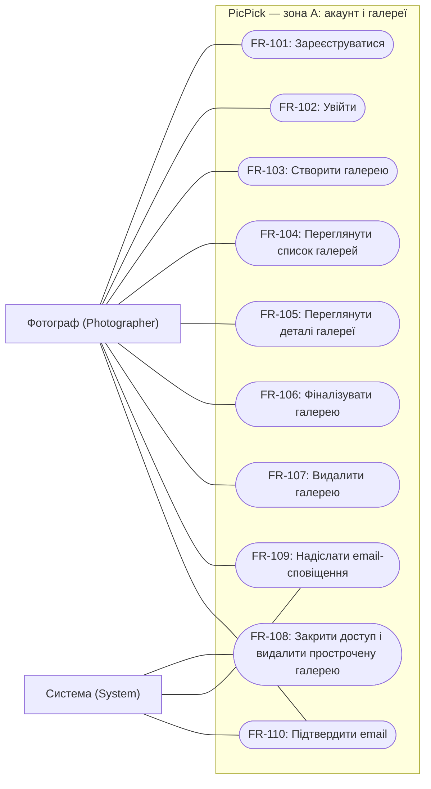

# Зона A: акаунт і галереї

Зона A охоплює акаунт фотографа та керування галереями.

## Функціональні вимоги

### FR-101. Реєстрація фотографа

**Вимога:** Система повинна дозволяти фотографу створити акаунт із нікнеймом, email і паролем з унікальним email.

**Актор:** Фотограф (`Photographer`). **Пріоритет:** Must.

**Критерії прийняття:**

1. Для нікнейма довжиною **1–50 символів** після видалення пробілів на початку й у кінці, коректного унікального email та пароля за NFR-101 створюється один `Photographer` із непідтвердженим email. Вхід стає доступним після підтвердження за FR-110. Нікнейм показується власнику в акаунті та клієнту на сторінці доступної галереї як текст без виконання HTML; показ у галереї належить [FR зони C про перегляд прев'ю, таска #11](https://github.com/alonasaienko/picpick/issues/11). Вхід виконується за email і паролем, а не за нікнеймом.
2. Повторна реєстрація того самого email, зокрема зі зміненим регістром літер, не створює другого акаунта. Однакові нікнейми для різних email дозволені.
3. Порожній нікнейм, нікнейм лише з пробілів або довший за 50 символів, некоректний email чи пароль, що не відповідає NFR-101, не створюють акаунта; фотограф бачить повідомлення про невиконані умови.

Термін Нікнейм визначено в [глосарії](../glossary.md).

### FR-102. Вхід фотографа

**Вимога:** Система повинна надавати фотографу доступ до його акаунта після успішної перевірки email і пароля, якщо email підтверджено за FR-110.

**Актор:** Фотограф (`Photographer`). **Пріоритет:** Must.

**Критерії прийняття:**

1. Зареєстрований фотограф із підтвердженим email і правильним паролем отримує доступ до власного списку галерей, який може бути порожнім. Без позначки «Запам'ятати мене» строк входу — до **8 годин**, із явно вибраною позначкою — до **14 діб**, включно з повторним відкриттям браузера; активність не подовжує ці строки.
2. Невідомий email або неправильний пароль, а також непідтверджений email не надають доступу; REST API повертає однаковий статус 401 і загальне повідомлення без ознаки існування акаунта. Перед перевіркою акаунта застосовуються спільні для форми й API ковзні ліміти: **5 запитів за 15 хвилин** на пару email + IP і **20 за хвилину** на IP. Після перевищення повертаються 429 та `Retry-After` незалежно від існування email; акаунт не блокується для інших IP. Точні повідомлення й нормалізацію email описано в [Identity Management](identity.md).
3. Без успішного входу запити на створення, перегляд, фіналізацію та видалення галерей від імені фотографа відхиляються без читання або зміни його даних. Гостьовий доступ клієнта за `ShareLink` визначається зоною C.

### FR-103. Створення галереї

**Вимога:** Система повинна дозволяти фотографу, який увійшов, створити власну галерею з назвою та терміном дії.

**Актор:** Фотограф (`Photographer`). **Пріоритет:** Must.

**Критерії прийняття:**

1. За назви довжиною **1–100 символів** після видалення пробілів на початку й у кінці та допустимого `ExpiresAt` створюється одна `Gallery` зі статусом `Draft`, без фото; власником є фотограф, який виконав дію.
2. `ExpiresAt` зберігається в UTC та має бути пізніше поточного серверного часу, але не більше ніж на **30 діб (720 годин)**. Після повторного відкриття назва й момент завершення терміну залишаються незмінними.
3. Порожня назва, назва лише з пробілів або довша за 100 символів, відсутній `ExpiresAt`, час, що вже настав або перевищує 30 діб, не створюють галерею; фотограф отримує повідомлення про некоректні дані. Назва рівно зі 100 символів і термін рівно 30 діб допустимі.

### FR-104. Перегляд списку галерей

**Вимога:** Система повинна показувати фотографу, який увійшов, список його власних галерей.

**Актор:** Фотограф (`Photographer`). **Пріоритет:** Must.

**Критерії прийняття:**

1. Для кожної власної галереї у списку доступні назва, поточний `Gallery.Status`, `ExpiresAt` і перехід до деталей. Галереї іншого фотографа у список не потрапляють. Порядок — від найновішої до найстарішої за часом створення; за однакового часу — за ідентифікатором у лексикографічному порядку за зростанням.
2. Для фотографа без галерей показується порожній список із можливістю створити галерею.
3. Після створення, фіналізації або видалення галереї повторний запит списку відображає відповідно нову галерею, статус `Finalized` або відсутність видаленої галереї.

### FR-105. Перегляд деталей галереї

**Вимога:** Система повинна дозволяти фотографу, який увійшов, переглядати деталі власної галереї та її поточний стан.

**Актор:** Фотограф (`Photographer`). **Пріоритет:** Must.

**Критерії прийняття:**

1. Для власної галереї показуються назва, `Gallery.Status`, `ExpiresAt` та кількість фото; для нової галереї кількість дорівнює нулю.
2. Значення статусу відповідає глосарію: `Draft`, `Processing`, `Ready`, `Shared`, `Finalized` або `Expired`. За серверного часу, що дорівнює `ExpiresAt` або перевищує його, фотограф бачить лише метадані простроченої галереї зі статусом `Expired` до її видалення — не довше **24 годин** після `ExpiresAt` за FR-108; доступ до фото й вибору закритий. Після видалення деталі недоступні.
3. Запит деталей неіснуючої або чужої галереї не повертає її даних; повідомлення не дозволяє відрізнити чужу галерею від неіснуючої.

### FR-106. Фіналізація галереї

**Вимога:** Система повинна дозволяти фотографу, який увійшов, фіналізувати власну галерею та після цього забороняти зміни її вмісту й вибору клієнта.

**Актор:** Фотограф (`Photographer`). **Пріоритет:** Should.

**Критерії прийняття:**

1. Власник може фіналізувати галерею зі статусом `Ready` або `Shared`, якщо її термін дії ще не настав; після успішної дії статус дорівнює `Finalized`, а наявні фото та вибір зберігаються для перегляду.
2. Після фіналізації запити на додавання фото, створення посилання для клієнта, зміну лайків чи відправку вибору відхиляються без зміни даних. Це обмеження діє і для запитів зі сторінки, відкритої до фіналізації.
3. Фіналізація галереї у стані `Draft`, `Processing` або `Expired` відхиляється без зміни стану. Повторна фіналізація власної `Finalized`, термін якої ще не настав, повертає успішний результат і повідомлення «Галерею вже фіналізовано», зберігаючи всі дані незмінними; чужу галерею фіналізувати неможливо.

Фіналізація не замінює відправку вибору: вона не переводить `Selection.Status` з `Open` у `Submitted`. Заборона змін не скасовує видалення за FR-107 або припинення доступу й автоматичне видалення після `ExpiresAt`.

### FR-107. Видалення галереї

**Вимога:** Система повинна дозволяти фотографу, який увійшов, видаляти власну галерею разом із пов'язаними даними та файлами.

**Актор:** Фотограф (`Photographer`). **Пріоритет:** Should.

**Критерії прийняття:**

1. Перед видаленням через сторінку фотограф підтверджує дію; скасування залишає галерею незмінною. Підтверджене видалення доступне для власної галереї в будь-якому статусі, включно з `Processing`, `Finalized` і `Expired`.
2. Після успішного прийняття видалення галерея відсутня у списку, а її деталі, оригінали й прев'ю недоступні; усі її посилання для клієнта припиняють надавати доступ. Після завершення очищення пов'язані `Gallery`, `Photo`, `PhotoPreview`, `ShareLink`, `Selection` та файли видалено, акаунт `Photographer` і решта його галерей збережені.
3. Спроба видалити чужу галерею не змінює даних. Якщо власну галерею видалено під час обробки, завершення або повторне виконання вже поставленої задачі не відновлює галерею чи доступ до її файлів; створені такою задачею файли також підлягають очищенню.

Механізм узгодження видалення з Worker та обробку помилок очищення буде деталізовано у документах з concurrency й error handling; новий статус галереї ця вимога не вводить.

### FR-108. Автоматичне завершення терміну й видалення галереї

**Вимога:** Система повинна автоматично закривати доступ до галереї після настання `ExpiresAt` та видаляти її дані й файли не пізніше ніж через **24 години** після цього моменту.

**Актор:** Система (`System`). **Пріоритет:** Must.

**Критерії прийняття:**

1. За серверного часу в UTC, що дорівнює `ExpiresAt` або перевищує його, галерея має стан `Expired` незалежно від попереднього статусу, включно з `Finalized`. Кожен запит перевіряє термін дії: клієнт не відкриває галерею та не змінює вибір, а фотограф не отримує її фото чи вибір; до очищення йому доступні лише метадані за FR-105. Закриття доступу не залежить від запуску фонового очищення чи наявності відкритих вкладок.
2. Не пізніше `ExpiresAt + 24 години` система видаляє `Gallery`, пов'язані `Photo`, `PhotoPreview`, `ShareLink`, `Selection` і файли в MinIO; галерея зникає зі списку фотографа. Акаунт `Photographer` та інші галереї залишаються незмінними. Перевірка виконується на галереї з відомим `ExpiresAt`, зокрема на межах терміну дії та строку очищення.
3. Повторне очищення вже видаленої галереї не спричиняє помилки й не зачіпає чужих даних. Невдалі операції очищення повторюються в межах того самого строку; незавершене очищення після 24 годин є порушенням вимоги, а не продовженням строку. Задача Worker, що завершилася після закриття доступу, не відновлює галерею або доступ до файлів; її результати також видаляються в межах строку очищення.

### FR-109. Email-сповіщення фотографу про відправку вибору

**Вимога:** Система повинна надсилати фотографу email-сповіщення після успішної відправки вибору клієнтом у його галереї.

**Актори:** Система (`System`), Фотограф (`Photographer`). **Пріоритет:** Should.

**Обсяг:** цільова система; у мінімальному прототипі email-сповіщення про вибір не реалізуються. Терміни Email та Email-сповіщення визначено в [глосарії](../glossary.md).

**Критерії прийняття:**

1. Після успішного переходу `Selection.Status` з `Open` у `Submitted` система надсилає лист на email власника відповідної `Gallery`. Відхилена відправка вибору та окремі зміни лайків не спричиняють цього сповіщення.
2. Лист повідомляє про відправлений вибір і містить посилання на власну галерею фотографа, яке потребує входу та перевірки власника за NFR-102. Лист не містить оригіналів, `Token` із `ShareLink` або адрес файлів у сховищі; дані іншого фотографа до нього не потрапляють.
3. Помилка доставки листа не скасовує `Submitted` і не приховує вибір від фотографа у Web App. Повторна обробка тієї самої події після успішного надсилання не створює нового сповіщення; правила повторів невдалої доставки деталізуються в error handling.

### FR-110. Підтвердження email фотографа

**Вимога:** Система повинна підтверджувати володіння email до першого входу фотографа.

**Актори:** Фотограф (`Photographer`), Система (`System`). **Пріоритет:** Must.

**Обсяг:** підтвердження email входить до мінімального прототипу: Identity створює посилання, а налаштований поштовий сервіс доставляє лист. Відновлення пароля та сповіщення про вибір залишаються поза прототипом. Загальнодоступного обходу підтвердження немає.

**Критерії прийняття:**

1. Після реєстрації лист надсилається лише на збережений email; посилання прив'язане до акаунта й адреси та діє **24 години**. Коректне чинне посилання підтверджує email і дозволяє вхід; прострочене або змінене — не підтверджує. Повторне відкриття після успіху повідомляє, що адресу вже підтверджено, без інших змін.
2. Повторне надсилання доступне лише на збережений email із тими самими лімітами та форматом 429, що й для входу за FR-102. Відповідь не розкриває існування акаунта. Зміна непідтвердженої адреси не передбачена; за помилки фотограф повторює реєстрацію з правильною адресою.
3. У цільовій системі відновлення пароля надсилає посилання лише на раніше підтверджений збережений email, а не на довільну адресу з запиту. Відповіді для відсутнього й непідтвердженого акаунта не відрізняються від загального повідомлення для наявного; сценарій описано в [Identity Management](identity.md). У прототипі відновлення недоступне, але реєстрація, доставка підтвердження та вхід після нього працюють.

## Нефункціональні вимоги

### NFR-101. Безпека акаунтів

**Вимога:** Система повинна захищати пароль фотографа під час передавання і зберігання та застосовувати мінімальну довжину пароля **12 символів**.

**Актор:** Фотограф (`Photographer`). **Пріоритет:** Must.

**Критерії перевірки:**

1. За коректного нікнейма й унікального email реєстрація з паролем довжиною 11 символів відхиляється, а з паролем довжиною 12 символів — успішна.
2. Під час реєстрації та входу пароль передається лише через HTTPS; запит через HTTP не обробляє облікові дані. Перевірка виконується для Web App із налаштованим HTTPS.
3. Після реєстрації двох фотографів з однаковим тестовим паролем збережені хеші паролів різні завдяки індивідуальній солі; відкритого пароля немає у базі даних, відповідях і журналах Web App. Зберігання та перевірку паролів виконує ASP.NET Core Identity.

### NFR-102. Приватність даних фотографа

**Вимога:** Система повинна перевіряти належність галереї фотографу для **кожного** запиту зони A та захищати нікнейм, email і дані галерей як персональні дані відповідного фотографа.

**Актор:** Фотограф (`Photographer`). **Пріоритет:** Must.

**Критерії перевірки:**

1. Для двох тестових акаунтів із різними галереями **100%** запитів списку повертають лише власні галереї, а підміна ідентифікатора в запитах деталей, фіналізації та видалення не дає доступу до чужої галереї й не змінює її даних.
2. Для чужого та неіснуючого ідентифікаторів у запитах зони A відповіді мають однакові HTTP-статус і загальне повідомлення; вони не містять назви галереї, нікнейма й email власника, імен файлів, `Token` або адрес файлів. Виняток для публічного показу — нікнейм фотографа на сторінці галереї кожному, хто має доступ за чинним `ShareLink`, без входу в акаунт фотографа; email залишається приватним і клієнту не повертається. Відмови в гостьовому доступі не розкривають нікнейм чи інші дані галереї.
3. Повторення запитів без входу не повертає жодних даних зони A. Перевірка охоплює і сторінки, і REST API; доступ клієнта за `ShareLink` регламентується окремими вимогами зони C та не надає прав фотографа.
4. Після завершення видалення акаунта його нікнейма, email і хешу пароля немає в активній базі даних; усі його попередні сесії, включно з «Запам'ятати мене», не надають доступу. Видалення галереї саме по собі не видаляє акаунт і його нікнейм.

## Персона: Фотограф

**Олена, 29 років** — фотограф, яка самостійно проводить сімейні й портретні зйомки. Працює з ноутбука, проводить 3–4 зйомки на тиждень та привозить із кожної 400–700 кадрів; клієнт зазвичай обирає 20–40 для фінальної обробки.

Зараз Олена розкладає фото по папках, завантажує їх у спільне сховище й отримує імена обраних файлів у переписці. Її дратують помилки в назвах файлів, повідомлення з доповненнями до вибору та необхідність щоразу перевіряти, якій людині належить папка. Вона також не хоче передавати незахищені оригінали й вручну прибирати старі зйомки зі сховища.

Олена хоче ввійти в один акаунт, створити окрему галерею для кожної зйомки й швидко бачити її стан та термін дії. Після відбору їй потрібні однозначний список обраних кадрів і можливість закрити галерею для змін, а після завершення роботи — видалити її. Клієнт має обирати фото без створення акаунта.

**Зв'язок із вимогами:** один акаунт — FR-101–102 і FR-110; розділення зйомок та огляд їхнього стану — FR-103–105; закриття й очищення галерей — FR-106–108; email-сповіщення — FR-109; захист акаунта та чужих зйомок — NFR-101–102. Перегляд прев'ю й отримання вибору деталізуються в зоні C.

## Use case-фрагмент зони A

Mermaid-фрагмент подано як flowchart: зовнішні вузли позначають акторів, підграф — межу PicPick, овальні вузли — сценарії зони A. Зв'язки показують участь актора, а не порядок виконання; для FR-103–107 потрібен успішний вхід фотографа, для першого входу — підтвердження за FR-110. FR-108 запускається системою за терміном дії, FR-109 — за подією відправки вибору; для отримання листа активна сесія фотографа не потрібна.

