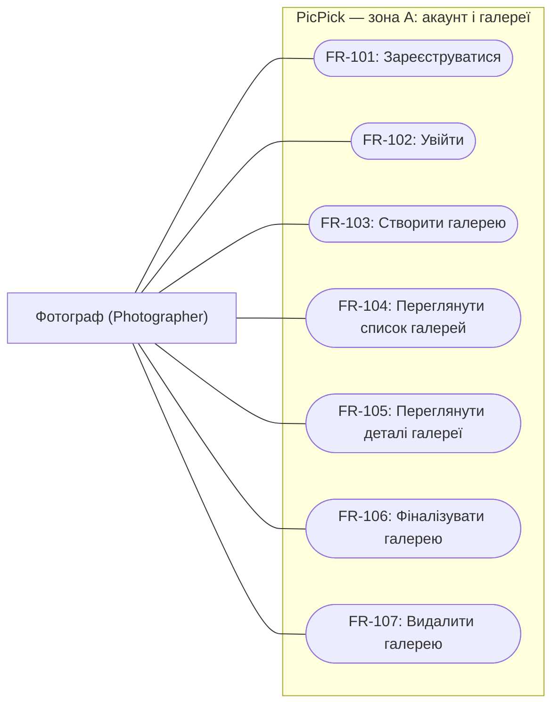

# Зона A: акаунт і галереї

Зона A охоплює акаунт фотографа та керування галереями.

## Функціональні вимоги

### FR-101. Реєстрація фотографа

**Вимога:** Система повинна дозволяти фотографу створити акаунт за email і паролем з унікальним email.

**Актор:** Фотограф (`Photographer`). **Пріоритет:** Must.

**Критерії прийняття:**

1. Для коректного email, який ще не зареєстровано, та пароля, що відповідає NFR-101, створюється один акаунт `Photographer`; його дані можна використати для входу за FR-102.
2. Повторна реєстрація того самого email, зокрема зі зміненим регістром літер, не створює другого акаунта.
3. За некоректного email або пароля, що не відповідає NFR-101, акаунт не створюється; фотограф бачить повідомлення про невиконані умови.

### FR-102. Вхід фотографа

**Вимога:** Система повинна надавати фотографу доступ до його акаунта після успішної перевірки email і пароля.

**Актор:** Фотограф (`Photographer`). **Пріоритет:** Must.

**Критерії прийняття:**

1. Зареєстрований фотограф із правильним email і паролем отримує доступ до власного списку галерей, який може бути порожнім.
2. Неправильний пароль і незареєстрований email не надають доступу та спричиняють однакове повідомлення про невдалий вхід, без уточнення, чи існує акаунт.
3. Без успішного входу запити на створення, перегляд, фіналізацію та видалення галерей від імені фотографа відхиляються без читання або зміни його даних. Гостьовий доступ клієнта за `ShareLink` визначається зоною C.

### FR-103. Створення галереї

**Вимога:** Система повинна дозволяти фотографу, який увійшов, створити власну галерею з назвою та терміном дії.

**Актор:** Фотограф (`Photographer`). **Пріоритет:** Must.

**Критерії прийняття:**

1. За непорожньої назви та `ExpiresAt` у майбутньому створюється одна `Gallery` зі статусом `Draft`, без фото; власником є фотограф, який виконав дію.
2. Створена галерея зберігає задані назву й термін дії та доступна у списку і деталях після повторного відкриття сторінки.
3. Порожня назва, назва лише з пробілів, відсутній термін дії або `ExpiresAt`, що вже настав, не створюють галерею; фотограф отримує повідомлення про некоректні дані.

### FR-104. Перегляд списку галерей

**Вимога:** Система повинна показувати фотографу, який увійшов, список його власних галерей.

**Актор:** Фотограф (`Photographer`). **Пріоритет:** Must.

**Критерії прийняття:**

1. Для кожної власної галереї у списку доступні назва, поточний `Gallery.Status`, `ExpiresAt` і перехід до деталей. Галереї іншого фотографа у список не потрапляють.
2. Для фотографа без галерей показується порожній список із можливістю створити галерею.
3. Після створення, фіналізації або видалення галереї повторний запит списку відображає відповідно нову галерею, статус `Finalized` або відсутність видаленої галереї.

### FR-105. Перегляд деталей галереї

**Вимога:** Система повинна дозволяти фотографу, який увійшов, переглядати деталі власної галереї та її поточний стан.

**Актор:** Фотограф (`Photographer`). **Пріоритет:** Must.

**Критерії прийняття:**

1. Для власної галереї показуються назва, `Gallery.Status`, `ExpiresAt` та кількість фото; для нової галереї кількість дорівнює нулю.
2. Значення статусу відповідає глосарію: `Draft`, `Processing`, `Ready`, `Shared`, `Finalized` або `Expired`. Повторний запит після зміни стану показує актуальний статус, зокрема `Expired` після настання `ExpiresAt`, доки галерея очікує видалення.
3. Запит деталей неіснуючої або чужої галереї не повертає її даних; повідомлення не дозволяє відрізнити чужу галерею від неіснуючої.

### FR-106. Фіналізація галереї

**Вимога:** Система повинна дозволяти фотографу, який увійшов, фіналізувати власну галерею та після цього забороняти зміни її вмісту й вибору клієнта.

**Актор:** Фотограф (`Photographer`). **Пріоритет:** Must.

**Критерії прийняття:**

1. Власник може фіналізувати галерею зі статусом `Ready` або `Shared`, якщо її термін дії ще не настав; після успішної дії статус дорівнює `Finalized`, а наявні фото та вибір зберігаються для перегляду.
2. Після фіналізації запити на зміну назви або терміну дії, додавання фото, створення посилання для клієнта, зміну лайків чи відправку вибору відхиляються без зміни даних. Це обмеження діє і для запитів зі сторінки, відкритої до фіналізації.
3. Фіналізація галереї у стані `Draft`, `Processing` або `Expired` відхиляється без зміни стану. Повторна фіналізація `Finalized` не змінює дані; чужу галерею фіналізувати неможливо.

Фіналізація не замінює відправку вибору: вона не переводить `Selection.Status` з `Open` у `Submitted`. Заборона змін не скасовує видалення за FR-107 або припинення доступу й автоматичне видалення після `ExpiresAt`.

### FR-107. Видалення галереї

**Вимога:** Система повинна дозволяти фотографу, який увійшов, видаляти власну галерею разом із пов'язаними даними та файлами.

**Актор:** Фотограф (`Photographer`). **Пріоритет:** Must.

**Критерії прийняття:**

1. Перед видаленням через сторінку фотограф підтверджує дію; скасування залишає галерею незмінною. Підтверджене видалення доступне для власної галереї в будь-якому статусі, включно з `Processing`, `Finalized` і `Expired`.
2. Після успішного прийняття видалення галерея відсутня у списку, а її деталі, оригінали й прев'ю недоступні; усі її посилання для клієнта припиняють надавати доступ. Після завершення очищення пов'язані `Gallery`, `Photo`, `PhotoPreview`, `ShareLink`, `Selection` та файли видалено, акаунт `Photographer` і решта його галерей збережені.
3. Спроба видалити чужу галерею не змінює даних. Якщо власну галерею видалено під час обробки, завершення або повторне виконання вже поставленої задачі не відновлює галерею чи доступ до її файлів; створені такою задачею файли також підлягають очищенню.

Механізм узгодження видалення з Worker та обробку помилок очищення буде деталізовано у документах з concurrency й error handling; новий статус галереї ця вимога не вводить.

## Нефункціональні вимоги

### NFR-101. Безпека акаунтів

**Вимога:** Система повинна захищати пароль фотографа під час передавання і зберігання та застосовувати мінімальну довжину пароля **12 символів**.

**Актор:** Фотограф (`Photographer`). **Пріоритет:** Must.

**Критерії перевірки:**

1. Реєстрація з паролем довжиною 11 символів відхиляється, а з паролем довжиною 12 символів і коректним унікальним email — успішна.
2. Під час реєстрації та входу пароль передається лише через HTTPS; запит через HTTP не обробляє облікові дані. Перевірка виконується для Web App із налаштованим HTTPS.
3. Після реєстрації двох фотографів з однаковим тестовим паролем збережені хеші паролів різні завдяки індивідуальній солі; відкритого пароля немає у базі даних, відповідях і журналах Web App. Зберігання та перевірку паролів виконує ASP.NET Core Identity.

### NFR-102. Приватність даних фотографа

**Вимога:** Система повинна перевіряти належність галереї фотографу для **кожного** запиту зони A та не розкривати дані чужих галерей.

**Актор:** Фотограф (`Photographer`). **Пріоритет:** Must.

**Критерії перевірки:**

1. Для двох тестових акаунтів із різними галереями **100%** запитів списку повертають лише власні галереї, а підміна ідентифікатора в запитах деталей, фіналізації та видалення не дає доступу до чужої галереї й не змінює її даних.
2. Для чужого та неіснуючого ідентифікаторів відповіді одного й того самого запиту мають однакові HTTP-статус і загальне повідомлення; вони не містять назви галереї, email власника, імен файлів, `Token` або адрес файлів.
3. Повторення запитів без входу не повертає жодних даних зони A. Перевірка охоплює і сторінки, і REST API; доступ клієнта за `ShareLink` регламентується окремими вимогами зони C та не надає прав фотографа.

## Персона: Фотограф

**Олена, 29 років** — фотограф, яка самостійно проводить сімейні й портретні зйомки. Працює з ноутбука, проводить 3–4 зйомки на тиждень та привозить із кожної 400–700 кадрів; клієнт зазвичай обирає 20–40 для фінальної обробки.

Зараз Олена розкладає фото по папках, завантажує їх у спільне сховище й отримує імена обраних файлів у переписці. Її дратують помилки в назвах файлів, повідомлення з доповненнями до вибору та необхідність щоразу перевіряти, якій людині належить папка. Вона також не хоче передавати незахищені оригінали й вручну прибирати старі зйомки зі сховища.

Олена хоче ввійти в один акаунт, створити окрему галерею для кожної зйомки й швидко бачити її стан та термін дії. Після відбору їй потрібні однозначний список обраних кадрів і можливість закрити галерею для змін, а після завершення роботи — видалити її. Клієнт має обирати фото без створення акаунта.

**Зв'язок із вимогами:** один акаунт — FR-101–102; розділення зйомок та огляд їхнього стану — FR-103–105; закриття й очищення галерей — FR-106–107; захист акаунта та чужих зйомок — NFR-101–102. Перегляд прев'ю й отримання вибору деталізуються в зоні C.

## Use case-фрагмент зони A

Mermaid-фрагмент подано як flowchart: зовнішній вузол позначає актора, підграф — межу PicPick, овальні вузли — його сценарії зони A. Зв'язки показують участь актора, а не порядок виконання; для FR-103–107 потрібен успішний вхід.

