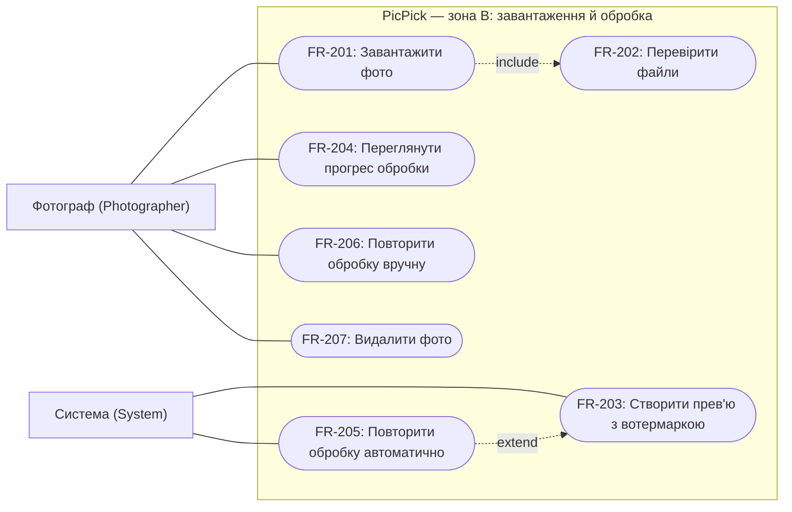

# Зона B: завантаження й обробка

Зона B охоплює завантаження оригіналів фото в галерею та їх фонову обробку: створення прев'ю з вотермаркою, відстеження прогресу й обробку збоїв.

## Обмеження зони B

Значення з цієї таблиці використовуються в критеріях прийняття нижче та в API зони B (п.5).

| Параметр | Значення | Чому |
|---|---|---|
| Формати оригіналу | JPEG, PNG, HEIC/HEIF і RAW: DNG, CR2, CR3 (Canon), NEF (Nikon), ARW (Sony), RAF (Fujifilm) | Фотографи знімають у RAW, а смартфони зберігають HEIC, тому вимога їх експортувати додала б фотографу зайвий крок. JPEG і PNG читає Pillow, HEIC — плагін pillow-heif (libheif), RAW — rawpy (LibRaw) |
| Визначення формату | За сигнатурою вмісту файлу; для RAW, що мають спільний із TIFF контейнер, додатково за розширенням зі списку вище. Не за заголовком `Content-Type` | Розширення і заголовок задає відправник, тому вони не гарантують, що файл справді є зображенням |
| Розмір одного файлу | від 1 байта до **30 МБ** для JPEG, PNG, HEIC; до **150 МБ** для RAW | JPEG із камери на 24–45 Мп займає 8–20 МБ, стиснений RAW тих самих камер — 25–90 МБ |
| Файлів за один запит | до **50** і сумарно до **1 ГБ** | Великий пакет браузер ділить на кілька запитів, тому збій мережі не скасовує всього завантаження. Ліміт обсягу потрібен, бо 50 RAW-файлів могли б займати понад 7 ГБ |
| Фото в одній галереї | до **1000** | Зйомка дає 400–700 кадрів (див. персону Фотографа в зоні A) |
| Стани галереї для завантаження | `Draft`, `Processing`, `Ready` | Після створення посилання клієнт уже обирає, тому набір фото не змінюється (див. FR-202) |
| Прев'ю | JPEG, довга сторона до **1600 px**, вотермарка | Достатньо для вибору кадру на екрані й непридатне для друку |
| Автоматичні спроби обробки | до **3** на фото | Тимчасовий збій не стає помилкою, а пошкоджений файл не займає Worker без кінця |

## Функціональні вимоги

### FR-201. Пакетне завантаження фото

**Вимога:** Система повинна дозволяти фотографу, який увійшов, завантажувати в одну власну галерею кілька файлів за одну дію, зокрема всі файли, вибрані з папки.

**Актор:** Фотограф (`Photographer`). **Пріоритет:** Must.

**Критерії прийняття:**

1. Для кожного прийнятого файлу створюється один `Photo` зі статусом `Uploaded`. Його оригінал зберігається в MinIO без змін, а задача на обробку потрапляє в Чергу задач. Після першого прийнятого фото галерея переходить зі стану `Draft` у `Processing`, а з `Ready` — знову в `Processing`.
2. Відповідь на запит повертається, не чекаючи обробки: вона містить список прийнятих фото з ідентифікаторами та статусом `Uploaded` і список відхилених файлів із причиною для кожного за FR-202. Фото, які залишаються в обробці, завершуються у фоні за FR-203, навіть якщо фотограф закрив сторінку.
3. Пакет із 300 файлів браузер надсилає кількома запитами по 50 файлів і більше. Після завершення всіх запитів у галереї рівно стільки `Photo`, скільки файлів прийнято; повторів і пропусків немає.
4. Завантаження в чужу або неіснуючу галерею не створює `Photo` і не зберігає файлів. Відповідь однакова для обох випадків і не розкриває даних галереї (NFR-102).

### FR-202. Перевірка файлів і стану галереї

**Вимога:** Система повинна перевіряти кожен файл і стан галереї перед збереженням оригіналу та приймати лише ті файли, що відповідають обмеженням зони B.

**Актори:** Фотограф (`Photographer`), Система (`System`). **Пріоритет:** Must.

**Критерії прийняття:**

1. Кожен файл перевіряється окремо. Відхиляються: порожній файл; файл JPEG, PNG чи HEIC, більший за 30 МБ; RAW-файл, більший за 150 МБ; файл, вміст якого не відповідає жодному з підтримуваних форматів, навіть якщо в нього розширення `.jpg` чи `.nef`. Межові значення (рівно 30 МБ для JPEG і рівно 150 МБ для RAW) приймаються, а на 1 байт більше — ні. Відхилений файл не зберігається в MinIO, а решта файлів пакета приймається.
2. Запит із понад 50 файлами чи сумарним обсягом понад 1 ГБ або такий, що після прийняття збільшив би кількість фото в галереї понад 1000, відхиляється повністю: жоден файл із нього не зберігається. Фотограф бачить, скільки фото ще можна додати. Галерея рівно з 1000 фото допустима.
3. Завантаження в галерею зі станом `Shared`, `Finalized` або `Expired` відхиляється повністю без змін у галереї; фотограф бачить причину. Для `Finalized` і `Expired` це узгоджено з FR-106 і FR-108.
4. Причина відхилення зрозуміла фотографу («Формат не підтримується: дозволено JPEG, PNG, HEIC і RAW (DNG, CR2, CR3, NEF, ARW, RAF)», «RAW-файл більший за 150 МБ») і не містить внутрішніх шляхів, назв бакетів MinIO чи технічних деталей.

### FR-203. Фонове створення прев'ю з вотермаркою

**Вимога:** Система повинна у фоні створювати для кожного прийнятого фото одне прев'ю з вотермаркою, не змінюючи оригіналу.

**Актор:** Система (`System`). **Пріоритет:** Must.

**Критерії прийняття:**

1. Фото проходить статуси `Uploaded` → `Processing` → `Ready`. У статусі `Ready` для нього існує рівно один `PhotoPreview`, зокрема й тоді, коли задачу оброблено повторно (NFR-202).
2. Прев'ю — JPEG із довгою стороною 1600 px для будь-якого формату оригіналу; менший оригінал не збільшується. Пропорції й орієнтація (з метаданих оригіналу) відповідають оригіналу. Для HEIC з кількома зображеннями використовується основне, для RAW — зображення з налаштуваннями камери за замовчуванням, без ручної корекції кольору. Напівпрозора вотермарка розташована в центральній частині кадру й займає щонайменше третину ширини прев'ю. Метадані EXIF, зокрема геолокація, у прев'ю не копіюються. Оригінал у MinIO після обробки байт у байт збігається із завантаженим.
3. Галерея переходить зі стану `Processing` у `Ready`, коли в ній не лишається фото в статусах `Uploaded` і `Processing`. Фото зі статусом `Failed` вважаються завершеними й не затримують галерею; вони не мають `PhotoPreview`, тому клієнт їх не бачить.
4. Якщо галерею або фото видалено (FR-107, FR-207) чи настав `ExpiresAt` (FR-108), поки йде обробка, результат обробки не відновлює доступу. Створені файли прев'ю видаляються в межах строку очищення, визначеного в цих вимогах.

### FR-204. Перегляд прогресу обробки

**Вимога:** Система повинна показувати фотографу, який увійшов, прогрес обробки власної галереї та статус кожного фото.

**Актор:** Фотограф (`Photographer`). **Пріоритет:** Must.

**Критерії прийняття:**

1. Для галереї показуються загальна кількість фото N, кількість готових X, кількість із помилкою K і кількість тих, що ще обробляються. Значення зберігають рівність: X + K + «в обробці» = N. Для кожного фото видно ім'я файлу, `Photo.Status` і для `Failed` — причину за FR-205.
2. Відкрита сторінка оновлює прогрес автоматично, без перезавантаження, не рідше ніж раз на 5 секунд. Зміна статусу фото стає видимою не пізніше ніж через 5 секунд. Коли галерея переходить у `Ready`, автоматичне оновлення зупиняється.
3. Прогрес доступний лише власнику галереї. Запит прогресу чужої чи неіснуючої галереї не повертає її даних і має ту саму відповідь, що й FR-105.

### FR-205. Автоматичні повтори і статус Failed

**Вимога:** Система повинна автоматично повторювати обробку фото після тимчасового збою і переводити фото у `Failed`, коли обробка неможлива.

**Актор:** Система (`System`). **Пріоритет:** Must.

**Критерії прийняття:**

1. Після тимчасового збою (недоступні MinIO чи PostgreSQL, зупинка Worker) обробка того самого фото повторюється. Усього виконується не більше 3 спроб, а пауза перед кожною наступною більша за попередню: щонайменше 10 і 60 секунд. Фото, оброблене під час повтору, отримує `Ready` так само, як за першої спроби.
2. Після 3 невдалих спроб фото отримує статус `Failed`. Якщо файл неможливо декодувати як зображення (пошкоджений або обрізаний файл, RAW камери, яку не підтримує бібліотека декодування), фото отримує `Failed` одразу, без повторів, бо повтор не змінить результату.
3. `Failed` одного фото не зупиняє й не сповільнює обробки інших фото тієї самої та інших галерей. Фотограф бачить коротку причину («Файл пошкоджено», «RAW цієї камери не підтримується», «Тимчасова помилка обробки, спробуйте ще раз») без стектрейсів і внутрішніх шляхів.

### FR-206. Ручний повтор обробки

**Вимога:** Система повинна дозволяти фотографу, який увійшов, повторно запускати обробку фото, яке отримало статус `Failed`.

**Актор:** Фотограф (`Photographer`). **Пріоритет:** Should.

**Критерії прийняття:**

1. Для власного фото зі статусом `Failed` у галереї зі станом `Processing` або `Ready` повтор переводить фото в `Uploaded` і ставить нову задачу в Чергу задач. Галерея в стані `Ready` переходить у `Processing`. Для ручного повтору знову діють до 3 автоматичних спроб за FR-205.
2. Повтор для фото зі статусом `Uploaded`, `Processing` або `Ready` відхиляється без змін і без нової задачі. Тому подвійне натискання кнопки не створює двох задач для одного фото.
3. Повтор у галереї зі станом `Shared`, `Finalized` або `Expired`, а також для чужого чи неіснуючого фото відхиляється без змін.

### FR-207. Видалення фото з галереї

**Вимога:** Система повинна дозволяти фотографу, який увійшов, видаляти окреме фото з власної галереї.

**Актор:** Фотограф (`Photographer`). **Пріоритет:** Could.

**Критерії прийняття:**

1. Видалення фото в галереї зі станом `Draft`, `Processing` або `Ready` видаляє `Photo`, `PhotoPreview` (якщо є), оригінал і прев'ю в MinIO. Фото зникає зі списку й лічильників прогресу. Решта фото галереї не змінюється.
2. Видалення фото, яке зараз обробляється, дозволене. Завершення вже поставленої задачі не відновлює фото, а створене нею прев'ю видаляється (як у FR-107). Після видалення стан галереї перераховується за FR-203; якщо фото не лишилося, галерея повертається в `Draft`.
3. Видалення в галереї зі станом `Shared`, `Finalized` або `Expired`, а також чужого чи неіснуючого фото відхиляється без змін.

## Нефункціональні вимоги

Вимірювання виконуються на **еталонному середовищі**: прототип у docker-compose на одній машині з 4 ядрами CPU і 8 ГБ RAM. **Еталонний набір**: 300 JPEG по 24 Мп, розміром 8–15 МБ кожен. **Еталонний RAW-набір**: 300 стиснених RAW-файлів по 24 Мп (наприклад, NEF або ARW), розміром 25–50 МБ кожен.

### NFR-201. Продуктивність і масштабованість обробки

**Вимога:** Система повинна обробляти зйомку розміром до 300 фото за кілька хвилин і прискорювати обробку, коли запущено додаткові Worker, без змін у коді.

**Актор:** Система (`System`). **Пріоритет:** Must.

**Критерії перевірки:**

1. З одним Worker усі фото еталонного набору отримують `Ready` не пізніше ніж за **10 хвилин** після прийняття останнього файлу, а еталонного RAW-набору — не пізніше ніж за **25 хвилин**. RAW потребує більше часу, бо його спершу треба перетворити на звичайне зображення (демозаїкінг).
2. Із двома Worker той самий набір обробляється щонайменше в **1,6 раза** швидше, ніж з одним. Щоб додати Worker, достатньо запустити ще один контейнер: код і налаштування Web App не змінюються.
3. Поки обробляється еталонний набір, 95% запитів до сторінок і REST API Web App, крім самого завантаження файлів, виконуються за **≤ 500 мс**.
4. Пам'ять одного контейнера Worker під час обробки не перевищує **1 ГБ** (за `docker stats`), незалежно від кількості фото в черзі.

### NFR-202. Надійність обробки

**Вимога:** Система повинна гарантувати, що кожне прийняте фото буде оброблене, навіть якщо компоненти збоять, і що повторна обробка не створює дублікатів.

**Актор:** Система (`System`). **Пріоритет:** Must.

**Критерії перевірки:**

1. Примусова зупинка Worker (`docker kill`) посеред обробки еталонного набору не втрачає жодного фото. Не пізніше ніж через 15 хвилин після запуску Worker кожне з 300 фото має статус `Ready` або `Failed`, і жодне не залишилося в `Uploaded` чи `Processing`. Те саме виконується, якщо Web App зупинився між збереженням `Photo` і постановкою задачі в чергу.
2. Перезапуск RabbitMQ у той момент, коли в Черзі задач є необроблені задачі, не втрачає жодної з них: після перезапуску всі вони обробляються.
3. Якщо одна задача доставлена Worker двічі, для фото існує рівно один `PhotoPreview` і один файл прев'ю в MinIO.
4. У наборі з 299 коректних і 1 пошкодженого файлу 299 фото отримують `Ready`, 1 — `Failed`, а галерея переходить у `Ready`.

Механізми, що забезпечують цю вимогу, описано в сценаріях concurrency (п.6).

## Актор: Система

**Система** (`System`) — не людина, а внутрішні сервіси PicPick, які виконують роботу без участі користувача. У зоні B це передусім **Worker**: Python-сервіс, що створює прев'ю з вотермаркою. Також до Системи належать фонові задачі **Web App**, які обробляють результати від Worker і стежать за термінами дії галерей.

| Що робить Система | Коли запускається | Вимоги |
|---|---|---|
| Створює прев'ю з вотермаркою | У Черзі задач з'явилася задача на обробку фото | FR-203 |
| Повторює обробку після тимчасового збою або ставить `Failed` | Спроба обробки завершилася помилкою | FR-205 |
| Оновлює `Photo.Status` і `Gallery.Status` | Worker повідомив про результат у Чергу подій | FR-203, FR-204 |
| Закриває доступ і видаляє прострочені галереї | Настав `ExpiresAt` (перевірка за розкладом) | FR-108 (зона A) |

Система не має акаунта й не входить через форму фотографа; увійти як Система ззовні неможливо (див. [Identity Management](identity.md)). Worker не приймає запитів від браузера. Він отримує лише задачі з RabbitMQ, читає оригінал і записує прев'ю в MinIO. Рішення про доступ фотографа чи клієнта Worker не ухвалює: їх перевіряє Web App.

## Узгодження з іншими зонами

- **Зона A, FR-105–106:** `Gallery.Status` змінюється з `Draft` у `Processing` і з `Processing` у `Ready` за правилами FR-201, FR-203, FR-206 і FR-207. Фіналізація галереї в стані `Processing` відхиляється за FR-106. Тому фото `Failed` не блокує галерею (FR-203).
- **Зона A, FR-107–108:** результат обробки для видаленої чи простроченої галереї не відновлює доступу (FR-203).
- **Зона C:** клієнт бачить лише фото з `PhotoPreview`, тобто зі статусом `Ready`. Оригінал клієнту не видається. Після створення посилання (`Shared`) набір фото не змінюється (FR-202, FR-206, FR-207).

## Use case-фрагмент зони B

Mermaid-фрагмент подано як flowchart у тому ж стилі, що й у зоні A: зовнішні вузли позначають акторів, підграф — межу PicPick, овальні вузли — сценарії зони B. Пунктир `include` означає, що перевірка файлів завжди виконується як частина завантаження. Пунктир `extend` означає, що автоматичний повтор доповнює обробку лише після збою.

