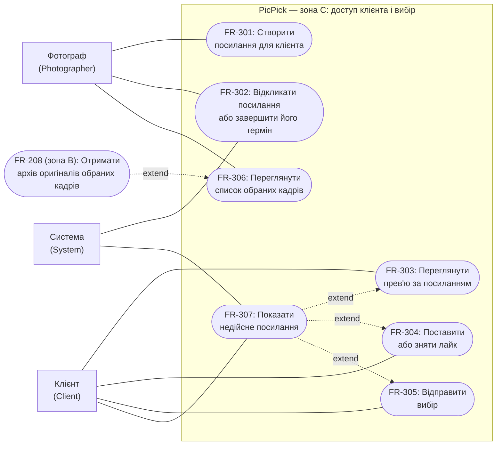

# Зона C: доступ клієнта і вибір

Зона C охоплює доступ клієнта до галереї за приватним посиланням: створення, термін дії та відкликання `ShareLink`, перегляд прев'ю, лайки, відправку вибору й список обраних кадрів для фотографа.

## Обмеження зони C

Значення з цієї таблиці використовуються в критеріях прийняття нижче та в API зони C (п.5).

| Параметр | Значення | Чому |
|---|---|---|
| Токен | Не менше **128 біт** ентропії, щонайменше **22 символи** base64url | Токен замінює клієнту логін, тому його неможливо підібрати перебором |
| Активних посилань на галерею | **1** | Фотограф завжди знає, яке посилання діє; нове посилання замінює старе |
| `ExpiresAt` посилання | Пізніше поточного часу й не пізніше `ExpiresAt` галереї; за замовчуванням менше з «+14 діб» і `ExpiresAt` галереї | Посилання не живе довше за галерею (максимум 30 діб, FR-103) |
| Мінімальний вибір | **1** лайк | Порожній вибір фотографу нічого не дає |
| Максимальний вибір | Кількість фото галереї зі статусом `Ready` (до 1000, зона B) | Обрати можна лише те, що клієнт бачить |
| Недійсних запитів з однієї IP | до **30 за хвилину** | Захист від підбору токена; після перевищення 429 і `Retry-After` |
| Відповідь на недійсне посилання | Один HTTP-статус 404 і код `SHARE_LINK_INVALID` для всіх причин | Клієнт і сторонній не дізнаються, чи існувало посилання |

## Функціональні вимоги

### FR-301. Створення посилання для клієнта

**Вимога:** Система повинна дозволяти фотографу, який увійшов, створити для власної галереї `ShareLink` із секретним токеном і терміном дії.

**Актор:** Фотограф (`Photographer`). **Пріоритет:** Must.

**Критерії прийняття:**

1. Для власної галереї зі станом Ready або Shared, ExpiresAt якої ще не настав, створюється один ShareLink у стані Active із токеном за NFR-301. Галерея зі стану Ready переходить у Shared, зі стану Shared залишається Shared. Повне посилання показується фотографу лише у відповіді на створення, бо система зберігає тільки хеш токена: токен діє як ключ клієнта, тому витік бази даних не повинен відкривати чинні галереї. Якщо посилання втрачено, фотограф створює нове; старе відкликається автоматично, а Selection зберігається (п.3), тож клієнт втрачає лише саме посилання. Зашифроване зберігання токена для повторного показу не обрано, бо воно потребує ключа в конфігурації й повертає ризик при його витоку.
2. `ExpiresAt` посилання зберігається в UTC, має бути пізніше поточного серверного часу й не пізніше `ExpiresAt` галереї. Якщо значення не задано, береться менше з «+14 діб від створення» і `ExpiresAt` галереї. Значення, що дорівнює `ExpiresAt` галереї, допустиме; пізніше за нього або таке, що вже настало, відхиляється з `SHARE_LINK_EXPIRES_AT_INVALID`.
3. У галереї одночасно не більше одного посилання в стані `Active`: створення нового в тій самій дії переводить попереднє `Active` у `Revoked`, і старий токен перестає діяти за NFR-301. Новий `ShareLink` продовжує той самий `Selection` галереї: лайки й статус `Submitted` зберігаються.
4. Створення для галереї у стані `Draft`, `Processing`, `Finalized` або `Expired` відхиляється з `GALLERY_NOT_SHAREABLE` без змін (див. FR-106, FR-202). Для чужої або неіснуючої галереї відповідь однакова й така сама, як у FR-105; даних галереї вона не містить.

### FR-302. Відкликання посилання і завершення його терміну

**Вимога:** Система повинна дозволяти фотографу відкликати `Active` `ShareLink` і автоматично закривати доступ за ним, коли настав його `ExpiresAt` або `ExpiresAt` галереї.

**Актори:** Фотограф (`Photographer`), Система (`System`). **Пріоритет:** Should.
Пріоритет Should стосується ручного відкликання (п.1). Автоматичне завершення терміну (п.2) обов'язкове, бо без нього порушується FR-108, але воно не потребує окремої дії фотографа й реалізується тією самою перевіркою `ExpiresAt` на кожному запиті, що й FR-307.

**Критерії прийняття:**

1. Власник галереї може відкликати посилання в стані `Active`: воно отримує `Revoked`, і доступ одразу закривається (NFR-301). Повторне відкликання вже `Revoked` посилання повертає успішний результат і повідомлення «Посилання вже відкликано» без змін; відкликання посилання в стані `Expired` та чужого чи неіснуючого відхиляється без змін.
2. За серверного часу в UTC, що дорівнює `ExpiresAt` посилання або перевищує його, посилання має стан `Expired`. Те саме діє, коли галерея має стан `Expired` за FR-108: усі її посилання недійсні незалежно від власного стану. Термін перевіряється на кожному запиті й не залежить від запуску фонових задач чи відкритих вкладок.
3. Відкликання, завершення терміну посилання та фіналізація галереї (FR-106) не видаляють `Selection` і не змінюють його статус: відправлений вибір залишається доступним фотографу за FR-306, доки існує галерея. Відкликання не змінює `Gallery.Status` і не вводить нових статусів. `Selection`, `ShareLink` і файли видаляються разом із галереєю за FR-107 і FR-108.

### FR-303. Перегляд прев'ю за посиланням

**Вимога:** Система повинна показувати клієнту без акаунта за чинним `ShareLink` галерею з прев'ю та відомостями про фотографа.

**Актор:** Клієнт (`Client`). **Пріоритет:** Must.

**Критерії прийняття:**

1. За токеном посилання в стані `Active`, якщо галерея має стан `Shared` або `Finalized`, клієнт без входу бачить назву галереї, нікнейм фотографа як текст без виконання HTML і сітку `PhotoPreview`. Email фотографа не показується ніколи (NFR-102). У стані `Finalized` галерея доступна лише для перегляду, про що клієнт бачить повідомлення «Галерею закрито фотографом».
2. Показуються лише фото зі статусом `Ready` і прев'ю з вотермаркою (FR-203); фото `Failed`, `Uploaded` і `Processing` клієнт не бачить. Оригінали й прямі адреси файлів у MinIO клієнту не повертаються: прев'ю віддає Web App після перевірки токена. Клієнт може відкрити прев'ю у збільшеному вигляді й перейти до наступного чи попереднього кадру.
3. Для кожного кадру видно, чи він лайкнутий, а над сіткою показано лічильник «Обрано: N з M», де M — кількість показаних прев'ю. Для галереї без жодного фото `Ready` клієнт бачить «У галереї поки немає кадрів», а відправка вибору недоступна.
4. Прев'ю завантажуються порціями: після відкриття сторінки браузер запитує лише прев'ю, що потрапляють на екран, а решту підвантажує під час прокручування (NFR-302).

### FR-304. Лайк і зняття лайка

**Вимога:** Система повинна дозволяти клієнту ставити й знімати лайк на прев'ю, формуючи `Selection` галереї.

**Актор:** Клієнт (`Client`). **Пріоритет:** Must.

**Критерії прийняття:**

1. Поки посилання `Active`, галерея має стан `Shared`, а `Selection.Status` дорівнює `Open` (або `Selection` ще не існує), один дотик по кадру додає його до `Selection` (перший лайк створює `Selection` зі статусом `Open`), наступний дотик знімає лайк. Лічильник оновлюється одразу, без перезавантаження. Лайки зберігаються на сервері: після повторного відкриття посилання, зокрема з іншого пристрою, клієнт бачить свій вибір. Лайки одного посилання з двох пристроїв не перезаписують один одного: обидва зберігаються.
2. Повторний лайк того самого фото (подвійний дотик, повторний запит) не створює дубліката: у `Selection` фото входить не більше одного разу. Зняття відсутнього лайка завершується успіхом без змін. Лайк фото, якого немає в галереї або яке не має статусу `Ready`, відхиляється з `PHOTO_NOT_FOUND`; відповідь однакова для чужого й неіснуючого фото.
3. Якщо `Selection.Status` дорівнює `Submitted`, галерея має стан `Finalized` або посилання стало недійсним, зміна лайка відхиляється без змін із кодами `SELECTION_ALREADY_SUBMITTED`, `GALLERY_FINALIZED` та відповіддю FR-307 відповідно. Це діє й для сторінки, відкритої до відправки, фіналізації чи відкликання.

### FR-305. Відправка вибору

**Вимога:** Система повинна дозволяти клієнту відправити вибір фотографу та після цього зафіксувати його без можливості змін.

**Актор:** Клієнт (`Client`). **Пріоритет:** Must.

**Критерії прийняття:**

1. Якщо посилання `Active`, галерея має стан `Shared`, `Selection.Status` дорівнює `Open` і в `Selection` є щонайменше 1 лайк, відправка переводить `Selection.Status` у `Submitted` і зберігає `submittedAt` в UTC. До вибору входять кадри, що були лайкнуті на сервері на момент відправки. Вибір рівно з 1 кадром і вибір з усіх `Ready` фото допустимі; порожній вибір відхиляється з `SELECTION_EMPTY` без змін. Для галереї `Finalized` або недійсного посилання відправка відхиляється за FR-304 п.3.
2. Перед відправкою клієнт бачить підтвердження з кількістю обраних кадрів і текстом, що змінити вибір після відправки не можна. Скасування підтвердження залишає `Selection` у статусі `Open`.
3. Повторна відправка вже відправленого вибору (подвійне натискання, повторний запит, відкриття з іншого пристрою) повертає успішний результат із початковим `submittedAt`; `Selection` не змінюється, а сповіщення за FR-109 не дублюється. Після `Submitted` змінити вибір не може ні клієнт, ні фотограф у Web App; повторне відкриття вибору не входить до першої версії.
4. Після відправки клієнт бачить повідомлення «Вибір надіслано» з кількістю кадрів, а галерея залишається доступною лише для перегляду, поки посилання `Active`. У цільовій системі успішний перехід у `Submitted` запускає email-сповіщення фотографу за FR-109; помилка його доставки не скасовує `Submitted`.

### FR-306. Список обраних кадрів для фотографа

**Вимога:** Система повинна показувати фотографу, який увійшов, вибір клієнта у власній галереї та передавати його для отримання архіву за FR-208.

**Актор:** Фотограф (`Photographer`). **Пріоритет:** Must.

**Критерії прийняття:**

1. Для власної галереї з `Selection` фотограф бачить `Selection.Status`, кількість обраних кадрів і для `Submitted` ще й `submittedAt`. Поки статус `Open`, показуються лише повідомлення «Клієнт ще обирає» та поточна кількість лайків; список імен недоступний, бо вибір ще може змінитися. Для галереї без лайків показується «Клієнт ще нічого не обрав».
2. Для `Submitted` список містить ім'я файлу оригіналу кожного обраного кадру в порядку завантаження в галерею. Імена збігаються з іменами записів ZIP за FR-208, зокрема з числовими суфіксами для повторюваних імен, щоб фотограф знайшов ці самі файли у себе. Список можна скопіювати одним натиском як текст: одне ім'я на рядок. Імена показуються як текст без виконання HTML. Прев'ю й оригінали в списку не показуються.
3. Список доступний у станах галереї `Shared` і `Finalized`, зокрема після відкликання чи завершення терміну посилання, доки існує галерея. Для галереї `Expired` фотограф бачить лише метадані за FR-105 і FR-108. Дія «Отримати архів» веде на FR-208 і доступна за його умовами; зона C архів не формує.
4. Запит списку для чужої чи неіснуючої галереї не повертає даних і має ту саму відповідь, що й FR-105. Клієнт список обраних для фотографа отримати не може.

### FR-307. Недійсне посилання

**Вимога:** Система повинна показувати клієнту зрозумілу сторінку без даних галереї, якщо посилання прострочене, відкликане або невідоме, і відхиляти будь-які запити за таким токеном.

**Актори:** Клієнт (`Client`), Система (`System`). **Пріоритет:** Must.

**Критерії прийняття:**

1. Для посилання в стані `Expired` або `Revoked`, невідомого чи пошкодженого токена, а також для токена галереї зі станом `Expired` (FR-108) клієнт бачить одну й ту саму сторінку: «Це посилання більше не діє. Зверніться до вашого фотографа по нове». Сторінка й відповіді API мають однаковий HTTP-статус 404 і код `SHARE_LINK_INVALID`; вони не містять назви галереї, нікнейма, кількості фото, прев'ю, `Selection` чи причини недійсності (NFR-102).
2. Дії зі сторінки, відкритої до того, як посилання стало недійсним (лайк, відправка, завантаження прев'ю), відхиляються тією самою відповіддю без змін, і клієнт бачить ту саму сторінку. Уже відправлений вибір не втрачається: клієнт його не бачить, а фотограф бачить його за FR-306.
3. Запити з недійсним токеном рахуються до ліміту за NFR-301. Після перевищення ліміту повертається 429 із `Retry-After`, і клієнт бачить «Забагато спроб, спробуйте за хвилину».

## Нефункціональні вимоги

### NFR-301. Безпека доступу за посиланням

**Вимога:** Система повинна захищати доступ клієнта за `ShareLink` від підбору токена, витоку галереї стороннім і використання після відкликання чи завершення терміну дії.

**Актор:** Клієнт (`Client`). **Пріоритет:** Must.

**Критерії перевірки:**

1. Токен створює криптографічно стійкий генератор: не менше 128 біт ентропії, не менше 22 символів base64url. Жоден токен не складається з `galleryId`, часу чи послідовного лічильника; для 10 000 згенерованих токенів повторів немає.
2. У PostgreSQL зберігається лише SHA-256-хеш токена. У дампі бази даних, журналах Web App і Worker та повідомленнях про помилки відкритого токена немає, шлях запиту в журналах маскується. Повне посилання показується лише у відповіді на створення (FR-301).
3. Усі сторінки й API клієнта працюють лише через HTTPS; запит через HTTP не повертає даних галереї. Усі відповіді мають `Referrer-Policy: no-referrer` і `X-Robots-Tag: noindex, nofollow`, тому токен не потрапляє в referrer чи пошуковий індекс. Сторінки й JSON-відповіді API мають `Cache-Control: private, no-store`. Прев'ю є винятком: вони мають `Cache-Control: private, no-cache` та `ETag`. Браузер може зберегти прев'ю у своєму приватному кеші, але щоразу перед показом надсилає умовний запит із токеном: чинне посилання отримує `304 Not Modified` без тіла, тому кадр не завантажується повторно (NFR-302 п.4), а недійсне отримує відповідь FR-307, і збережений кадр не показується.
4. Запитів з недійсним токеном з однієї IP-адреси допускається не більше **30 за хвилину** (ковзне вікно). Тридцять перший запит отримує 429 із `Retry-After` незалежно від того, чи існує токен. Ліміт не впливає на запити з чинним токеном.
5. Стан `ShareLink` і галереї читається з PostgreSQL на кожному запиті й не кешується в пам'яті Web App, тому відкликання діє **одразу**: **100%** запитів із цим токеном (сторінка, прев'ю, лайк, відправка), що надійшли після того, як фотографу повернуто підтвердження відкликання або настав `ExpiresAt` посилання чи галереї, не отримують даних і дістають відповідь FR-307. Запит, який уже перевірено до відкликання, може завершитися. Перевірка охоплює сторінку, відкриту до відкликання, і умовні запити прев'ю з кешу браузера (п.3). Копія прев'ю в приватному кеші браузера клієнта може фізично залишитися на його пристрої, але після відкликання галерея її не показує й не відновлює доступу.
6. Токен однієї галереї не дає доступу до фото, прев'ю чи `Selection` іншої галереї: у **100%** підмін `photoId` або `galleryId` відповідь така сама, як для неіснуючого ресурсу, і не містить імен файлів. Прямі адреси файлів у MinIO клієнту не повертаються ніколи.

### NFR-302. Юзабіліті й мобільні пристрої

**Вимога:** Система повинна забезпечувати клієнту зручний перегляд, вибір і відправку фото зі смартфона без реєстрації.

**Актор:** Клієнт (`Client`). **Пріоритет:** Must.

**Критерії перевірки:**

1. Сторінки клієнта коректно відображаються без горизонтального прокручування на екранах шириною **360, 390, 768 і 1280 px** (перевірка на 360×640, 390×844, 768×1024, 1280×800).
2. Розмір цілі для дотику (лайк, відкриття прев'ю, перехід між кадрами, відправка, підтвердження) не менший за **44 × 44 CSS px**, відстань між сусідніми цілями не менша за 8 px.
3. На мережі Fast 4G (9 Мбіт/с, затримка 170 мс) для галереї з 100 прев'ю перші 6 прев'ю першого екрана з'являються не довше ніж за **3 секунди** після відкриття посилання. Решта прев'ю завантажується під час прокручування.
4. Повторний перегляд уже завантажених прев'ю (повернення до кадру, повторне відкриття посилання) не завантажує їх знову: для 100 раніше переглянутих прев'ю браузер надсилає умовні запити, сервер відповідає `304 Not Modified` без тіла, а сумарний трафік такого перегляду не перевищує **100 КБ**. Це забезпечують `ETag` і `Cache-Control: private, no-cache` за NFR-301 п.3, тож кеш прискорює перегляд, не порушуючи відкликання.
5. Візуальна реакція на лайк з'являється не довше ніж за **200 мс**. Якщо запит на збереження лайка не вдався (обрив мережі), лічильник і кадр повертаються до стану сервера, а клієнт бачить повідомлення «Не вдалося зберегти, спробуйте ще раз». Після перезавантаження сторінки лічильник дорівнює кількості лайків на сервері.
6. Від відкриття посилання до першого лайка потрібно не більше **2 дій** (відкрити посилання, торкнутися кадру), без форм, входу чи згоди на cookie, що блокує перегляд. Сторінки працюють у двох останніх мажорних версіях Safari (iOS), Chrome (Android і настільний), Firefox та Edge.

## Персона: Клієнт

**Марія, 28 років** — наречена, яка два тижні тому мала весільну зйомку. Фотограф надіслав їй у месенджері посилання на галерею з приблизно 500 кадрами, з яких потрібно обрати 30–60 для весільного альбому. Вона не працює з фотографіями професійно, не має часу розбиратися в інструментах і не хоче створювати чергові акаунти.

Зазвичай Марія відкриває посилання зі смартфона (iPhone, Safari, екран близько 390 px) у метро, у перерві на роботі чи ввечері на дивані, а інколи з ноутбука разом із нареченим, якому переслала те саме посилання. Мобільний інтернет нестабільний, тому великі зображення вантажаться повільно. Марії важливо відкрити галерею одним дотиком, швидко гортати кадри й лайкати одним тапом, бачити, скільки кадрів уже обрано, не втратити вибір після закриття вкладки та чітко розуміти, що після відправки змінити його не можна. Їй також важливо, щоб галерею не бачили сторонні.

Марію дратують реєстрація, дрібні кнопки, повільне завантаження й незрозумілі повідомлення на кшталт «помилка 404». Якщо посилання вже не діє, вона хоче знати, що робити далі: звернутися до фотографа по нове.

**Зв'язок із вимогами:** відкриття галереї без акаунта — FR-303 і NFR-301; швидкий вибір на телефоні — FR-304 і NFR-302; чітке підтвердження відправки — FR-305; зрозуміла сторінка недійсного посилання — FR-307; приватність галереї — FR-301, FR-302 і NFR-301. Те, що отримує фотограф, описано в FR-306 та FR-208 (зона B).

## Узгодження з іншими зонами

- **Зона A, FR-103–108:** `ExpiresAt` посилання не перевищує `ExpiresAt` галереї, а прострочена галерея робить недійсними всі свої посилання (FR-302). Фіналізація за FR-106 забороняє створення посилання, зміну лайків і відправку вибору, а клієнт бачить галерею лише для читання (FR-303). Відповіді про чужу чи неіснуючу галерею збігаються з FR-105.
- **Зона A, FR-109 і NFR-102:** успішна відправка вибору запускає email-сповіщення в цільовій системі (FR-305); нікнейм фотографа показується лише за чинним посиланням, email не показується ніколи, а відмови в доступі не розкривають жодних даних галереї (FR-307).
- **Зона B, FR-202, FR-206, FR-207:** після створення посилання (`Shared`) набір фото не змінюється, тому клієнт обирає з незмінного набору. Клієнт бачить лише фото `Ready` із `PhotoPreview` (FR-203).
- **Зона B, FR-208:** архів оригіналів формує зона B за відправленим `Selection`. Список імен у FR-306 збігається з іменами записів у цьому архіві.

## Use case-фрагмент зони C

Mermaid-фрагмент подано як flowchart у тому ж стилі, що й у зонах A і B: зовнішні вузли позначають акторів, підграф — межу PicPick, овальні вузли — сценарії зони C. Пунктир `extend` для FR-307 означає, що сценарій спрацьовує замість звичайного, коли посилання недійсне. Вузол FR-208 належить зоні B і показаний поза межею для зв'язку зі списком обраних кадрів.

