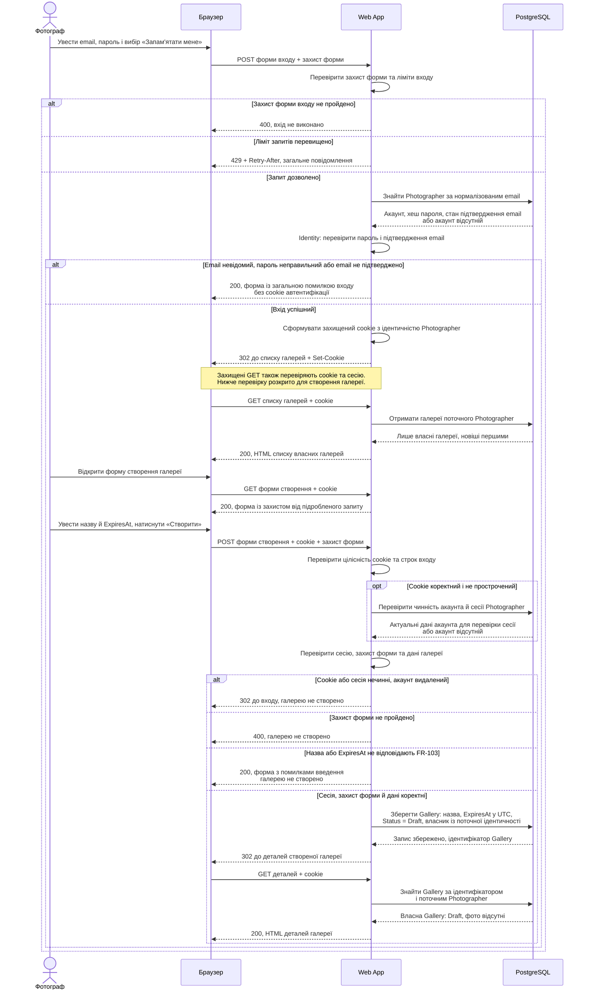

# Вхід фотографа і створення галереї

Сценарій охоплює FR-102–FR-105: фотограф входить у Web App, переглядає власні галереї та створює нову. Передумови: акаунт уже зареєстровано, email підтверджено за FR-110, у браузері відкрито форму входу; взаємодія з Web App відбувається через HTTPS.

Учасники названі за [глосарієм](../glossary.md): Браузер, Web App і PostgreSQL; Фотограф — зовнішній актор. ASP.NET Core Identity працює всередині Web App, тому не є окремим сервісом на діаграмі.

## Пояснення

**Перевірка входу.** PostgreSQL повертає збережений хеш, а пароль перевіряє Identity у Web App. Пароль не надсилається до PostgreSQL для порівняння у відкритому вигляді й не повертається браузеру. Невідомий email, неправильний пароль і непідтверджений email дають однакове повідомлення за [Identity Management](../03-srs/identity.md), без ознаки існування акаунта. У діаграмі показано Razor Pages: невдалий вхід повторно відображає форму, тому HTTP 200 означає доставлену сторінку з помилкою, а не успішну автентифікацію; для REST API цей випадок має статус 401.

**Обмеження частоти.** До пошуку акаунта перевіряються спільні для форми й REST API ліміти: 5 запитів за 15 хвилин для пари нормалізований email + IP та 20 запитів за хвилину для IP. Перевищення повертає 429 і `Retry-After` незалежно від наявності акаунта; така гілка не переходить до створення галереї.

**Як зберігається вхід.** Браузер отримує cookie через `Set-Cookie` і додає його до наступних запитів. Web App перевіряє захист cookie, строк входу та актуальність акаунта/сесії, відновлює ідентичність фотографа й використовує її для перевірки власника. Звичайний вхід діє до 8 годин, «Запам'ятати мене» — до 14 діб; активність не продовжує строк. Cookie має `HttpOnly`, `Secure` і `SameSite=Lax` та не містить пароля. На наступному захищеному запиті відкликана сесія або видалений акаунт не повинні надавати доступ; ця перевірка не обмежується лише строком cookie. Механізм cookie описано в [документації Microsoft](https://learn.microsoft.com/en-us/aspnet/core/security/authentication/cookie?view=aspnetcore-8.0).

**Створення галереї.** Web App перевіряє назву довжиною 1–100 символів після видалення крайніх пробілів та `ExpiresAt` у майбутньому, не далі ніж на 30 діб від поточного серверного часу; термін зберігається в UTC. Власник береться з перевіреної ідентичності, а не з поля форми. Після збереження галерея має статус `Draft` і нуль фото; перехід до її деталей також перевіряє власника. Створення відповідає [FR-103](../03-srs/zone-a-accounts.md#fr-103-створення-галереї), список і деталі — FR-104–FR-105. Помилки введення не виконують запис у PostgreSQL; помилка збереження не повинна завершуватися переходом до нібито створеної галереї й деталізується в error handling.

**Форми та компоненти.** POST-запити перевіряють захист від підроблених міжсайтових запитів; cookie сам по собі його не замінює. Огляд механізму наведено в [документації ASP.NET Core](https://learn.microsoft.com/en-us/aspnet/core/security/anti-request-forgery?view=aspnetcore-8.0). Адреси сторінок у діаграмі позначено за призначенням, без запровадження нових шляхів REST API. RabbitMQ, Worker і MinIO в цьому сценарії не використовуються: завантаження оригіналів і створення прев'ю починаються в окремому флоу зони B після створення галереї.
