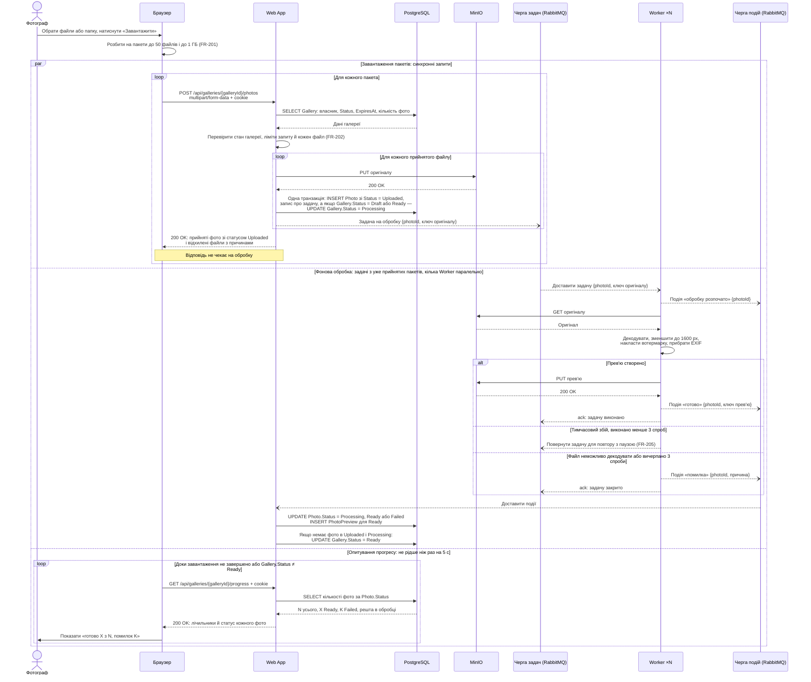

# Завантаження й обробка фото

Сценарій охоплює пакетне завантаження фото (FR-201, FR-202), фонове створення прев'ю (FR-203, FR-205) і перегляд прогресу (FR-204). Передумови: фотограф увійшов (див. [flow-zone-a.md](flow-zone-a.md)), галерея існує, належить йому, має стан `Draft`, `Processing` або `Ready`, і її термін дії не настав.

Учасники відповідають компонентам із [High-level Architecture](../03-srs/high-level-architecture.md) і [глосарія](../glossary.md). RabbitMQ показано двома учасниками, бо задачі й результати йдуть різними чергами: Черга задач і Черга подій.

**Позначення стрілок:**
- `->>` (суцільна) — синхронний запит: відправник чекає на відповідь;
- `-->>` (пунктирна зі стрілкою) — відповідь на синхронний запит;
- `--)` (пунктирна з відкритою стрілкою) — асинхронне повідомлення через RabbitMQ: відправник не чекає, доки його оброблять.

## Пояснення

**Що синхронне, а що асинхронне.** Поки фотограф чекає відповіді, Web App робить лише швидкі кроки: перевіряє галерею й файли, зберігає оригінали в MinIO, створює `Photo` зі статусом `Uploaded` і ставить задачі в чергу. Галерея переходить у `Processing` у тій самій транзакції, що й збереження першого прийнятого фото, і до публікації задачі; якщо всі файли пакета відхилено, стан галереї не змінюється. Після цього відповідь повертається одразу, а прев'ю створюються у фоні (FR-201). Обробка 300 RAW займає десятки хвилин (NFR-201), тож HTTP-запит, який чекав би на неї, обірвався б за тайм-аутом. На діаграмі асинхронні кроки позначено пунктирними стрілками `--)`, а блок `par` має три паралельні гілки: завантаження пакетів, фонову обробку й опитування прогресу. Worker починає обробляти фото з першого прийнятого пакета, поки Браузер ще надсилає наступні. Саме ця незалежність частин пояснює, навіщо в архітектурі черга.

**Що лежить у черзі.** Оригінал зберігається в MinIO, а в Чергу задач Web App кладе лише ідентифікатор фото й ключ файлу. Повідомлення займає кілька сотень байтів замість десятків мегабайтів RAW, тому брокер не перевантажується, а Worker сам читає файл зі сховища. `Photo` і запис про задачу зберігаються в одній транзакції PostgreSQL, тож задача не загубиться, навіть якщо RabbitMQ тимчасово недоступний (див. [2.5 Assumptions and Dependencies](../03-srs/02-product-overview.md)).

**Як Worker дізнається про задачу й повідомляє результат.** Worker підписаний на Чергу задач: RabbitMQ сам доставляє йому наступну задачу, щойно він звільнився. Якщо запущено кілька Worker, кожна доставка задачі дістається лише одному з них. У PostgreSQL Worker не пише. Про початок і результат обробки він публікує події в Чергу подій, а Web App отримує їх і оновлює `Photo.Status`, `PhotoPreview` та `Gallery.Status`. Задачу Worker підтверджує (`ack`) лише після публікації результату, тому падіння посеред обробки не втрачає фото: непідтверджену задачу RabbitMQ доставить знову, можливо іншому Worker. Тому та сама задача може бути оброблена повторно, і результат має бути ідемпотентним: повторна обробка не створює другого `PhotoPreview` (NFR-202).

**Як фотограф бачить прогрес.** Сторінка сама опитує Web App не рідше ніж раз на 5 секунд, а сервер нічого не надсилає першим. Такий підхід обрано в [ADR-001](adr/001-ui-razor-pages.md): він простий і працює без постійного з'єднання. Третя гілка блоку `par` показує, що опитування відбувається одночасно із завантаженням і обробкою. Опитування зупиняється, коли завершено всі запити поточного завантаження, а галерея має стан `Ready` (FR-204).

**Помилка обробки (`alt`).** Тимчасовий збій, наприклад недоступний MinIO, повертає задачу в чергу для повтору з паузою, загалом до 3 спроб (FR-205). Якщо файл неможливо декодувати або спроби вичерпано, фото отримує статус `Failed` з короткою причиною, а решта фото обробляються далі. `Failed` вважається завершеним станом, тому галерея все одно переходить у `Ready` і її можна фіналізувати (FR-203, FR-106).

**Помилки запиту завантаження.** Відмови синхронної частини на діаграмі не розкрито, щоб не перевантажувати її: невалідні файли повертаються у списку відхилених (FR-202), запит до чужої чи неіснуючої галереї не розкриває її даних (NFR-102), а перевищення ліміту частоти повертає 429 з `Retry-After`. Коди й формат цих помилок описано в п.5.

**Що свідомо не показано.** Діаграма показує основний флоу. Механізми запобігання втраті задач між базою й чергою, ідемпотентної обробки повторних доставок без дублювання `PhotoPreview` і файлів прев'ю та розподілу задач між кількома Worker буде описано в сценаріях concurrency п.6. Шляхи `/api/galleries/{galleryId}/photos` і `/api/galleries/{galleryId}/progress` попередні, остаточно їх фіксує API зони B у п.5.
