# Вибір фото клієнтом

Сценарій охоплює головний флоу зони C: клієнт відкриває посилання (FR-303), переглядає прев'ю, ставить і знімає лайки (FR-304), відправляє вибір (FR-305), а фотограф бачить результат (FR-306). Передумови: галерея має стан `Shared`, її прев'ю створено (див. [flow-zone-b.md](flow-zone-b.md)), фотограф створив `ShareLink` і передав клієнту посилання поза системою. Ці умови стосуються початку сценарію: посилання можуть відкликати, а термін може настати в будь-який момент, тому Web App перевіряє `ShareLink` і галерею **на кожному запиті**, а не лише під час відкриття сторінки.

Учасники відповідають компонентам із [High-level Architecture](../03-srs/high-level-architecture.md) і [глосарія](../glossary.md). Клієнт не має акаунта, тому на діаграмі немає cookie: його єдиний «ключ» — `Token` у посиланні (докладніше в [Identity Management, розділ «Клієнт»](../03-srs/identity.md#клієнт)). Worker і RabbitMQ у цьому флоу не беруть участі: прев'ю вже створено в зоні B, а лайки й відправка вибору обробляються синхронно.

**Позначення стрілок:**
- `->>` (суцільна) — синхронний запит: відправник чекає на відповідь;
- `-->>` (пунктирна зі стрілкою) — відповідь на синхронний запит.

```mermaid
sequenceDiagram
    actor Client as Клієнт
    participant Browser as Браузер
    participant WebApp as Web App
    participant PostgreSQL as PostgreSQL
    participant MinIO as MinIO
    actor Photographer as Фотограф
 
    Note over Client,MinIO: 1. Відкриття посилання і перегляд прев'ю
    Client->>Browser: Відкриває посилання з токеном
    Browser->>WebApp: GET сторінка галереї (токен у шляху, HTTPS)
    WebApp->>WebApp: SHA-256 від токена
    WebApp->>PostgreSQL: SELECT ShareLink за хешем разом з Gallery
    PostgreSQL-->>WebApp: ShareLink і Gallery або порожній результат
 
    alt ShareLink Active, ExpiresAt посилання і галереї не настав, Gallery Shared або Finalized
        WebApp->>PostgreSQL: SELECT нікнейм, PhotoPreview зі статусом Ready, Selection і лайки
        PostgreSQL-->>WebApp: Дані галереї
        WebApp-->>Browser: 200 OK: сітка прев'ю, лічильник «Обрано N з M»<br/>(для Finalized ще й «Галерею закрито фотографом», лайки вимкнено)
        Note over WebApp,Browser: Cache-Control private no-store, Referrer-Policy no-referrer,<br/>X-Robots-Tag noindex
        loop прев'ю, що потрапляють на екран
            Browser->>WebApp: GET прев'ю (токен, previewId, If-None-Match)
            WebApp->>PostgreSQL: Повторна перевірка посилання і галереї,<br/>прев'ю має належати цій галереї
            alt посилання й галерея досі чинні
                alt прев'ю належить цій галереї і має статус Ready
                    alt ETag прев'ю збігається з If-None-Match
                        WebApp-->>Browser: 304 Not Modified
                    else прев'ю змінилося або немає в кеші
                        WebApp->>MinIO: GET прев'ю за ключем із запису PhotoPreview
                        MinIO-->>WebApp: Файл прев'ю
                        WebApp-->>Browser: 200 OK, ETag, Cache-Control private no-cache
                    end
                else прев'ю чуже або не існує
                    WebApp-->>Browser: 404 PHOTO_NOT_FOUND, як для неіснуючого ресурсу (NFR-301 п.6)
                    Note over Browser,WebApp: Посилання чинне: сторінка і решта прев'ю працюють,<br/>для цього кадру браузер показує заглушку
                end
            else посилання стало Revoked або Expired, або галерея Expired
                WebApp->>WebApp: Врахувати недійсний запит для IP
                WebApp-->>Browser: 404 SHARE_LINK_INVALID (або 429 понад 30 за хвилину з IP)
            end
        end
    else Expired, Revoked, невідомий токен або галерея Expired
        WebApp->>WebApp: Врахувати недійсний запит для IP
        alt понад 30 недійсних запитів за хвилину з цієї IP
            WebApp-->>Browser: 429 і Retry-After
        else
            WebApp-->>Browser: 404 SHARE_LINK_INVALID, однакова сторінка для всіх причин
        end
        Browser->>Client: «Це посилання більше не діє. Зверніться до вашого фотографа по нове»
    end
 
    Note over Client,PostgreSQL: 2. Лайк і зняття лайка (повторюється для кожного кадру)
    Client->>Browser: Торкається серця на кадрі
    Browser->>WebApp: Запит «поставити лайк» (токен, photoId)
    WebApp->>PostgreSQL: Одна транзакція: перевірити ShareLink, Gallery і Selection.Status = Open,<br/>фото належить галереї й має статус Ready, INSERT лайка (повтор не дублює)
    alt посилання чинне, Selection.Status = Open
        PostgreSQL-->>WebApp: Збережено, кількість обраних
        WebApp-->>Browser: 200 OK: актуальний лічильник «Обрано N з M»
        Browser->>Client: Серце заповнене, лічильник оновлено
    else Gallery.Status = Finalized
        WebApp-->>Browser: Відмова GALLERY_FINALIZED, без змін у базі
        Browser->>Client: «Галерею закрито фотографом», сторінка тільки для перегляду
    else Selection.Status = Submitted
        WebApp-->>Browser: Відмова SELECTION_ALREADY_SUBMITTED, без змін у базі
        Browser->>Client: «Вибір уже відправлено», сторінка тільки для перегляду
    else фото чуже, не існує або не Ready
        WebApp-->>Browser: 404 PHOTO_NOT_FOUND, без змін у базі
        Browser->>Client: Повідомлення про кадр, який не знайдено, посилання працює далі
    else посилання недійсне
        WebApp->>WebApp: Врахувати недійсний запит для IP
        WebApp-->>Browser: 404 SHARE_LINK_INVALID (або 429), зміни не зберігаються (FR-307)
        Browser->>Client: Сторінка «Це посилання більше не діє»
    end
    Note over Browser,WebApp: Зняття лайка працює так само: DELETE лайка в тій самій транзакції з тими самими перевірками
 
    Note over Client,PostgreSQL: 3. Відправка вибору
    Client->>Browser: Натискає «Відправити вибір»
    Browser->>Client: Підтвердження: «Відправити N кадрів? Змінити вибір буде неможливо»
    Client->>Browser: Підтверджує
    Browser->>WebApp: Запит «відправити вибір» (токен)
    WebApp->>PostgreSQL: Одна транзакція: перевірити ShareLink і Gallery,<br/>UPDATE Selection.Status = Submitted, якщо зараз Open
    alt посилання чинне, Selection був Open
        PostgreSQL-->>WebApp: Вибір зафіксовано
        WebApp-->>Browser: 200 OK: вибір відправлено
        Browser->>Client: «Вибір відправлено», лайки заблоковано
        Note over WebApp,Photographer: Прототип: окремого сповіщення немає.<br/>Цільова система: Система надсилає email фотографу (FR-109)
    else Gallery.Status = Finalized
        WebApp-->>Browser: Відмова GALLERY_FINALIZED, вибір не змінюється
        Browser->>Client: «Галерею закрито фотографом»
    else Selection уже Submitted (наприклад, відправили з іншого пристрою)
        WebApp-->>Browser: Відмова SELECTION_ALREADY_SUBMITTED, без повторної зміни
        Browser->>Client: «Вибір уже відправлено»
    else посилання недійсне
        WebApp->>WebApp: Врахувати недійсний запит для IP
        WebApp-->>Browser: 404 SHARE_LINK_INVALID (або 429), вибір не змінюється (FR-307)
        Browser->>Client: Сторінка «Це посилання більше не діє»
    end
 
    Note over Photographer,PostgreSQL: 4. Фотограф бачить результат (власний браузер, після входу)
    Photographer->>Browser: Відкриває свою галерею
    Browser->>WebApp: GET деталі галереї + cookie
    WebApp->>PostgreSQL: SELECT Gallery: власник, ExpiresAt
    PostgreSQL-->>WebApp: Дані галереї
    alt Галерея чужа або не існує
        WebApp-->>Browser: Відповідь як у FR-105, однакова для чужої й неіснуючої,<br/>без даних галереї
    else Власна галерея, ExpiresAt не настав
        WebApp->>PostgreSQL: SELECT Selection.Status і обрані фото
        PostgreSQL-->>WebApp: Submitted і N обраних кадрів
        WebApp-->>Browser: 200 OK: «Клієнт відправив вибір: N кадрів», список обраних (FR-306)
        Browser->>Photographer: Показати вибір клієнта
    end
```

## Пояснення
**Як Web App перевіряє посилання і що зберігається в базі.** Токен приходить у шляху запиту через HTTPS. Web App рахує від нього SHA-256 і за цим хешем одним запитом знаходить `ShareLink` разом із `Gallery`. У PostgreSQL лежить лише хеш токена, а сам токен фотограф бачить один раз під час створення посилання (FR-301), тому витік дампа не дає жодного чинного посилання. Далі Web App перевіряє чотири умови: `ShareLink` має стан `Active`, `ExpiresAt` посилання не настав, `ExpiresAt` галереї не настав, а `Gallery.Status` дорівнює `Shared` або `Finalized`. Час порівнюється в UTC на кожному запиті, без фонових задач. Токен не потрапляє в журнали, а `Referrer-Policy: no-referrer` і `X-Robots-Tag: noindex` не дають йому витекти через переходи й пошукові системи.
 
**Звідки браузер бере прев'ю і чому це не оригінали.** Браузер клієнта ніколи не звертається до MinIO напряму: усі картинки віддає Web App, тому посилань на сховище клієнт не бачить. У запиті прев'ю є лише токен і `previewId`, а ключ файлу Web App бере із запису `PhotoPreview`, перевіривши, що цей запис належить галереї з токена. Підміна `previewId` чи `photoId` дає ту саму відповідь, що й для неіснуючого ресурсу (NFR-301 п.6): 404 `PHOTO_NOT_FOUND`. Це помилка про кадр, а не про посилання: посилання чинне, тож сторінка й інші прев'ю працюють, а клієнт не бачить «Це посилання більше не діє». Гарантію «не оригінал» забезпечують три речі:
1. Для клієнта не існує жодного маршруту до оригіналів: Web App читає з MinIO лише файли `PhotoPreview`. Доступ до оригіналів потребує cookie фотографа та перевірки власника, а токен його не замінює.
2. Прев'ю створює Worker: воно зменшене до 1600 px, з вотермаркою, без EXIF (див. зону B).
3. Клієнту показуються лише прев'ю у статусі `Ready`, а ключ оригіналу не потрапляє у відповіді.
Прев'ю кешуються приватно з `ETag`, але перед кожною відповіддю Web App заново перевіряє посилання. Тому після відкликання навіть кешована картинка більше не показується: на запит повертається 404.
 
**Що відбувається в базі під час лайка і відправки вибору.** Лайк записується в `Selection` галереї, а не прив'язується до браузера чи пристрою. Дія виконується однією транзакцією: перевірка посилання, перевірка `Selection.Status = Open` і `Gallery.Status ≠ Finalized`, перевірка, що фото належить цій галереї та має статус `Ready`, і лише потім запис лайка. Повторний лайк того самого кадру не створює дубліката, а зняття лайка видаляє запис. Відмови розрізняються за причиною: `GALLERY_FINALIZED` («Галерею закрито фотографом», FR-303) для фіналізованої галереї, навіть якщо вибір ще `Open`; `SELECTION_ALREADY_SUBMITTED` («Вибір уже відправлено») для відправленого вибору; `PHOTO_NOT_FOUND` для чужого чи неіснуючого фото (FR-304 п.2). Ці відмови не змінюють дані і не означають, що посилання недійсне. Лайки з двох пристроїв зберігаються обидва, бо `Selection` один на галерею (FR-304 п.1). Відправка вибору виконує `UPDATE Selection.Status = Submitted` за умови, що статус зараз `Open`. Якщо лайк і відправка прийдуть одночасно, умова в базі виграє лише для одного з них; деталі подано в concurrency п.6. Після `Submitted` змінити вибір не може ніхто (FR-305). Перед відправкою браузер показує підтвердження з кількістю кадрів: це єдиний захист від випадкового натискання. Якщо вибір уже відправлено з іншого пристрою, повторна відправка нічого не змінює й повертає той самий результат.
 
**Як фотограф дізнається про відправку.** У прототипі система нічого не надсилає першою: email-сповіщення про вибір не входять до обсягу (див. [Identity Management](../03-srs/identity.md#фотограф)). Фотограф бачить результат, відкривши власну галерею: Web App читає `Selection.Status` у момент запиту, повертає `Submitted` і список обраних кадрів (FR-306). Перед цим перевіряється власник, а для чужої чи неіснуючої галереї повертається та сама відповідь, що й за FR-105. Відправлений вибір фотограф бачить незалежно від стану посилання, доки галерея існує, тож відкликання посилання вибір не стирає. У цільовій системі Система додатково надсилає email (FR-109).
 
**Що бачить клієнт, якщо посилання прострочене або відкликане (`alt`).** Для будь-якої недійсної причини — `Expired`, `Revoked`, невідомий чи пошкоджений токен, прострочена галерея — клієнт отримує одну й ту саму сторінку «Це посилання більше не діє. Зверніться до вашого фотографа по нове», HTTP 404 і код `SHARE_LINK_INVALID` (FR-307). Назви галереї, нікнейма й прев'ю на ній немає. Причину розрізнити неможливо, і це свідомо: так сторонній не дізнається, чи існувало посилання, а перебір токенів стає складнішим. Недійсні запити рахуються: після 30 за хвилину з однієї IP повертається 429 з `Retry-After`, а запити з чинним токеном не обмежуються. Така сама відповідь діє й для сторінки, відкритої до відкликання: будь-яка наступна дія (лайк, відправка, догрузка прев'ю) отримує 404, зміни не зберігаються, а `Selection` не видаляється. Новий `ShareLink`, створений для галереї у стані `Ready` або `Shared`, продовжує той самий `Selection` (FR-301 п.3).
 
**Що свідомо не показано.** Діаграма показує основний флоу. Окремо не розкрито: послідовність відкликання посилання фотографом (FR-302), вибір, відправлений не тією людиною (повторне відкриття вибору не входить в обсяг), правила конкурентного доступу до `Selection` (concurrency п.6) і фінальні коди та формат помилок (п.5). Маршрути запитів лайка й відправки на діаграмі описані словами: їх остаточно фіксує API зони C у п.5.
## Узгодженість з Identity

| Що стверджує діаграма | Де зафіксовано в [Identity Management](../03-srs/identity.md#клієнт) |
|---|---|
| Клієнт не має акаунта й cookie, доступ дає лише `Token` | «Як система розуміє, що це клієнт» |
| У базі лише SHA-256-хеш токена, пошук за хешем на кожному запиті | «Токен у посиланні», FR-301, NFR-301 |
| Одна відповідь 404 `SHARE_LINK_INVALID` для всіх причин, 429 після 30 недійсних запитів за хвилину з IP | «Скільки діє посилання і що буде після завершення», FR-307 |
| Клієнт бачить лише прев'ю з вотермаркою й нікнейм, без email і оригіналів | Матриця дозволів, FR-303, NFR-102 |
| Лайки належать `Selection` галереї, а не браузеру; два пристрої працюють з одним вибором | «Чи "пам'ятає" система клієнта між візитами», FR-304 |
| Відправка незворотна, повторного відкриття вибору немає | «Якщо клієнт переслав посилання комусь іншому», FR-305 |
| Фотограф бачить вибір, доки існує галерея, незалежно від стану посилання | FR-306 |
| Email-сповіщення про вибір — лише цільова система | «Реєстрація» (обсяг прототипу), матриця дозволів, FR-109 |