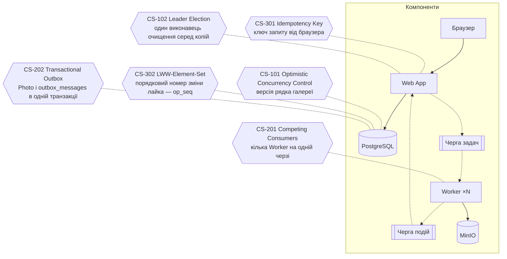

# П.6 Concurrency Patterns

Проблеми паралельності в PicPick виникають із самої природи продукту. Фотограф завантажує сотні фото, і їх одночасно обробляють кілька Worker. Web App може працювати в кількох копіях, у кожній є фонові задачі. Web App і Worker — різні сервіси з власними збоями, які обмінюються повідомленнями через RabbitMQ. Нарешті, фотограф і клієнт, а то й кілька вкладок чи пристроїв одного клієнта, діють з тією самою галереєю одночасно. Кожен сценарій нижче бере одну таку ситуацію, показує, що зламається без захисту, і описує патерн, який це виправляє.

Сценарії написано за [шаблоном](_template.md); патерни зареєстровано в [реєстрі](patterns.md).

## Зведена таблиця

**Тип:** *один сервіс* — конкурентні операції всередині Web App і його бази (паралельні обробники, запити з кількох вкладок); *distributed* — взаємодія кількох копій або різних сервісів (Web App, Worker, RabbitMQ, MinIO).

| ID | Сценарій | Патерн | Тип | Компоненти | Файл |
|---|---|---|---|---|---|
| CS-101 | Одночасне оновлення статусу галереї двома обробниками подій | Оптимістичне блокування (Optimistic Concurrency Control) | Один сервіс | Черга подій, Web App, PostgreSQL | [cs-101-gallery-status.md](cs-101-gallery-status.md) |
| CS-102 | Очищення прострочених галерей кількома копіями Web App | Вибір лідера (Leader Election) | Distributed | Web App ×2, PostgreSQL, MinIO | [cs-102-expired-gallery-cleanup.md](cs-102-expired-gallery-cleanup.md) |
| CS-201 | Розподіл обробки фото між кількома Worker | Конкуруючі споживачі (Competing Consumers) | Distributed | Web App, Черга задач, Worker ×N, MinIO | [cs-201-competing-consumers.md](cs-201-competing-consumers.md) |
| CS-202 | Збереження фото й постановка задачі в чергу | Транзакційний outbox (Transactional Outbox) | Distributed | Web App, PostgreSQL, Черга задач | [cs-202-transactional-outbox.md](cs-202-transactional-outbox.md) |
| CS-301 | Подвійна відправка вибору клієнта | Ключ ідемпотентності (Idempotency Key) | Один сервіс | Браузер ×2, Web App, PostgreSQL | [cs-301-idempotency-key.md](cs-301-idempotency-key.md) |
| CS-302 | Лайки з двох пристроїв не затирають одне одного | LWW-множина (LWW-Element-Set, CRDT) | Один сервіс | Браузер ×2, Web App, PostgreSQL | [cs-302-lww-element-set.md](cs-302-lww-element-set.md) |

## Перевірка вимог п.6

| Вимога | Результат |
|---|---|
| ≥ 5 сценаріїв | **6** — по два на кожну зону |
| Патерни не повторюються | Так: 6 різних патернів, кожен записаний у [реєстрі](patterns.md) |
| Sequence-діаграма на кожен сценарій | Так: по одній у кожному файлі, усі 6 рендеряться в Mermaid |
| Пояснення патерну й застосування | Так: розділи «Патерн», «Як застосовано», «Гарантія та механізм» і «Компроміси» в кожному сценарії |
| Обидва типи | 3 сценарії в одному сервісі й 3 distributed |

## Де застосовано патерни

Схема показує, на якому компоненті з [High-level Architecture](../03-srs/high-level-architecture.md) працює кожен патерн. Шестикутники — патерни; кожен з'єднано з компонентом, де працює його ключовий механізм. Повний перелік учасників кожного сценарію — у зведеній таблиці.

Зона B охоплює шлях фото від Web App через Чергу задач до Worker (CS-201, CS-202). Зона A — обробку результатів і фонові задачі Web App (CS-101, CS-102). Зона C — одночасні дії клієнтів через браузер (CS-301, CS-302). Спільна риса всіх шести: остаточне рішення ухвалює одне місце — база даних або брокер — атомарною операцією, а не кожен учасник окремо.
