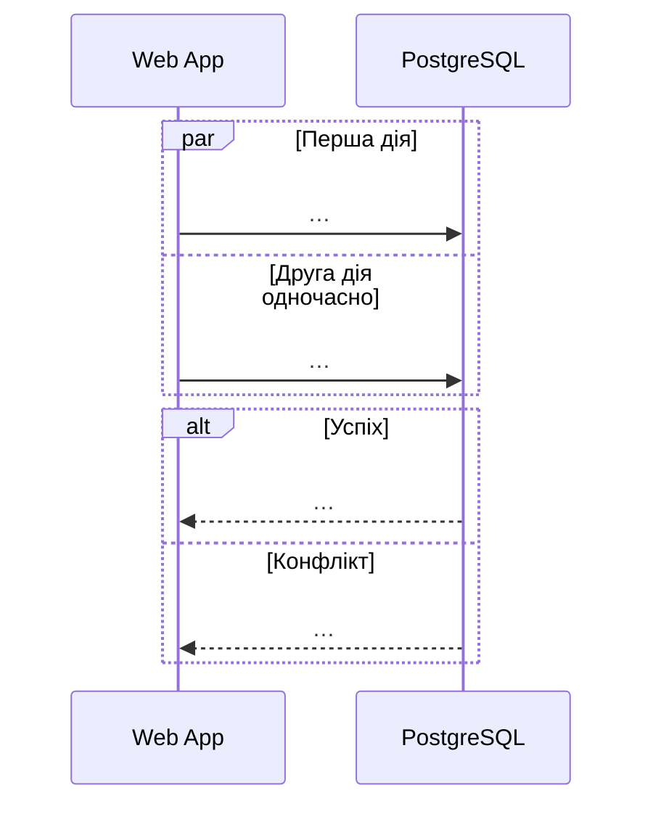

# CS-XYZ: Коротка назва сценарію

<!--
Як користуватися шаблоном:
1. Скопіюйте файл як cs-XYZ-<коротка-назва>.md (наприклад, cs-201-competing-consumers.md).
2. Перед початком запишіть свій патерн у patterns.md, щоб патерни не повторювалися.
3. Замініть усі підказки в цьому файлі й видаліть цей коментар.
-->

**Зона:** A / B / C. **Авторка:** … **Патерн:** …

## Ситуація

Що робить користувач чи система — 2–3 речення, конкретно. Наприклад: «Фотограф завантажив 500 фото, і три Worker одночасно беруть задачі з Черги задач».

## Проблема

Що піде не так **без** патерну. Опишіть конкретний приклад: «Два Worker одночасно…, у результаті…». Добре, якщо видно наслідок для користувача: фото загубилося, вибір зафіксувався двічі, галерея застрягла в `Processing`.

## Патерн

**Назва патерну.** 2–3 речення: що це таке і яку проблему він розв'язує в загальному випадку.

Джерело: [назва](посилання) — наприклад, Microsoft Cloud Design Patterns, microservices.io або Enterprise Integration Patterns.

## Sequence-діаграма

Учасники мають ті самі назви, що й у [High-level Architecture](../03-srs/high-level-architecture.md). Синхронні виклики — `->>`, відповіді — `-->>`, асинхронні повідомлення — `--)`. Одночасні дії показуйте через `par`, результати — через `alt`, повтори — через `loop`, критичну секцію — через `critical`.

## Як застосовано в нашій системі

- **Компоненти:** які беруть участь.
- **Дані:** що де зберігається (таблиця, поле, черга, файл у MinIO).
- **Перевірки:** хто що перевіряє і в який момент.

## Компроміси

- **Чим платимо:** складність, затримка, додаткові дані чи компоненти.
- **Альтернативи:** які інші підходи можливі і чому обрано цей.

## Зв'язок з іншими пунктами

| Пункт | Що саме |
|---|---|
| п.3 Вимоги | FR-…, NFR-… |
| п.4 Архітектура | flow-zone-….md, ADR-… |
| п.5 API | ендпоінти й коди помилок, напр. `POST /api/…` → 409 `…` |

## Для захисту