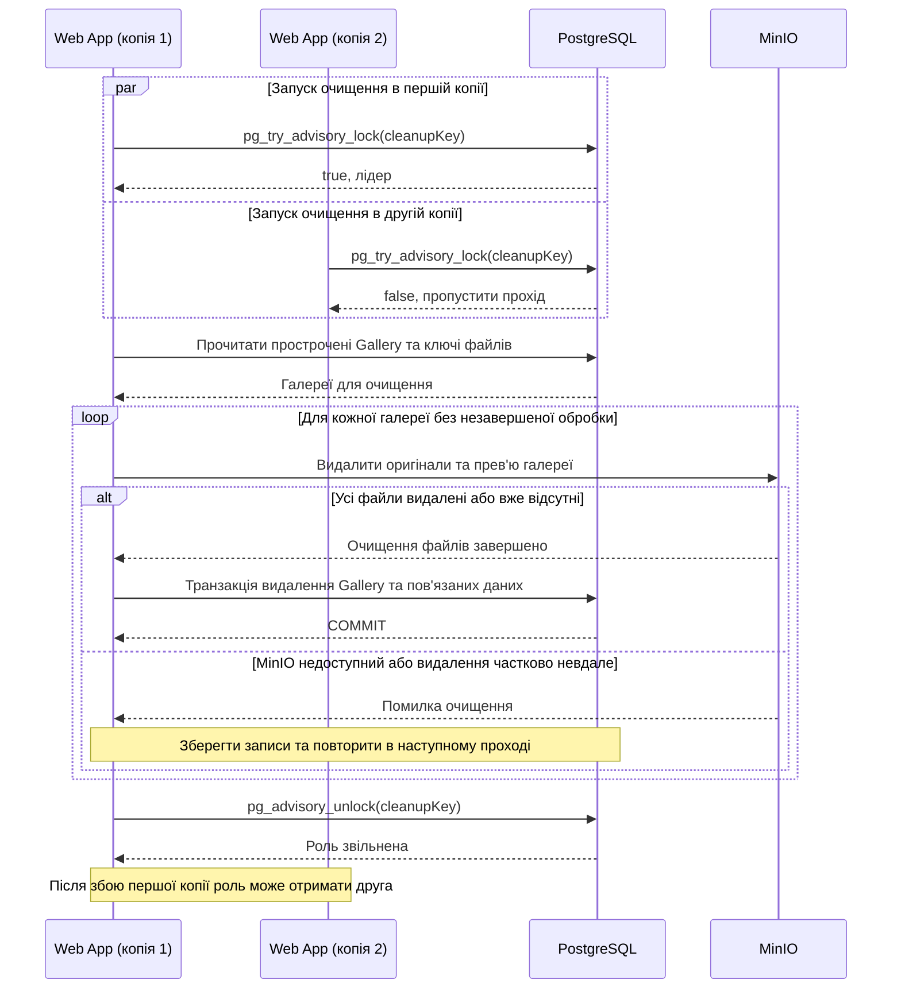

# CS-102: очищення прострочених галерей кількома копіями Web App

**Зона:** A. **Авторка:** Юлія. **Патерн:** Вибір лідера (Leader Election).

## Ситуація

Запущено дві копії Web App, у кожній є фонова задача очищення за FR-108. Вони одночасно знаходять галерею, термін дії якої вже минув, і намагаються видалити її дані з PostgreSQL та файли з MinIO.

## Проблема

Без координації обидві копії почнуть те саме очищення. Одна може вже видалити файли, а інша сприйме їх відсутність як помилку; після збою частина даних залишиться неочищеною. Звичайний `lock` у коді не допоможе, бо копії працюють у різних процесах.

## Патерн

**Вибір лідера:** серед кількох копій обирається одна, яка виконує спільну фонову роботу. Інші продовжують обслуговувати користувачів і можуть стати лідером після її зупинки. Для PicPick роль лідера діє лише протягом одного проходу очищення.

Джерела: [Microsoft — Leader Election](https://learn.microsoft.com/en-us/azure/architecture/patterns/leader-election), [PostgreSQL 16 — Advisory Locks](https://www.postgresql.org/docs/16/explicit-locking.html#ADVISORY-LOCKS).

## Sequence-діаграма

Два учасники Web App — копії одного компонента з [High-level Architecture](../03-srs/high-level-architecture.md). На діаграмі перша копія отримала роль лідера, але перемогти може будь-яка.

## Як застосовано в нашій системі

- **Компоненти:** копії Web App обирають лідера через PostgreSQL. Лише лідер запускає цей прохід очищення в PostgreSQL і MinIO. Новий сервіс не потрібен.
- **Дані та вибір:** усі копії використовують один сталий числовий `cleanupKey`, зарезервований у коді для цього завдання. `pg_try_advisory_lock` повертає результат одразу. За `false` копія нічого не видаляє й пробує знову під час наступного запуску за розкладом.
- **З'єднання:** лідер тримає блокування на окремому відкритому з'єднанні PostgreSQL до кінця проходу й звільняє його в `finally`. З'єднання з утримуваним блокуванням не повертають у пул. Після завершення сесії PostgreSQL звільняє блокування автоматично; за втрати зв'язку Web App припиняє очищення, доки знову не отримає роль.
- **Перевірки:** доступ закривається за `ExpiresAt` на кожному запиті, незалежно від лідера. Очищення бере лише галереї з `ExpiresAt <=` поточного серверного часу UTC, включно з раніше `Finalized`. Поки є незавершена обробка, записи галереї та фото зберігаються для повторного очищення. Результат Worker після закінчення терміну не відновлює доступу, а створене прев'ю очищується за FR-203. Перед остаточним видаленням перевіряють, що немає незавершених задач і відкладених результатів для цієї галереї.
- **Порядок і повтор:** спочатку видаляються файли лише цієї галереї, потім однією транзакцією — `Gallery`, `Photo`, `PhotoPreview`, `ShareLink` і `Selection`. `Photographer` не видаляється. Відсутній файл або вже видалена галерея означає успішний повтор. За помилки файлів записи з їхніми ключами залишаються для наступної спроби. Якщо файли видалено, а транзакція відкотилася, наступний лідер безпечно повторить очищення.
- **Гарантія:** одна сесія PostgreSQL володіє роллю лідера в кожний момент. Це не спільна транзакція PostgreSQL і MinIO: уже надісланий запит до MinIO може завершитися після втрати ролі, тому повторне видалення має бути безпечним, а ключі видалених файлів не використовуються повторно. Ручне видалення за FR-107 також має допускати ці повтори.
- **Строк:** очищення та повтори плануються так, щоб завершитися до `ExpiresAt + 24 години`. Помилки записуються в журнал з ідентифікатором галереї. Перевищення строку, зокрема через недоступність сховища чи незавершені задачі, є порушенням FR-108, а не продовженням терміну.

## Компроміси

- **Переваги:** один прохід очищення замість дублювання роботи, автоматична передача ролі після завершення сесії, використання наявного PostgreSQL.
- **Ризики й ціна:** окреме з'єднання, послідовне очищення та залежність від PostgreSQL. Завислий лідер може затримати інші копії, тому потрібні тайм-аути запитів і обмеження тривалості проходу. Після обриву мережі передача ролі чекає, доки PostgreSQL завершить стару сесію.
- **Альтернативи:** окремий єдиний процес очищення простіший, але потребує окремого запуску та відновлення. Розподіл галерей між копіями підвищив би швидкість, проте для навчального проєкту достатньо одного лідера. На відміну від CS-101, тут обирається виконавець фонового завдання, а не перевіряється версія `Gallery`.

## Зв'язок з іншими пунктами

| Пункт | Що саме |
|---|---|
| п.3 Вимоги | [FR-105, FR-107–108](../03-srs/zone-a-accounts.md): метадані до очищення, видалення та строк 24 години. [FR-203](../03-srs/zone-b-processing.md): пізній результат Worker не відновлює галерею |
| п.4 Архітектура | [High-level Architecture](../03-srs/high-level-architecture.md): фонові задачі у Web App, PostgreSQL і MinIO. [Флоу зони B](../04-architecture/flow-zone-b.md): обробка результату для простроченої галереї |
| п.5 API | [API зони A](../05-error-handling/zone-a.md): після очищення `GET /api/galleries/{id}` → 404 `GALLERY_NOT_FOUND`. До очищення власнику доступні лише метадані `Expired`. Внутрішній повтор очищення вже видаленого не є повторним HTTP DELETE, який повертає 404. Формат помилок — за [конвенцією](../05-error-handling/conventions.md) |

## Перевірка результату (для захисту)

Це проєктний сценарій для майбутньої реалізації: поточні API-заглушки не виконують вибір лідера та очищення MinIO.

1. Створити прострочену галерею з файлами й чинну контрольну галерею. Запустити дві копії Web App з одним PostgreSQL, одночасно активувати очищення й затримати лідера перед видаленням. У журналі лише одна копія має отримати роль, друга — пропустити прохід.
2. Зупинити лідера після видалення частини файлів, але до видалення записів. Після завершення його сесії друга копія має отримати роль і завершити очищення без помилок через відсутні файли. Окремо перевірити тимчасову недоступність MinIO та повтор після відновлення.
3. Прострочити галерею під час роботи Worker. Переконатися, що доступ одразу закрито, пізній результат не відновлює галерею, а його прев'ю також видаляється. Повторити очищення вже видаленої галереї.
4. Перевірити PostgreSQL і MinIO: усі дані й файли простроченої галереї відсутні до межі 24 годин, акаунт та контрольна галерея збережені. Запит деталей після видалення дає 404 `GALLERY_NOT_FOUND`; у журналі видно передачу ролі та завершення очищення.
