# CS-102: очищення прострочених галерей кількома копіями Web App

**Зона:** A. **Авторка:** Юлія. **Патерн:** Вибір лідера (Leader Election).

## Ситуація

Запущено дві копії Web App, у кожній є фонова задача очищення за FR-108. Вони одночасно знаходять галерею, термін дії якої вже минув, і намагаються видалити її дані з PostgreSQL та файли з MinIO.

## Проблема

Без координації обидві копії повторять ті самі читання PostgreSQL і запити видалення до MinIO, а їхні транзакції конкуруватимуть за ті самі рядки. Навіть за безпечного повторного видалення це зайве навантаження, яке зростає з кількістю копій Web App і може сповільнити очищення. Ідемпотентність робить повтор безпечним, але не прибирає дублювання роботи; звичайний `lock` діє лише всередині одного процесу.

## Патерн

**Вибір лідера:** серед кількох копій обирається одна, яка виконує спільну фонову роботу. Інші продовжують обслуговувати користувачів і можуть стати лідером після її зупинки. Для PicPick роль лідера діє лише протягом одного проходу очищення.

Тут обираємо відповідальну копію для **всього проходу очищення**, а не блокуємо кожну галерею окремо. Розподілений м'ютекс у PostgreSQL — механізм вибору й утримання цієї ролі, як у варіанті Leader Election від Microsoft. Механізм спільний із Distributed Lock, але окремий сценарій блокування ресурсу тут не описується й цей патерн не резервується додатково.

Джерела: [Microsoft — Leader Election](https://learn.microsoft.com/en-us/azure/architecture/patterns/leader-election), [PostgreSQL 16 — Advisory Locks](https://www.postgresql.org/docs/16/explicit-locking.html#ADVISORY-LOCKS).

## Sequence-діаграма

Два учасники Web App — копії одного компонента з [High-level Architecture](../03-srs/high-level-architecture.md). На діаграмі перша копія отримала роль лідера, але перемогти може будь-яка.

```mermaid
sequenceDiagram
    participant First as Web App (копія 1)
    participant Second as Web App (копія 2)
    participant DB as PostgreSQL
    participant Files as MinIO

    par Запуск очищення в першій копії
        First->>DB: pg_try_advisory_lock(cleanupKey)
        DB-->>First: true, лідер
    and Запуск очищення в другій копії
        Second->>DB: pg_try_advisory_lock(cleanupKey)
        DB-->>Second: false, пропустити прохід
    end
    First->>DB: Прочитати прострочені Gallery та ключі файлів
    DB-->>First: Галереї для очищення
    loop Для кожної галереї без незавершеної обробки
        First->>Files: Видалити оригінали та прев'ю галереї
        alt Усі файли видалені або вже відсутні
            Files-->>First: Очищення файлів завершено
            First->>DB: Транзакція видалення Gallery та пов'язаних даних
            DB-->>First: COMMIT
        else MinIO недоступний або видалення частково невдале
            Files-->>First: Помилка очищення
            Note over First,DB: Зберегти записи та повторити в наступному проході
        end
    end
    First->>DB: pg_advisory_unlock(cleanupKey)
    DB-->>First: Роль звільнена
    Note over First,Second: Після збою першої копії роль може отримати друга
```

## Як застосовано в нашій системі

- **Компоненти:** копії Web App обирають одного виконавця проходу через PostgreSQL; він очищує PostgreSQL і MinIO. Інші пропускають прохід та пробують отримати роль за наступним запуском розкладу.
- **Дані:** усі копії використовують один сталий числовий `cleanupKey` у `pg_try_advisory_lock`. Лідер утримує роль на окремому з'єднанні до кінця проходу, звільняє її в `finally` і не повертає з'єднання в пул із блокуванням. Очищення спершу видаляє файли, потім транзакцією — `Gallery`, `Photo`, `PhotoPreview`, `ShareLink`, `Selection`, зберігаючи `Photographer`.
- **Перевірки:** беруться лише галереї з `ExpiresAt <=` серверного часу UTC, включно з раніше `Finalized`. Доступ закривається на кожному запиті незалежно від очищення. Поки є незавершені задачі чи відкладені результати Worker, записи залишаються для повтору; пізні прев'ю очищуються за FR-203. Усе очищення має завершитися до `ExpiresAt + 24 години`; перевищення є порушенням FR-108.
- **Гарантія та відновлення:** лише одна сесія володіє роллю. Після її завершення PostgreSQL звільняє блокування; за втрати зв'язку копія припиняє очищення до повторного отримання ролі. Уже надісланий запит до MinIO може завершитися й після цього, тому відсутність файлу чи галереї є успішним повтором, а ключі не використовуються знову. За помилки файлів або відкату транзакції записи та ключі залишаються для наступного лідера; ручне видалення за FR-107 теж допускає повтори. Помилки журналюються з ідентифікатором галереї.

## Компроміси

- **Переваги:** один прохід очищення замість дублювання роботи, автоматична передача ролі після завершення сесії, використання наявного PostgreSQL.
- **Ризики й ціна:** окреме з'єднання, послідовне очищення та залежність від PostgreSQL. Завислий лідер може затримати інші копії, тому потрібні тайм-аути запитів і обмеження тривалості проходу. Після обриву мережі передача ролі чекає, доки PostgreSQL завершить стару сесію.
- **Альтернативи:** окремий єдиний процес очищення простіший, але потребує окремого запуску та відновлення. Розподіл галерей між копіями підвищив би швидкість, проте для навчального проєкту достатньо одного лідера. На відміну від CS-101, тут обирається виконавець фонового завдання, а не перевіряється версія `Gallery`.

## Зв'язок з іншими пунктами

| Пункт | Що саме |
|---|---|
| п.3 Вимоги | [FR-105, FR-107–108](../03-srs/zone-a-accounts.md): метадані до очищення, видалення та строк 24 години. [FR-203](../03-srs/zone-b-processing.md): пізній результат Worker не відновлює галерею |
| п.4 Архітектура | [High-level Architecture](../03-srs/high-level-architecture.md): фонові задачі у Web App, PostgreSQL і MinIO. [Флоу зони B](../04-architecture/flow-zone-b.md): обробка результату для простроченої галереї |
| п.5 API | [API зони A](../05-error-handling/zone-a.md): після очищення `GET /api/galleries/{id}` → 404 `GALLERY_NOT_FOUND`. До очищення власнику доступні лише метадані `Expired`. Внутрішній повтор очищення вже видаленого не є повторним HTTP DELETE, який повертає 404. Формат помилок — за [конвенцією](../05-error-handling/conventions.md) |

## Перевірка результату (для захисту)

Це проєктний сценарій для майбутньої реалізації: поточні API-заглушки не виконують вибір лідера та очищення MinIO.

1. Створити прострочену галерею з файлами й чинну контрольну галерею. Запустити дві копії Web App з одним PostgreSQL, одночасно активувати очищення й затримати лідера перед видаленням. У журналі лише одна копія має отримати роль, друга — пропустити прохід.
2. Зупинити лідера після видалення частини файлів, але до видалення записів. Після завершення його сесії друга копія має отримати роль і завершити очищення без помилок через відсутні файли. Окремо перевірити тимчасову недоступність MinIO та повтор після відновлення.
3. Прострочити галерею під час роботи Worker. Переконатися, що доступ одразу закрито, пізній результат не відновлює галерею, а його прев'ю також видаляється. Повторити очищення вже видаленої галереї.
4. Перевірити PostgreSQL і MinIO: усі дані й файли простроченої галереї відсутні до межі 24 годин, акаунт та контрольна галерея збережені. Запит деталей після видалення дає 404 `GALLERY_NOT_FOUND`; у журналі видно передачу ролі та завершення очищення.
