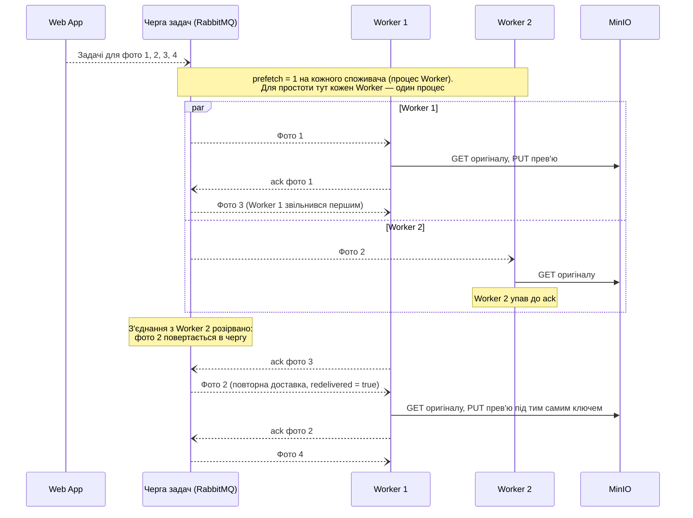

# CS-201: розподіл обробки фото між кількома Worker

**Зона:** B. **Авторка:** Альона. **Патерн:** Конкуруючі споживачі (Competing Consumers).

## Ситуація

Фотограф завантажив 500 фото. Web App поставив у Чергу задач 500 задач «обробити фото», а запущено три копії Worker. Потрібно, щоб усі Worker працювали одночасно, кожну задачу в кожен момент виконував лише один із них, а запуск ще одного Worker пришвидшував обробку (NFR-201).

## Проблема

Без узгодженого розподілу є три погані варіанти:
- **Worker самі шукають роботу в базі.** Два Worker одночасно читають «фото зі статусом `Uploaded`», обидва бачать фото 17 і обидва його обробляють. Процесорний час витрачено двічі, у MinIO двічі записано прев'ю.
- **Web App сам розподіляє фото між Worker** (перше — Worker 1, друге — Worker 2…). Якщо Worker 2 обробляє повільні RAW, а Worker 1 — швидкі JPEG, Worker 1 простоює, поки в Worker 2 росте черга. Якщо Worker 2 впав, призначені йому фото «застрягають», і Web App мусить сам це помітити й перепризначити.
- **Один Worker.** 300 RAW обробляються до 25 хвилин, а другий Worker нічого не пришвидшує, бо роботу між ними ніхто не ділить.

## Патерн

**Конкуруючі споживачі (Competing Consumers).** Кілька споживачів підписуються на одну чергу, і брокер доставляє кожне повідомлення лише одному з них. Споживачі «змагаються» за повідомлення: вільний бере наступне, тож навантаження розподіляється саме собою, а щоб пришвидшити обробку, досить додати споживача.

Джерела: [Microsoft — Competing Consumers pattern](https://learn.microsoft.com/en-us/azure/architecture/patterns/competing-consumers), [RabbitMQ — Consumer Prefetch](https://www.rabbitmq.com/docs/consumer-prefetch), [RabbitMQ — Consumer Acknowledgements](https://www.rabbitmq.com/docs/confirms).

## Sequence-діаграма

Показано два Worker на одній Черзі задач і збій одного з них. Результат обробки Worker публікує в Чергу подій, як у [флоу зони B](../04-architecture/flow-zone-b.md); тут ця частина скорочена.

## Як застосовано в нашій системі

- **Компоненти:** Web App публікує задачі, Черга задач у RabbitMQ їх зберігає, кілька контейнерів Worker на неї підписані. Кількість Worker змінюється без змін у коді: досить запустити ще один контейнер у Docker Compose.
- **Дані:** у повідомленні лише `photoId` і ключ оригіналу в MinIO. Черга оголошена як durable, а повідомлення — persistent, тому задачі переживають перезапуск RabbitMQ (NFR-202).
- **Перевірки:** кожен споживач (процес Worker зі своїм каналом) встановлює `prefetch_count = 1` і підтверджує задачу вручну (`ack`) лише після того, як брокер прийняв подію результату. Тому зайнятий споживач не отримує нових задач, а вільний бере наступну.
- **Паралельність усередині одного Worker:** обробка зображень навантажує CPU, тому всередині Worker використовуються процеси, а не потоки (у Python потоки не прискорюють такі обчислення через GIL). Кількість процесів дорівнює кількості ядер, виділених контейнеру. Кожен процес — окремий споживач зі своїм з'єднанням і `prefetch_count = 1`, тож до Черги задач застосовується той самий патерн.
- **Гарантія та механізм:** кожну доставку задачі в кожен момент отримує лише один Worker, і жодна задача не губиться, доки її не підтверджено. Це забезпечують сам брокер (він доставляє повідомлення одному споживачу), ручний `ack` і `prefetch`. Якщо Worker упав до `ack`, RabbitMQ повертає задачу в чергу, і її обробляє інший Worker. Тому та сама задача може бути оброблена двічі. Дублікату не виникає з двох причин. У MinIO прев'ю пишеться під ключем, який визначається `photoId`, тож повторний запис лише перезаписує той самий файл. У PostgreSQL на `PhotoPreview.PhotoId` є унікальне обмеження, і Web App у транзакції обробки події виконує вставку з обробкою конфлікту (`INSERT … ON CONFLICT (photo_id) DO NOTHING`). Окремої перевірки «чи є вже прев'ю» недостатньо: дві одночасні повторні події обидві побачили б, що запису немає, і обидві його вставили б. Унікальне обмеження робить це атомарно, тому повторна подія завершується успішно (її підтверджують) без другого запису (NFR-202, критерій 3).

## Компроміси

- **Чим платимо:**
  - **Порядок обробки не гарантується:** фото 3 може бути готове раніше за фото 2. Для нас це неважливо, бо прогрес рахує кількість, а не порядок.
  - **Можливі повторні обробки** після збою, тому потрібна ідемпотентність результату.
  - **`prefetch = 1` трохи знижує пропускну здатність:** споживач чекає нову задачу після кожного `ack`. Але обробка фото триває секунди, тож затримка в мілісекунди непомітна.
  - **Швидкість упирається в ресурси машини:** на одній машині Worker ділять CPU (див. [ADR-002](../04-architecture/adr/002-microservices.md)), тому кожен новий Worker пришвидшує обробку менше за попередній.
- **Альтернативи:**
  - **Опитування бази з блокуванням рядків** (`SELECT … FOR UPDATE SKIP LOCKED`) теж дає кожне фото лише одному Worker, але Worker мусять постійно опитувати PostgreSQL, і з'являється ще один клієнт бази, якою за архітектурою володіє лише Web App.
  - **Розподіл за галереями** (один Worker на галерею) погано балансує навантаження: велика галерея займає один Worker, а інші простоюють.
  - **Прямий HTTP від Web App до Worker** розглянуто в ADR-002.

## Зв'язок з іншими пунктами

| Пункт | Що саме |
|---|---|
| п.3 Вимоги | FR-203 (фонове створення прев'ю), FR-205 (повтори), NFR-201 (другий Worker пришвидшує обробку щонайменше в 1,6 раза), NFR-202 (задачі не губляться, немає дублікатів) |
| п.4 Архітектура | [flow-zone-b.md](../04-architecture/flow-zone-b.md) — гілка фонової обробки, [ADR-002](../04-architecture/adr/002-microservices.md) — навіщо черга, [High-level Architecture](../03-srs/high-level-architecture.md) — принцип «Worker не має стану» |
| п.5 API | `POST /api/galleries/{galleryId}/photos` створює задачі; `GET /api/galleries/{galleryId}/progress` показує, як вони обробляються паралельно |

## Перевірка результату (для захисту)

- **Як відтворити:** завантажити еталонний набір із 300 JPEG і заміряти час з одним Worker, потім з двома (`docker compose up --scale worker=2`). Під час обробки зупинити один Worker командою `docker kill`.
- **Очікуваний кінцевий стан:** з двома Worker обробка щонайменше в 1,6 раза швидша (NFR-201). Після `docker kill` усі 300 фото мають статус `Ready` або `Failed`, і жодне не залишилося в `Uploaded` чи `Processing`. Для кожного фото зі статусом `Ready` існує рівно один `PhotoPreview` і один файл прев'ю в MinIO; фото зі статусом `Failed` не мають `PhotoPreview` (FR-203).
- **Як перевірити, що проблему усунуто:** у RabbitMQ Management UI для Черги задач кількість `Unacked` не перевищує сумарну кількість активних споживачів у всіх Worker (бо `prefetch = 1` на споживача; наприклад, два контейнери по чотири процеси — до 8), а колонка Consumers показує саме цю кількість, а після `docker kill` непідтверджена задача повертається в `Ready` і зникає з черги, щойно її обробить інший Worker. У PostgreSQL кількість `PhotoPreview` дорівнює кількості фото зі статусом `Ready`; у журналах обох Worker видно, що задачі розподілено між ними.
