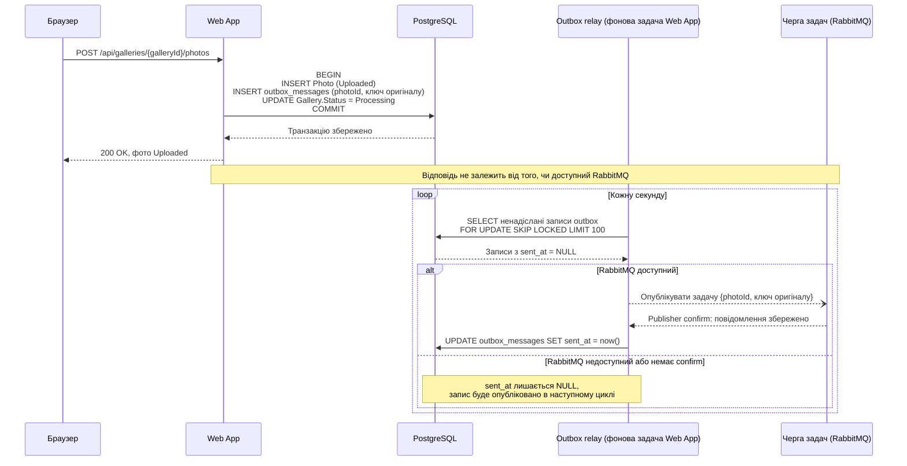

# CS-202: збереження фото й постановка задачі в чергу

**Зона:** B. **Авторка:** Альона. **Патерн:** Транзакційний outbox (Transactional Outbox).

## Ситуація

Фотограф завантажує пакет фото. Для кожного прийнятого файлу Web App має зробити дві речі: зберегти `Photo` зі статусом `Uploaded` у PostgreSQL і поставити задачу на обробку в Чергу задач RabbitMQ (FR-201). Це дві різні системи, і спільної транзакції між ними немає.

## Проблема

Хоч у якому порядку виконувати два записи, збій між ними залишає систему в неузгодженому стані:
- **Спершу база, потім черга.** Web App зберіг `Photo` і впав (або RabbitMQ тимчасово недоступний) до публікації задачі. Фото назавжди лишається в `Uploaded`: задачі немає, Worker про нього не знає. Галерея застрягає в `Processing`, і фотограф не може її фіналізувати (FR-106).
- **Спершу черга, потім база.** Задачу опубліковано, а транзакція в PostgreSQL відкотилася. Worker обробляє фото, якого немає в базі, і створює в MinIO прев'ю, на яке ніщо не посилається.

## Патерн

**Транзакційний outbox (Transactional Outbox).** Повідомлення не надсилається в брокер одразу, а записується в окрему таблицю бази (outbox) **у тій самій локальній транзакції**, що й бізнес-дані. Окремий фоновий процес (relay) читає з outbox ще не надіслані повідомлення, публікує їх у брокер і позначає як надіслані. Так «зберегти дані» і «запланувати повідомлення» стають однією атомарною операцією бази.

Джерела: [microservices.io — Transactional outbox](https://microservices.io/patterns/data/transactional-outbox.html), [RabbitMQ — Publisher Confirms](https://www.rabbitmq.com/docs/confirms#publisher-confirms).

## Sequence-діаграма

Показано запит на завантаження і фоновий relay у Web App, зокрема випадок, коли RabbitMQ недоступний. Решту потоку див. у [флоу зони B](../04-architecture/flow-zone-b.md).

## Як застосовано в нашій системі

- **Компоненти:** Web App (обробник запиту й фоновий relay), PostgreSQL, Черга задач у RabbitMQ. Relay — це фонова задача Web App «публікація відкладених задач», уже згадана в [High-level Architecture](../03-srs/high-level-architecture.md). Worker нічого не змінює.
- **Дані:** таблиця `outbox_messages` з полями `id`, `type`, `payload` (JSON з `photoId` і ключем оригіналу), `created_at`, `sent_at`. Рядок `Photo`, рядок outbox і оновлення статусу галереї записуються однією транзакцією. Надіслані записи видаляються фоновим очищенням через кілька днів.
- **Перевірки:** relay раз на секунду вибирає до 100 записів із `sent_at = NULL`, публікує кожен і чекає підтвердження брокера (publisher confirm). Лише після підтвердження запис позначається як надісланий. Через `FOR UPDATE SKIP LOCKED` кілька копій Web App не беруть той самий запис одночасно. Ручний повтор обробки (FR-206) теж ставить задачу через outbox.
- **Гарантія та механізм:** якщо транзакцію з `Photo` збережено, задача на його обробку рано чи пізно потрапить у Чергу задач. Якщо транзакцію відкочено, задачі не буде. Першу половину забезпечує атомарність локальної транзакції PostgreSQL: обидва рядки або є, або їх немає. Другу — relay, який повторює публікацію, доки не отримає publisher confirm. Після збою: якщо relay упав між публікацією і `UPDATE sent_at`, задачу буде опубліковано ще раз. Це повторна доставка, яку безпечно обробляє Worker: прев'ю пишеться під тим самим ключем, а `PhotoPreview` створюється лише один (див. [CS-201](cs-201-competing-consumers.md)). Якщо недоступний RabbitMQ, записи накопичуються в outbox і публікуються після його відновлення (NFR-202).

## Компроміси

- **Чим платимо:**
  - **Затримка:** задача потрапляє в чергу не одразу, а в наступному циклі relay — до 1 секунди. Порівняно з обробкою фото це непомітно.
  - **Додаткові дані й навантаження:** окрема таблиця, її очищення і запит до бази щосекунди.
  - **Можливі дублікати:** гарантія at-least-once, а не exactly-once, тому споживачі мають бути ідемпотентними.
  - **Outbox не покриває MinIO:** оригінал записується в MinIO до транзакції. Якщо транзакцію відкочено, у MinIO лишається файл без `Photo`; такі файли прибирає фонове очищення.
- **Альтернативи:**
  - **Розподілена транзакція (2PC) між PostgreSQL і RabbitMQ:** RabbitMQ її не підтримує, а сам механізм складний і повільний.
  - **«Спершу черга, потім база»:** див. проблему вище, лишаються осиротілі прев'ю.
  - **Change Data Capture** (читання журналу змін PostgreSQL, наприклад Debezium): прибирає опитування таблиці, але потребує окремої інфраструктури, надмірної для прототипу.

## Зв'язок з іншими пунктами

| Пункт | Що саме |
|---|---|
| п.3 Вимоги | FR-201 (прийняте фото має задачу на обробку), FR-206 (ручний повтор), NFR-202 критерії 1–2 (збій Web App між збереженням і постановкою задачі, перезапуск RabbitMQ), [2.5 Assumptions and Dependencies](../03-srs/02-product-overview.md) — рядок RabbitMQ |
| п.4 Архітектура | [flow-zone-b.md](../04-architecture/flow-zone-b.md) — «запис про задачу в одній транзакції», [ADR-002](../04-architecture/adr/002-microservices.md) — узгодженість бази й черги, [High-level Architecture](../03-srs/high-level-architecture.md) — фонова публікація відкладених задач |
| п.5 API | `POST /api/galleries/{galleryId}/photos` і `POST /api/galleries/{galleryId}/photos/{photoId}/retry` ставлять задачі через outbox |
| п.6 | [CS-201](cs-201-competing-consumers.md) — ідемпотентна обробка повторних доставок на боці Worker |

## Перевірка результату (для захисту)

- **Як відтворити:** зупинити RabbitMQ (`docker stop rabbitmq`) і завантажити пакет із 50 фото. Потім запустити RabbitMQ знову. Окремо: примусово зупинити Web App (`docker kill`) під час роботи relay і запустити знову.
- **Очікуваний кінцевий стан:** поки RabbitMQ зупинений, завантаження успішне (200), фото мають статус `Uploaded`, а в `outbox_messages` 50 записів із `sent_at = NULL`. Після запуску RabbitMQ протягом кількох секунд усі записи отримують `sent_at`, задачі з'являються в Черзі задач, і всі 50 фото переходять у `Ready` або `Failed`. Після перезапуску Web App жодне фото не лишається в `Uploaded` без задачі.
- **Як перевірити, що проблему усунуто:** `SELECT count(*) FROM outbox_messages WHERE sent_at IS NULL` повертає 0 після відновлення; кожен `Photo` має відповідний запис в outbox; у RabbitMQ Management UI видно, що повідомлення з'явилися в Черзі задач після запуску брокера; у PostgreSQL рівно один `PhotoPreview` на кожне фото зі статусом `Ready`.
