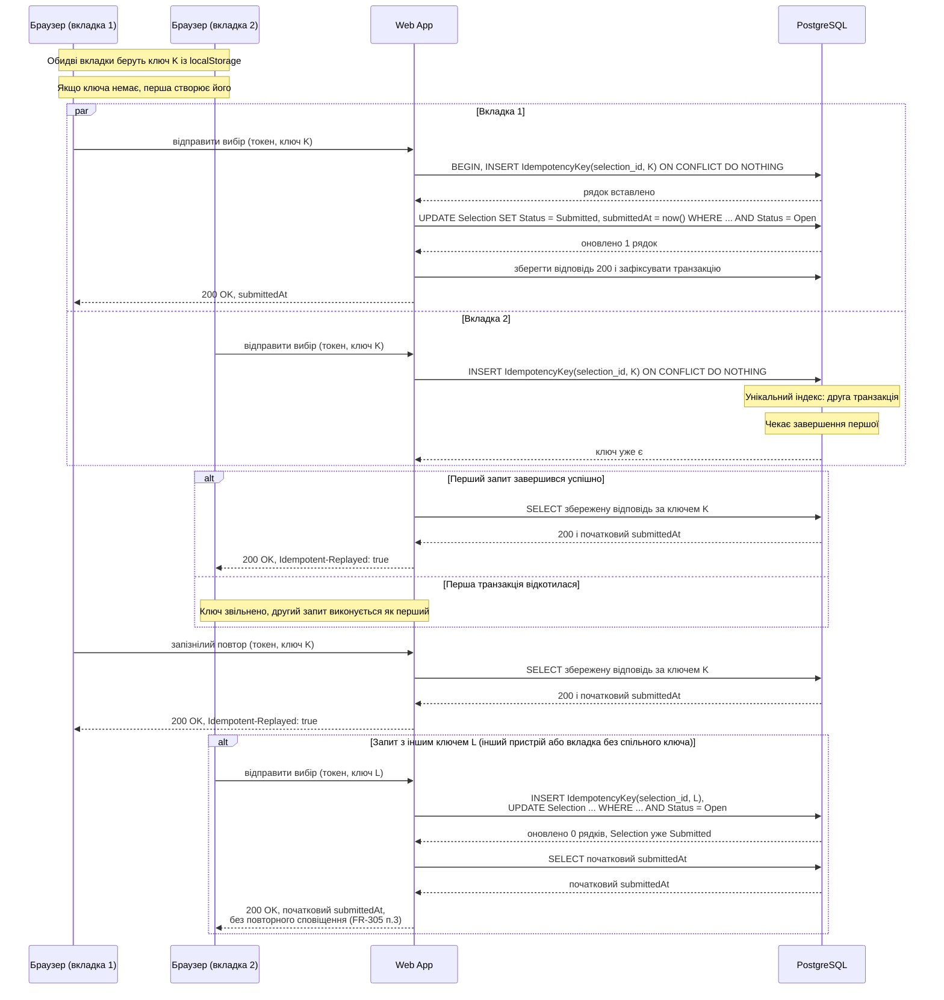

# CS-301: подвійна відправка вибору клієнта

**Зона:** C. **Авторка:** Уляна. **Патерн:** Ключ ідемпотентності (Idempotency Key).

## Ситуація

Клієнт відібрав у галереї фото й натиснув «Відправити вибір». Інтернет «задумався», відповіді немає, і він натиснув кнопку ще раз. Або клієнт відкрив ту саму галерею у двох вкладках і відправив вибір з обох майже одночасно. Потрібно, щоб вибір перейшов у `Submitted` рівно один раз, а повторна відправка повернула успішну відповідь із початковим часом відправки.

## Проблема

Без узгодженого захисту є чотири погані варіанти:
- **Нічого не робити.** Обидва запити побачать `Selection.Status = Open` і виконають відправку. Друга відправка перезапише `submittedAt`, у цільовій системі фотограф отримає два сповіщення, а лайк між двома відправками змінить уже відправлений вибір.
- **Блокувати кнопку на клієнті.** Це допомагає від подвійного кліку, але не від повторної відправки після обриву з'єднання («я не знаю, дійшло чи ні») і не від двох вкладок. Захист, який живе лише в браузері, сервер не гарантує.
- **Перевіряти на сервері «чи вже відправлено» окремим `SELECT`, а потім діяти.** Два одночасні запити обидва побачать `Selection.Status = Open` і обидва виконають відправку. Це класична гонка «перевірити, потім діяти».
- **Повертати помилку на повторний запит.** Клієнт, чия перша відповідь загубилась, побачить «помилка», хоча вибір насправді відправлено. Він не знає, що робити далі.

## Патерн

**Ключ ідемпотентності (Idempotency Key).** Клієнт генерує унікальний ключ для однієї логічної операції й передає його із запитом. Сервер зберігає ключ разом із результатом першого виконання. Якщо запит із тим самим ключем приходить знову, сервер не виконує операцію вдруге, а повертає збережений результат. У цій системі основну гарантію дає умовне оновлення `Selection` з `Open` на `Submitted`, а ключ є додатковим шаром: він зберігає відповідь і дозволяє точно відтворити результат того самого запиту.

Джерела: [Stripe — Idempotent requests](https://docs.stripe.com/api/idempotent_requests), [IETF draft — The Idempotency-Key HTTP Header Field](https://datatracker.ietf.org/doc/draft-ietf-httpapi-idempotency-key-header/), [PostgreSQL — INSERT … ON CONFLICT](https://www.postgresql.org/docs/current/sql-insert.html).

## Sequence-діаграма

Показано два одночасні запити з однаковим ключем і наступний запізнілий повтор. Клієнт передає токен, а API за ним знаходить відповідний `Selection`.

## Як застосовано в нашій системі

- **Компоненти:** клієнтська сторінка галереї, Web App (єдиний власник бази, як у [ADR-002](../04-architecture/adr/002-microservices.md)) і PostgreSQL. Окремих сервісів чи черг для цього сценарію не потрібно.
- **Дані:** таблиця `IdempotencyKey` з полями `key`, `selection_id`, `response_status`, `response_body`, `created_at` і унікальним обмеженням на `(selection_id, key)`. Клієнт працює через токен, тому Web App спочатку перевіряє токен і визначає `Selection`; `galleryId` клієнту не потрібен. Записи старші за 24 години чистяться фоновим завданням.
- **Перевірки на клієнті:** під час відкриття діалогу «Відправити вибір» клієнт бере ключ із `localStorage`, а якщо його немає — створює UUID і зберігає його. Усі вкладки того самого браузера читають той самий ключ. Ключ видаляється після успішної відповіді `200`, а для нової логічної операції створюється новий. Кнопка на час запиту блокується, але це лише зручність, а не гарантія.
- **Перевірки на сервері:** доступ дозволений лише за дійсним токеном відповідно до `NFR-301`. В одній транзакції Web App намагається вставити ключ і виконує `UPDATE Selection SET Status = 'Submitted', submittedAt = ... WHERE ... AND Status = 'Open'`. Якщо оновлено один рядок, це перша відправка: зберігається відповідь `200` із `submittedAt`, а цільова система отримує одне сповіщення. Якщо ключ уже є, сервер читає збережену відповідь і повертає її без змін із `Idempotent-Replayed: true`.
- **Одночасні запити:** коли два запити з одним ключем приходять разом, друга транзакція на унікальному обмеженні чекає завершення першої. Після успішного завершення вона отримує збережену відповідь; після відкату ключ звільняється, і другий запит виконується як перший.
- **Різні ключі:** якщо дві вкладки не поділили ключ, умовне оновлення другого запиту змінює 0 рядків, бо `Selection.Status` уже `Submitted`. Web App повертає `200 OK` із початковим `submittedAt` і не надсилає повторне сповіщення. Це правило працює також після очищення `IdempotencyKey` через 24 години.
- **Гарантія та механізм:** `Selection` переходить з `Open` у `Submitted` не більше одного разу, а `submittedAt` після цього не змінюється. Це забезпечує умовне оновлення в транзакції, а унікальне обмеження на `(selection_id, key)` додатково гарантує повторне відтворення відповіді для того самого ключа.

## Компроміси

- **Чим платимо:**
  - **Додаткова таблиця й запис у кожній відправці.** Для рідкісної дії (раз на галерею) це прийнятна ціна за відтворювану відповідь.
  - **Клієнт має керувати ключем:** читати його з `localStorage`, створювати лише за відсутності та видаляти після успіху. Помилка в цій логіці не порушує основну гарантію, бо її забезпечує умовне оновлення `Selection`.
  - **Збережена відповідь застаріває.** Після 24 годин ключ може бути видалений, але повтор все одно отримає `200` із початковим `submittedAt`, оскільки умовне оновлення `Selection` не змінить уже відправлений вибір.
  - **`localStorage` не спільний між браузерами й пристроями.** Такі запити не матимуть спільного ключа, але умовне оновлення запобігає повторній відправці та повторному сповіщенню.
- **Альтернативи:**
  - **Природна ідемпотентність** (`PUT` замість `POST`) не потрібна: відправка є фінальною операцією над наявним `Selection`, а її основну ідемпотентність уже дає умовне оновлення.
  - **Унікальне обмеження лише на `Selection`** не повернуло б результат першої операції клієнту. Обраний підхід повертає `200` із початковим `submittedAt`.
  - **Оптимістичне блокування** вирішує конфлікт змін одного ресурсу, а не повтор одного й того самого запиту, і розглянуте в CS-101.

## Зв'язок з іншими пунктами

| Пункт | Що саме |
|---|---|
| п.3 Вимоги | [FR-304](../03-srs/zone-c-client.md#fr-304-лайк-і-зняття-лайка) — вибір створює перший лайк; [FR-305](../03-srs/zone-c-client.md#fr-305-відправка-вибору) — відправка вибору; [NFR-301](../03-srs/zone-c-client.md#nfr-301-безпека-доступу-за-посиланням) — доступ лише за токеном |
| п.4 Архітектура | [flow-zone-c.md](../04-architecture/flow-zone-c.md); [ADR-002](../04-architecture/adr/002-microservices.md) — Web App єдиний власник бази |
| п.5 API | Маршрут за токеном фіксує API зони C. Запит містить токен і `Idempotency-Key`; успішна перша й повторна відправка повертають `200` із `submittedAt`. Можливі відповіді: `SELECTION_EMPTY`, `GALLERY_FINALIZED`, `SHARE_LINK_INVALID`. |

## Перевірка результату (для захисту)

- **Як відтворити:** відкрити галерею у двох вкладках і відправити вибір одночасно; окремо надіслати два паралельні запити з однаковим ключем; окремо надіслати два запити з різними ключами; повторити запит після успіху та після очищення ключа через 24 години.
- **Очікуваний кінцевий стан:** `Selection.Status = Submitted`, `submittedAt` встановлено один раз, фотограф отримав одне сповіщення. Обидва запити з однаковим ключем повернули `200` з однаковим `submittedAt`, другий — із `Idempotent-Replayed: true`. Запит з іншим ключем також повернув `200` із тим самим `submittedAt` і не спричинив повторного сповіщення.
- **Як перевірити, що проблему усунуто:** порівняти `submittedAt` до та після повторної відправки; перевірити в журналі цільової системи рівно одне сповіщення; у `IdempotencyKey` перевірити один рядок для пари `(selection_id, key)` зі статусом `200`; недійсний або відкликаний токен має повертати `SHARE_LINK_INVALID`, порожній вибір — `SELECTION_EMPTY`, а фіналізована галерея — `GALLERY_FINALIZED`.
