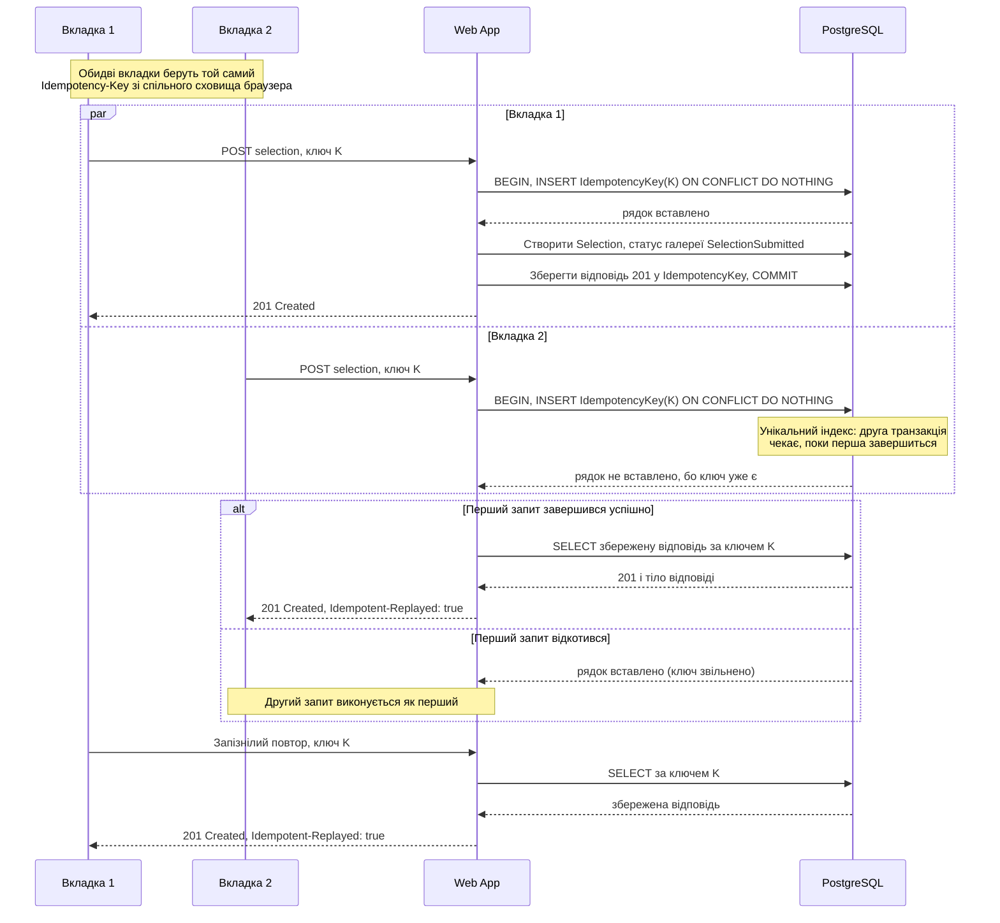

# CS-301: подвійна відправка вибору клієнта

**Зона:** C. **Авторка:** Уляна. **Патерн:** Ключ ідемпотентності (Idempotency Key).

## Ситуація

Клієнт відібрав у галереї фото й натиснув «Відправити вибір». Інтернет «задумався», відповіді немає, і він натиснув кнопку ще раз. Або він відкрив ту саму галерею у двох вкладках і відправив вибір з обох майже одночасно. Потрібно, щоб вибір зафіксувався рівно один раз, а другий запит отримав зрозумілу відповідь, а не помилку чи дубль.

## Проблема

Без узгодженого захисту є три погані варіанти:
- **Нічого не робити.** Обидва запити проходять, у БД з'являються два вибори, фотограф отримує два сповіщення «клієнт відправив вибір», а в списку відібраних можуть задвоїтися фото.
- **Блокувати кнопку на клієнті.** Це допомагає від подвійного кліку, але не від повторної відправки після обриву з'єднання («я не знаю, дійшло чи ні») і не від двох вкладок. Захист, який живе лише в браузері, сервер не гарантує.
- **Перевіряти на сервері «чи вже є вибір» окремим `SELECT`, а потім вставляти.** Два одночасні запити обидва побачать, що вибору немає, і обидва його створять. Це класична гонка «перевірити, потім діяти».
- **Повертати помилку на повторний запит.** Клієнт, чия перша відповідь загубилась, побачить «помилка», хоча вибір насправді збережено. Він не знає, що робити далі.

## Патерн

**Ключ ідемпотентності (Idempotency Key).** Клієнт генерує унікальний ключ для однієї логічної операції й передає його із запитом (заголовок `Idempotency-Key`). Сервер зберігає ключ разом з результатом першого виконання. Якщо запит із тим самим ключем приходить знову, сервер не виконує операцію вдруге, а повертає збережений результат. Для клієнта кілька однакових запитів поводяться як один.

Джерела: [Stripe — Idempotent requests](https://docs.stripe.com/api/idempotent_requests), [IETF draft — The Idempotency-Key HTTP Header Field](https://datatracker.ietf.org/doc/draft-ietf-httpapi-idempotency-key-header/), [PostgreSQL — INSERT … ON CONFLICT](https://www.postgresql.org/docs/current/sql-insert.html).

## Sequence-діаграма

Показано два одночасні запити з однаковим ключем (дві вкладки або повторний клік) і наступний запізнілий повтор.

## Як застосовано в нашій системі

- **Компоненти:** клієнтська сторінка галереї, Web App (єдиний власник бази, як у [ADR-002](../04-architecture/adr/002-microservices.md)) і PostgreSQL. Окремих сервісів чи черг для цього сценарію не потрібно.
- **Дані:** таблиця `IdempotencyKey` з полями `key`, `gallery_id`, `request_hash`, `response_status`, `response_body`, `created_at` і унікальним обмеженням на `(gallery_id, key)`. Записи старші за 24 години чистяться фоновим завданням.
- **Перевірки на клієнті:** при відкритті діалогу «Відправити вибір» клієнт створює UUID і кладе його в `localStorage` під ключем, прив'язаним до галереї. Усі вкладки того самого браузера читають той самий ключ, тому дві вкладки відправляють однаковий `Idempotency-Key`. Ключ видаляється, коли отримано відповідь 2xx або 409 «вже відправлено». Якщо клієнт змінив вибір після невдалої спроби, створюється новий ключ. Кнопка на час запиту блокується, але це лише зручність, а не гарантія.
- **Перевірки на сервері:** в одній транзакції Web App виконує `INSERT INTO IdempotencyKey … ON CONFLICT (gallery_id, key) DO NOTHING`. Якщо рядок вставлено, це перше виконання: створюється вибір, статус галереї змінюється, відповідь зберігається в тому самому рядку, транзакція фіксується. Якщо рядок не вставлено, ключ уже був: сервер читає збережену відповідь і повертає її без змін, додаючи заголовок `Idempotent-Replayed: true`. Окремий `SELECT` перед вставкою не потрібен, бо саме унікальне обмеження атомарно вирішує, хто перший.
- **Одночасні запити:** коли два запити з одним ключем приходять разом, друга транзакція на вставці чекає завершення першої (так працює унікальний індекс у PostgreSQL). Тому окремого стану «у процесі» і відповіді «спробуйте пізніше» не потрібно. Якщо перша транзакція відкотилась, ключ вільний, і друга виконується як перша.
- **Той самий ключ з іншим вмістом:** сервер порівнює `request_hash` (хеш відсортованого списку `photoId`). Якщо він відрізняється від збереженого, повертається `422 Unprocessable Entity` з повідомленням, що ключ уже використано з іншим запитом.
- **Запасний захист від різних ключів:** якщо дві вкладки все ж створили різні ключі (наприклад, один браузерний профіль у приватному режимі), спрацьовує бізнес-правило. Перехід `AwaitingSelection → SelectionSubmitted` виконується умовним оновленням `UPDATE Gallery SET status = 'SelectionSubmitted' WHERE id = ? AND status = 'AwaitingSelection'`. Якщо оновлено 0 рядків, запит отримує `409 Conflict` з текстом «Вибір уже відправлено» і часом відправки. Вибір створюється лише в разі успішного оновлення, тож дубль неможливий навіть без ключа.
- **Гарантія та механізм:** вибір для галереї фіксується рівно один раз, а кожен повторний запит дістає зрозумілу відповідь: ту саму успішну (за ключем) або `409` з поясненням (без ключа). Це забезпечують унікальне обмеження на `(gallery_id, key)` і умовне оновлення статусу, а не перевірки в коді застосунку.

## Компроміси

- **Чим платимо:**
  - **Додаткова таблиця й запис у кожній відправці.** Для рідкісної дії (раз на галерею) це непомітно.
  - **Клієнт має керувати ключем:** генерувати, зберігати, видаляти. Помилка в цій логіці (наприклад, новий ключ на кожен клік) зводить патерн нанівець, тому запасний захист зі статусом обов'язковий.
  - **Збережена відповідь застаріває.** Повтор через добу вже не знайде ключа, і клієнт отримає `409`, а не `201`. Для цього сценарію це прийнятно.
  - **`localStorage` не спільний між браузерами й пристроями.** Дві різні машини з одним посиланням покриває лише запасний захист, а не ключ.
- **Альтернативи:**
  - **Природна ідемпотентність** (`PUT /selection` замість `POST`) хороша, коли вибір можна перезаписувати. У нас відправка фінальна й запускає сповіщення фотографу, тому одного лише `PUT` недостатньо.
  - **Унікальне обмеження лише на `Selection(gallery_id)`** теж не дасть створити дубль, але другий запит отримає помилку, а не результат першого, і клієнт, що втратив відповідь, не дізнається, чи все вдалося.
  - **Оптимістичне блокування** вирішує конфлікт змін одного ресурсу, а не повтор одного й того самого запиту, і розглянуте в CS-101.

## Зв'язок з іншими пунктами

| Пункт | Що саме |
|---|---|
| п.3 Вимоги | FR-305 (відправка вибору клієнтом) |
| п.4 Архітектура | [flow-zone-c.md](../04-architecture/flow-zone-c.md); [ADR-002](../04-architecture/adr/002-microservices.md) — Web App єдиний власник бази |
| п.5 API | `POST /api/galleries/{galleryId}/selection` приймає заголовок `Idempotency-Key`; відповіді `201`, `409`, `422`.  |

## Перевірка результату (для захисту)

- **Як відтворити:** відкрити галерею у двох вкладках і відправити вибір одночасно; окремо надіслати два паралельні запити з однаковим ключем (наприклад, `curl … & curl … &`); окремо надіслати два запити з різними ключами; ще окремо повторити запит після успіху.
- **Очікуваний кінцевий стан:** для галереї існує рівно один `Selection`, статус галереї `SelectionSubmitted`, фотограф отримав одне сповіщення. Обидва запити з однаковим ключем повернули `201` з однаковим тілом (другий з `Idempotent-Replayed: true`). Запит з іншим ключем повернув `409` «Вибір уже відправлено». Той самий ключ з іншим списком фото повернув `422`.
- **Як перевірити, що проблему усунуто:** `SELECT count(*) FROM Selection WHERE gallery_id = ?` повертає 1; у `IdempotencyKey` для цього ключа один рядок із `response_status = 201`; у журналах Web App видно, що другий запит не створював вибір, а віддав збережену відповідь.