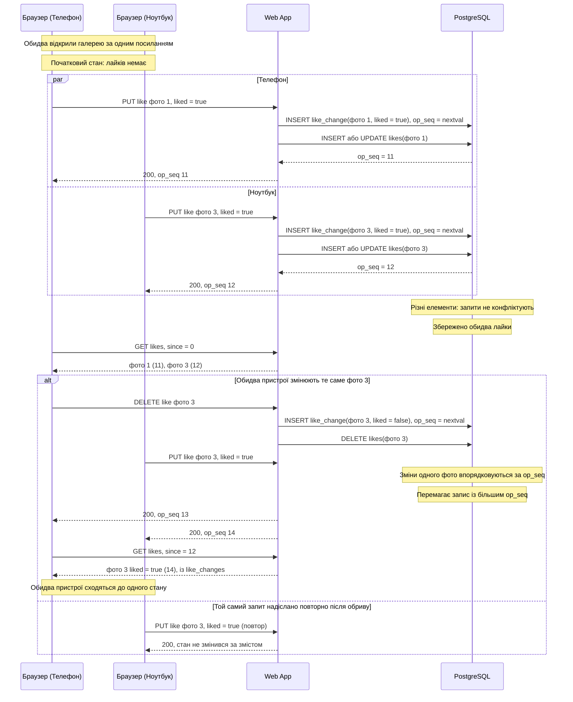

# CS-302: лайки з двох пристроїв не затирають одне одного

**Зона:** C. **Авторка:** Уляна. **Патерн:** LWW-множина (LWW-Element-Set, різновид CRDT).

## Ситуація

Клієнт відкрив галерею на телефоні й ставить лайки. Його партнер відкрив те саме посилання на ноутбуці й теж ставить лайки. Лайки в галереї спільні: це одна множина вибраних фото. Потрібно, щоб лайки з обох пристроїв збереглися, а ніхто нічого не загубив лише тому, що діяв одночасно з іншим.

## Проблема

Без узгодженого способу об'єднання є чотири погані варіанти:
- **Пристрій надсилає весь список лайків** (`PUT` повної множини). Телефон надсилає `[1, 2]`, ноутбук, який цього не бачив, надсилає `[3]`. Хто прийшов останнім, той затер іншого, і фото 1 та 2 втрачено.
- **Сервер читає список, додає й записує назад** (`SELECT`, потім `UPDATE`). Два запити читають однаковий старий список, кожен дописує своє, і один запис перекриває другий. Це та сама втрата лайка, тільки на сервері.
- **Перемикач «лайк/зняти лайк»** (`toggle`). Повторний запит після обриву з'єднання перемикає стан назад, і лайк зникає. До того ж два пристрої, що бачать різний стан, перемикають його в різні боки.
- **Блокувати всю галерею на час запису.** Це серіалізує всі лайки, а пристрій без мережі однаково не може взяти блокування.

## Патерн

**LWW-множина (Last-Writer-Wins Element Set).** Множину лайків зберігають не як один список, а як набір незалежних елементів, у кожного з яких є стан («є» або «знято») і порядковий номер останньої прийнятої зміни. Пристрої надсилають не весь список, а окрему операцію над одним елементом: «фото 5 лайкнуте» або «зняти лайк із фото 5». Web App призначає `op_seq` у PostgreSQL під час прийняття операції; у цій реалізації це порядок прийняття сервером, а не час на годиннику пристрою. Об'єднання змін виконується поелементно: для кожного фото перемагає запис із більшим `op_seq`. Така операція злиття комутативна, асоціативна й ідемпотентна, тож повторна доставка не змінює результат, а зміни різних елементів не конфліктують.

Джерела: [Shapiro et al. — A comprehensive study of Convergent and Commutative Replicated Data Types](https://inria.hal.science/inria-00555588/document), [crdt.tech — Resources](https://crdt.tech/), [PostgreSQL — INSERT … ON CONFLICT](https://www.postgresql.org/docs/current/sql-insert.html).

## Sequence-діаграма

Показано дві одночасні дії з різних пристроїв, а потім випадок, коли обидва чіпають те саме фото.

## Як застосовано в нашій системі

- **Компоненти:** клієнтська сторінка галереї на кожному пристрої, Web App (єдиний власник бази, як у [ADR-002](../04-architecture/adr/002-microservices.md)) і PostgreSQL. Брокер, окремі сервіси чи блокування галереї не потрібні.
- **Дані:** поточна таблиця `likes` має первинний ключ `(selection_id, photo_id)` і містить лише активні лайки. Для кожної зміни окремо append-only записується журнал `like_changes` з полями `selection_id`, `photo_id`, `liked`, `op_seq` і `created_at`. Запис `liked = false` у журналі зберігає факт зняття лайка після `DELETE` з `likes`, тому синхронізація не втрачає цю операцію.
- **API:** пристрій надсилає операцію над одним фото, а не весь список: `PUT /api/share-links/{token}/likes/{photoId}` для встановлення лайка і `DELETE /api/share-links/{token}/likes/{photoId}` для його зняття. Операція задає стан явно через метод HTTP, а не перемикає його, тому повтор безпечний.
- **Перший лайк:** `Selection` створюється першим лайком (FR-304 п.1), тому два пристрої можуть створювати його одночасно. На `Selection(gallery_id)` стоїть унікальне обмеження, а створення виконується як `INSERT … ON CONFLICT (gallery_id) DO NOTHING` з наступним читанням, тож обидва пристрої працюють з одним `Selection`.
- **Запис:** в одній транзакції Web App перевіряє `ShareLink`, `Gallery`, `Selection.Status` і `Photo.Status`, а потім отримує `op_seq` через `nextval('like_op_seq')`. Для `PUT` він записує `liked = true` у `like_changes` і створює або оновлює рядок у `likes`. Для `DELETE` він записує `liked = false` у `like_changes` і видаляє рядок із `likes`. Окремого читання перед записом немає; зняття відсутнього лайка завершується успішно без зміни поточної проекції.
- **Синхронізація:** пристрій періодично (і після кожної власної дії) викликає `GET /api/share-links/{token}/likes?since={останній op_seq}` і отримує записи `like_changes` після курсора. Клієнт зливає їх у локальний стан за тим самим правилом, що й сервер: для кожного фото лишається запис із більшим `op_seq`; `liked = false` видаляє фото з локальної множини. Повторне отримання тих самих змін нічого не ламає.
- **Гарантія та механізм:** зміни різних фото не конфліктують і зберігаються обидві; зміни того самого фото детерміновано завершуються одним значенням на всіх пристроях. Це забезпечують журнал `like_changes`, поточна проекція `likes`, унікальний ключ `(selection_id, photo_id)` і порівняння за `op_seq`, а не перевірки в коді застосунку.
- **Межі сценарію:** що буде з лайками, коли фотограф закриває галерею, ця історія не розглядає. Вона зачіпає стан галереї із зони A і розглянута окремо (CS-101, оптимістичне блокування). Запис лайка після відправки, фіналізації чи відкликання посилання відхиляє Web App за FR-304 п.3.

## Компроміси

- **Чим платимо:**
  - **Перемагає той, хто досяг сервера пізніше, а не той, хто натиснув пізніше.** Якщо ноутбук був офлайн і надіслав стару дію вже після нової дії з телефона, стара дія переможе. Для лайків це прийнятно, бо ціна помилки мала, а користувач легко виправить.
  - **Журнал змін накопичується.** Операції `PUT` і `DELETE` залишаються в `like_changes` для синхронізації. Для однієї галереї це сотні рядків, тому окремого очищення не потрібно, а при видаленні галереї вони зникають разом із нею.
  - **Не втрачається нічого, але й «розумного» злиття немає.** Якщо двоє одночасно по-різному вирішили долю того самого фото, лишається одне рішення, а не компроміс.
  - **Потрібна синхронізація на клієнті.** Без періодичного `GET likes` пристрій не побачить лайків партнера до перезавантаження сторінки.
- **Альтернативи:**
  - **Оптимістичне блокування** з номером версії всієї множини (CS-101) виявило б конфлікт, але змусило б пристрій, що програв, повторювати операцію. Для лайків, які легко комбінуються, це зайва робота.
  - **Песимістичне блокування галереї** (`SELECT … FOR UPDATE`) серіалізує всі лайки й не допомагає пристрою без мережі.
  - **Повний OR-Set** з унікальними мітками для кожного додавання дозволяє «додавання перемагає» без залежності від порядку, але для лайків із явним станом він складніший без помітної користі.
  - **Подія «лайк» у журналі подій** (event sourcing) дає повну історію, але для однієї булевої ознаки на фото це надмірно.

## Зв'язок з іншими пунктами

| Пункт | Що саме |
|---|---|
| п.3 Вимоги | [FR-304](../03-srs/zone-c-client.md) п.1 (лайки з двох пристроїв не перезаписують один одного), п.2 (повторний лайк не створює дубліката, зняття відсутнього лайка успішне), п.3 (відмови після `Submitted`, фіналізації чи недійсного посилання); NFR-302 п.5 (швидка реакція на лайк, відкат при помилці); FR-303 п.3 (лічильник «Обрано: N з M»); FR-307 і NFR-301 (недійсне посилання, токен не потрапляє в базу й журнали) |
| п.4 Архітектура | use case-фрагмент зони C у [zone-c-client.md](../03-srs/zone-c-client.md), [ADR-002](../04-architecture/adr/002-microservices.md) — Web App єдиний власник бази |
| п.5 API | `PUT /api/share-links/{token}/likes/{photoId}`, `DELETE /api/share-links/{token}/likes/{photoId}` і `GET /api/share-links/{token}/likes?since=` (шляхи за [конвенцією](../05-api/conventions.md)). Помилки у форматі Problem Details: `404 PHOTO_NOT_FOUND` (однакова для чужого й неіснуючого фото), `404 SHARE_LINK_INVALID`, `409 SELECTION_ALREADY_SUBMITTED` і `GALLERY_FINALIZED`, `429 RATE_LIMIT_EXCEEDED` з `Retry-After`. `instance` містить `{token}`, а не сам токен |
| Інші сценарії п.6 | CS-301 (ключ ідемпотентності) захищає від повтору однієї відправки, а тут різні запити з різних пристроїв мають зберегтися разом; CS-101 (оптимістичне блокування) покриває конфлікт зі станом галереї |

## Перевірка результату (для захисту)

- **Як відтворити:** відкрити одну галерею у двох браузерах (або у звичайному й приватному вікні). Одночасно лайкнути різні фото (наприклад, `curl` двома паралельними командами). Окремо одночасно змінити те саме фото з протилежними значеннями. Окремо повторити той самий `PUT` двічі. Окремо вимкнути мережу на одному пристрої, поставити лайк, увімкнути мережу.
- **Очікуваний кінцевий стан:** після паралельних лайків різних фото в `likes` є обидва рядки. Після конфлікту на одному фото в `likes` є не більше одного рядка, а обидва пристрої після синхронізації показують однакове значення, що відповідає більшому `op_seq`. Повторний `PUT` не створює другого активного лайка й не змінює результату. Після `DELETE` рядок активного лайка відсутній у `likes`, а в `like_changes` є запис `liked = false`.
- **Як перевірити, що проблему усунуто:** `SELECT photo_id, op_seq FROM likes WHERE selection_id = ?` показує лише активні лайки; `SELECT photo_id, liked, op_seq FROM like_changes WHERE selection_id = ? ORDER BY op_seq` містить і встановлення, і зняття лайка; `GET likes?since=0` на обох пристроях повертає однаковий результат; у журналах Web App видно, що операції виконувались у транзакції без попереднього `SELECT`.