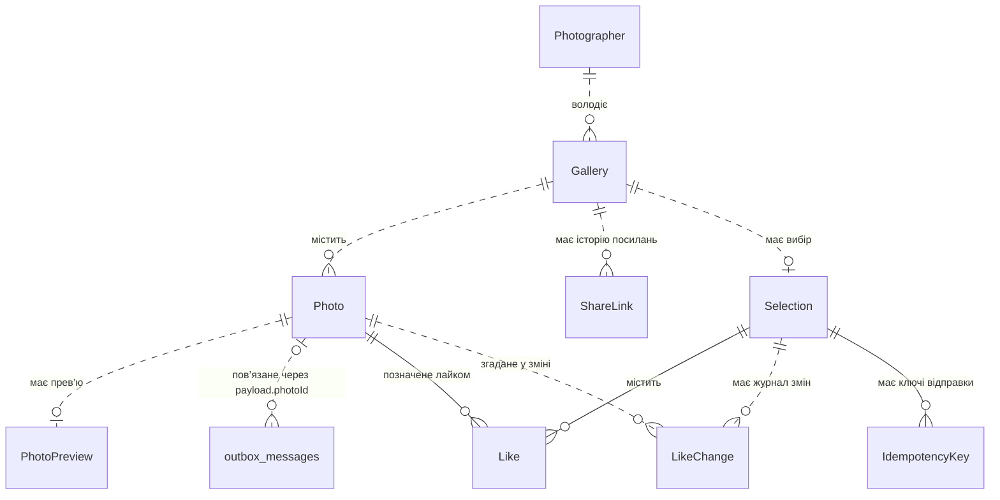

# П.7 Модель даних

Зведена модель PicPick об’єднує акаунти й галереї, завантаження й обробку фото, доступ клієнта й вибір. Рядки зберігаються в PostgreSQL, оригінали й прев’ю — у MinIO. Назви предметних сутностей узято з [глосарія](../glossary.md).

## ER-діаграма

Діаграма показує зв’язки предметних сутностей і службових записів, описаних у моделях зон. Поля, ключі та індекси наведено в описах нижче.

- Кожна галерея належить одному фотографу. Історія може містити кілька `ShareLink`, з яких одночасно діє щонайбільше один. `Selection` належить галереї та зберігається при заміні посилання.
- `Like` має складений ключ із `selection_id` і `photo_id`. У межах галереї на фото припадає щонайбільше один активний лайк, бо вибір один, а Web App перевіряє належність фото до цієї галереї. Журнал `LikeChange` може містити багато змін того самого фото.
- Зв’язок `outbox_messages` із фото логічний, через `payload.photoId`. Запис може існувати після видалення фото. Інші зв’язки на діаграмі мають зовнішні ключі. Службові таблиці Identity описані в [моделі зони A](entities-zone-a.md#1-як-використовуємо-identity).

## Сутності й службові записи

| Назва | Зона | Призначення | Опис |
|---|---|---|---|
| `Photographer` | A | Акаунт фотографа, якому належать галереї | [Photographer](entities-zone-a.md#photographer) |
| `Gallery` | A | Фото однієї зйомки, її стан і термін дії | [Gallery](entities-zone-a.md#gallery) |
| `Photo` | B | Метадані оригіналу та стан його обробки | [Photo](entities-zone-b.md#photo) |
| `PhotoPreview` | B | Метадані прев’ю з вотермаркою для одного фото | [PhotoPreview](entities-zone-b.md#photopreview) |
| `outbox_messages` | B | Службові записи для надійної постановки задач обробки в чергу | [Outbox](entities-zone-b.md#outbox_messages) |
| `ShareLink` | C | Приватне посилання на галерею, для якого в базі зберігається хеш токена | [ShareLink](entities-zone-c.md#sharelink) |
| `Selection` | C | Поточний або відправлений вибір клієнта в галереї | [Selection](entities-zone-c.md#selection) |
| `Like` | C | Активна позначка обраного фото у виборі | [Like](entities-zone-c.md#like) |
| `LikeChange` | C | Службовий запис зміни лайка в таблиці `like_changes` для синхронізації пристроїв | [Журнал змін лайків](entities-zone-c.md#like_changes-журнал-змін-лайків) |
| `IdempotencyKey` | C | Службовий запис для повтору відправки вибору з тією самою відповіддю | [IdempotencyKey](entities-zone-c.md#idempotencykey) |

## Строки зберігання

«Разом із галереєю» означає фізичне видалення до 24 год після `ExpiresAt` або запиту видалення галереї чи акаунта, залежно від того, що настане раніше. Доступ закривається в момент цієї події. [Політика зберігання](retention-policy.md#5-строки-зберігання)

| Зона | Дані | Клас | Фізичне видалення |
|---|---|---|---|
| A | `Photographer` і службові записи Identity | Email і нікнейм — персональні, хеш пароля — конфіденційний | До 24 год після запиту видалення акаунта, після очищення його галерей |
| A | `Gallery` | Назва — персональні дані, доступні за посиланням, службові поля — внутрішні | Разом із галереєю |
| B | `Photo`, `PhotoPreview` і файли в MinIO | Ім’я оригіналу й зображення — персональні, службові метадані — внутрішні | Разом із галереєю або до 24 год після запиту видалення окремого фото, якщо раніше |
| B | Надіслані `outbox_messages` | Внутрішні | Через 7 діб від `sent_at` |
| B | Файли, що стали сиротами в MinIO | Персональні | До 24 год від моменту, коли файл став сиротою |
| C | `ShareLink` | Хеш токена — конфіденційний, решта полів — внутрішні | Разом із галереєю. Відкликання чи завершення терміну самого посилання закриває доступ одразу |
| C | `Selection`, `Like` і `LikeChange` | Персональні | Разом із галереєю |
| C | `IdempotencyKey` | Тіло відповіді — персональні дані, ключ і службові поля — внутрішні | Через 24 год від створення або разом із галереєю, якщо раніше |

У цільовій системі резервні копії зберігаються 30 діб, журнал видалень — щонайменше 31 добу від запиту видалення чи `ExpiresAt`. Перед відкриттям доступу після відновлення повторно застосовуються видалення з журналу. [Резервні копії та журнал видалень](retention-policy.md#6-резервні-копії)

## Рішення щодо даних

- [Consensus](consensus.md) описує, як компоненти погоджують стан і відновлюються після відмов.
- [Batching і streaming](batching-streaming.md) описує роботу з пакетами фото й потоками файлів.
- [Consistency](consistency.md) визначає, яку узгодженість потребують операції трьох зон.
