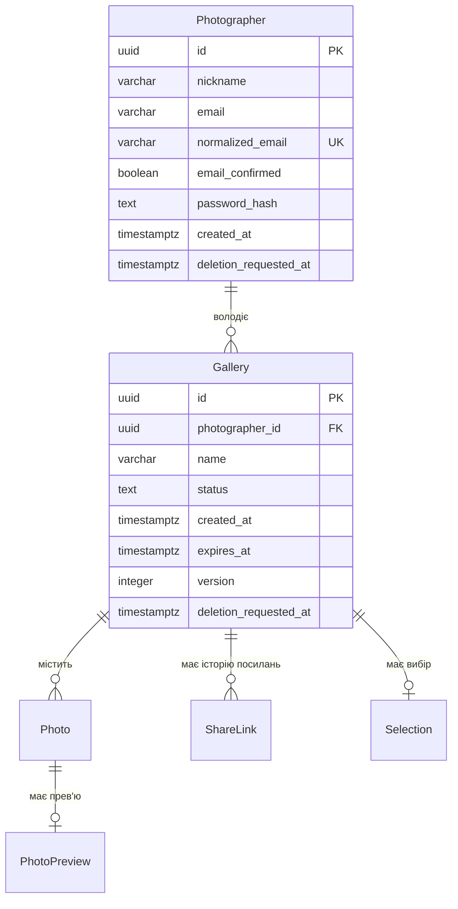

# Сутності зони A

Проєктна модель для PostgreSQL 16 та EF Core: у поточному прототипі акаунти й галереї ще не зберігаються в базі. Назви — за [глосарієм](../glossary.md), строки видалення — за [retention policy](retention-policy.md).

## 1. Як використовуємо Identity

`Photographer` розширює `IdentityUser<Guid>` і зберігається в одній таблиці `photographers`, яка замінює стандартну `AspNetUsers`. Email, пароль і підтвердження не дублюються в окремому профілі; додаються лише нікнейм, час створення та позначка запиту на видалення. Назви таблиць і колонок явно налаштовуються в EF Core у snake_case.

Повний `IdentityDbContext` містить сім таблиць: `AspNetUsers`, `AspNetUserClaims`, `AspNetUserLogins`, `AspNetUserTokens`, `AspNetRoles`, `AspNetRoleClaims`, `AspNetUserRoles`. Для PicPick обираємо `IdentityUserContext<Photographer, Guid>` без ролей: лишаються користувачі та три службові таблиці, перейменовані на `identity_user_claims`, `identity_user_logins`, `identity_user_tokens`. Власних claims, зовнішніх входів і збережених токенів у першій версії немає, тому ці таблиці порожні й у предметну ER-діаграму не входять; якщо записи з'являться, їх FK до Photographer має каскадне видалення.

Cookie входу зберігається в браузері, а не в `identity_user_tokens`; код підтвердження email та код скидання пароля створює й перевіряє штатний Data Protection token provider Identity, окремих рядків для них не потрібно. Строки 24 години та 1 година налаштовуються окремо за [Identity Management](../03-srs/identity.md).

Джерела: [модель Identity](https://learn.microsoft.com/en-us/aspnet/core/security/authentication/customize-identity-model?view=aspnetcore-8.0), вихідний код .NET 8: [IdentityUser](https://github.com/dotnet/aspnetcore/blob/v8.0.0/src/Identity/Extensions.Stores/src/IdentityUser.cs), [IdentityUserContext](https://github.com/dotnet/aspnetcore/blob/v8.0.0/src/Identity/EntityFrameworkCore/src/IdentityUserContext.cs).

## 2. Сутності

### Photographer

**Що це:** акаунт фотографа для входу та володіння галереями. Таблиця: `photographers`.

| Поле | Тип (PostgreSQL) | Обмеження | Опис |
|---|---|---|---|
| `id` | `uuid` | PK | Ідентифікатор `IdentityUser<Guid>` |
| `nickname` | `varchar(50)` | NOT NULL, 1–50 символів після Trim | Неунікальне відображуване ім'я, не логін (FR-101) |
| `email` | `varchar(256)` | NOT NULL | Збережена адреса фотографа, приватна |
| `normalized_email` | `varchar(256)` | NOT NULL, UNIQUE | Нормалізований Identity email для пошуку та унікальності без урахування регістру |
| `email_confirmed` | `boolean` | NOT NULL, default false | Без підтвердження вхід заборонений (FR-110) |
| `user_name` | `varchar(256)` | NOT NULL | Технічне поле Identity, дорівнює email, не нікнейму |
| `normalized_user_name` | `varchar(256)` | NOT NULL, UNIQUE | Нормалізоване технічне ім'я, дорівнює `normalized_email` |
| `password_hash` | `text` | NOT NULL | Штатний хеш Identity, не відкритий пароль (NFR-101) |
| `security_stamp` | `text` | NOT NULL | Змінюється при скиданні пароля й відкликанні всіх сесій |
| `concurrency_stamp` | `text` | NOT NULL, concurrency token EF Core | Захист одночасних змін акаунта, не версія Gallery |
| `phone_number` | `text` | NULL | Стандартне поле Identity, у PicPick не заповнюється |
| `phone_number_confirmed` | `boolean` | NOT NULL, default false | Телефон не використовується |
| `two_factor_enabled` | `boolean` | NOT NULL, default false | Двофакторний вхід у вимогах не передбачений |
| `lockout_end` | `timestamptz` | NULL | Блокування Identity не застосовується |
| `lockout_enabled` | `boolean` | NOT NULL, default false | Вимкнено явно: від перебору захищає rate limiting |
| `access_failed_count` | `integer` | NOT NULL, default 0 | Поле Identity, лічильник блокування не ведеться |
| `created_at` | `timestamptz` | NOT NULL, default `now()` | Час реєстрації в UTC |
| `deletion_requested_at` | `timestamptz` | NULL | Початок незворотного видалення акаунта; від нього рахуємо 24 години |

**Зв'язки:** Photographer 1 → 0..N Gallery. `Gallery.photographer_id` має `ON DELETE RESTRICT`: акаунт фізично видаляється після очищення його галерей, а не раніше.

**Індекси:** UNIQUE `normalized_email` гарантує FR-101 навіть за двох одночасних реєстрацій; стандартний UNIQUE `normalized_user_name` залишається для Identity. Нікнейм не індексується як унікальний. Унікальність email у БД налаштовується явно: стандартний індекс Identity для email неунікальний.

**Retention:** email і нікнейм — персональні, хеш пароля й security stamp — конфіденційні; строки наведено нижче.

**Видалення й сесії:** після перевірки пароля Web App записує `deletion_requested_at`, змінює `security_stamp` і припиняє видавати нові сесії. На кожному захищеному запиті фотографа перевіряються чинність stamp та відсутність позначки видалення; стандартного періодичного інтервалу перевірки cookie недостатньо для негайного відкликання. Доступ клієнта за ShareLink також перевіряє позначку видалення власника галереї, але cookie Identity клієнт не має. Очищення видаляє всі галереї та файли, далі службові записи Identity й Photographer до 24 годин; після збою повторює незавершені дії. Строки cookie 8 годин / 14 діб залишаються в захищеному квитку Identity, окрема таблиця сесій не вводиться.

### Gallery

**Що це:** набір фото однієї зйомки, що належить фотографу. Таблиця: `galleries`.

| Поле | Тип (PostgreSQL) | Обмеження | Опис |
|---|---|---|---|
| `id` | `uuid` | PK | Ідентифікатор галереї |
| `photographer_id` | `uuid` | FK → Photographer, NOT NULL, `ON DELETE RESTRICT` | Власник, визначений сервером |
| `name` | `varchar(100)` | NOT NULL, 1–100 символів після Trim | Назва галереї (FR-103) |
| `status` | `text` | NOT NULL, default `Draft`, CHECK: `Draft`, `Processing`, `Ready`, `Shared`, `Finalized`, `Expired` | Стан за глосарієм |
| `created_at` | `timestamptz` | NOT NULL, default `now()` | Створення в UTC, задається сервером |
| `expires_at` | `timestamptz` | NOT NULL, CHECK `expires_at > created_at AND expires_at <= created_at + interval '720 hours'` | Термін дії, після якого доступ закрито (FR-108) |
| `version` | `integer` | NOT NULL, default 0, CHECK `version >= 0`, concurrency token EF Core | Версія для оптимістичного блокування CS-101 |
| `deletion_requested_at` | `timestamptz` | NULL | Запит ручного видалення; новий статус Gallery не вводиться |

Web App обрізає крайні пробіли, а CHECK для `nickname` та `name` перевіряє довжину й відхиляє порожній після обрізання рядок. Строк `expires_at` перевіряється і за поточним серверним часом при створенні. На кожному запиті `expires_at <= now` означає `Expired`, навіть якщо фоновий запис статусу ще не відбувся.

**Зв'язки:** Gallery 1 → 0..N Photo; Gallery 1 → 0..N ShareLink (історія, не більше одного `Active`); Gallery 1 → 0..1 Selection. Фото, посилання й вибір посилаються на Gallery, їхні поля та каскадне видалення визначають зони B/C; PhotoPreview пов'язаний із Gallery через Photo.

**Індекси:** `(photographer_id, created_at DESC, id)` — список власних галерей (FR-104); `(expires_at)` — пошук прострочених для очищення; частковий `(deletion_requested_at) WHERE deletion_requested_at IS NOT NULL` — черга ручного видалення. Окремий індекс `version` не потрібний: умовне оновлення шукає Gallery за PK.

**Лічильники:** `photoCount` та кількість `Ready`/`Failed`/незавершених фото рахуються запитом до Photo. Це не дублює стан і відповідає CS-101; ціна — додатковий COUNT на читання та обробку події. Збережені лічильники прискорили б читання, але вимагали б атомарного оновлення при кожному завантаженні, видаленні та повторі. Поки їх не вводимо; для підрахунків зона B передбачає індекс `(gallery_id, status)` ([модель зони B](entities-zone-b.md)).

**Версія:** збільшується в тій самій транзакції при зміні набору чи стану фото, статусу або позначки видалення Gallery, навіть коли статус лишається `Processing`. Оновлення перевіряє стару версію; конфлікт відкочує всю транзакцію, включно зі зміною Photo, і повторює її за [CS-101](../06-concurrency/cs-101-gallery-status.md).

**Retention:** назва може містити ім'я клієнта, тому це персональні дані, доступні за чинним ShareLink; статус, версія та дати — внутрішні. Ручне видалення одразу закриває доступ через `deletion_requested_at`; рядок із даними для очищення зберігається лише до його завершення, без відновлення. Для строку очищення береться раніший із `expires_at` і запиту на видалення; видалення акаунта теж може скоротити цей строк.

## 3. Дані вибору лідера

У [CS-102](../06-concurrency/cs-102-expired-gallery-cleanup.md) використано сесійний `pg_try_advisory_lock` з одним сталим `cleanupKey`. Це стан блокування PostgreSQL, а не рядок таблиці: `leader_id`, heartbeat і таблиця лідерів не потрібні. Після завершення сесії роль звільняється; між проходами нічого не зберігається. Особливості відмов описано в [consensus.md](consensus.md).

## 4. ER-фрагмент зони A

Сутності B/C показано лише назвами. Для Photographer наведено основні поля акаунта; повний набір полів Identity залишається в таблиці опису вище. Службові таблиці Identity не є сутностями продукту.

## 5. Класифікація retention

| Сутність / поле | Клас | Термін | Від чого рахується | Що потім |
|---|---|---|---|---|
| Photographer: email, normalized_email, user_name, normalized_user_name | Персональні | Поки існує акаунт, після запиту видалення — до 24 год | Запит на видалення акаунта | Фізичне видалення після очищення галерей |
| Photographer.nickname | Персональні, доступні за посиланням | Як акаунт | Запит на видалення акаунта | Фізичне видалення, доступ клієнта закрито одразу |
| Photographer.password_hash, security_stamp | Конфіденційні | Як акаунт | Запит на видалення акаунта | Сесії відкликаються одразу, поля видаляються з акаунтом |
| Решта службових полів Photographer і записи Identity, якщо є | Внутрішні; секрети — конфіденційні | Як акаунт | Запит на видалення акаунта | Фізичне видалення, зокрема каскадом службових записів |
| Gallery.name | Персональні, доступні за посиланням | До найранішого зі строків: `expires_at + 24 год`, запит видалення галереї/акаунта + 24 год | `expires_at` або відповідний запит | Фізичне видалення разом із галереєю |
| Решта полів Gallery | Внутрішні | Як Gallery.name | Як Gallery.name | Фізичне видалення з пов'язаними даними та файлами |

Доступ закривається одразу за запитом на видалення або при `expires_at`; його не подовжують повтори очищення. Дані інших галерей і фотографів не зачіпаються. Бекапи зберігаються 30 діб, журнал видалень — не менше 31 доби; перед відкриттям доступу після відновлення видалення застосовується повторно за [політикою, розділ 6](retention-policy.md#6-резервні-копії). Цей документ не вводить нових сутностей для глосарія.
