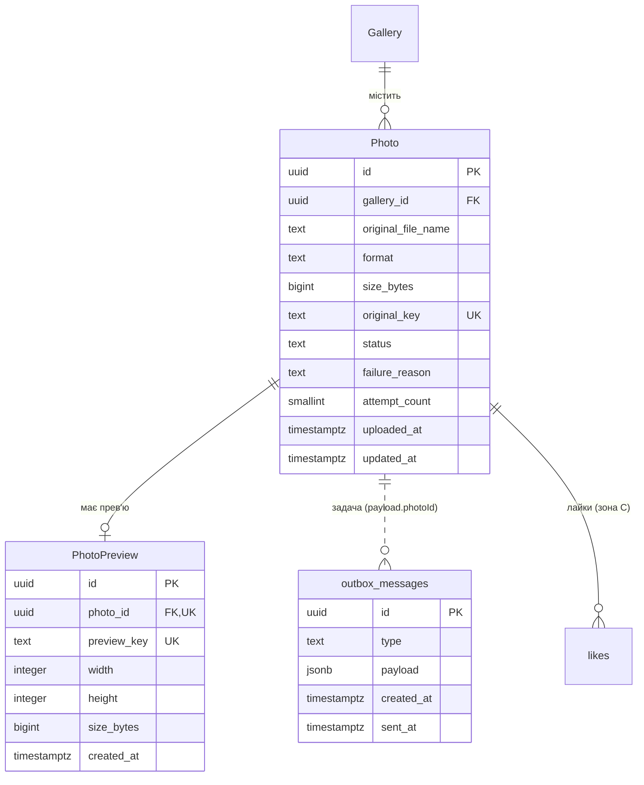

# Модель даних зони B: завантаження й обробка фото

Сутності, які створює й змінює зона B: оригінал фото, прев'ю і запис outbox для постановки задачі в чергу. Формат опису спільний для всіх зон; назви сутностей — як у [глосарії](../glossary.md), назви таблиць і полів — snake_case ([глосарій, розділ 7](../glossary.md#7-конвенції-іменування)). Класи даних і строки зберігання взято з [data retention policy](retention-policy.md).

## 1. Що зберігається в PostgreSQL, а що в MinIO

**Самі файли — лише в MinIO, у базі — лише їхні ключі й метадані.** MinIO — об'єктне сховище: файл у ньому знаходять за ключем, як за шляхом. Байти зображень у PostgreSQL не потрапляють: оригінал RAW важить до 150 МБ, і база з тисячами таких рядків повільно бекапилася б і відновлювалася.

| Що | Де | Ключ об'єкта в MinIO |
|---|---|---|
| Оригінал | MinIO, бакет `originals` | `{gallery_id}/{photo_id}` |
| Прев'ю | MinIO, бакет `previews` | `{gallery_id}/{photo_id}.jpg` |
| Ім'я файлу, розмір, формат, статус, причина `Failed` | PostgreSQL, `photos` | — |
| Розміри прев'ю, посилання на нього | PostgreSQL, `photo_previews` | — |

Ключ будується лише з ідентифікаторів, а не з імені файлу від користувача. Тому ім'я на кшталт `../../x.jpg` не впливає на розташування файлу (загроза T-204 у [threat model](../09-security/zone-b.md)), а повторна обробка того самого фото записує прев'ю під тим самим ключем ([CS-201](../06-concurrency/cs-201-competing-consumers.md)). Префікс `{gallery_id}/` дає змогу видалити всі файли галереї одним проходом за префіксом.

### Узгодженість бази і MinIO

Запис у PostgreSQL і запис у MinIO не входять в одну транзакцію, тож розбіжності можливі. Для кожної з них визначено, як вона виникає і що з нею робить система.

| Розбіжність | Коли виникає | Що робить система |
|---|---|---|
| Файл у MinIO є, рядка в базі немає | Оригінал збережено, а транзакцію з `Photo` відкочено ([CS-202](../06-concurrency/cs-202-transactional-outbox.md)); фото чи галерею видалено (FR-107, FR-207); Worker записав прев'ю для вже видаленого фото (FR-203, п.4) | Фонове очищення звіряє об'єкти з рядками й видаляє «сироти» до 24 год ([retention, розділ 5](retention-policy.md#5-строки-зберігання)). Об'єкти, молодші за 1 годину, пропускає, бо їхня транзакція може бути ще не завершена |
| Рядок `Photo` є, оригіналу немає | Файл втрачено чи видалено поза застосунком | Worker не може прочитати оригінал: після 3 спроб фото отримує `Failed` (FR-205). Архів оригіналів не формується, фотограф бачить помилку (FR-208, п.5) |
| Рядок `PhotoPreview` є, файлу прев'ю немає | Файл втрачено поза застосунком | Web App на запит прев'ю повертає 404; фотограф може видалити фото й завантажити ще раз. Автоматичного відновлення немає: у нормальній роботі `PhotoPreview` створюється лише після того, як файл записано |
| Файл прев'ю є, `PhotoPreview` ще немає | Worker записав файл, подію ще не оброблено | Нормальний проміжний стан: подія буде оброблена або доставлена повторно (NFR-202) |

**Порядок запису:** спершу файл у MinIO, потім рядок у базі. Тоді рядок ніколи не посилається на файл, якого ще не було, а можливий зайвий файл прибирає очищення.

**Порядок видалення:** спершу рядок у базі (доступ закривається одразу), потім файл (фонове очищення до 24 год). Тоді користувач не побачить рядка з битим файлом, а зайвий файл знову прибирає очищення.

## 2. Сутності

### Photo

**Що це:** оригінал фото, завантажений фотографом у галерею, і стан його обробки.

Таблиця: `photos`.

| Поле | Тип (PostgreSQL) | Обмеження | Опис |
|---|---|---|---|
| `id` | `uuid` | PK | Ідентифікатор фото; з нього будується ключ у MinIO |
| `gallery_id` | `uuid` | FK → Gallery, NOT NULL, `ON DELETE CASCADE` | Галерея, якій належить фото; власника фото визначає власник галереї |
| `original_file_name` | `text` | NOT NULL, довжина 1–255 | Ім'я файлу, як його завантажив фотограф. Показується в прогресі (FR-204) і використовується в архіві оригіналів (FR-208); для ключа в MinIO не використовується |
| `format` | `text` | NOT NULL, одне з: `jpeg`, `png`, `heic`, `raw` | Формат, визначений за вмістом файлу, а не за розширенням (FR-202) |
| `size_bytes` | `bigint` | NOT NULL, `CHECK (size_bytes > 0)` | Розмір оригіналу; межі 30 і 150 МБ перевіряє Web App до збереження (FR-202) |
| `original_key` | `text` | NOT NULL, UNIQUE | Ключ оригіналу в бакеті `originals` |
| `status` | `text` | NOT NULL, одне з: `Uploaded`, `Processing`, `Ready`, `Failed` | Стан обробки ([глосарій, Photo.Status](../glossary.md#4-статуси)) |
| `failure_reason` | `text` | NULL; `CHECK ((status = 'Failed') = (failure_reason IS NOT NULL))` | Коротка причина для фотографа, наприклад «Файл пошкоджено» (FR-205). Без стектрейсів і внутрішніх шляхів |
| `attempt_count` | `smallint` | NOT NULL, default 0, `CHECK (attempt_count BETWEEN 0 AND 3)` | Скільки спроб обробки вже виконано. Значення приходить у події від Worker; ручний повтор (FR-206) скидає його в 0 |
| `uploaded_at` | `timestamptz` | NOT NULL, default `now()` | Момент прийняття файлу; задає порядок у галереї й в архіві (FR-208) |
| `updated_at` | `timestamptz` | NOT NULL | Остання зміна статусу |

**Зв'язки:** Gallery 1 → N Photo; Photo 1 → 0..1 PhotoPreview; Photo 1 → N `outbox_messages` (логічний зв'язок через `payload`, без FK; див. нижче); Photo 1 → N `likes` зони C (`likes.photo_id`, [CS-302](../06-concurrency/cs-302-lww-element-set.md)).

**Індекси:**
- `(gallery_id, status)` — підрахунок прогресу «готово / помилка / в обробці» (FR-204) і перевірка, чи лишилися фото в `Uploaded` і `Processing`, перед переходом галереї в `Ready` (FR-203);
- `(gallery_id, uploaded_at, id)` — список фото галереї в порядку завантаження і порядок файлів в архіві (FR-208); `id` робить порядок однозначним, якщо час збігся;
- UNIQUE `original_key` — два рядки не можуть посилатися на один файл.

**Retention:** рядок — внутрішні дані, крім `original_file_name`: ім'я файлу може містити ім'я людини, тому це персональні дані. Оригінал у MinIO — персональні дані (фото людей). Строки — у [розділі 4](#4-класифікація-retention).

**Чого тут немає — EXIF.** Метадані (дата, камера, геолокація) в окремі поля не витягуються: жодна вимога їх не використовує, а геолокація — персональні дані, які довелося б окремо захищати й видаляти. В оригіналі EXIF лишається як частина файлу, бо оригінал зберігається без змін (FR-203, п.2); у прев'ю Worker його не копіює (загроза T-205).

**Чого тут немає — прапорця «оброблено».** Захист від повторної обробки дає не булеве поле, а унікальне обмеження в `photo_previews` (див. нижче). Поле `is_processed` не допомогло б: два Worker одночасно прочитали б `false`, і обидва записали б результат. Роль «оброблено чи ні» вже виконує `status`.

### PhotoPreview

**Що це:** зменшена копія фото з вотермаркою, яку бачить клієнт за посиланням.

Таблиця: `photo_previews`.

| Поле | Тип (PostgreSQL) | Обмеження | Опис |
|---|---|---|---|
| `id` | `uuid` | PK | Ідентифікатор прев'ю (`previewId` у запитах клієнта, [flow зони C](../04-architecture/flow-zone-c.md)) |
| `photo_id` | `uuid` | FK → Photo, NOT NULL, UNIQUE, `ON DELETE CASCADE` | Фото, з якого зроблено прев'ю |
| `preview_key` | `text` | NOT NULL, UNIQUE | Ключ прев'ю в бакеті `previews` |
| `width` | `integer` | NOT NULL, `CHECK (width BETWEEN 1 AND 1600)` | Ширина в пікселях |
| `height` | `integer` | NOT NULL, `CHECK (height BETWEEN 1 AND 1600)` | Висота в пікселях; довга сторона не більша за 1600 (FR-203) |
| `size_bytes` | `bigint` | NOT NULL, `CHECK (size_bytes > 0)` | Розмір файлу прев'ю |
| `created_at` | `timestamptz` | NOT NULL, default `now()` | Коли Web App обробив подію «прев'ю готове» |

**Зв'язки:** Photo 1 → 0..1 PhotoPreview. Прев'ю немає, поки фото не `Ready`, і в `Failed` (FR-203, п.3).

**Індекси:** UNIQUE `photo_id`. Це головне обмеження зони B: Web App вставляє прев'ю як `INSERT … ON CONFLICT (photo_id) DO NOTHING`, тому повторна подія від Worker не створює другого запису (FR-203, п.1; [CS-201](../06-concurrency/cs-201-competing-consumers.md)). Цей самий індекс пришвидшує пошук прев'ю за фото.

**Retention:** рядок — внутрішні дані; файл у MinIO — персональні дані, доступні за посиланням. Строки — у [розділі 4](#4-класифікація-retention).

### outbox_messages

**Що це:** задача на обробку фото, збережена в тій самій транзакції, що й `Photo`, яку фоновий relay згодом публікує в Чергу задач ([CS-202](../06-concurrency/cs-202-transactional-outbox.md)).

Службова таблиця, а не сутність предметної області, тому окремої назви в глосарії не має.

| Поле | Тип (PostgreSQL) | Обмеження | Опис |
|---|---|---|---|
| `id` | `uuid` | PK | Ідентифікатор запису |
| `type` | `text` | NOT NULL, одне з: `ProcessPhoto` | Тип повідомлення; поки один |
| `payload` | `jsonb` | NOT NULL | `{ "photoId": …, "originalKey": … }` — лише те, що потрібно Worker. Персональних даних немає |
| `created_at` | `timestamptz` | NOT NULL, default `now()` | Коли задачу створено; задає порядок публікації |
| `sent_at` | `timestamptz` | NULL | Коли брокер підтвердив прийняття; `NULL` — ще не надіслано |

**Зв'язки:** Photo 1 → N `outbox_messages`. Кілька записів на одне фото з'являються після ручного повтору (FR-206). Зв'язок логічний, через `payload.photoId`, без FK: запис outbox має пережити видалення фото, щоб relay не впав на ньому, а Worker, не знайшовши оригіналу, завершить задачу без результату (FR-207, п.2).

**Індекси:** частковий індекс `(created_at) WHERE sent_at IS NULL` — relay щосекунди вибирає ненадіслані записи `FOR UPDATE SKIP LOCKED LIMIT 100`, і індекс містить лише їх, тож не росте з історією; індекс `(sent_at) WHERE sent_at IS NOT NULL` — для фонового видалення записів старших за 7 діб.

**Retention:** внутрішні дані; надіслані записи видаляються через 7 діб.

### Спроби обробки: чому окремої таблиці немає

Повтори після тимчасового збою виконує черга: задача повертається в RabbitMQ з паузою, і лічильник спроб іде разом із повідомленням (FR-205). Worker у PostgreSQL не пише: про результат він повідомляє подією, а `Photo` оновлює Web App. Тому база зберігає лише **результат**, потрібний фотографу: `status`, `failure_reason` і `attempt_count`.

Окрема таблиця з історією кожної спроби (`photo_processing_attempts`) корисна для діагностики, але жодна вимога її не потребує, а для неї довелося б окремо визначати строк зберігання. Технічні деталі помилок (стектрейс, `traceId`) пишуться в журнали Worker, які зберігаються 30 діб ([retention, розділ 5](retention-policy.md#5-строки-зберігання)).

## 3. ER-фрагмент зони B

Сутності інших зон показано лише назвою. Пунктир — логічний зв'язок без FK.

## 4. Класифікація retention

Оригінали й прев'ю однаково чутливі (фото людей, персональні дані), але різні за доступом: оригінал бачить лише фотограф, прев'ю — ще й клієнт за посиланням, і в прев'ю немає EXIF. Строк зберігання однаковий: обидва потрібні лише поки діє галерея.

**Автоматичне видалення.** У PostgreSQL немає вбудованого строку життя рядка, а тригер спрацьовує на зміну даних, а не за часом. Тому видаляє фонова задача очищення Web App за розкладом, одна на всі копії ([CS-102](../06-concurrency/cs-102-expired-gallery-cleanup.md)). Рядки галереї видаляються в одній транзакції (`photos` і `photo_previews` — каскадом від `Gallery`), файли в MinIO — після неї, бо в транзакцію бази вони не входять.

| Сутність / поле | Клас | Термін | Від чого рахується | Що потім |
|---|---|---|---|---|
| `Photo` (оригінал у MinIO) | Персональні | До `ExpiresAt` + 24 год або до ручного видалення + 24 год | `ExpiresAt` галереї / запит на видалення фото чи галереї | Фізичне видалення разом із галереєю або окремо (FR-108, FR-107, FR-207) |
| `Photo` (рядок `photos`) | Внутрішні | До `ExpiresAt` + 24 год або до ручного видалення | `ExpiresAt` галереї / запит на видалення | Фізичне видалення разом із галереєю; за ручного видалення фото — одразу |
| `Photo.original_file_name` | Персональні | Як рядок `photos` | Як рядок `photos` | Видаляється разом із рядком; після `ExpiresAt` не показується (FR-105, FR-108) |
| `Photo.failure_reason` | Внутрішні | Як рядок `photos` | Як рядок `photos` | Очищається під час ручного повтору (FR-206), далі разом із рядком |
| `PhotoPreview` (файл у MinIO) | Персональні, доступні за посиланням | До `ExpiresAt` + 24 год або до ручного видалення + 24 год | `ExpiresAt` галереї / запит на видалення | Фізичне видалення разом із фото |
| `PhotoPreview` (рядок `photo_previews`) | Внутрішні | Як рядок `photos` | Як рядок `photos` | Каскадне видалення разом із `Photo` |
| `outbox_messages` (надіслані) | Внутрішні | 7 діб | `sent_at` | Фізичне видалення ([CS-202](../06-concurrency/cs-202-transactional-outbox.md)) |
| `outbox_messages` (ненадіслані) | Внутрішні | Поки relay не отримає підтвердження брокера | `created_at` | Стає надісланим і далі за рядком вище |
| Файли в MinIO без рядка в базі | Персональні | До 24 год | Поява «сироти» (див. [розділ 1](#узгодженість-бази-і-minio)) | Фізичне видалення фоновим очищенням |

Резервні копії й журнал видалень — за [retention, розділ 6](retention-policy.md#6-резервні-копії): після відновлення з бекапу дані, видалені раніше, видаляються повторно.

## Зв'язок з іншими пунктами

| Пункт | Що саме |
|---|---|
| п.3 Вимоги | [FR-201–FR-208](../03-srs/zone-b-processing.md) — поля `Photo` і `PhotoPreview`, статуси, причина `Failed`, порядок для архіву |
| п.4 Архітектура | [flow-zone-b.md](../04-architecture/flow-zone-b.md) — хто й коли оновлює `Photo.status` |
| п.6 Concurrency | [CS-201](../06-concurrency/cs-201-competing-consumers.md) — UNIQUE `photo_previews.photo_id`; [CS-202](../06-concurrency/cs-202-transactional-outbox.md) — `outbox_messages`; [CS-102](../06-concurrency/cs-102-expired-gallery-cleanup.md) — фонове очищення |
| п.7 Data model | [retention-policy.md](retention-policy.md) — класи даних і строки |
| п.9 Security | [threat model зони B](../09-security/zone-b.md) — T-204 (ключ за `photo_id`), T-205 (EXIF), T-207 (прямий доступ до MinIO) |
