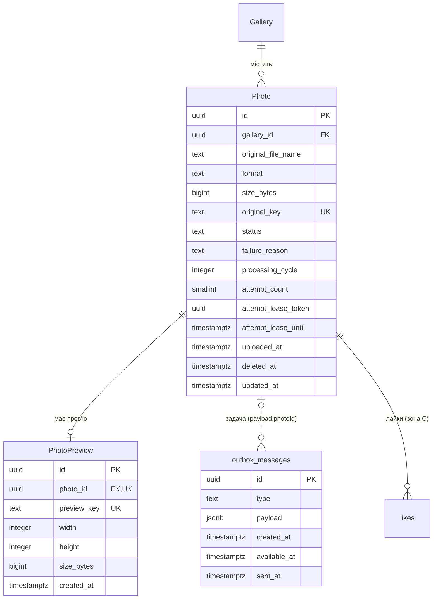

# Модель даних зони B: завантаження й обробка фото

Сутності, які створює й змінює зона B: оригінал фото, прев'ю і запис outbox для постановки задачі в чергу. Формат опису спільний для всіх зон; назви сутностей — як у [глосарії](../glossary.md), назви таблиць і полів — snake_case ([глосарій, розділ 7](../glossary.md#7-конвенції-іменування)). Класи даних і строки зберігання взято з [data retention policy](retention-policy.md).

## 1. Що зберігається в PostgreSQL, а що в MinIO

**Самі файли — лише в MinIO, у базі — лише їхні ключі й метадані.** MinIO — об'єктне сховище: файл у ньому знаходять за ключем, як за шляхом. Байти зображень у PostgreSQL не потрапляють: оригінал RAW важить до 150 МБ, і база з тисячами таких рядків повільно бекапилася б і відновлювалася.

| Що | Де | Ключ об'єкта в MinIO |
|---|---|---|
| Оригінал | MinIO, бакет `originals` | `{gallery_id}/{photo_id}` |
| Прев'ю | MinIO, бакет `previews` | `{gallery_id}/{photo_id}/{attempt_lease_token}.jpg` |
| Ім'я файлу, розмір, формат, статус, причина `Failed` | PostgreSQL, `photos` | — |
| Розміри прев'ю, посилання на нього | PostgreSQL, `photo_previews` | — |

Ключ будується лише з ідентифікаторів, а не з імені файлу від користувача. Тому ім'я на кшталт `../../x.jpg` не впливає на розташування файлу (загроза T-204 у [threat model](../09-security/zone-b.md)), а кожна спроба обробки пише прев'ю під **власним ключем із токеном lease** ([облік спроб](#облік-спроб-обробки)). Токен унікальний для спроби, тож файли різних спроб і циклів не перетинаються: Worker, який відновився після втрати lease, запише свій PUT під своїм старим ключем і не перезапише прев'ю нової, уже успішної спроби. Повторний PUT у межах однієї спроби (наприклад, після тайм-ауту запиту до MinIO) пише той самий ключ. `PhotoPreview.preview_key` береться лише з прийнятого результату ([CS-201](../06-concurrency/cs-201-competing-consumers.md)). Префікс `{gallery_id}/` дає змогу видалити всі файли галереї одним проходом за префіксом.

### Узгодженість бази і MinIO

Запис у PostgreSQL і запис у MinIO не входять в одну транзакцію, тож розбіжності можливі. Для кожної з них визначено, як вона виникає і що з нею робить система.

| Розбіжність | Коли виникає | Що робить система |
|---|---|---|
| Файл у MinIO є, але на нього не посилається жоден рядок і не посилатиметься | Оригінал збережено, а транзакцію з `Photo` відкочено чи пакет відхилено ([CS-202](../06-concurrency/cs-202-transactional-outbox.md)); фото чи галерею видалено (FR-107, FR-207); Worker записав прев'ю для вже видаленого фото (FR-203, п.4), для попереднього циклу чи для фото, що вже `Failed` | Фонове очищення видаляє такі «сироти» до 24 год ([retention, розділ 5](retention-policy.md#5-строки-зберігання)). Що вважається сиротою, визначає не вік об'єкта, а стан `Photo` — див. [правила нижче](#коли-файл-є-сиротою) |
| Рядок `Photo` є, оригіналу немає | Файл втрачено чи видалено поза застосунком | MinIO підтверджено відповів `NoSuchKey`: це постійна помилка, тож Worker публікує подію «помилка», і фото отримує `Failed` одразу, без повторів, бо повтор не поверне файл (як у R-I6-1 [RMA зони B](../08-resiliency/zone-b.md)). Три спроби з паузами лишаються для тимчасових збоїв: недоступний MinIO, тайм-аут (FR-205). Архів оригіналів не формується, фотограф бачить помилку (FR-208, п.5) |
| Рядок `PhotoPreview` є, файлу прев'ю немає | Файл втрачено поза застосунком | Web App на запит прев'ю повертає 404; фотограф може видалити фото й завантажити ще раз. Автоматичного відновлення немає: у нормальній роботі `PhotoPreview` створюється лише після того, як файл записано |
| Файл прев'ю є, `PhotoPreview` ще немає | Worker записав файл, подію ще не оброблено. Затримка не обмежена: Черга подій могла бути недоступна чи Web App зупинений годинами | Нормальний проміжний стан, а не сирота: поки токен у ключі збігається з поточним `Photo.attempt_lease_token`, очищення файл не чіпає. Подія буде оброблена або доставлена повторно (NFR-202) |

### Коли файл є сиротою

Самого віку об'єкта недостатньо: файл прев'ю може законно чекати на подію довше будь-якого порогу, і очищення за віком видалило б його перед тим, як подія створить `PhotoPreview` і переведе фото в `Ready` — уже без файлу. Тому очищення для кожного об'єкта знаходить `Photo` за `photo_id` з ключа і вирішує за його станом:

| Об'єкт | Стан `Photo` | Рішення |
|---|---|---|
| Оригінал чи прев'ю | `Photo` є, але з `deleted_at` чи в галереї, що минула `ExpiresAt` або позначена видаленою | Не сирота, а дані на видалення: їх видаляє основний прохід очищення за ключами з рядка, потім рядок (CS-102). Прев'ю, яке Worker записав уже після цього, стане сиротою без `Photo` і зникне наступним проходом |
| Оригінал | `Photo` є і доступне | Не сирота |
| Оригінал | `Photo` немає, об'єкт молодший за 1 годину | Не чіпати: це може бути пакет, запит якого ще читається (`Photo` створюється в кінці запиту). Година більша за максимальну тривалість запиту завантаження, яку обмежує тайм-аут Web App |
| Оригінал | `Photo` немає, об'єкт старший за 1 годину | Сирота: транзакцію відкочено, пакет відхилено або фото видалено |
| Прев'ю | `Photo` немає | Сирота: фото видалено, і пізня подія для нього ігнорується (FR-203, п.4). Вік не важливий: прев'ю не може з'явитися раніше за `Photo`, бо задача створюється в тій самій транзакції |
| Прев'ю | ключ дорівнює `PhotoPreview.preview_key` | **Не сирота**: це прийнятий результат |
| Прев'ю | токен у ключі дорівнює поточному `Photo.attempt_lease_token` | **Не сирота**: спроба триває або її подія ще не оброблена. Файл лишається, скільки б не чекав |
| Прев'ю | будь-який інший токен | Сирота: файл відхиленої спроби — lease прострочено чи забрано, спробу закрито як невдалу, результат постійної помилки, попередній цикл, `Failed`-фото. Web App не прийме результат із таким токеном, тож файл ніколи не стане `preview_key` |

Через токен у ключі немає й гонок між очищенням, повтором і запізнілим Worker: токен, що вже не поточний, ніколи не стає поточним знову, а `preview_key` з'являється лише з результату з поточним токеном. Тому очищення видаляє лише ключі, які за жодного подальшого розвитку подій не стануть `preview_key`, а нова спроба пише під іншим ключем. Якщо подію з успіхом не встигли обробити до кінця lease, спроба закривається як перервана, і її файл стає сиротою; наступна спроба створить нове прев'ю під новим токеном.

**Порядок запису:** спершу файл у MinIO, потім рядок у базі. Тоді рядок ніколи не посилається на файл, якого ще не було, а можливий зайвий файл прибирає очищення.

**Порядок видалення — як у [CS-102](../06-concurrency/cs-102-expired-gallery-cleanup.md):** спершу файли в MinIO, потім рядки в базі. Доступ закривається одразу, але не видаленням рядка: його закриває настання `ExpiresAt` галереї чи позначка видалення (`photos.deleted_at`, а для галереї — `deletion_requested_at` зони A), які Web App перевіряє на кожному запиті. Рядок лишається, поки не видалено файли, і зберігає їхні ключі: якщо прохід очищення впав посередині, наступний прохід знайде той самий рядок і продовжить, а повторне видалення вже відсутнього файлу не дає помилки. Тому окремої черги «що ще треба видалити» не потрібно — нею є самі позначені рядки.

## 2. Сутності

### Photo

**Що це:** оригінал фото, завантажений фотографом у галерею, і стан його обробки.

Таблиця: `photos`.

| Поле | Тип (PostgreSQL) | Обмеження | Опис |
|---|---|---|---|
| `id` | `uuid` | PK | Ідентифікатор фото; з нього будується ключ у MinIO |
| `gallery_id` | `uuid` | FK → Gallery, NOT NULL, `ON DELETE CASCADE` | Галерея, якій належить фото; власника фото визначає власник галереї |
| `original_file_name` | `text` | NOT NULL, довжина 1–255 | Ім'я файлу, як його завантажив фотограф. Показується в прогресі (FR-204) і використовується в архіві оригіналів (FR-208); для ключа в MinIO не використовується |
| `format` | `text` | NOT NULL, одне з: `jpeg`, `png`, `heic`, `raw` | Формат, визначений за вмістом файлу, а не за розширенням (FR-202) |
| `size_bytes` | `bigint` | NOT NULL, `CHECK (size_bytes > 0)` | Розмір оригіналу; межі 30 і 150 МБ перевіряє Web App до збереження (FR-202) |
| `original_key` | `text` | NOT NULL, UNIQUE | Ключ оригіналу в бакеті `originals` |
| `status` | `text` | NOT NULL, одне з: `Uploaded`, `Processing`, `Ready`, `Failed` | Стан обробки ([глосарій, Photo.Status](../glossary.md#4-статуси)) |
| `failure_reason` | `text` | NULL; `CHECK ((status = 'Failed') = (failure_reason IS NOT NULL))` | Коротка причина для фотографа, наприклад «Файл пошкоджено» (FR-205). Без стектрейсів і внутрішніх шляхів |
| `processing_cycle` | `integer` | NOT NULL, default 1, `CHECK (processing_cycle >= 1)` | Номер циклу обробки. Ручний повтор (FR-206) збільшує його на 1. Входить у задачу й подію: Web App приймає результат лише поточного циклу і лише для фото в `Uploaded` чи `Processing` |
| `attempt_count` | `smallint` | NOT NULL, default 0, `CHECK (attempt_count BETWEEN 0 AND 3)` | Скільки спроб поточного циклу вже невдалі. Збільшує Web App за подією від Worker чи після закінчення lease умовним `UPDATE` ([облік спроб](#облік-спроб-обробки)); ручний повтор скидає його в 0 |
| `attempt_lease_token` | `uuid` | NULL | Токен права на поточну спробу; `NULL` — спробу ніхто не виконує. Результат приймається лише з цим токеном ([облік спроб](#облік-спроб-обробки)) |
| `attempt_lease_until` | `timestamptz` | NULL; `CHECK ((attempt_lease_token IS NULL) = (attempt_lease_until IS NULL))` | До якого моменту дійсне право; Worker продовжує його щохвилини. Після цього моменту спробу закриває фонова задача як перервану |
| `uploaded_at` | `timestamptz` | NOT NULL, default `now()` | Момент прийняття файлу; задає порядок у галереї й в архіві (FR-208) |
| `deleted_at` | `timestamptz` | NULL | Позначка ручного видалення фото (FR-207). Не `NULL` — фото недоступне: не показується, не входить у прогрес і лічильники, пізні результати Worker для нього ігноруються. Рядок фізично видаляє фонове очищення після видалення файлів |
| `updated_at` | `timestamptz` | NOT NULL | Остання зміна статусу |

**Зв'язки:** Gallery 1 → N Photo; Photo 1 → 0..1 PhotoPreview; Photo 1 → N `outbox_messages` (логічний зв'язок через `payload`, без FK; див. нижче); Photo 1 → N `likes` зони C (`likes.photo_id`, [CS-302](../06-concurrency/cs-302-lww-element-set.md)).

**Індекси:**
- `(gallery_id, status) WHERE deleted_at IS NULL` — частковий індекс лише для доступних фото: підрахунок прогресу «готово / помилка / в обробці» (FR-204) і перевірка, чи лишилися фото в `Uploaded` і `Processing`, перед переходом галереї в `Ready` (FR-203);
- `(gallery_id, uploaded_at, id)` — список фото галереї в порядку завантаження і порядок файлів в архіві (FR-208); `id` робить порядок однозначним, якщо час збігся;
- UNIQUE `original_key` — два рядки не можуть посилатися на один файл;
- `(deleted_at) WHERE deleted_at IS NOT NULL` — фонове очищення знаходить позначені фото, не переглядаючи всю таблицю;
- `(attempt_lease_until) WHERE attempt_lease_token IS NOT NULL` — фонова задача кожні 30 с знаходить прострочені lease серед лише тих фото, що зараз обробляються.

Позначка `deleted_at` означає, що запити до доступних фото мають фільтр `deleted_at IS NULL`. Це ціна того, що ключі файлів не губляться до завершення очищення; частковий індекс робить цей фільтр безкоштовним для головних запитів.

**Retention:** рядок — внутрішні дані, крім `original_file_name`: ім'я файлу може містити ім'я людини, тому це персональні дані. Оригінал у MinIO — персональні дані (фото людей). Строки — у [розділі 4](#4-класифікація-retention).

**Чого тут немає — EXIF.** Метадані (дата, камера, геолокація) в окремі поля не витягуються: жодна вимога їх не використовує, а геолокація — персональні дані, які довелося б окремо захищати й видаляти. В оригіналі EXIF лишається як частина файлу, бо оригінал зберігається без змін (FR-203, п.2); у прев'ю Worker його не копіює (загроза T-205).

**Чого тут немає — прапорця «оброблено».** Захист від повторної обробки дає не булеве поле, а унікальне обмеження в `photo_previews` (див. нижче). Поле `is_processed` не допомогло б: два Worker одночасно прочитали б `false`, і обидва записали б результат. Роль «оброблено чи ні» вже виконує `status`.

### PhotoPreview

**Що це:** зменшена копія фото з вотермаркою, яку бачить клієнт за посиланням.

Таблиця: `photo_previews`.

| Поле | Тип (PostgreSQL) | Обмеження | Опис |
|---|---|---|---|
| `id` | `uuid` | PK | Ідентифікатор прев'ю (`previewId` у запитах клієнта, [flow зони C](../04-architecture/flow-zone-c.md)) |
| `photo_id` | `uuid` | FK → Photo, NOT NULL, UNIQUE, `ON DELETE CASCADE` | Фото, з якого зроблено прев'ю |
| `preview_key` | `text` | NOT NULL, UNIQUE | Ключ прев'ю в бакеті `previews`, `{gallery_id}/{photo_id}/{attempt_lease_token}.jpg`, з прийнятого результату |
| `width` | `integer` | NOT NULL, `CHECK (width BETWEEN 1 AND 1600)` | Ширина в пікселях |
| `height` | `integer` | NOT NULL, `CHECK (height BETWEEN 1 AND 1600)` | Висота в пікселях; довга сторона не більша за 1600 (FR-203) |
| `size_bytes` | `bigint` | NOT NULL, `CHECK (size_bytes > 0)` | Розмір файлу прев'ю |
| `created_at` | `timestamptz` | NOT NULL, default `now()` | Коли Web App обробив подію «готово» |

**Зв'язки:** Photo 1 → 0..1 PhotoPreview. Прев'ю немає, поки фото не `Ready`, і в `Failed` (FR-203, п.3).

**Індекси:** UNIQUE `photo_id`. Це головне обмеження зони B: Web App вставляє прев'ю як `INSERT … ON CONFLICT (photo_id) DO NOTHING`, тому повторна подія від Worker не створює другого запису (FR-203, п.1; [CS-201](../06-concurrency/cs-201-competing-consumers.md)). Цей самий індекс пришвидшує пошук прев'ю за фото.

**Retention:** рядок — внутрішні дані; файл у MinIO — персональні дані, доступні за посиланням. Строки — у [розділі 4](#4-класифікація-retention).

### outbox_messages

**Що це:** задача на обробку фото, збережена в тій самій транзакції, що й `Photo`, яку фоновий relay згодом публікує в Чергу задач ([CS-202](../06-concurrency/cs-202-transactional-outbox.md)).

Службова таблиця, а не сутність предметної області, тому окремої назви в глосарії не має.

| Поле | Тип (PostgreSQL) | Обмеження | Опис |
|---|---|---|---|
| `id` | `uuid` | PK | Ідентифікатор запису |
| `type` | `text` | NOT NULL, одне з: `ProcessPhoto` | Тип повідомлення; поки один |
| `payload` | `jsonb` | NOT NULL | `{ "photoId": …, "originalKey": …, "cycle": …, "attempt": … }` — персональних даних немає. Ключ оригіналу в повідомленні — лише для журналу й додаткової звірки: читає Worker ключ із відповіді на `claim` (T-206). `id` запису передається як AMQP `message_id` (`taskId`) |
| `created_at` | `timestamptz` | NOT NULL, default `now()` | Коли задачу створено; задає порядок публікації |
| `available_at` | `timestamptz` | NOT NULL, default `now()` | Не раніше якого моменту relay може опублікувати задачу. Для відкладеного повтору — `now() + 10 с` чи `+ 60 с` (FR-205) |
| `sent_at` | `timestamptz` | NULL | Коли брокер підтвердив прийняття; `NULL` — ще не надіслано |

**Зв'язки:** Photo 1 → N `outbox_messages`. Кілька записів на одне фото з'являються після автоматичного (FR-205) чи ручного (FR-206) повтору. Зв'язок логічний, через `payload.photoId`, без FK: запис outbox має пережити видалення фото, щоб relay не впав на ньому, а Worker, не знайшовши оригіналу, завершить задачу без результату (FR-207, п.2).

**Індекси:** частковий індекс `(available_at, created_at) WHERE sent_at IS NULL` — relay щосекунди вибирає ненадіслані записи з `available_at <= now()` `FOR UPDATE SKIP LOCKED LIMIT 100`, і індекс містить лише їх, тож не росте з історією; індекс `(sent_at) WHERE sent_at IS NOT NULL` — для фонового видалення записів старших за 7 діб.

**Retention:** внутрішні дані; надіслані записи видаляються через 7 діб.

### Облік спроб обробки

FR-205 вимагає не більше 3 спроб із паузами щонайменше 10 і 60 с, зокрема після зупинки Worker. Брокер цього не забезпечує: непідтверджену задачу він повертає одразу, без паузи, а його лічильник доставок належить одному повідомленню, тоді як повторна публікація з outbox (CS-202) створює нове повідомлення з власним лічильником. Тому облік веде **Web App у PostgreSQL**, для логічної задачі «обробити фото в цьому циклі». Повний сценарій з відмовами — у [RMA зони B](../08-resiliency/zone-b.md#облік-спроб-обробки). Облік має дві частини: право на запуск спроби до декодування і прийняття результату лише від власника цього права.

- **Сталий ідентифікатор циклу** — пара `(photos.id, photos.processing_cycle)`. Цикл 1 починається під час завантаження; ручний повтор (FR-206) в одній транзакції збільшує `processing_cycle`, скидає `attempt_count` у 0, ставить `Uploaded` і додає задачу зі спробою 1 нового циклу.
- **Що несе задача і подія.** Payload задачі містить `photoId`, `cycle` і `attempt`; `id` запису outbox передається як AMQP `message_id` і не змінюється за повторної публікації. Події Worker повторюють `photoId`, `cycle`, `attempt` і цей `taskId`. Тож усі копії однієї спроби — після повторної доставки чи повторної публікації — мають однакові `(photoId, cycle, attempt)`.
- **Ресурс має бути доступним.** Кожне рішення про спробу — видача права, прийняття результату, закриття спроби за простроченим lease і обробка повідомлення з DLQ — містить ту саму умову доступності в тому самому `UPDATE`:

  ```sql
  AND photos.deleted_at IS NULL
  AND EXISTS (SELECT 1 FROM galleries g
              WHERE g.id = photos.gallery_id
                AND g.deletion_requested_at IS NULL  -- ручне видалення галереї (зона A)
                AND g.expires_at > now())     -- термін дії не настав (FR-108)
  ```

  Видалене фото лишається рядком із `deleted_at`, поки очищення не видалить файли, і його статус може бути `Uploaded` чи `Processing`. Без цієї умови подія чи DLQ для нього створили б новий повтор. Якщо ресурс недоступний, рядок не змінюється: Web App підтверджує подію чи повідомлення з DLQ без нової задачі, а Worker, не отримавши права, — задачу без декодування. Створений тим часом файл прев'ю прибирає очищення ([коли файл є сиротою](#коли-файл-є-сиротою)).
- **Право на запуск спроби (lease).** Однакові `taskId` і `(photoId, cycle, attempt)` прибирають дублікати результатів, але не зайві запуски декодера: повторна публікація з outbox — нове повідомлення, воно може прийти з `redelivered = false`, і два Worker почнуть ту саму спробу. Тому **до декодування** Worker атомарно отримує право на спробу. Прямого доступу до PostgreSQL він не має: він викликає внутрішній ендпоінт Web App (`POST /internal/processing/claim` з `photoId`, `cycle`, `attempt`; окремий внутрішній порт і ключ Worker — [High-level Architecture, принцип 5](../03-srs/high-level-architecture.md#ключові-архітектурні-принципи)), а Web App виконує:

  ```sql
  UPDATE photos
  SET status = 'Processing', attempt_lease_token = gen_random_uuid(),
      attempt_lease_until = now() + interval '5 minutes', updated_at = now()
  WHERE id = :photoId AND processing_cycle = :cycle
    AND attempt_count = :attempt - 1 AND status IN ('Uploaded', 'Processing')
    AND attempt_lease_token IS NULL
    -- + умова доступності фото й галереї (див. вище)
  RETURNING attempt_lease_token, gallery_id, id;
  ```

  Рядок змінюється лише для однієї копії: вона отримує токен і ключ оригіналу (бакет `originals`, `{gallery_id}/{photo_id}`), який Web App будує з цього рядка `Photo`, і починає декодування. Ключу з повідомлення Worker не довіряє (T-206 у [threat model](../09-security/zone-b.md)). Для решти копій рядок не змінюється, бо спробу вже взято, закрито, цикл застарів, фото видалено або галерею видалено чи прострочено. Такі копії Worker підтверджує (`ack`), нічого не декодуючи. Поки триває обробка, Worker щохвилини продовжує lease тим самим токеном через `POST /internal/processing/renew`: `UPDATE … WHERE attempt_lease_token = :token AND attempt_lease_until >= now()`, тож прострочений lease продовжити не можна, навіть якщо його ще не закрили. Якщо продовжити не вдалося (lease уже забрано чи прострочено), Worker припиняє роботу без події.
- **Worker не повторює сам.** На тимчасову помилку він публікує подію «спроба невдала», на постійну — «помилка», на успіх — «готово» (назви як у [flow зони B](../04-architecture/flow-zone-b.md)). Кожна подія містить токен lease. `ack` задачі — лише після підтвердження брокером події (CS-201).
- **Результат приймається лише від власника lease.** Усі три типи подій Web App обробляє одним умовним `UPDATE` з `attempt_lease_token = :token` і умовою доступності. Токен унікальний для пари `(cycle, attempt)`, тож результат закритої спроби, старого циклу чи копії без lease умову не пройде й буде проігнорований. Тому **старі події не перезаписують ні стан, ні лічильник нового циклу**. Той самий `UPDATE` очищає lease:
  - **успіх:** `status = 'Ready'`, і в тій самій транзакції, лише якщо рядок змінився, вставляється `PhotoPreview` (`ON CONFLICT (photo_id) DO NOTHING`) з ключем, який Web App сам будує з токена прийнятої спроби, а не бере з події;
  - **постійна помилка:** `status = 'Failed'` з причиною, без повторів;
  - **тимчасова помилка:** `attempt_count = attempt`, `status = 'Uploaded'`. Якщо `attempt < 3`, у тій самій транзакції додається задача зі спробою `attempt + 1` і `available_at = now() + 10 с` (після першої невдачі) або `+ 60 с` (після другої) — relay не опублікує її раніше. Якщо `attempt = 3`, фото стає `Failed` із причиною «Тимчасова помилка обробки».
- **Відновлення права після падіння.** Якщо Worker упав, lease ніхто не продовжує. Фонова задача Web App кожні 30 секунд знаходить фото з `attempt_lease_until < now()` і закриває таку спробу як перервану — тим самим умовним `UPDATE` з поточним токеном і умовою доступності, що й для тимчасової помилки, але з **перевіркою прострочення в самому оновленні** (`AND attempt_lease_until < now()`). Пошук лише відбирає кандидатів: між вибіркою й оновленням Worker міг продовжити lease тим самим токеном, і перевірка самого токена закрила б уже продовжену спробу. Продовження й закриття змінюють той самий рядок під протилежними умовами, тож удатися може лише одне з них. Якщо закрито: лічильник +1, lease очищено, наступна спроба з паузою або `Failed` після третьої. Повторна доставка задачі після падіння право не отримає, поки lease не закрито, тож декодер вдруге без паузи не запуститься. Кілька копій Web App можуть виконувати цю задачу одночасно: умова за токеном пропускає лише одну зміну.
- **Якщо Web App недоступний для claim,** Worker повертає задачу (`nack` з `requeue`) і не декодує. Після ліміту доставок quorum-черги задача потрапляє в Dead Letter Queue. Web App обробляє її як невдалу спробу лише тоді, коли саме ця спроба поточного циклу ще чекає й ніхто її не взяв:

  ```sql
  UPDATE photos SET attempt_count = :attempt, status = 'Uploaded', updated_at = now()
  WHERE id = :photoId
    AND processing_cycle = :cycle
    AND status IN ('Uploaded', 'Processing')
    AND attempt_count = :attempt - 1
    AND attempt_lease_token IS NULL
    -- + умова доступності фото й галереї
  ```

  Перевірка `processing_cycle` обов'язкова: ручний повтор (FR-206) скидає `attempt_count` у 0, і без неї запізніле повідомлення спроби 1 старого циклу пройшло б умову `attempt_count = 0` і витратило б спробу нового. Якщо рядок змінився, далі все як для тимчасової помилки: наступна спроба з паузою або `Failed` після третьої. Якщо не змінився — старий цикл, закрита чи вже взята спроба, недоступний ресурс — повідомлення підтверджується без нової задачі.
- **Ціна:** Worker тепер залежить від Web App перед кожною спробою. Але це один короткий запит на фото, яке потім декодується секунди чи десятки секунд.

**Окремої таблиці історії немає.** Таблиця `photo_processing_attempts` корисна для діагностики, але для FR-205 достатньо поточного стану циклу в `photos`, а для таблиці довелося б окремо визначати строк зберігання. Технічні деталі помилок (стектрейс, `taskId`, `traceId`) пишуться в журнали Worker і Web App, які зберігаються 30 діб ([retention, розділ 5](retention-policy.md#5-строки-зберігання)).

## 3. ER-фрагмент зони B

Сутності інших зон показано лише назвою. Пунктир — логічний зв'язок без FK.



## 4. Класифікація retention

Оригінали й прев'ю однаково чутливі (фото людей, персональні дані), але різні за доступом: оригінал бачить лише фотограф, прев'ю — ще й клієнт за посиланням, і в прев'ю немає EXIF. Строк зберігання однаковий: обидва потрібні лише поки діє галерея.

**Автоматичне видалення.** У PostgreSQL немає вбудованого строку життя рядка, а тригер спрацьовує на зміну даних, а не за часом. Тому видаляє фонова задача очищення Web App за розкладом, одна на всі копії ([CS-102](../06-concurrency/cs-102-expired-gallery-cleanup.md)). Порядок — як у CS-102: спершу файли галереї в MinIO (`DeleteObjects` за ключами з рядків), потім одна транзакція з рядками (`photos` і `photo_previews` — каскадом від `Gallery`). Для фото, видаленого вручну, так само: спершу оригінал і прев'ю, потім рядок `photos` із `deleted_at`. Доки файли не видалено, рядки зберігають їхні ключі, тож перерваний прохід продовжує наступний.

| Сутність / поле | Клас | Термін | Від чого рахується | Що потім |
|---|---|---|---|---|
| `Photo` (оригінал у MinIO) | Персональні | До `ExpiresAt` + 24 год або до ручного видалення + 24 год | `ExpiresAt` галереї / запит на видалення фото чи галереї | Фізичне видалення разом із галереєю або окремо (FR-108, FR-107, FR-207) |
| `Photo` (рядок `photos`) | Внутрішні | До `ExpiresAt` + 24 год або до ручного видалення + 24 год | `ExpiresAt` галереї / запит на видалення | Фізичне видалення після видалення файлів: разом із галереєю або окремо для фото з `deleted_at` |
| `Photo.original_file_name` | Персональні | Як рядок `photos` | Як рядок `photos` | Видаляється разом із рядком; після `ExpiresAt` не показується (FR-105, FR-108) |
| `Photo.failure_reason` | Внутрішні | Як рядок `photos` | Як рядок `photos` | Очищається під час ручного повтору (FR-206), далі разом із рядком |
| `PhotoPreview` (файл у MinIO) | Персональні, доступні за посиланням | До `ExpiresAt` + 24 год або до ручного видалення + 24 год | `ExpiresAt` галереї / запит на видалення | Фізичне видалення разом із фото |
| `PhotoPreview` (рядок `photo_previews`) | Внутрішні | Як рядок `photos` | Як рядок `photos` | Каскадне видалення разом із `Photo` |
| `outbox_messages` (надіслані) | Внутрішні | 7 діб | `sent_at` | Фізичне видалення ([CS-202](../06-concurrency/cs-202-transactional-outbox.md)) |
| `outbox_messages` (ненадіслані) | Внутрішні | Поки relay не отримає підтвердження брокера | `created_at` | Стає надісланим і далі за рядком вище |
| Файли-«сироти» в MinIO | Персональні | До 24 год | Момент, коли файл став сиротою (див. [правила](#коли-файл-є-сиротою)) | Фізичне видалення фоновим очищенням |

Резервні копії й журнал видалень — за [retention, розділ 6](retention-policy.md#6-резервні-копії): після відновлення з бекапу дані, видалені раніше, видаляються повторно.

## Зв'язок з іншими пунктами

| Пункт | Що саме |
|---|---|
| п.3 Вимоги | [FR-201–FR-208](../03-srs/zone-b-processing.md) — поля `Photo` і `PhotoPreview`, статуси, причина `Failed`, порядок для архіву |
| п.4 Архітектура | [flow-zone-b.md](../04-architecture/flow-zone-b.md) — хто й коли оновлює `Photo.status` |
| п.6 Concurrency | [CS-201](../06-concurrency/cs-201-competing-consumers.md) — UNIQUE `photo_previews.photo_id`; [CS-202](../06-concurrency/cs-202-transactional-outbox.md) — `outbox_messages`; [CS-102](../06-concurrency/cs-102-expired-gallery-cleanup.md) — фонове очищення |
| п.7 Data model | [retention-policy.md](retention-policy.md) — класи даних і строки |
| п.9 Security | [threat model зони B](../09-security/zone-b.md) — T-204 (ключ за `photo_id`), T-205 (EXIF), T-207 (прямий доступ до MinIO) |
