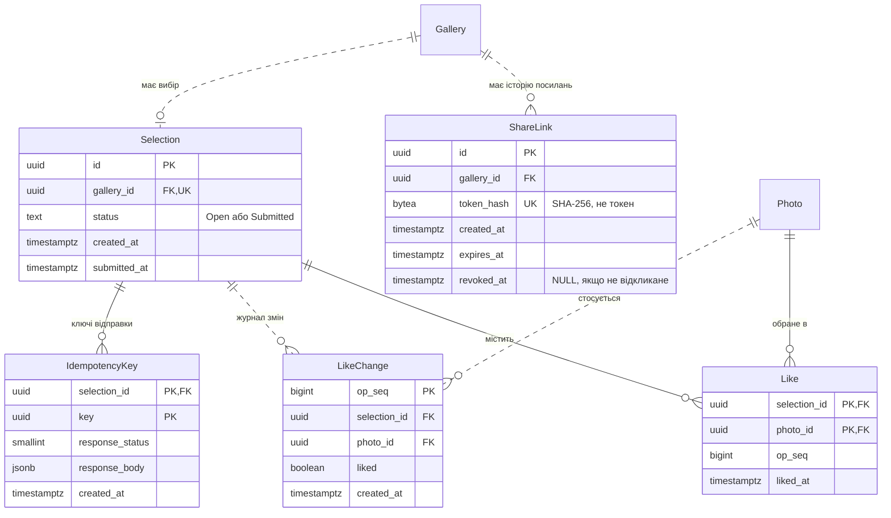

# Сутності зони C

Проєктна модель для PostgreSQL 16 та EF Core. Зона C зберігає посилання для клієнта, його вибір і лайки, а також ключі ідемпотентності відправки вибору. Усі таблиці живуть у PostgreSQL, власник бази — Web App ([ADR-002](../04-architecture/adr/002-microservices.md)); файлів у MinIO зона C не створює. Назви — за [глосарієм](../glossary.md), строки видалення — за [retention policy](retention-policy.md).

## 1. Ключові рішення

### Токен посилання: лише хеш

У `share_links` зберігається лише **SHA-256-хеш** токена (`token_hash`, 32 байти), а сам токен фотограф бачить один раз у відповіді на створення (FR-301, NFR-301 п.2). На кожному запиті клієнта Web App рахує хеш від токена зі шляху й шукає посилання за унікальним індексом `token_hash` ([flow зони C](../04-architecture/flow-zone-c.md)).

Чому так, а не інакше (обґрунтування — в [Identity Management](../03-srs/identity.md#токен-у-посиланні)):
- **Витік дампа бази не відкриває жодної галереї.** Щоб отримати доступ, потрібен сам токен, а з хеша його не відновити: токен випадковий, має щонайменше 128 біт, тож словникового перебору не існує.
- **Сіль і повільний алгоритм не потрібні**, на відміну від паролів фотографів. Вони захищають від перебору передбачуваних значень, а тут значення непередбачуване. Швидкий детермінований хеш потрібен, щоб знайти посилання одним пошуком за індексом.
- **Шифрування для повторного показу не обрано** (FR-301 п.1): ключ шифрування в конфігурації повертав би ризик при його витоку. Якщо посилання втрачено, фотограф створює нове.

### Стан посилання обчислюється з дат

Стани `Active`, `Expired` і `Revoked` ([глосарій](../glossary.md)) не зберігаються окремою колонкою. Web App обчислює їх на кожному запиті з двох дат:

| Стан | Умова |
|---|---|
| `Revoked` | `revoked_at IS NOT NULL` |
| `Expired` | `revoked_at IS NULL AND now() >= expires_at` |
| `Active` | `revoked_at IS NULL AND now() < expires_at` |

Чому так:
- **Expired — це подія часу, а не дія користувача.** Колонку `status` хтось мав би переписати в момент `ExpiresAt`, тобто фонова задача, яка запізнюється. FR-302 п.2 прямо вимагає, щоб термін перевірявся на кожному запиті й не залежав від фонових задач. Дата не може застаріти, а збережений статус може.
- **Revoked — дія фотографа**, тож її фіксує момент `revoked_at`. Відкликати можна лише `Active` посилання (FR-302 п.1), тому `revoked_at < expires_at` завжди, і два стани ніколи не накладаються. Це перевіряє CHECK.
- **Чинність посилання ширша за його стан.** Посилання дає доступ, лише коли воно `Active`, а також `Gallery.expires_at` не настав, `Gallery.Status` дорівнює `Shared` чи `Finalized`, а галерея й акаунт фотографа не позначені до видалення (`deletion_requested_at IS NULL`, [модель зони A](entities-zone-a.md)). Ці умови перевіряються тим самим запитом, що знаходить посилання за хешем, без кешу (NFR-301 п.5). Тому відкликання й закінчення терміну діють одразу.

### Лайки — окремі рядки, а не частина Selection

Лайки зберігаються окремими рядками `likes` (один рядок — одне обране фото) і журналом змін `like_changes`, а не масивом чи `jsonb` у рядку `selections`. Так вимагає [CS-302](../06-concurrency/cs-302-lww-element-set.md):
- **Операція стосується одного фото.** `PUT` і `DELETE` змінюють один рядок, а не переписують весь список. Масив у `selections` означав би «прочитати, змінити, записати назад», і лайк з іншого пристрою міг би загубитися.
- **Дублікат неможливий на рівні бази.** Первинний ключ `(selection_id, photo_id)` не дає лайкнути те саме фото двічі (FR-304 п.2).
- **Зняття лайка не зникає безслідно.** Після `DELETE` з `likes` у `like_changes` лишається запис `liked = false`, тож інший пристрій, синхронізуючись за курсором, дізнається і про зняття.
- **Цілісність.** Зовнішній ключ на `photos` не дає лайкнути неіснуюче фото, а каскадне видалення прибирає лайки разом із галереєю.

`Selection` — це «заголовок» вибору: статус і час відправки. Кількість обраних кадрів не зберігається, а рахується з `likes`. Для галереї це до 1000 рядків за первинним ключем, а лічильник, що зберігається окремо, довелося б атомарно оновлювати при кожному лайку.

### Де живе op_seq і що він гарантує

`op_seq` — номер зміни лайка з послідовності PostgreSQL `like_op_seq` (`bigint`). Він зберігається у двох місцях:
- `like_changes.op_seq` — номер кожної зміни; первинний ключ журналу й курсор синхронізації `GET …/likes?since={op_seq}`;
- `likes.op_seq` — номер останньої зміни, яка поставила цей лайк.

У `selections` останній номер окремо не зберігається: його дає `max(op_seq)` з `like_changes` за індексом `(selection_id, op_seq)`.

Що `op_seq` **гарантує**:
- **Порядок змін одного `Selection` збігається з порядком commit.** Web App бере номер лише після `SELECT … FOR UPDATE` рядка `selections`, тож зміни одного вибору серіалізовані. Номер, отриманий пізніше, закомічується пізніше, і клієнт, який прочитав зміни до курсора `N`, не пропустить зміну з меншим номером, яка закомітилася потім.
- **Детермінований переможець для одного фото.** Якщо два пристрої змінили те саме фото, перемагає більший `op_seq`, тобто зміна, яку Web App закомітив пізніше. Годинники пристроїв не використовуються.
- **Унікальність** у всій базі, бо послідовність одна.

Чого `op_seq` **не гарантує**:
- **Безперервності.** Номер, узятий транзакцією, що відкотилася, пропадає, і в журналі з'являється «дірка». Курсор працює через `op_seq > since`, тож пропуски нічого не ламають.
- **Порядку між різними виборами.** Номери різних `Selection` перемежовуються, але їх ніхто не порівнює.
- **Відповідності часу натискання.** Перемагає пізніший commit, а не пізніший дотик ([CS-302, компроміси](../06-concurrency/cs-302-lww-element-set.md#компроміси)).

### Ключі ідемпотентності зберігаються в базі

Ключ відправки вибору ([CS-301](../06-concurrency/cs-301-idempotency-key.md)) зберігається в PostgreSQL, а не в пам'яті Web App, з трьох причин:
- запис ключа й перехід `Selection` у `Submitted` мають бути **однією транзакцією**: інакше збій між ними залишив би ключ без відправки чи відправку без збереженої відповіді;
- повторний запит може потрапити на **іншу копію Web App** або прийти після її перезапуску;
- два одночасні запити з тим самим ключем виконуються по черзі: обидва спершу блокують рядок вибору, а **унікальний первинний ключ** гарантує, що другий знайде вже збережений ключ і не вставить дубліката.

**Скільки зберігати: 24 години від створення**, як у CS-301. Цього досить, щоб покрити повтори після обриву зв'язку (секунди чи хвилини) і повторне відкриття вкладки того самого дня. Довше зберігати немає сенсу: після очищення ключа повтор однаково отримає `200` з початковим `submittedAt`, бо умовне оновлення `Selection` з `Open` на `Submitted` вдруге нічого не змінить. Втрачається лише заголовок `Idempotent-Replayed`. Ключі видаляє фонова задача очищення Web App, а разом із галереєю вони зникають каскадом, якщо це станеться раніше.

## 2. Сутності

### ShareLink

**Що це:** приватне посилання для клієнта із секретним токеном, за яким клієнт відкриває галерею без акаунта. Таблиця: `share_links`.

| Поле | Тип (PostgreSQL) | Обмеження | Опис |
|---|---|---|---|
| `id` | `uuid` | PK | Ідентифікатор посилання (`shareLinkId` в API фотографа). Клієнт його не бачить і не використовує |
| `gallery_id` | `uuid` | FK → Gallery, NOT NULL, `ON DELETE CASCADE` | Галерея, яку відкриває посилання. Посилання зберігаються історією: у галереї може бути кілька рядків, але не більше одного `Active` |
| `token_hash` | `bytea` | NOT NULL, UNIQUE, `CHECK (octet_length(token_hash) = 32)` | SHA-256 від токена. Сам токен не зберігається (NFR-301 п.2) |
| `created_at` | `timestamptz` | NOT NULL, default `now()` | Момент створення в UTC |
| `expires_at` | `timestamptz` | NOT NULL, `CHECK (expires_at > created_at)` | Термін дії в UTC. Не пізніше `Gallery.expires_at`: це перевіряє Web App у транзакції створення, бо CHECK не бачить іншої таблиці. За замовчуванням — менше з «+14 діб» і `Gallery.expires_at` (FR-301 п.2) |
| `revoked_at` | `timestamptz` | NULL, `CHECK (revoked_at IS NULL OR revoked_at < expires_at)` | Момент відкликання: вручну (FR-302 п.1) або автоматично, коли створено нове посилання (FR-301 п.3). `NULL` — не відкликане |

**Стан** `Active` / `Expired` / `Revoked` обчислюється з `expires_at` і `revoked_at` ([розділ 1](#стан-посилання-обчислюється-з-дат)).

**Не більше одного `Active`** (FR-301 п.3). Частковий унікальний індекс тут не допоможе: `Active` залежить від `now()`, а умова індексу не може містити змінного часу, тож прострочені, але не відкликані посилання заважали б створити нове. Тому створення виконується однією транзакцією:
1. `SELECT … FROM galleries WHERE id = :galleryId FOR UPDATE` — блокування рядка галереї; два одночасні створення для однієї галереї виконуються по черзі;
2. перевірка власника, стану галереї (`Ready` чи `Shared`) і `expires_at` нового посилання;
3. `UPDATE share_links SET revoked_at = now() WHERE gallery_id = :galleryId AND revoked_at IS NULL AND expires_at > now()` — попереднє `Active` стає `Revoked`;
4. `INSERT` нового посилання; якщо галерея ще `Ready`, у тій самій транзакції — умовне оновлення в `Shared` зі збільшенням `Gallery.version` ([CS-101, переходи без результатів обробки](../06-concurrency/cs-101-gallery-status.md#як-застосовано-в-нашій-системі)). Для галереї вже в `Shared` статус і версія не змінюються.

**Статус галереї після посилання.** Відкликання чи завершення терміну самого `ShareLink` зберігає поточний статус галереї й не повертає її в `Ready`:
- **`Shared` лишається `Shared`.** Фотограф і далі бачить вибір клієнта (FR-306) і, поки `ExpiresAt` галереї не настав, може створити нове посилання на заміну (FR-301 п.1); `Selection` продовжується з ним.
- **`Finalized` лишається `Finalized`.** Чинне посилання можна відкликати й після фіналізації (FR-302): доступ клієнта закривається, вибір фотограф і далі бачить (FR-306), але нове посилання створити не можна (FR-301 п.4).

Коли настає `ExpiresAt` самої галереї, діє окремий перехід у `Expired` за FR-108: недійсними стають усі її посилання.

**Зв'язки:** Gallery 1 → 0..N ShareLink. Selection з посиланням не пов'язаний: він належить галереї й переживає заміну посилання (FR-301 п.3).

**Індекси:**
- UNIQUE `token_hash` — пошук посилання за токеном на кожному запиті клієнта (сторінка, прев'ю, лайк, відправка);
- `(gallery_id, created_at DESC)` — поточне посилання галереї для фотографа і крок 3 створення.

**Retention:** `token_hash` — конфіденційні дані, решта полів — внутрішні. Відкликані й прострочені посилання доступу не дають одразу, а фізично видаляються разом із галереєю ([retention, розділ 5](retention-policy.md#5-строки-зберігання)): окремо їх не видаляємо, бо вони показують фотографу історію посилань і нічого не відкривають.

### Selection

**Що це:** вибір клієнта в галереї — сукупність лайків і статус відправки. Таблиця: `selections`.

| Поле | Тип (PostgreSQL) | Обмеження | Опис |
|---|---|---|---|
| `id` | `uuid` | PK | Ідентифікатор вибору |
| `gallery_id` | `uuid` | FK → Gallery, NOT NULL, UNIQUE, `ON DELETE CASCADE` | Галерея. Один вибір на галерею, незалежно від того, скільки посилань створено |
| `status` | `text` | NOT NULL, default `Open`, CHECK: `Open`, `Submitted` | Стан за глосарієм. Переходить з `Open` у `Submitted` один раз і назад не повертається (FR-305 п.3) |
| `created_at` | `timestamptz` | NOT NULL, default `now()` | Момент першого лайка, який створив вибір (FR-304 п.1) |
| `submitted_at` | `timestamptz` | NULL, `CHECK ((status = 'Submitted') = (submitted_at IS NOT NULL))` | Момент відправки в UTC (`submittedAt`). Встановлюється один раз і не змінюється при повторній відправці (FR-305 п.3) |

**Створення:** `Selection` з'являється з першим лайком. Два пристрої можуть лайкнути одночасно, тому створення виконується як `INSERT … ON CONFLICT (gallery_id) DO NOTHING` з наступним читанням, і обидва працюють з одним рядком ([CS-302](../06-concurrency/cs-302-lww-element-set.md)).

**Відправка** — одна транзакція разом із ключем ідемпотентності ([CS-301](../06-concurrency/cs-301-idempotency-key.md)):
1. `SELECT … FROM selections WHERE gallery_id = :galleryId FOR UPDATE` — пошук і блокування вибору галереї з токена, першою дією транзакції. Якщо рядка немає (клієнт ще не поставив жодного лайка), відповідь — `409 SELECTION_EMPTY` без змін: ключ не вставляється, бо йому ні на що посилатися;
2. `INSERT` ключа в `idempotency_keys … ON CONFLICT DO NOTHING`; якщо ключ уже є, повертається збережена відповідь;
3. **уже під блокуванням** — один із трьох результатів за [C-305](../05-error-handling/zone-c.md):
   - **`Submitted`, новий ключ** (повторна відправка з іншого пристрою чи вкладки): вибір не змінюється, відповідь — `200` з початковим `submitted_at` і тим самим списком кадрів із `likes`, без нового сповіщення (FR-305 п.3); відповідь записується в ключ;
   - **`Open` без лайків:** `409 SELECTION_EMPTY` (FR-305 п.1); транзакція відкочується, тож вибір не змінюється, а незаповнений ключ не зберігається, і клієнт може повторити з тим самим ключем, коли обере кадр;
   - **`Open` з лайками:** крок 4;
4. `UPDATE selections SET status = 'Submitted', submitted_at = now() WHERE id = :id AND status = 'Open'` і запис відповіді `200` у ключ.

Порядок важливий. Якби перевірка лайків ішла до блокування, інший пристрій міг би зняти останній лайк між перевіркою й `UPDATE`, і порожній вибір було б відправлено всупереч FR-305. Зміна лайка бере те саме блокування першою дією над вибором, тож лайк і відправка не перемежовуються: до вибору входять саме ті лайки, що закомічені до відправки. **Чому блокування — до ключа.** Вставка в `idempotency_keys` перевіряє зовнішній ключ на `selections` і тому бере на рядку вибору блокування `FOR KEY SHARE`. Воно сумісне з таким самим блокуванням іншої транзакції, але конфліктує з `FOR UPDATE`. Якби дві відправки з різними ключами спершу вставили свої ключі, обидві отримали б `FOR KEY SHARE`, а потім кожна чекала б на `FOR UPDATE`, поки інша не звільнить своє, — взаємне блокування (deadlock). Тому кожна транзакція, що змінює вибір (відправка, лайк), спершу бере `FOR UPDATE` на `selections`, а вже потім вставляє рядки, що на нього посилаються: `idempotency_keys`, `likes`, `like_changes`. Порядок блокувань однаковий, тож взаємного блокування немає. Дві відправки з тим самим ключем тепер чекають одна на одну на рядку вибору, а не на унікальному індексі ключа: друга, отримавши блокування, бачить уже закомічений ключ і повертає збережену відповідь, як у [CS-301](../06-concurrency/cs-301-idempotency-key.md).

**Зв'язки:** Gallery 1 → 0..1 Selection; Selection 1 → 0..N Like; Selection 1 → 0..N LikeChange; Selection 1 → 0..N IdempotencyKey.

**Індекси:** UNIQUE `gallery_id` — гарантує один вибір на галерею й дає ціль для `ON CONFLICT`; ним же фотограф знаходить вибір своєї галереї (FR-306).

**Retention:** вибір пов'язаний із посиланням і показує, які кадри обрала людина, тому всі поля класифікуємо як персональні дані. Видаляються разом із галереєю.

### Like

**Що це:** лайк клієнта — поточна позначка «цей кадр обрано» в `Selection`. Таблиця: `likes`, проєкція поточного стану [LWW-множини](../06-concurrency/cs-302-lww-element-set.md); містить лише активні лайки.

| Поле | Тип (PostgreSQL) | Обмеження | Опис |
|---|---|---|---|
| `selection_id` | `uuid` | PK (разом із `photo_id`), FK → Selection, NOT NULL, `ON DELETE CASCADE` | Вибір, до якого належить лайк |
| `photo_id` | `uuid` | PK (разом із `selection_id`), FK → Photo, NOT NULL, `ON DELETE CASCADE` | Обране фото. Web App у тій самій транзакції перевіряє, що фото належить галереї цього вибору, має статус `Ready` і не позначене видаленим (`photos.deleted_at IS NULL`): за [моделлю зони B](entities-zone-b.md) видалене фото лишається рядком зі старим статусом до фізичного очищення (FR-304 п.2, FR-207, NFR-301 п.6) |
| `op_seq` | `bigint` | NOT NULL | Номер зміни, що поставила лайк ([розділ 1](#де-живе-op_seq-і-що-він-гарантує)) |
| `liked_at` | `timestamptz` | NOT NULL, default `now()` | Момент, коли лайк поставлено |

Зміна лайка — одна транзакція: перевірка посилання й галереї, `SELECT … FROM selections WHERE id = :id FOR UPDATE`, і **вже під блокуванням** — перевірка `Selection.Status = 'Open'` (FR-304 п.3) і фото. Лише після цього Web App бере `op_seq`, а `PUT` створює рядок або оновлює `op_seq` наявного (`INSERT … ON CONFLICT (selection_id, photo_id) DO UPDATE`), `DELETE` видаляє рядок; обидва разом із записом у `like_changes`. Статус, прочитаний до блокування, міг би застаріти: відправка, що закомітилася між читанням і записом, пропустила б лайк у вже відправлений вибір.

**Зв'язки:** Selection 1 → 0..N Like; Photo 1 → 0..N Like (на практиці 0..1, бо в галереї один вибір).

**Індекси:** PK `(selection_id, photo_id)` — не допускає дубліката, дає лічильник «Обрано: N з M» (FR-303 п.3) і список обраних (FR-306). 

**Імена у списку FR-306 збігаються з записами ZIP за FR-208**, бо обидва формує одна функція Web App за одним правилом:
1. взяти обрані фото вибору (`likes` ⋈ `photos`);
2. упорядкувати їх за `(uploaded_at, id)` — для цього є індекс `(gallery_id, uploaded_at, id)` з [моделі зони B](entities-zone-b.md); `id` робить порядок однозначним, якщо час збігся;
3. у цьому порядку призначити імена з `original_file_name`: перше входження зберігає ім'я, а при збігу без урахування регістру перед розширенням додається найменший вільний суфікс `(2)`, `(3)`… (FR-208 п.1).

Суфікси рахуються серед обраних фото, бо саме вони потрапляють в архів. Готові імена не зберігаються: правило детерміноване, а після `Submitted` набір обраних фото й порядок не змінюються, тож список і ZIP завжди дають однаковий результат.

**Retention:** персональні дані (лайки, пов'язані з посиланням). Видаляються разом із галереєю.

### like_changes (журнал змін лайків)

**Що це:** append-only журнал усіх змін лайків, з якого пристрої дізнаються про зміни один одного. Таблиця: `like_changes`. Окремого терміну в глосарії немає, бо це технічна таблиця, як `outbox_messages` у [зоні B](entities-zone-b.md).

| Поле | Тип (PostgreSQL) | Обмеження | Опис |
|---|---|---|---|
| `op_seq` | `bigint` | PK, default `nextval('like_op_seq')` | Номер зміни; курсор синхронізації |
| `selection_id` | `uuid` | FK → Selection, NOT NULL, `ON DELETE CASCADE` | Вибір |
| `photo_id` | `uuid` | FK → Photo, NOT NULL, `ON DELETE CASCADE` | Фото, якого стосується зміна |
| `liked` | `boolean` | NOT NULL | `true` — лайк поставлено, `false` — знято |
| `created_at` | `timestamptz` | NOT NULL, default `now()` | Момент зміни; для діагностики, не для порядку |

Зняття відсутнього лайка теж записується в журнал: операція успішна (FR-304 п.2), а запис нічого не ламає, бо клієнт застосовує зміни поелементно.

**Зв'язки:** Selection 1 → 0..N LikeChange; Photo 1 → 0..N LikeChange.

**Індекси:** `(selection_id, op_seq)` — `GET …/likes?since=` читає зміни одного вибору після курсора за один діапазонний прохід.

**Retention:** персональні дані. Окремого очищення немає: на галерею це сотні рядків ([CS-302, компроміси](../06-concurrency/cs-302-lww-element-set.md#компроміси)), і вони видаляються разом із галереєю.

### IdempotencyKey

**Що це:** ключ однієї логічної відправки вибору зі збереженою відповіддю першого виконання ([CS-301](../06-concurrency/cs-301-idempotency-key.md)). Таблиця: `idempotency_keys`.

| Поле | Тип (PostgreSQL) | Обмеження | Опис |
|---|---|---|---|
| `selection_id` | `uuid` | PK (разом із `key`), FK → Selection, NOT NULL, `ON DELETE CASCADE` | Вибір, який відправляли. Ключ діє в межах вибору, тож однакові UUID різних клієнтів не конфліктують |
| `key` | `uuid` | PK (разом із `selection_id`) | Значення заголовка `Idempotency-Key`; браузер створює UUID і тримає його в `localStorage` до успішної відповіді |
| `response_status` | `smallint` | NULL лише всередині першої транзакції | HTTP-статус першої відповіді |
| `response_body` | `jsonb` | NULL лише всередині першої транзакції | Тіло першої відповіді: `status`, `submittedAt`, кількість і ідентифікатори обраних фото |
| `created_at` | `timestamptz` | NOT NULL, default `now()` | Від цього моменту рахуються 24 години зберігання |

Ключ вставляється одразу після блокування рядка вибору (`INSERT … ON CONFLICT DO NOTHING`), а відповідь дописується перед `COMMIT`. Тому `NULL` у полях відповіді іншим транзакціям ніколи не видно: вони чекають на блокуванні вибору, доки перша не завершиться.

**Зв'язки:** Selection 1 → 0..N IdempotencyKey.

**Індекси:** PK `(selection_id, key)` — пошук збереженої відповіді й серіалізація одночасних повторів; `(created_at)` — фонове видалення ключів, старших за 24 години.

**Retention:** `response_body` містить перелік обраних фото, тому це персональні дані; `key` і `response_status` — внутрішні. Видаляються через 24 години від `created_at` або разом із галереєю, якщо це станеться раніше.

## 3. ER-фрагмент зони C

Сутності інших зон показано лише назвами: Gallery — [зона A](entities-zone-a.md), Photo — [зона B](entities-zone-b.md). Як і в [зведеній діаграмі](README.md#er-діаграма), суцільна лінія означає, що зовнішній ключ входить до первинного ключа, а пунктир — звичайний зовнішній ключ.

## 4. Класифікація retention

Рядки за [шаблоном retention policy](retention-policy.md#8-шаблон-рядка-класифікації). «Як Gallery» означає: до найранішого з `expires_at + 24 год` і запиту видалення галереї чи акаунта + 24 год, як у [зоні A](entities-zone-a.md#5-класифікація-retention).

| Сутність / поле | Клас | Термін | Від чого рахується | Що потім |
|---|---|---|---|---|
| `ShareLink.token_hash` | Конфіденційні | Як Gallery; доступ закривається одразу при відкликанні, закінченні терміну посилання чи галереї | `expires_at` галереї / запит на видалення | Фізичне видалення разом із галереєю |
| Решта полів `ShareLink` | Внутрішні | Як Gallery | `expires_at` галереї / запит на видалення | Фізичне видалення разом із галереєю |
| `Selection` (усі поля) | Персональні | Як Gallery | `expires_at` галереї / запит на видалення | Фізичне видалення разом із галереєю |
| `Like` (усі поля) | Персональні | Як Gallery | `expires_at` галереї / запит на видалення | Фізичне видалення разом із галереєю (каскадом через `Selection`) |
| `LikeChange` (усі поля) | Персональні | Як Gallery | `expires_at` галереї / запит на видалення | Фізичне видалення разом із галереєю (каскадом через `Selection`) |
| `IdempotencyKey.response_body` | Персональні | 24 год або як Gallery, що настане раніше | Створення ключа / `expires_at` галереї / запит на видалення | Фізичне видалення фоновою задачею очищення |
| `IdempotencyKey.key`, `response_status`, `created_at` | Внутрішні | Як `response_body` | Як `response_body` | Як `response_body` |

Відкритого токена немає ніде: ні в базі, ні в журналах, ні в повідомленнях про помилки (NFR-301 п.2), тож для нього рядка класифікації немає. IP-адреси для ліміту недійсних запитів (NFR-301 п.4) живуть у пам'яті не довше вікна ліміту й у базі зони C не зберігаються. Бекапи й журнал видалень — за [розділом 6](retention-policy.md#6-резервні-копії).

## Зв'язок з іншими пунктами

| Пункт | Що саме |
|---|---|
| п.3 Вимоги | [FR-301…FR-307, NFR-301](../03-srs/zone-c-client.md): токен лише хешем, один `Active` на галерею, стан із дат, лайки без дублікатів, відправка один раз |
| п.4 Архітектура | [flow-zone-c.md](../04-architecture/flow-zone-c.md): пошук посилання за хешем і перевірки на кожному запиті |
| п.6 Concurrency | [CS-301](../06-concurrency/cs-301-idempotency-key.md) — `idempotency_keys` і умовне оновлення `selections`; [CS-302](../06-concurrency/cs-302-lww-element-set.md) — `likes`, `like_changes`, `op_seq`; [CS-101](../06-concurrency/cs-101-gallery-status.md) — перехід галереї в `Shared` |
| п.7 Data model | [зона A](entities-zone-a.md) — Gallery, позначки видалення; [зона B](entities-zone-b.md) — Photo; [consistency.md](consistency.md) — які операції потребують сильної узгодженості; [retention policy](retention-policy.md) |
| Identity | [Токен у посиланні](../03-srs/identity.md#токен-у-посиланні) — чому SHA-256 без солі |
