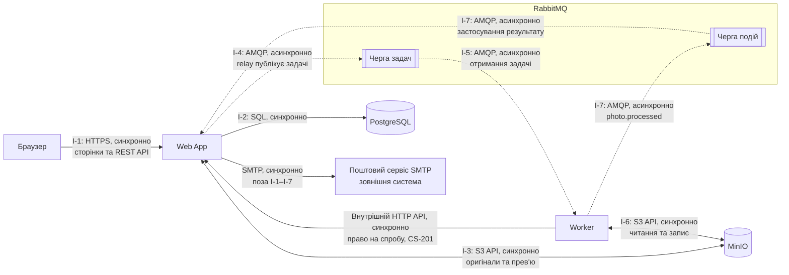

# Надійність і відновлення PicPick

CID (Component Interaction Diagram) показує взаємодії компонентів, а RMA workbook — режими їхніх відмов, вплив на користувача, виявлення та відновлення. Компоненти й потоки взято з [High-level Architecture](../03-srs/high-level-architecture.md), назви — з [глосарія](../glossary.md).

## CID-діаграма

Суцільні стрілки — синхронні виклики, пунктирні — асинхронні задачі й події. I-7 проходить двома стрілками через Чергу подій, але рахується як одна взаємодія. Підтвердження брокера не означає завершення обробки фото.

Внутрішній HTTP-виклик Worker → Web App доповнює отримання задачі в [CS-201](../06-concurrency/cs-201-competing-consumers.md): Worker запитує право на спробу, а в PostgreSQL пише лише Web App. SMTP показано для повноти архітектури. Ці допоміжні виклики не змінюють задану нумерацію семи взаємодій і не включені в підрахунок RMA нижче. Браузер не звертається безпосередньо до сховища, бази, Worker чи брокера.

## Взаємодії та аналіз зон

| ID | Взаємодія | Протокол і характер | RMA |
|---|---|---|---|
| I-1 | Браузер → Web App | HTTPS, синхронно | [Зона A](zone-a.md#i-1-браузер--web-app-сторінки-та-rest-api) |
| I-2 | Web App → PostgreSQL | SQL, синхронно | [Зона A](zone-a.md#i-2-web-app--postgresql-дані-акаунтів-і-галерей) |
| I-3 | Web App ↔ MinIO | S3 API, синхронно | [Зона C](zone-c.md#i-3--web-app-і-minio) |
| I-4 | Web App → RabbitMQ | AMQP, асинхронно | [Зона B](zone-b.md) |
| I-5 | RabbitMQ → Worker | AMQP, асинхронно | [Зона B](zone-b.md) |
| I-6 | Worker ↔ MinIO | S3 API, синхронно | [Зона B](zone-b.md) |
| I-7 | Worker → RabbitMQ → Web App | AMQP, асинхронно | [Зона C](zone-c.md#i-7--доставка-результату-обробки) |

## Огляд п.8

RMA охоплює **усі 7 взаємодій CID і 26 режимів відмови**. Зона A описує 8 відмов, зона B — 12, зона C — 6.

Ймовірність оцінюється якісно, критичність — від 1 до 5. Нижче п’ять пріоритетних відмов з трьох зон за спаданням критичності. Серед відмов із критичністю 4 виділено ті, що зупиняють роботу з файлами або просування обробки фото.

| Режим відмови | Критичність | Чому важливий і що робимо |
|---|---|---|
| [R-I1-1](zone-a.md), усі Web App недоступні | 5 | Користувачі не можуть працювати. Відкотити розгортання чи підняти здорову копію, перевірити зовнішній доступ |
| [R-I2-1](zone-a.md), база недоступна | 5 | Неможливі перевірка доступу та робота з даними. Не обходити авторизацію, дочекатися RDS failover чи відновити мережу, перевірити з'єднання |
| [R-I4-3](zone-b.md), задача не потрапила в чергу | 4 | Фото може застрягнути в обробці. `mandatory`, `basic.return` та outbox зберігають задачу до успішної публікації |
| [R-I3-1](zone-c.md#i-3--web-app-і-minio), MinIO недоступний для Web App | 4 | Клієнт не отримує прев’ю, а фотограф не може завантажити файли. Відновити сховище й перевірити прийняті фото перед повтором завантаження |
| [R-I7-1](zone-c.md#i-7--доставка-результату-обробки), результат не потрапив у Чергу подій | 4 | Прогрес фото зупиняється. Повторити публікацію за чинного lease або запланувати наступну спробу після його завершення |

Механізми захищають різні межі: SQL-транзакція не дає часткового запису в базі, outbox — втрати задачі між базою й брокером, lease та перевірка результату — прийняття застарілої спроби. Вони не утворюють спільної транзакції з MinIO. Тому потрібні повтори, фонове очищення й перевірка результату операції після обриву зв'язку. Поточний стан реалізації та робочі припущення зазначено у файлах зон; інфраструктурні механізми не вважаються вже перевіреними на заглушках API.
