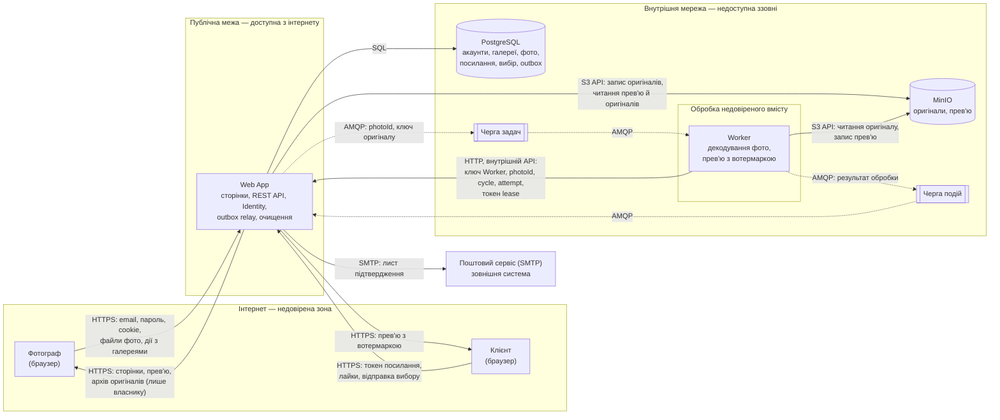

# П.9 Security model

Модель загроз PicPick. Кожна зона описує загрози свого головного флоу у файлі `zone-X.md`; тут зібрано спільну методологію й загальну діаграму потоків даних (DFD) системи, на яку орієнтуються зони.

## Методологія

- **STRIDE** для пошуку загроз: **S**poofing (підробка особи), **T**ampering (підміна даних), **R**epudiation (заперечення дій), **I**nformation disclosure (витік), **D**enial of service (відмова в обслуговуванні), **E**levation of privilege (підвищення прав). Опис категорій: [Microsoft Threat Modeling Tool](https://learn.microsoft.com/azure/security/develop/threat-modeling-tool-threats).
- **Ризик** = Ймовірність (1–3) × Вплив (1–3), тобто від 1 до 9.
- **Межі довіри** (trust boundaries) — місця, де дані переходять із менш довіреної зони в більш довірену. Саме на них живе більшість загроз, тому кожна загроза в зонах прив'язана до межі.

## DFD системи

Прямокутники — процеси, циліндри — сховища, підграфи — зони довіри. Пунктиром позначено асинхронні повідомлення через RabbitMQ.

## Межі довіри

| ID | Межа | Що перетинає | Чому важлива |
|---|---|---|---|
| TB-1 | Інтернет → Web App | Облікові дані, cookie, токени посилань, файли, усі параметри запитів | Усе, що надходить із браузера, контролює користувач або нападник. Web App — єдина точка входу, тож усі перевірки (вхід, власник, `ShareLink`, `ExpiresAt`, ліміти) виконуються тут |
| TB-2 | Web App → внутрішня мережа | SQL-запити, ключі файлів, повідомлення черг | PostgreSQL, MinIO і RabbitMQ не мають власної перевірки прав користувача. Якщо вони доступні напряму, усі перевірки Web App можна оминути |
| TB-3 | Файл користувача → декодер у Worker | Вміст фото: JPEG, PNG, HEIC, RAW | Файл пройшов лише перевірку сигнатури, але його внутрішня структура — недовірені дані. Декодер читає складні формати, тож Worker обробляє потенційно шкідливий вміст і має бути ізольованим |
| TB-4 | Web App → поштовий сервіс | Email фотографа, посилання підтвердження | Дані залишають систему; лист не повинен містити секретів, окрім одноразового посилання (Identity Management) |
| TB-5 | Worker → внутрішній API Web App | Ключ Worker, `photoId`, `cycle`, `attempt`, токен lease | Worker обробляє недовірений вміст (TB-3), тож після його зламу запити до API контролює нападник. Web App вважає їх лише частково довіреними: автентифікує ключ, приймає тільки два ендпоінти права на спробу й перевіряє всі параметри умовним `UPDATE` |

## Модель загроз за зонами

| Зона | Флоу | Файл |
|---|---|---|
| A | Вхід фотографа і керування галереями | [zone-a.md](zone-a.md) |
| B | Завантаження й обробка фото | [zone-b.md](zone-b.md) |
| C | Доступ клієнта за посиланням і вибір | `zone-c.md` |

ID загроз: T-1xx — зона A, T-2xx — зона B, T-3xx — зона C.

## Зведений план захисту

Попередній топ-10 за моделями зон A і B. Модель зони C буде враховано після її додавання до `main`. Якщо станом на 25 листопада вона ще буде в роботі, задача дозволяє завершити план із наявних моделей. [Задача #108](https://github.com/alonasaienko/picpick/issues/108)

Для порівняння використано оцінки з моделей зон за спільною шкалою «ймовірність × вплив». Сортуємо за спаданням ризику, при рівності — за спаданням впливу, далі за ID. Усі десять загроз мають ризик 6 і вплив 3. T-205 теж має ризик 6, але вплив 2, тому лишається поза топ-10. Він залишається в моделі зони B із заходом захисту від витоку EXIF.

| # | Загроза (ID) | Ризик | Mitigation | Тип | Компонент | Статус |
|---|---|---|---|---|---|---|
| 1 | [T-101](zone-a.md) Перебір паролів і credential stuffing | 6 (2 × 3) | Увімкнути Identity, ліміти спроб входу за email + IP та за IP. Уніфікувати відповіді на невдалий вхід | Запобігання | Web App, Identity | Заплановано. Є загальний ліміт API |
| 2 | [T-102](zone-a.md) Викрадений cookie | 6 (2 × 3) | Захистити cookie через HTTPS, `Secure`, `HttpOnly` і `SameSite=Lax`. Обмежити строк сесії. Відкликати сесії після скидання пароля або видалення акаунта | Запобігання, реагування | Web App, Identity | Заплановано |
| 3 | [T-103](zone-a.md) Доступ до чужої галереї | 6 (2 × 3) | Визначати власника з перевіреної сесії. Перевіряти власність на читанні й зміні. Повертати однаковий 404 для чужої та відсутньої галереї | Запобігання | Web App | Заплановано. Перевірка є для тестового фотографа |
| 4 | [T-104](zone-a.md) CSRF у діях фотографа | 6 (2 × 3) | Перевіряти antiforgery token перед зміною даних у Razor Pages та REST API з cookie. Залишити GET для читання | Запобігання | Web App | Заплановано для флоу |
| 5 | [T-105](zone-a.md) Збережений XSS у назві чи нікнеймі | 6 (2 × 3) | Виводити назву й нікнейм як текст через кодування Razor або `textContent` | Запобігання | Web App, браузер | Заплановано. Назва вже валідується |
| 6 | [T-201](zone-b.md) Завантаження в чужу галерею | 6 (2 × 3) | Перевіряти власника з сесії під час кожного завантаження. Використати той самий принцип перевірки, що в T-103 | Запобігання | Web App | Заплановано. Перевірка є для тестового фотографа |
| 7 | [T-202](zone-b.md) Файл, що прикидається фото | 6 (2 × 3) | Перевіряти сигнатуру файлу. Видавати клієнту заново створене JPEG-прев’ю з точним `Content-Type` та `nosniff` | Запобігання | Web App, Worker | Є перевірка сигнатури. Видачу прев’ю заплановано |
| 8 | [T-203](zone-b.md) Вичерпання пам’яті під час декодування | 6 (2 × 3) | Перевіряти ліміт 100 Мп перед повним декодуванням. Обмежити пам’ять контейнера й бюджет спроб. Позначати невідновну помилку як `Failed` | Запобігання, реагування | Worker | Заплановано за моделлю зони B |
| 9 | [T-204](zone-b.md) Шкідливе ім’я файлу | 6 (2 × 3) | Формувати ключ сховища на основі `photoId`. Показувати ім’я файлу як текст | Запобігання | Web App, MinIO | Є кодування виводу. Запис у сховище заплановано |
| 10 | [T-207](zone-b.md) Прямий доступ до оригіналів | 6 (2 × 3) | Зберігати оригінали у приватному бакеті. Видати сервісам окремі ключі з мінімальними правами. Віддавати оригінали через Web App після перевірки власника | Запобігання | MinIO, Web App | Заплановано |

## Покриття моделей загроз

Підрахунок охоплює всі загрози з наявних моделей, включно з тими, що поза топ-10.

| Зона | Флоу | Загрози | Категорії STRIDE |
|---|---|---:|---|
| A | Вхід фотографа і керування галереями | 7 | S, T, R, I, D |
| B | Завантаження й обробка фото | 10 | S, T, R, I, D, E |
| Разом | 2 флоу | 17 | 6 із 6 категорій |
