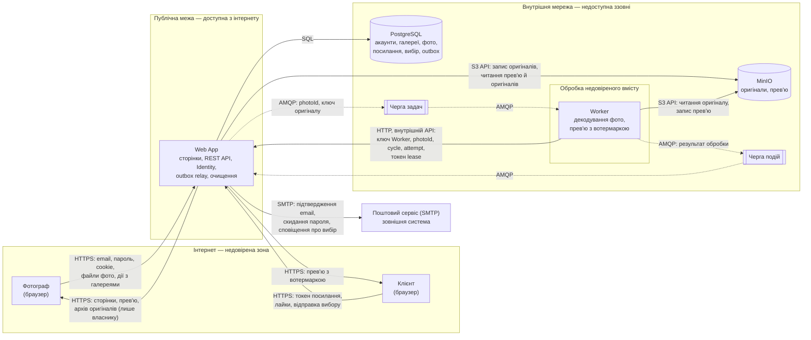

# П.9 Security model

Модель загроз PicPick. Кожна зона описує загрози свого головного флоу у файлі `zone-X.md`; тут зібрано спільну методологію й загальну діаграму потоків даних (DFD) системи, на яку орієнтуються зони.

## Методологія

- **STRIDE** для пошуку загроз: **S**poofing (підробка особи), **T**ampering (підміна даних), **R**epudiation (заперечення дій), **I**nformation disclosure (витік), **D**enial of service (відмова в обслуговуванні), **E**levation of privilege (підвищення прав). Опис категорій: [Microsoft Threat Modeling Tool](https://learn.microsoft.com/azure/security/develop/threat-modeling-tool-threats).
- **Ризик** = Ймовірність (1–3) × Вплив (1–3), тобто від 1 до 9. Шкала однакова для всіх зон:
  - **Ймовірність:** 1 — потрібні додаткові умови, 2 — реалістична атака, 3 — часта й проста.
  - **Вплив:** 1 — обмежена незручність; 2 — збій окремої функції, спір без доказів чи втрата можливості розібрати інцидент; 3 — доступ до чужого акаунта, фото чи даних або їх видалення.

  Це якісна оцінка сценарію до повного впровадження mitigation, а не виміряний залишковий ризик.
- **Межі довіри** (trust boundaries) — місця, де дані переходять із менш довіреної зони в більш довірену. Саме на них живе більшість загроз, тому кожна загроза в зонах прив'язана до межі.

## DFD системи

Прямокутники — процеси, циліндри — сховища, підграфи — зони довіри. Пунктиром позначено асинхронні повідомлення через RabbitMQ.

## Межі довіри

| ID | Межа | Що перетинає | Чому важлива |
|---|---|---|---|
| TB-1 | Інтернет → Web App | Облікові дані, cookie, токени посилань, файли, усі параметри запитів | Усе, що надходить із браузера, контролює користувач або нападник. Web App — єдина точка входу, тож усі перевірки (вхід, власник, `ShareLink`, `ExpiresAt`, ліміти) виконуються тут |
| TB-2 | Web App → внутрішня мережа | SQL-запити, ключі файлів, повідомлення черг | PostgreSQL, MinIO і RabbitMQ не мають власної перевірки прав користувача. Якщо вони доступні напряму, усі перевірки Web App можна оминути |
| TB-3 | Файл користувача → декодер у Worker | Вміст фото: JPEG, PNG, HEIC, RAW | Файл пройшов лише перевірку сигнатури, але його внутрішня структура — недовірені дані. Декодер читає складні формати, тож Worker обробляє потенційно шкідливий вміст і має бути ізольованим |
| TB-4 | Web App → поштовий сервіс | Email фотографа; одноразові посилання підтвердження email і скидання пароля; сповіщення про відправлений вибір (FR-109, цільова система) | Дані залишають систему; лист не повинен містити секретів, окрім одноразового посилання (Identity Management). Сповіщення про вибір містить лише посилання на власну галерею, що потребує входу, без токена клієнта |
| TB-5 | Worker → внутрішній API Web App | Ключ Worker, `photoId`, `cycle`, `attempt`, токен lease | Worker обробляє недовірений вміст (TB-3), тож після його зламу запити до API контролює нападник. Web App вважає їх лише частково довіреними: автентифікує ключ, приймає тільки два ендпоінти права на спробу й перевіряє всі параметри умовним `UPDATE` |

## Модель загроз за зонами

| Зона | Флоу | Файл |
|---|---|---|
| A | Вхід фотографа і керування галереями | [zone-a.md](zone-a.md) |
| B | Завантаження й обробка фото | [zone-b.md](zone-b.md) |
| C | Доступ клієнта за посиланням і вибір | [zone-c.md](zone-c.md) |

ID загроз: T-1xx — зона A, T-2xx — зона B, T-3xx — зона C.

## Зведений план захисту

Топ-10 за моделями зон A, B і C.

Порівнюємо оцінки за спільною шкалою «ймовірність × вплив». Пріоритет визначає ризик, а за рівності — більший вплив. Серед 13 загроз із ризиком 6 і впливом 3 об'єднали T-103 і T-201 за перевіркою власника, а T-207 і T-304 — за захистом доступу до оригіналів. Оцінка в кожному спільному рядку належить обом загрозам. Серед заходів з однаковим пріоритетом окремі рядки віддали перевіркам доступу, захисту сесій і посилань та безпечній обробці фото. T-204 залишили в моделі зони B, де частину захисту вже забезпечує кодування виводу. T-205 має той самий ризик 6, але вплив 2, тому захід проти витоку EXIF також лишається в моделі зони B.

| # | Загроза (ID) | Ризик | Mitigation | Тип | Компонент | Статус |
|---|---|---|---|---|---|---|
| 1 | [T-101](zone-a.md) Перебір паролів і credential stuffing | 6 (2 × 3) | Увімкнути Identity, ліміти спроб входу за email + IP та за IP. Уніфікувати відповіді на невдалий вхід | Запобігання | Web App, Identity | Заплановано. Є загальний ліміт API |
| 2 | [T-102](zone-a.md) Викрадений cookie | 6 (2 × 3) | Захистити cookie через HTTPS, `Secure`, `HttpOnly` і `SameSite=Lax`. Обмежити строк сесії. Відкликати сесії після скидання пароля або видалення акаунта | Запобігання, реагування | Web App, Identity | Заплановано |
| 3 | [T-103](zone-a.md), [T-201](zone-b.md) Доступ і завантаження в чужу галерею | 6 (2 × 3) | Визначати власника з перевіреної сесії. Перевіряти власність при читанні, зміні та завантаженні фото. Повертати однаковий 404 для чужої та відсутньої галереї | Запобігання | Web App | Заплановано. Перевірка є для тестового фотографа |
| 4 | [T-104](zone-a.md) CSRF у діях фотографа | 6 (2 × 3) | Перевіряти antiforgery token перед зміною даних у Razor Pages та REST API з cookie. Залишити GET для читання | Запобігання | Web App | Заплановано для флоу |
| 5 | [T-105](zone-a.md) Збережений XSS у назві чи нікнеймі | 6 (2 × 3) | Виводити назву й нікнейм як текст через кодування Razor або `textContent` | Запобігання | Web App, браузер | Заплановано. Назва вже валідується |
| 6 | [T-202](zone-b.md) Файл, що прикидається фото | 6 (2 × 3) | Перевіряти сигнатуру файлу. Видавати клієнту заново створене JPEG-прев'ю з точним `Content-Type` та `nosniff` | Запобігання | Web App, Worker | Є перевірка сигнатури. Видачу прев'ю заплановано |
| 7 | [T-203](zone-b.md) Вичерпання пам'яті під час декодування | 6 (2 × 3) | Перевіряти ліміт 100 Мп перед повним декодуванням. Обмежити пам'ять контейнера й бюджет спроб. Позначати невідновну помилку як `Failed` | Запобігання, реагування | Worker | Частково: ліміт 100 Мп у `make_preview` є; ліміт пам'яті контейнера й бюджет спроб заплановано |
| 8 | [T-207](zone-b.md), [T-304](zone-c.md) Доступ до оригіналів або чужих прев'ю | 6 (2 × 3) | Тримати файли в приватних бакетах MinIO. Видавати оригінали через Web App після перевірки сесії власника. Клієнту видавати лише прев'ю, що належать галереї з токена, без прямих адрес сховища | Запобігання | MinIO, Web App | Заплановано. Заглушка повертає демонстраційну підписану адресу прев'ю |
| 9 | [T-302](zone-c.md) Витік посилання | 6 (2 × 3) | Додати `Referrer-Policy: no-referrer` і `X-Robots-Tag: noindex, nofollow`. Маскувати токен у журналах. Зберігати лише хеш токена й відкликати посилання після витоку | Запобігання, реагування | Web App, PostgreSQL | Частково. Є HTTPS-редирект, HSTS поза середовищем Development і `traceId` у Problem Details. Заголовки та маскування заплановано |
| 10 | [T-308](zone-c.md) Доступ після відкликання чи закінчення терміну | 6 (2 × 3) | На кожному запиті перевіряти стан `ShareLink` і `ExpiresAt` посилання та галереї в PostgreSQL. Для прев'ю вимагати повторну перевірку кешу. Повертати 404 після відкликання або прострочення | Запобігання | Web App, PostgreSQL, браузер | Частково. Демо-стани `Expired` і `Revoked` дають 404. Перевірку в PostgreSQL, дію відкликання й заголовки кешування заплановано |

## Покриття моделей загроз

Підрахунок охоплює всі загрози з наявних моделей, включно з тими, що поза топ-10.

| Зона | Флоу | Загрози | Категорії STRIDE |
|---|---|---:|---|
| A | Вхід фотографа і керування галереями | 7 | S, T, R, I, D |
| B | Завантаження й обробка фото | 10 | S, T, R, I, D, E |
| C | Доступ клієнта за посиланням і вибір | 8 | S, T, R, I, D, E |
| Разом | 3 флоу | 25 | 6 із 6 категорій |
