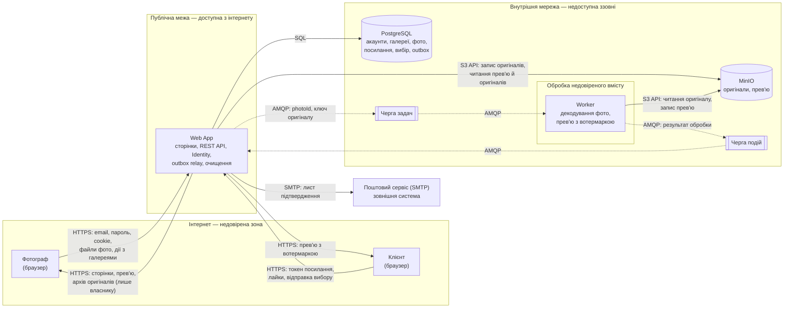

# П.9 Security model

Модель загроз PicPick. Кожна зона описує загрози свого головного флоу у файлі `zone-X.md`; тут зібрано спільну методологію й загальну діаграму потоків даних (DFD) системи, на яку орієнтуються зони.

## Методологія

- **STRIDE** для пошуку загроз: **S**poofing (підробка особи), **T**ampering (підміна даних), **R**epudiation (заперечення дій), **I**nformation disclosure (витік), **D**enial of service (відмова в обслуговуванні), **E**levation of privilege (підвищення прав). Опис категорій: [Microsoft Threat Modeling Tool](https://learn.microsoft.com/azure/security/develop/threat-modeling-tool-threats).
- **Ризик** = Ймовірність (1–3) × Вплив (1–3), тобто від 1 до 9.
- **Межі довіри** (trust boundaries) — місця, де дані переходять із менш довіреної зони в більш довірену. Саме на них живе більшість загроз, тому кожна загроза в зонах прив'язана до межі.

## DFD системи

Прямокутники — процеси, циліндри — сховища, підграфи — зони довіри. Пунктиром позначено асинхронні повідомлення через RabbitMQ.

## Межі довіри

| ID | Межа | Що перетинає | Чому важлива |
|---|---|---|---|
| TB-1 | Інтернет → Web App | Облікові дані, cookie, токени посилань, файли, усі параметри запитів | Усе, що надходить із браузера, контролює користувач або нападник. Web App — єдина точка входу, тож усі перевірки (вхід, власник, `ShareLink`, `ExpiresAt`, ліміти) виконуються тут |
| TB-2 | Web App → внутрішня мережа | SQL-запити, ключі файлів, повідомлення черг | PostgreSQL, MinIO і RabbitMQ не мають власної перевірки прав користувача. Якщо вони доступні напряму, усі перевірки Web App можна оминути |
| TB-3 | Файл користувача → декодер у Worker | Вміст фото: JPEG, PNG, HEIC, RAW | Файл пройшов лише перевірку сигнатури, але його внутрішня структура — недовірені дані. Декодер читає складні формати, тож Worker обробляє потенційно шкідливий вміст і має бути ізольованим |
| TB-4 | Web App → поштовий сервіс | Email фотографа, посилання підтвердження | Дані залишають систему; лист не повинен містити секретів, окрім одноразового посилання (Identity Management) |

## Модель загроз за зонами

| Зона | Флоу | Файл |
|---|---|---|
| A | Вхід фотографа і керування галереями | `zone-a.md` |
| B | Завантаження й обробка фото | [zone-b.md](zone-b.md) |
| C | Доступ клієнта за посиланням і вибір | `zone-c.md` |

ID загроз: T-1xx — зона A, T-2xx — зона B, T-3xx — зона C.
