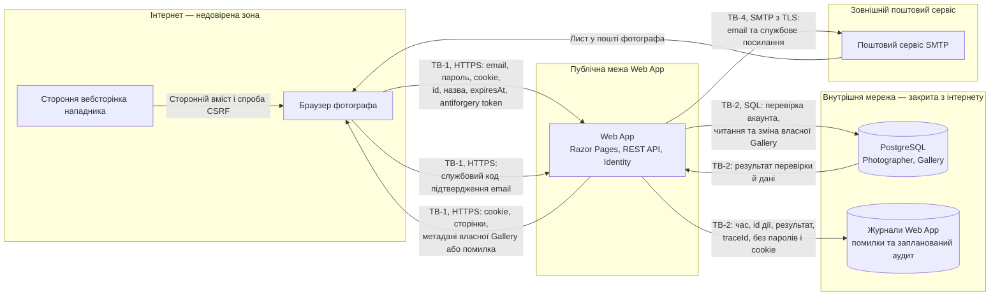

# Threat model: зона A

Флоу: **вхід фотографа і керування галереями**. Модель спирається на [Identity Management](../03-srs/identity.md), [вимоги зони A](../03-srs/zone-a-accounts.md) та [спільну методологію STRIDE](README.md#методологія). Це сценарії загроз і запланований захист, а не звіт про підтверджені вразливості.

## Обсяг і припущення

- **Активи:** email і пароль фотографа, cookie входу, цілісність Gallery та її видалення, приватність даних інших фотографів, доступність Web App.
- **Нападник:** анонімний відвідувач або фотограф зі своїм акаунтом. Він контролює параметри HTTP-запитів і назви власних галерей, може розмістити сторонню вебсторінку; за замовчуванням не має чужого cookie, доступу до PostgreSQL чи пошти фотографа. Викрадення cookie — окрема передумова T-102.
- **Очікувані гарантії:** власник визначається сервером за входом, а не переданим id; чужа й відсутня Gallery дають однаковий 404; видалення потребує дозволу власника й захисту від CSRF. Ролей адміністратора та підвищення прав через вибір ролі немає.
- **Обсяг прототипу:** заглушки API з одним тестовим Photographer, rate limiting і спільною обробкою помилок. Identity, PostgreSQL, SMTP та робочі сторінки керування галереями ще не підключені. Прототип не є захищеним багатокористувацьким розгортанням і не призначений для справжніх персональних даних.

## DFD флоу та межі довіри

Номери TB-1, TB-2 і TB-4 відповідають [DFD системи](README.md#межі-довіри). Підграфи показують зони довіри; підписи стрілок — дані, які перетинають межу. Діаграма описує цільовий флоу. Фото й робота Worker належать зоні B, доступ клієнта за ShareLink — зоні C.

**TB-1:** наявність cookie не означає, що запит справді ініціював фотограф; назва з бази також лишається недовіреним текстом при показі в браузері. **TB-2:** внутрішня мережа й обліковий запис БД не замінюють перевірку власника у Web App; базу та журнали не публікують назовні. **TB-4:** лист надсилається лише на збережений email, містить службове посилання, але не пароль; коди не потрапляють у журнали. Відновлення пароля — лише цільова система, за правилами Identity Management.

## Загрози

Ризик = **Ймовірність × Вплив**. Ймовірність: 1 — потрібні додаткові умови, 2 — реалістична атака, 3 — часта й проста. Вплив: 1 — обмежена незручність, 2 — збій окремої функції чи втрата можливості розібрати інцидент, 3 — доступ до чужого акаунта/даних або їх видалення. Це якісна оцінка сценарію до повного впровадження mitigation, а не виміряний залишковий ризик чи оцінка готовності прототипу.

| ID | STRIDE | Загроза | Актив під загрозою | Сценарій атаки | Ймовірність | Вплив | Ризик | Mitigation | Є в прототипі? |
|---|---|---|---|---|---|---|---|---|---|
| T-101 | Spoofing | Перебір паролів і credential stuffing, TB-1 | Акаунт Photographer та його галереї | Нападник надсилає спроби входу з паролями з витоків для відомого email, щоб діяти як фотограф | 2 | 3 | 6 | Штатний PasswordHasher Identity, пароль від 12 символів; перед пошуком акаунта — спільні ліміти форми/API: 5 спроб за 15 хв на email + IP та 20/хв на IP, однакові відмови для невідомого email, неправильного пароля й непідтвердженого акаунта. Глобального блокування за email немає; розподілений перебір лишається ризиком ([Identity](../03-srs/identity.md#вхід-сесія-та-вихід)) | Ні: входу ще немає; загальний ліміт API не є лімітом входу |
| T-102 | Spoofing | Повторне використання викраденого cookie, TB-1 | Сесія фотографа | Отримавши чинний cookie через скомпрометований пристрій чи витік, нападник повторює його та читає або видаляє галереї власника | 2 | 3 | 6 | HTTPS, `Secure`, `HttpOnly`, `SameSite=Lax`, фіксовані 8 год / 14 діб без sliding expiration. Після скидання пароля або видалення акаунта — відкликання всіх сесій із перевіркою вже на наступному запиті. Ці заходи обмежують ризик, але не захищають скомпрометований пристрій повністю | Ні: cookie входу й перевірка сесій не реалізовані |
| T-103 | Information disclosure | IDOR: доступ до чужої Gallery, TB-1/TB-2 | Метадані й вміст галерей іншого фотографа | Фотограф зі своїм входом замінює id у GET, finalize або DELETE на id чужої галереї, щоб прочитати чи змінити її дані | 2 | 3 | 6 | Власник лише з перевіреної сесії; кожне читання й зміна фільтрується за id галереї та власником. Перевірити `ExpiresAt` і видалення акаунта/галереї. Чужа й відсутня — однаковий 404 `GALLERY_NOT_FOUND`, без даних власника (NFR-102) | Частково: `FindOwned` відсіює чужий тестовий запис, але Photographer фіксований, автентифікації немає |
| T-104 | Tampering | CSRF: дія від імені фотографа, TB-1 | Цілісність Gallery, захист від небажаного видалення | Нападник заманює фотографа з чинним входом на свій сайт і намагається надіслати запит фіналізації чи видалення з його cookie, якщо браузер і формат запиту це дозволяють | 2 | 3 | 6 | Antiforgery-перевірка для всіх дій фотографа зі зміною даних: форми Razor Pages і cookie-authenticated REST API. JS передає antiforgery token у заголовку; сервер перевіряє його до зміни. `SameSite=Lax` — додатковий захист, HTTPS чи вікно підтвердження самі CSRF не усувають; GET не змінює дані | Ні для флоу: Razor Pages мають штатну підтримку antiforgery, але робочого входу, форм і перевірки API ще немає |
| T-105 | Tampering | Збережений XSS у назві чи нікнеймі, TB-1 | Сесія та дії в браузері того, хто переглядає галерею | Фотограф зберігає HTML/скрипт як назву або нікнейм; якщо UI вставить значення як HTML, код виконається під доменом PicPick у браузері фотографа чи клієнта | 2 | 3 | 6 | Показувати як текст: штатне кодування Razor, `textContent` у JS, без `Html.Raw` та `innerHTML` для цих полів. Ліміти 1–100 / 1–50 і Trim не замінюють кодування. `HttpOnly` забороняє читання cookie з JS, але не зупиняє дії скрипта від імені користувача | Частково: назва валідовується й повертається JSON; показ користувацької назви/нікнейма у сторінках цього флоу ще не реалізований |
| T-106 | Repudiation | Заперечення видалення галереї, TB-1/TB-2 | Можливість розібрати інцидент | Фотограф стверджує, що галерею видалив хтось інший; самих технічних помилок недостатньо, щоб установити, який акаунт ініціював дію | 1 | 2 | 2 | Запланувати аудит створення, фіналізації й запиту видалення: UTC-час, id фотографа й Gallery, дія, результат, `traceId`; без паролів, cookie й службових кодів. Доступ до журналу — лише обслуговуванню, запис недоступний користувачу. Строк 30 діб за retention policy; журнал видалень для бекапів має окрему мету й не замінює аудит. Аудит показує дію акаунта, не доводить особу людини з викраденим cookie | Ні: є журнал неочікуваних помилок, але немає аудиту успішних дій |
| T-107 | Denial of service | Виснаження Web App частими запитами, TB-1 | Доступність для фотографів і клієнтів | Скрипт безперервно викликає API галерей із багатьох з'єднань чи IP, витрачаючи CPU, пам'ять і з'єднання до БД | 2 | 2 | 4 | Політика `default` 120 запитів/хв на IP, обмеження паралельності й пулів, тайм-аути та моніторинг. Для кількох Web App — узгоджений ліміт на спільному вході, а не незалежний бюджет кожної копії. Ліміт на IP не усуває розподілену атаку; інфраструктурні заходи деталізуються в п.10–12 | Частково: ліміт API є, але лічильники локальні процесу, без розподіленого захисту й моніторингу |

Покрито **7 загроз і 5 категорій STRIDE**: Spoofing (T-101–102), Tampering (T-104–105), Repudiation (T-106), Information disclosure (T-103), Denial of service (T-107).

## На чому ґрунтується стан прототипу

Стан захисту перевірено за кодом прототипу.

| Код | Що підтверджує |
|---|---|
| [Program.cs](../../src/webapp/Program.cs#L5) | Реєстрацію Razor Pages, контролерів, помилок і rate limiting; немає підключення Identity та middleware автентифікації |
| [GalleryDemoStore.cs](../../src/webapp/Controllers/ZoneA/GalleryDemoStore.cs#L9) | Фіксованого Photographer та перевірку тестового власника в `FindOwned` |
| [GalleriesController.cs](../../src/webapp/Controllers/GalleriesController.cs#L143) | Видалення тестових метаданих через `FindOwned`; аудиту успішного видалення немає |
| [CreateGalleryRequest.cs](../../src/webapp/Models/ZoneA/CreateGalleryRequest.cs#L13) | Ліміт назви й Trim; це валідація, а не захист від виконання HTML |
| [RateLimitingExtensions.cs](../../src/webapp/Infrastructure/RateLimitingExtensions.cs#L37) | Політику `default`, повернення 429 і ключ за IP |
| [ErrorHandlingExtensions.cs](../../src/webapp/Infrastructure/ErrorHandlingExtensions.cs#L124) | Запис неочікуваних винятків із `traceId`, а не журнал усіх дій |
| [Сторінка галерей](../../src/webapp/Pages/Galleries/Index.cshtml#L11) | Заглушку майбутнього UI |

## Що перевірити після реалізації

1. Невідомий email, неправильний пароль і непідтверджений акаунт дають однакову відмову; перевищення ліміту входу — 429 незалежно від існування email.
2. Два фотографи: підміна id у читанні, фіналізації й видаленні не відкриває чужих даних. Старий cookie після скидання пароля/видалення акаунта відхиляється на наступному запиті.
3. Запити зміни без коректного antiforgery token не змінюють даних. HTML у назві/нікнеймі відображається текстом. Успішні дії мають записи аудиту, секретів у них немає.

Джерела: [Microsoft — STRIDE](https://learn.microsoft.com/azure/security/develop/threat-modeling-tool-threats), [antiforgery в ASP.NET Core](https://learn.microsoft.com/en-us/aspnet/core/security/anti-request-forgery?view=aspnetcore-8.0). Строки журналів та видалення — за [retention policy](../07-data-model/retention-policy.md); поведінка помилок — за [конвенцією](../05-error-handling/conventions.md).
