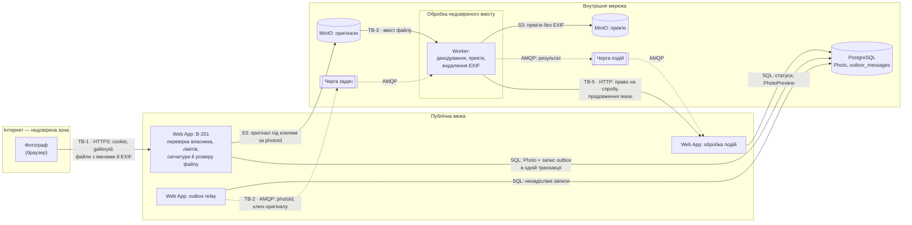

# Threat model: зона B — завантаження й обробка фото

Флоу: фотограф завантажує пакет фото (B-201), Web App перевіряє файли й зберігає оригінали в MinIO, задача через outbox потрапляє в Чергу задач, Worker створює прев'ю з вотермаркою й повідомляє результат. Загальна DFD системи, межі довіри TB-1…TB-5 і методологія — у [README](README.md). Модель спирається на [вимоги зони B](../03-srs/zone-b-processing.md), [модель даних зони B](../07-data-model/entities-zone-b.md) і сценарії [CS-201](../06-concurrency/cs-201-competing-consumers.md) та [CS-202](../06-concurrency/cs-202-transactional-outbox.md). Це сценарії загроз і запланований захист, а не звіт про захищеність прототипу.

## Обсяг і припущення

- **Активи:** оригінали фото (персональні дані людей у кадрі), прев'ю з вотермаркою, метадані EXIF з геолокацією, цілісність галереї, доступність обробки для всіх фотографів, ключі доступу до MinIO, RabbitMQ і внутрішнього API.
- **Нападник:**
  - фотограф із власним акаунтом, який контролює вміст і імена файлів, параметри запиту завантаження й частоту запитів;
  - той, хто дістався внутрішньої мережі чи відкритого порту RabbitMQ або MinIO;
  - той, хто через вразливість декодера отримав виконання коду в контейнері Worker (TB-3).

  За замовчуванням нападник не має чужого cookie входу й доступу до PostgreSQL.
- **Особливість флоу:** файл від користувача проходить дві межі. На TB-1 Web App перевіряє лише сигнатуру й розмір, а внутрішню структуру файлу вперше розбирає декодер у Worker на TB-3. Тому обидві межі мають власний захист.
- **Обсяг прототипу:** `PhotosController` — заглушки API з тестовими даними в пам'яті, без PostgreSQL і MinIO; Worker поки складається з функції `make_preview` без черги. RabbitMQ і MinIO уже піднімає [compose.yaml](../../compose.yaml), але Web App і Worker до них ще не підключені; внутрішнього API ще немає. Стан захисту в останній колонці таблиці перевірено за кодом ([нижче](#на-чому-ґрунтується-стан-прототипу)).

## DFD флоу

## Загрози

Ризик = **Ймовірність × Вплив** за [спільною шкалою](README.md#методологія). Оцінка — для сценарію до повного впровадження mitigation.

| ID | STRIDE | Загроза | Актив під загрозою | Сценарій атаки | Ймовірність | Вплив | Ризик | Mitigation | Є в прототипі? |
|---|---|---|---|---|---|---|---|---|---|
| T-201 | Spoofing | Завантаження в чужу галерею | Галерея й вибір іншого фотографа | Фотограф із власним акаунтом підставляє в `POST /api/galleries/{galleryId}/photos` ідентифікатор чужої галереї й підкидає туди свої фото, які потім побачить клієнт іншого фотографа | 2 | 3 | 6 | Власник визначається з cookie входу, а не з параметра запиту; кожен запит перевіряє, що галерея належить поточному фотографу, і для чужої відповідає так само, як для неіснуючої (404, NFR-102); ідентифікатори — випадкові UUID | Частково: перевірка власника є, але для одного тестового фотографа, без входу |
| T-202 | Tampering | Файл, що прикидається фото | Сесія фотографа й клієнта, вміст галереї | Нападник завантажує HTML-сторінку чи скрипт з розширенням `.jpg`. Якщо сервер повірить розширенню й колись віддасть файл як `text/html`, скрипт виконається в браузері того, хто його відкриє | 2 | 3 | 6 | Формат визначається за сигнатурою вмісту, а не за розширенням чи `Content-Type` (FR-202); клієнт отримує лише прев'ю, заново створене Worker як JPEG; відповіді з файлами мають точний `Content-Type` і `X-Content-Type-Options: nosniff`; оригінали віддаються лише як вкладення в архіві (FR-208) | Частково: перевірка сигнатури є; віддачі файлів ще немає |
| T-203 | Denial of service | «Бомба» з розпакування | Worker і обробка фото для всіх фотографів | Нападник завантажує PNG на кілька кілобайтів, у заголовку якого вказано розмір 50 000 × 50 000 px. Декодер намагається виділити понад 7 ГБ пам'яті, Worker падає, задача повертається в чергу й валить наступний Worker | 2 | 3 | 6 | Явна перевірка розміру **до повного декодування**, окремо для кожного декодера: для JPEG, PNG і HEIC Worker відкриває файл (`Image.open` читає лише заголовок, пікселі ще не розпаковані) і, якщо `width × height > 100_000_000`, одразу ставить `Failed` без повторів, не викликаючи `load()`. Самого `Image.MAX_IMAGE_PIXELS` недостатньо: між 1× і 2× порога Pillow лише видає `DecompressionBombWarning` і продовжує декодування, а `DecompressionBombError` кидає тільки понад 2×. Тому додатково `warnings.simplefilter("error", Image.DecompressionBombWarning)` перетворює попередження на помилку як другу лінію захисту. Для RAW налаштування Pillow не діють, бо декодує rawpy/LibRaw: після `rawpy.imread` доступні розміри з метаданих (`raw.sizes.raw_width`, `raw_height`, `width`, `height`), і Worker перевіряє той самий ліміт 100 Мп до `postprocess()`, яке розпаковує дані. Далі — ліміт пам'яті 1 ГБ на контейнер і бюджет 3 спроб на цикл обробки з Dead Letter Queue як запобіжником, після чого `Failed` (FR-205, облік спроб і R-I5-2 у п.8). Джерела: [Pillow — Image.open і DecompressionBombError](https://pillow.readthedocs.io/en/stable/reference/Image.html#PIL.Image.open), [rawpy API](https://letmaik.github.io/rawpy/api/) | Частково: для **JPEG і PNG** [`make_preview`](../../src/worker/preview.py) перевіряє ліміт 100 Мп до повного декодування й перетворює `DecompressionBombWarning` на помилку. `SUPPORTED_FORMATS` поки містить лише ці два формати: HEIC (`pillow-heif`) і RAW (`rawpy`) не приймаються, тож їхніх перевірок ще немає. Worker з чергою, ліміт пам'яті контейнера й бюджет спроб ще не реалізовано |
| T-204 | Tampering | Шкідливе ім'я файлу | Сторінки фотографа, сховище | Нападник називає файл `.jpg` або `../../config.json`. Ім'я показується у прогресі й у списку обраних (FR-204, FR-306), а якби воно використовувалось як шлях, запис потрапив би поза потрібну папку | 2 | 3 | 6 | Ім'я файлу ніколи не використовується як ключ у MinIO — ключ визначає `photoId`; на сторінках ім'я виводиться як текст (Razor кодує HTML за замовчуванням, FR-306); довжина обмежена, керувальні символи прибираються | Частково: Razor і JSON кодують вивід; у MinIO ще нічого не записується |
| T-205 | Information disclosure | Витік геолокації та даних камери через EXIF | Місце зйомки людей у кадрі, серійний номер камери фотографа | Фото зі смартфона містять у EXIF GPS-координати. Будь-хто з посиланням на галерею завантажує прев'ю й дізнається, де, наприклад, живе наречена | 3 | 2 | 6 | Worker не копіює EXIF у прев'ю (FR-203), орієнтацію застосовує до пікселів; оригінали з EXIF доступні лише власнику (FR-208) | Частково: для JPEG і PNG [`make_preview`](../../src/worker/preview.py) не копіює EXIF, ICC і XMP у прев'ю й застосовує орієнтацію до пікселів. Видачі прев'ю клієнту й захищеної видачі оригіналів лише власнику (FR-208) ще немає |
| T-206 | Spoofing | Підроблені задачі, події чи запити до внутрішнього API | Оригінали інших галерей, статуси фото | Хтось отримав доступ до RabbitMQ (стандартний обліковий запис `guest`, відкритий порт) і публікує задачу з ключем чужого оригіналу або подію «готово» для фото, яке не оброблялося. Або той, хто дістався внутрішньої мережі, викликає внутрішній API Web App і забирає право на чужі спроби, щоб зупинити обробку | 1 | 3 | 3 | RabbitMQ доступний лише у внутрішній мережі; окремі облікові записи з мінімальними правами (Web App публікує задачі й читає події, Worker — навпаки); ключ оригіналу Worker бере не з повідомлення, а з відповіді Web App на `claim`: Web App будує його з рядка `Photo` (бакет `originals`, ключ `{gallery_id}/{photo_id}`) лише для фото, що справді чекає цієї спроби, тож підроблена задача з чужим ключем не дасть прочитати інший оригінал, а задача для неіснуючого чи вже обробленого фото не отримає права; формат ключа сам по собі захистом не є, Worker лише додатково звіряє, що `gallery_id` і `photo_id` у ключі збігаються з відповіддю `claim`; Web App приймає подію лише з чинним токеном lease, тож підроблена подія «готово» без токена ігнорується; внутрішній API слухає окремий порт, опублікований лише у внутрішній мережі контейнерів, і приймає лише запити з ключем Worker (`Authorization: Bearer`, секрет із `.env`, окремий від ключів RabbitMQ і MinIO); ключ дозволяє лише `claim` і `renew` для задач, що очікують обробки, а кожен виклик перевіряє `photoId`, `cycle`, `attempt` і доступність фото умовним `UPDATE` | Частково: [compose.yaml](../../compose.yaml) створює RabbitMQ з обліковим записом із `.env` замість `guest` і публікує порти лише на `127.0.0.1`. Окремих записів для Web App і Worker, перевірки токена lease та внутрішнього API ще немає |
| T-207 | Information disclosure | Прямий доступ до оригіналів у MinIO | Усі оригінали всіх фотографів | Порт MinIO чи його консоль доступні з інтернету зі стандартними ключами `minioadmin`, або бакет публічний. Нападник завантажує всі оригінали, оминаючи перевірки Web App | 2 | 3 | 6 | Бакети приватні, порти MinIO не публікуються назовні; ключі не стандартні й зберігаються в `.env`; у кожного сервісу свої ключі з мінімальними правами (Worker лише читає оригінали й пише прев'ю); оригінали віддає лише Web App після перевірки власника, без прямих посилань на MinIO (FR-208) | Частково: [compose.yaml](../../compose.yaml) робить бакети `originals` і `previews` приватними (`mc anonymous set none`), бере ключі з `.env` замість `minioadmin` і публікує порти лише на `127.0.0.1`. Окремих ключів із мінімальними правами для Web App і Worker та віддачі оригіналів через Web App ще немає |
| T-208 | Denial of service | Заповнення сховища й черги | Диск MinIO, Черга задач, обробка для інших фотографів | Скрипт від імені одного акаунта безперервно завантажує максимальні пакети по 1 ГБ у нові галереї, заповнюючи диск і чергу | 2 | 2 | 4 | Ліміт частоти `upload` (token bucket); 50 файлів і 1 ГБ на запит, 1000 фото на галерею; квота місця на фотографа (цільова система); моніторинг заповнення диска MinIO (R-I6-4 у п.8); автоматичне видалення прострочених галерей | Частково: ліміти запиту, галереї й частоти є; квоти й моніторингу немає |
| T-209 | Repudiation | Заперечення завантаження чи видалення | Довіра між фотографом і клієнтом, розбір інцидентів | Фотограф стверджує, що не завантажував фото, яке потрапило до клієнта, або що фото «зникли самі». Без журналу неможливо встановити, хто й коли це зробив | 1 | 2 | 2 | Журнал дій: завантаження, повтори й видалення фото з ідентифікатором фотографа, часом і `traceId`; журнал видалень (retention policy п.7) | Ні |
| T-210 | Elevation of privilege | Виконання коду через вразливість декодера | Worker і всі ключі, до яких він має доступ | Нападник готує RAW чи HEIC, що використовує відому вразливість у LibRaw чи libheif, і отримує виконання коду в контейнері Worker | 1 | 3 | 3 | Бібліотеки декодування оновлюються; Worker працює не від root, з файловою системою лише для читання й тимчасовою папкою; доступ мережею лише до RabbitMQ, MinIO і внутрішнього API Web App; у Worker немає ключів до PostgreSQL. **Реальна область прав Worker у MinIO:** у прототипі й базовій цільовій схемі ключ Worker спільний для всіх галерей: **читання** всього бакета `originals` і **запис** у весь бакет `previews`, без права видаляти чи писати в `originals`. Ізоляція контейнера не захищає ці файли: код нападника в Worker успадковує той самий ключ. **Залишковий ризик:** після виконання коду нападник може прочитати оригінали будь-яких галерей і підмінити будь-які прев'ю (наприклад, прибрати вотермарку чи показати клієнтові чужі кадри). Він не бачить PostgreSQL, не змінює оригінали й не дістає ключів Web App. Ключ внутрішнього API він теж успадковує, але той дає лише `claim` і `renew`, тобто відмову в обробці, а не доступ до даних. Можливі два сценарії: (1) нападник забирає право на спроби, що очікують обробки, і **не продовжує** lease — тоді спроби закінчуються як перервані, і фото після 3 спроб отримують `Failed`; (2) нападник **регулярно продовжує** отриманий lease через `renew` — тоді спроба не закінчується, лічильник не збільшується, і фото лишається в `Processing`, а галерея — у `Processing` без переходу в `Ready`, доки ресурс не стане недоступним (видалення чи `ExpiresAt`) або не втрутиться той, хто обслуговує систему (зупинка зламаного Worker і заміна ключа API). Обмеження загальної тривалості спроби в цьому PR не вводиться; ознака сценарію — фото в `Processing` з lease, що продовжується довше за звичайну обробку. Через API нападник не читає даних галерей і не змінює стан поза спробами, які сам отримав. **Додатковий захід (цільова система):** звузити права до конкретної задачі. Worker не має власного ключа MinIO, а relay під час публікації кладе в задачу два presigned URL: `GET` одного оригіналу й `PUT` одного ключа прев'ю, з коротким строком дії. Тоді зламаний Worker дістає лише файли задач, які отримує, поки його не перезапущено. Строк дії має покривати очікування в черзі; якщо URL прострочився, це тимчасова помилка, і повтор отримує нову задачу з новими URL (FR-205) | Ні: Worker ще не реалізовано |

## Підсумок

| Категорія STRIDE | Загрози |
|---|---|
| Spoofing | T-201, T-206 |
| Tampering | T-202, T-204 |
| Repudiation | T-209 |
| Information disclosure | T-205, T-207 |
| Denial of service | T-203, T-208 |
| Elevation of privilege | T-210 |

Покрито всі 6 категорій. Найвищий ризик (6) мають загрози на межах TB-1 і TB-3: файли й параметри від користувача, і вміст, який розбирає декодер. Більшість заходів для них уже закладено у вимоги зони B (FR-202, FR-203, FR-205, FR-208, NFR-102) і в п.8; у прототипі реалізовано ті, що стосуються Web App, а також захист у функції прев'ю Worker (ліміт 100 Мп для T-203, прев'ю без EXIF для T-205). Решта захисту Worker, MinIO та RabbitMQ з'явиться разом із ними.

## На чому ґрунтується стан прототипу

| Код | Що підтверджує |
|---|---|
| [PhotosController.cs](../../src/webapp/Controllers/PhotosController.cs#L38) | Політику `upload` (token bucket) і ліміт розміру тіла запиту для B-201 |
| [PhotosController.cs](../../src/webapp/Controllers/PhotosController.cs#L53) | Перевірку власника через `FindOwned` для одного тестового фотографа; чужа й відсутня галерея дають однаковий 404 |
| [PhotoFileCheck.cs](../../src/webapp/Controllers/ZoneB/PhotoFileCheck.cs#L16) | Визначення формату за сигнатурою вмісту, а не за розширенням, і ліміти 30 / 150 МБ |
| [RateLimitingExtensions.cs](../../src/webapp/Infrastructure/RateLimitingExtensions.cs#L27) | Token bucket для `upload`; ключ ліміту — IP-адреса |
| [preview.py](../../src/worker/preview.py#L29) | `SUPPORTED_FORMATS = ("JPEG", "PNG")`: інші формати, зокрема HEIC і RAW, поки не декодуються |
| [preview.py](../../src/worker/preview.py#L74) | Перевірку `width × height` проти 100 Мп до повного декодування — для JPEG і PNG |
| [preview.py](../../src/worker/preview.py#L55) | `DecompressionBombWarning` як помилку (для JPEG і PNG), прев'ю без EXIF, ICC і XMP, орієнтацію з EXIF у пікселях |
| [test_preview.py](../../tests/worker/test_preview.py#L90) | Тести: EXIF і GPS не потрапляють у прев'ю, «бомба» відхиляється до декодування, ліміт рівно 100 Мп |

## Що перевірити після реалізації

1. **Власник:** фотограф підставляє в B-201 id чужої галереї й отримує той самий 404, що й для неіснуючої; у чужій галереї не з'являється жодного фото.
2. **Файли:** HTML із розширенням `.jpg` відхиляється з `PHOTO_FORMAT_NOT_SUPPORTED`; клієнт отримує лише JPEG-прев'ю з `Content-Type: image/jpeg` і `X-Content-Type-Options: nosniff`; файл з іменем `../../config.json` зберігається під ключем за `photoId`, а ім'я на сторінках показується текстом.
3. **Декодер:** PNG 50 000 × 50 000 px дає `Failed` без повторів, а Worker не перевищує ліміту пам'яті контейнера 1 ГБ.
4. **EXIF:** у прев'ю фото зі смартфона немає GPS-координат і даних камери, а оригінал у MinIO байт у байт збігається із завантаженим.
5. **Внутрішня мережа:** порти MinIO і RabbitMQ недоступні ззовні, стандартні облікові записи `guest` і `minioadmin` вимкнено; задача з чужим ключем оригіналу чи подія без чинного токена lease нічого не змінюють.
