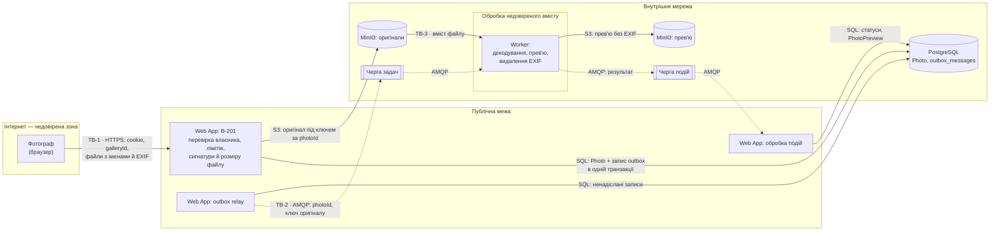

# Threat model: зона B — завантаження й обробка фото

Флоу: фотограф завантажує пакет фото (B-201), Web App перевіряє файли й зберігає оригінали в MinIO, задача через outbox потрапляє в Чергу задач, Worker створює прев'ю з вотермаркою й повідомляє результат. Загальна DFD системи, межі довіри TB-1…TB-4 і методологія — у [README](README.md).

## DFD флоу

## Загрози

| ID | STRIDE | Загроза | Актив під загрозою | Сценарій атаки | Ймовірність | Вплив | Ризик | Mitigation | Є в прототипі? |
|---|---|---|---|---|---|---|---|---|---|
| T-201 | Spoofing | Завантаження в чужу галерею | Галерея й вибір іншого фотографа | Фотограф із власним акаунтом підставляє в `POST /api/galleries/{galleryId}/photos` ідентифікатор чужої галереї й підкидає туди свої фото, які потім побачить клієнт іншого фотографа | 2 | 3 | 6 | Власник визначається з cookie входу, а не з параметра запиту; кожен запит перевіряє, що галерея належить поточному фотографу, і для чужої відповідає так само, як для неіснуючої (404, NFR-102); ідентифікатори — випадкові UUID | Частково: перевірка власника є, але для одного тестового фотографа, без входу |
| T-202 | Tampering | Файл, що прикидається фото | Сесія фотографа й клієнта, вміст галереї | Нападник завантажує HTML-сторінку чи скрипт з розширенням `.jpg`. Якщо сервер повірить розширенню й колись віддасть файл як `text/html`, скрипт виконається в браузері того, хто його відкриє | 2 | 3 | 6 | Формат визначається за сигнатурою вмісту, а не за розширенням чи `Content-Type` (FR-202); клієнт отримує лише прев'ю, заново створене Worker як JPEG; відповіді з файлами мають точний `Content-Type` і `X-Content-Type-Options: nosniff`; оригінали віддаються лише як вкладення в архіві (FR-208) | Частково: перевірка сигнатури є; віддачі файлів ще немає |
| T-203 | Denial of service | «Бомба» з розпакування | Worker і обробка фото для всіх фотографів | Нападник завантажує PNG на кілька кілобайтів, у заголовку якого вказано розмір 50 000 × 50 000 px. Декодер намагається виділити понад 7 ГБ пам'яті, Worker падає, задача повертається в чергу й валить наступний Worker | 2 | 3 | 6 | Явна перевірка розміру **до повного декодування**, окремо для кожного декодера: для JPEG, PNG і HEIC Worker відкриває файл (`Image.open` читає лише заголовок, пікселі ще не розпаковані) і, якщо `width × height > 100_000_000`, одразу ставить `Failed` без повторів, не викликаючи `load()`. Самого `Image.MAX_IMAGE_PIXELS` недостатньо: між 1× і 2× порога Pillow лише видає `DecompressionBombWarning` і продовжує декодування, а `DecompressionBombError` кидає тільки понад 2×. Тому додатково `warnings.simplefilter("error", Image.DecompressionBombWarning)` перетворює попередження на помилку як другу лінію захисту. Для RAW налаштування Pillow не діють, бо декодує rawpy/LibRaw: після `rawpy.imread` доступні розміри з метаданих (`raw.sizes.raw_width`, `raw_height`, `width`, `height`), і Worker перевіряє той самий ліміт 100 Мп до `postprocess()`, яке розпаковує дані. Далі — ліміт пам'яті 1 ГБ на контейнер і бюджет 3 спроб на цикл обробки з Dead Letter Queue як запобіжником, після чого `Failed` (FR-205, облік спроб і R-I5-2 у п.8). Джерела: [Pillow — Image.open і DecompressionBombError](https://pillow.readthedocs.io/en/stable/reference/Image.html#PIL.Image.open), [rawpy API](https://letmaik.github.io/rawpy/api/) | Ні: Worker ще не реалізовано |
| T-204 | Tampering | Шкідливе ім'я файлу | Сторінки фотографа, сховище | Нападник називає файл `.jpg` або `../../config.json`. Ім'я показується у прогресі й у списку обраних (FR-204, FR-306), а якби воно використовувалось як шлях, запис потрапив би поза потрібну папку | 2 | 3 | 6 | Ім'я файлу ніколи не використовується як ключ у MinIO — ключ визначає `photoId`; на сторінках ім'я виводиться як текст (Razor кодує HTML за замовчуванням, FR-306); довжина обмежена, керувальні символи прибираються | Частково: Razor і JSON кодують вивід; у MinIO ще нічого не записується |
| T-205 | Information disclosure | Витік геолокації та даних камери через EXIF | Місце зйомки людей у кадрі, серійний номер камери фотографа | Фото зі смартфона містять у EXIF GPS-координати. Будь-хто з посиланням на галерею завантажує прев'ю й дізнається, де, наприклад, живе наречена | 3 | 2 | 6 | Worker не копіює EXIF у прев'ю (FR-203), орієнтацію застосовує до пікселів; оригінали з EXIF доступні лише власнику (FR-208) | Ні: Worker ще не реалізовано |
| T-206 | Spoofing | Підроблені задачі чи події в черзі | Оригінали інших галерей, статуси фото | Хтось отримав доступ до RabbitMQ (стандартний обліковий запис `guest`, відкритий порт) і публікує задачу з ключем чужого оригіналу або подію «готово» для фото, яке не оброблялося | 1 | 3 | 3 | RabbitMQ доступний лише у внутрішній мережі; окремі облікові записи з мінімальними правами (Web App публікує задачі й читає події, Worker — навпаки); Worker приймає лише ключі формату `originals/{photoId}`; Web App перевіряє, що фото існує, а перехід статусу допустимий | Ні: RabbitMQ ще не розгорнуто |
| T-207 | Information disclosure | Прямий доступ до оригіналів у MinIO | Усі оригінали всіх фотографів | Порт MinIO чи його консоль доступні з інтернету зі стандартними ключами `minioadmin`, або бакет публічний. Нападник завантажує всі оригінали, оминаючи перевірки Web App | 2 | 3 | 6 | Бакети приватні, порти MinIO не публікуються назовні; ключі не стандартні й зберігаються в `.env`; у кожного сервісу свої ключі з мінімальними правами (Worker лише читає оригінали й пише прев'ю); оригінали віддає лише Web App після перевірки власника, без прямих посилань на MinIO (FR-208) | Ні: MinIO ще не розгорнуто |
| T-208 | Denial of service | Заповнення сховища й черги | Диск MinIO, Черга задач, обробка для інших фотографів | Скрипт від імені одного акаунта безперервно завантажує максимальні пакети по 1 ГБ у нові галереї, заповнюючи диск і чергу | 2 | 2 | 4 | Ліміт частоти `upload` (token bucket); 50 файлів і 1 ГБ на запит, 1000 фото на галерею; квота місця на фотографа (цільова система); моніторинг заповнення диска MinIO (R-I6-4 у п.8); автоматичне видалення прострочених галерей | Частково: ліміти запиту, галереї й частоти є; квоти й моніторингу немає |
| T-209 | Repudiation | Заперечення завантаження чи видалення | Довіра між фотографом і клієнтом, розбір інцидентів | Фотограф стверджує, що не завантажував фото, яке потрапило до клієнта, або що фото «зникли самі». Без журналу неможливо встановити, хто й коли це зробив | 1 | 2 | 2 | Журнал дій: завантаження, повтори й видалення фото з ідентифікатором фотографа, часом і `traceId`; журнал видалень (retention policy п.7) | Ні |
| T-210 | Elevation of privilege | Виконання коду через вразливість декодера | Worker і всі ключі, до яких він має доступ | Нападник готує RAW чи HEIC, що використовує відому вразливість у LibRaw чи libheif, і отримує виконання коду в контейнері Worker | 1 | 3 | 3 | Бібліотеки декодування оновлюються; Worker працює не від root, з файловою системою лише для читання й тимчасовою папкою; доступ мережею лише до RabbitMQ і MinIO; ключі з мінімальними правами, тож навіть зламаний Worker не бачить PostgreSQL і не читає чужі прев'ю на запис | Ні: Worker ще не реалізовано |

## Підсумок

| Категорія STRIDE | Загрози |
|---|---|
| Spoofing | T-201, T-206 |
| Tampering | T-202, T-204 |
| Repudiation | T-209 |
| Information disclosure | T-205, T-207 |
| Denial of service | T-203, T-208 |
| Elevation of privilege | T-210 |

Покрито всі 6 категорій. Найвищий ризик (6) мають загрози на межах TB-1 і TB-3: файли й параметри від користувача, і вміст, який розбирає декодер. Більшість заходів для них уже закладено у вимоги зони B (FR-202, FR-203, FR-205, FR-208, NFR-102) і в п.8; у прототипі реалізовано ті, що стосуються Web App, а захист Worker, MinIO та RabbitMQ з'явиться разом із ними.
