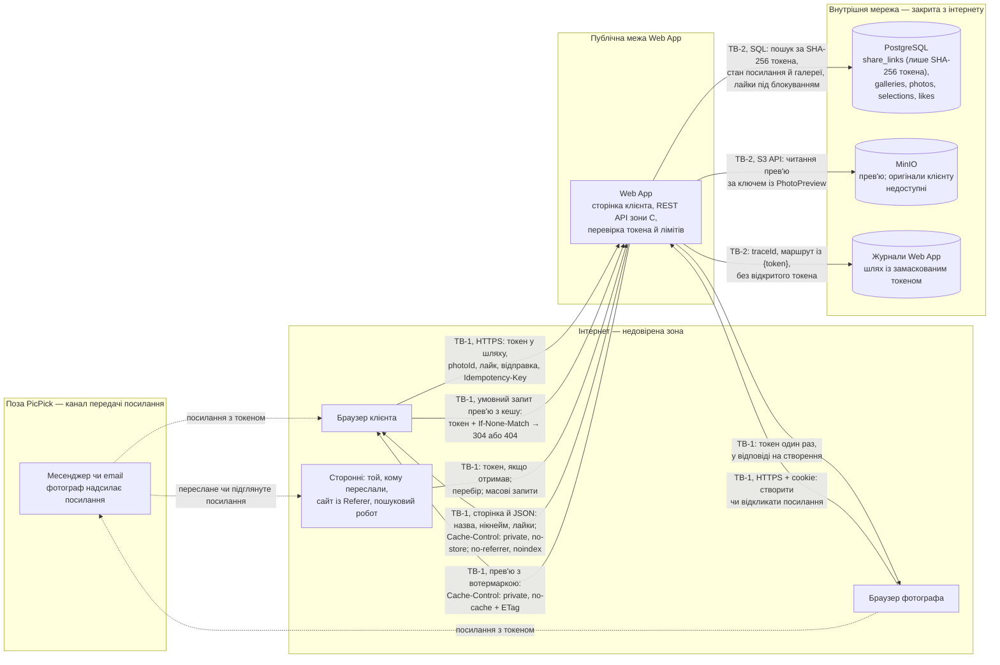

# Threat model: зона C

Флоу: **доступ клієнта за посиланням і вибір**. Модель спирається на [вимоги зони C](../03-srs/zone-c-client.md), [гостьовий доступ в Identity Management](../03-srs/identity.md#клієнт), [flow зони C](../04-architecture/flow-zone-c.md), сценарії [CS-301](../06-concurrency/cs-301-idempotency-key.md) і [CS-302](../06-concurrency/cs-302-lww-element-set.md) та [спільну методологію STRIDE](README.md#методологія). Це сценарії загроз і запланований захист, а не звіт про захищеність прототипу.

## Обсяг і припущення

- **Активи:** токен посилання (замінює клієнту логін і пароль), прев'ю з вотермаркою, оригінали фотографа, назва галереї й нікнейм, `Selection` і лайки, доступність сторінки клієнта.
- **Нападник:**
  - анонім в інтернеті без посилання — перебирає токени, шле масові запити;
  - людина, до якої посилання потрапило без відома фотографа: переслали, побачила в чужому телефоні чи історії браузера, знайшла в журналі чи заголовку `Referer`;
  - клієнт із чинним посиланням, який хоче більше, ніж йому дозволено: оригінали, чужі галереї, зміну вже відправленого вибору.

  Нападник контролює всі параметри запиту: токен, `photoId`, `previewId`, `galleryId`, заголовки. Доступу до PostgreSQL, MinIO чи cookie фотографа за замовчуванням не має.
- **Особливість флоу:** клієнт не має акаунта. Система ідентифікує не людину, а власника посилання: хто пред'явив чинний токен, той і діє як клієнт ([Identity Management](../03-srs/identity.md#як-система-розуміє-що-це-клієнт)). Тому весь захист зводиться до трьох речей: токен неможливо вгадати, він не витікає і не діє після відкликання чи закінчення терміну.
- **Обсяг прототипу:** [ShareController](../../src/webapp/Controllers/ShareController.cs) — заглушки API з фіксованими демо-токенами, без PostgreSQL. Стан захисту в останній колонці таблиці перевірено за кодом ([нижче](#на-чому-ґрунтується-стан-прототипу)).

## DFD флоу та межі довіри

Номери TB-1 і TB-2 відповідають [DFD системи](README.md#межі-довіри). Підграфи — зони довіри, підписи стрілок — дані, що перетинають межу. Діаграма описує цільовий флоу.

- **TB-1, кешування:** сторінка й JSON мають `no-store` — браузер їх не зберігає. Прев'ю — єдина відповідь, яку браузер може зберегти у своєму приватному кеші (`no-cache` з `ETag`, NFR-301 п.3), але перед кожним показом він надсилає умовний запит із токеном: чинне посилання отримує `304` без тіла, недійсне — 404, і збережений кадр не показується (T-308).
- **TB-1:** токен у запиті — недовірені дані. Він може бути вгаданим, переданим кимось стороннім або вже відкликаним, тому Web App перевіряє його на кожному запиті й не довіряє жодному `photoId` чи `galleryId` з запиту: галерею визначає лише токен.
- **TB-2:** PostgreSQL і MinIO не знають про токени й права клієнта, тож перевірки Web App — єдиний захист. У базі лежить хеш, а не токен, тож дамп бази доступу не дає. Журнали — внутрішнє сховище, але токен туди не потрапляє.
- **Канал передачі посилання** — поза контролем PicPick. Що відбувається з посиланням у месенджері чи листі, система не бачить; від цього захищають строк дії, відкликання й заміна посилання.

## Загрози

Ризик = **Ймовірність × Вплив**, шкала як у [зоні A](zone-a.md#загрози): ймовірність 1 — потрібні додаткові умови, 2 — реалістична атака, 3 — часта й проста; вплив 1 — обмежена незручність, 2 — збій окремої функції чи спір без доказів, 3 — доступ до чужих фото чи даних. Оцінка — для сценарію до повного впровадження mitigation.

| ID | STRIDE | Загроза | Актив під загрозою | Сценарій атаки | Ймовірність | Вплив | Ризик | Mitigation | Є в прототипі? |
|---|---|---|---|---|---|---|---|---|---|
| T-301 | Spoofing | Перебір токенів посилань, TB-1 | Галереї з чинними посиланнями: прев'ю людей, назва, нікнейм | Нападник скриптом із ботнету підставляє випадкові токени в `/api/share-links/{token}/previews`, сподіваючись влучити в чинне посилання й переглядати чужі весільні фото. За різними відповідями (404 проти 410, різний текст, різний час) він міг би також з'ясувати, які токени колись існували | 1 | 3 | 3 | Токен із криптографічно стійкого генератора, ≥ 128 біт, ≥ 22 символи base64url, без `galleryId`, часу чи лічильника (NFR-301 п.1). Простір 2^128: навіть мільйон IP по 30 запитів за хвилину перебиратимуть порядку 10^25 років ([Identity](../03-srs/identity.md#токен-у-посиланні)). Ліміт 30 недійсних запитів за хвилину з IP, далі 429 з `Retry-After` (NFR-301 п.4). Одна відповідь 404 `SHARE_LINK_INVALID` для невідомого, прострочено, відкликаного токена й простроченої галереї (FR-307), пошук за унікальним індексом хеша — без розгалужень, що дають помітну різницю в часі. Алерт на сплеск 404 цього маршруту (п.12) | Частково: токен генерує `RandomNumberGenerator` (256 біт), відповідь для всіх недійсних токенів однакова. Окремого ліміту 30/хв немає — діє лише загальний 120/хв на IP; демо-токени мають фіксовані значення `demo-*` |
| T-302 | Information disclosure | Витік посилання через Referer, журнали, кеш і пошуковики, TB-1/TB-2 | Токен, а отже вся галерея | Клієнт відкриває галерею, а сторінка вантажить сторонній ресурс — заголовок `Referer` з повним URL і токеном іде на чужий сервер. Або адміністратор хостингу читає журнали запитів зі шляхом `/share/{token}`, або спільний комп'ютер зберігає сторінку в кеші, або пошуковий робот індексує посилання, опубліковане десь випадково | 2 | 3 | 6 | `Referrer-Policy: no-referrer` і `X-Robots-Tag: noindex, nofollow` на всіх відповідях; сторінки й JSON — `Cache-Control: private, no-store`, прев'ю — `private, no-cache` з `ETag` (NFR-301 п.3). Лише HTTPS, HSTS. Шлях запиту в журналах маскується (`/share/{token}`), `instance` у Problem Details містить `traceId`, а не токен. У базі — лише SHA-256 токена ([модель зони C](../07-data-model/entities-zone-c.md#токен-посилання-лише-хеш)), тож дамп бази посилання не відкриває. Сторінка клієнта не вантажить сторонніх скриптів і шрифтів. Якщо посилання все ж витекло, фотограф відкликає його й створює нове: `Selection` зберігається (FR-301 п.3) | Частково: HTTPS-редирект і HSTS увімкнено, `instance` будується з `traceId`, журнал `Microsoft.AspNetCore` на рівні `Warning` не пише шляхів. Заголовків `Referrer-Policy`, `X-Robots-Tag`, `Cache-Control` і маскування шляху немає |
| T-303 | Spoofing | Чужа людина з пересланим посиланням діє як клієнт, TB-1 | `Selection`: лайки й відправлений вибір | Наречена переслала посилання подрузі, щоб показати фото. Подруга знімає лайки нареченої й ставить свої, а потім натискає «Відправити вибір». Вибір фіксується назавжди, і фотограф друкує альбом не з тими кадрами | 2 | 2 | 4 | **Свідомо прийнятий ризик:** токен — і логін, і пароль, система не знає, хто саме тримає посилання ([Identity](../03-srs/identity.md#як-система-розуміє-що-це-клієнт)). Другий секрет (PIN) розглянуто й відхилено: він порушує NFR-302 п.6 (без форм і входу). Захист: підтвердження перед відправкою з кількістю кадрів і попередженням про незворотність (FR-305 п.2); синхронізація лайків між пристроями, тож клієнт бачить чужі зміни ([CS-302](../06-concurrency/cs-302-lww-element-set.md)); відкликання й нове посилання, поки вибір ще `Open`. Повторне відкриття вибору не входить у першу версію (FR-305 п.3), тож після відправки виправити помилку може лише фотограф поза системою | Частково: є лише API відправки без діалогу підтвердження; синхронізації лайків і відкликання з наслідками для доступу в заглушці немає |
| T-304 | Elevation of privilege | Отримання оригіналу чи чужого прев'ю заміною параметрів, TB-1/TB-2 | Оригінали фотографа без вотермарки, прев'ю інших галерей | Клієнт бачить у мережевих запитах `previewId` і `photoId` і пробує: змінити `preview` на `original` в URL, підставити `photoId` з іншої галереї, вгадати адресу файлу в MinIO, щоб отримати оригінал без вотермарки чи чуже прев'ю, тобто права фотографа | 2 | 3 | 6 | Для клієнта немає жодного маршруту до оригіналів: доступ до них вимагає cookie власника (FR-208). Прев'ю віддає сам Web App, а не MinIO: ключ файлу береться з запису `PhotoPreview`, який має належати галереї з токена (NFR-301 п.6). Будь-яка підміна `photoId`, `previewId` чи `galleryId` дає 404 `PHOTO_NOT_FOUND`, однаковий для чужого й неіснуючого кадру. MinIO недоступний з інтернету (TB-2), прямих і presigned-адрес клієнт не отримує. Прев'ю — 1600 px з вотермаркою й без EXIF (FR-203, T-205) | Ні: заглушка повертає `PreviewUrl` вигляду `https://storage.example.com/previews/{id}.jpg?signature=demo`, тобто адресу сховища з підписом, що суперечить NFR-301 п.6. Перевірка `photoId` є лише для лайків (фіксований список `ReadyPhotos`) |
| T-305 | Tampering | Зміна вибору поза правилами: після відправки, фіналізації, відкликання чи гонкою, TB-1 | Цілісність відправленого `Selection` | Клієнт уже відправив вибір, але з другої вкладки, відкритої раніше, шле `PUT …/likes/{photoId}`. Або шле лайк і відправку одночасно, щоб лайк потрапив у вже зафіксований вибір. Або лайкає `photoId` видаленого чи чужого фото, щоб у список фотографа потрапив кадр, якого клієнт не бачив | 2 | 2 | 4 | Кожна зміна — одна транзакція з `SELECT … FOR UPDATE` рядка `selections`; під блокуванням перевіряються чинність посилання й `Gallery.Status ≠ Finalized` ([модель зони C](../07-data-model/entities-zone-c.md#selection)). Далі гілки різні: **лайк** і **перший перехід у `Submitted`** потребують `Selection.Status = Open`, а для фото — належності до галереї, статусу `Ready` і `deleted_at IS NULL`; перехід — умовний `UPDATE … WHERE status = 'Open'` з ключем ідемпотентності ([CS-301](../06-concurrency/cs-301-idempotency-key.md)). **Повторна відправка** вже відправленого вибору за чинного посилання в галереї `Shared` нічого не змінює й повертає `200` з початковим `submittedAt` без повторного сповіщення (FR-305 п.3): за тим самим ключем — збережену відповідь, за іншим — відповідь із наявного `submitted_at`. Відмови: лайк після відправки — `SELECTION_ALREADY_SUBMITTED`, у фіналізованій галереї — `GALLERY_FINALIZED`, чуже чи видалене фото — `PHOTO_NOT_FOUND`, недійсне посилання — `SHARE_LINK_INVALID` (FR-304 п.3) | Частково: заглушка відхиляє лайк для демо-станів `Submitted` і `Finalized` та для `photoId` поза списком, але без бази, транзакцій і блокувань |
| T-306 | Repudiation | Заперечення відправки чи змісту вибору, TB-1/TB-2 | Можливість розв'язати спір фотографа з клієнтом | Клієнт каже фотографу: «Ми цього не відправляли» або «Ми обирали інші кадри», а система не може показати, коли й з якого посилання відправлено вибір і як змінювалися лайки | 1 | 2 | 2 | `submitted_at` встановлюється один раз і не змінюється (FR-305 п.3). Журнал `like_changes` зберігає кожну зміну з `op_seq` і часом ([модель зони C](../07-data-model/entities-zone-c.md#like_changes-журнал-змін-лайків)). Запис аудиту відправки: UTC-час, id галереї, id посилання, `traceId`, клас пристрою; без токена. Обмеження: система доводить, з якого **посилання** відправлено вибір, але не хто саме з тих, хто його мав (T-303). Аудит зберігається 30 діб, як журнали ([retention](../07-data-model/retention-policy.md#5-строки-зберігання)) | Ні: ні журналу змін лайків, ні аудиту відправки немає |
| T-307 | Denial of service | Масові запити до галереї з чинним токеном, TB-1 | Доступність Web App і MinIO для всіх користувачів | Хтось із чинним посиланням (чи скрипт, якому його передали) у циклі вантажить усі 1000 прев'ю галереї та викликає синхронізацію лайків. Ліміт недійсних запитів на нього не діє, бо токен чинний, а кожне прев'ю — читання з MinIO | 2 | 2 | 4 | Загальна політика `default` — 120 запитів за хвилину на IP; у цільовій системі для клієнта ключ ліміту — посилання, а не лише IP (коментар у `RateLimitingExtensions`). Прев'ю з `ETag`: повторний перегляд дає `304` без тіла (NFR-302 п.4). Підвантаження порціями (FR-303 п.4). Тайм-аути, обмежені пули з'єднань і алерти AL-101…105 (п.12). PIN, який треба було б захищати від перебору, не запроваджено (T-303) | Частково: політика `default` 120/хв на IP діє на всьому `ShareController`; ліміту за посиланням і `ETag` немає |
| T-308 | Information disclosure | Доступ після відкликання чи закінчення терміну, TB-1 | Галерея, посилання на яку фотограф відкликав через витік | Фотограф дізнався, що посилання потрапило в чужі руки, і відкликав його. Але Web App тримає стан посилання в кеші, сторінка відкрита ще з учора, а прев'ю лежать у кеші браузера — і той, хто мав посилання, продовжує гортати галерею | 2 | 3 | 6 | Стан `ShareLink` і галереї читається з PostgreSQL на кожному запиті й не кешується в пам'яті (NFR-301 п.5); стан обчислюється з `revoked_at` і `expires_at` без фонових задач ([модель зони C](../07-data-model/entities-zone-c.md#стан-посилання-обчислюється-з-дат)). Прев'ю мають `Cache-Control: private, no-cache`: браузер перевіряє кожне прев'ю запитом із токеном і після відкликання отримує 404 (NFR-301 п.3). Дії зі сторінки, відкритої до відкликання, відхиляються тією самою відповіддю (FR-307 п.2). Запит, уже перевірений до відкликання, може завершитися — це допустима межа | Частково: демо-стани `Expired` і `Revoked` відхиляються з 404, але відкликання не змінює стану демо-токенів, а заголовків кешування немає |

Покрито **8 загроз і всі 6 категорій STRIDE**: Spoofing (T-301, T-303), Tampering (T-305), Repudiation (T-306), Information disclosure (T-302, T-308), Denial of service (T-307), Elevation of privilege (T-304). Найвищий ризик (6) — витік посилання (T-302), доступ після відкликання (T-308) і доступ до оригіналів (T-304).

Збережений XSS у назві галереї чи нікнеймі, що показуються клієнту, описано в [T-105 зони A](zone-a.md#загрози): показ як тексту діє й для сторінки клієнта (FR-303 п.1).

## На чому ґрунтується стан прототипу

| Код | Що підтверджує |
|---|---|
| [ShareController.cs](../../src/webapp/Controllers/ShareController.cs#L20) | Фіксовані демо-токени `demo-*` у пам'яті, без хешування й PostgreSQL |
| [ShareController.cs](../../src/webapp/Controllers/ShareController.cs#L92) | Генерацію токена через `RandomNumberGenerator.GetBytes(32)` і base64url |
| [ShareController.cs](../../src/webapp/Controllers/ShareController.cs#L187) | `PreviewUrl` з адресою сховища й підписом замість прев'ю через Web App |
| [ShareController.cs](../../src/webapp/Controllers/ShareController.cs#L431) | Одну відповідь 404 `SHARE_LINK_INVALID` для невідомого, простроченого й відкликаного токена |
| [RateLimitingExtensions.cs](../../src/webapp/Infrastructure/RateLimitingExtensions.cs#L37) | Політику `default` 120/хв на IP; окремого ліміту недійсних токенів немає |
| [ErrorHandlingExtensions.cs](../../src/webapp/Infrastructure/ErrorHandlingExtensions.cs#L81) | `instance` вигляду `urn:request:{traceId}` без токена |
| [Program.cs](../../src/webapp/Program.cs#L23) | HSTS і HTTPS-редирект; заголовків безпеки для сторінок клієнта немає |

## Що перевірити після реалізації

1. **Токени й ліміт:** 10 000 згенерованих токенів без повторів; 31-й недійсний запит із тієї самої IP за хвилину отримує 429, а запити з чинним токеном — ні; невідомий, прострочений, відкликаний токен і прострочена галерея дають однаковий статус 404, код `SHARE_LINK_INVALID` і те саме публічне повідомлення без причини відмови й даних галереї. Відрізнятися можуть лише поля кореляції запиту (`traceId` і `instance`, який його містить).
2. **Витік:** у дампі бази й журналах Web App немає відкритого токена; усі відповіді зони C мають `Referrer-Policy: no-referrer`, `X-Robots-Tag` і правильний `Cache-Control`.
3. **Права клієнта:** підміна `photoId`, `previewId` і `galleryId` на значення з іншої галереї дає 404 без імен файлів; жодна відповідь не містить адреси MinIO; маршруту до оригіналу за токеном немає.
4. **Відкликання:** після підтвердження відкликання сторінка, лайк, відправка й умовний запит прев'ю з кешу браузера отримують 404.
5. **Вибір:** лайк і відправка одночасно, лайк із другої вкладки після відправки, лайк видаленого фото — вибір не змінюється, відповіді за FR-304 п.3; є запис аудиту відправки без токена.

Джерела: [Microsoft — STRIDE](https://learn.microsoft.com/azure/security/develop/threat-modeling-tool-threats), [OWASP — Insecure Direct Object Reference Prevention](https://cheatsheetseries.owasp.org/cheatsheets/Insecure_Direct_Object_Reference_Prevention_Cheat_Sheet.html), [MDN — Referrer-Policy](https://developer.mozilla.org/en-US/docs/Web/HTTP/Headers/Referrer-Policy). Строки журналів — за [retention policy](../07-data-model/retention-policy.md); формат помилок — за [конвенцією](../05-error-handling/conventions.md).
