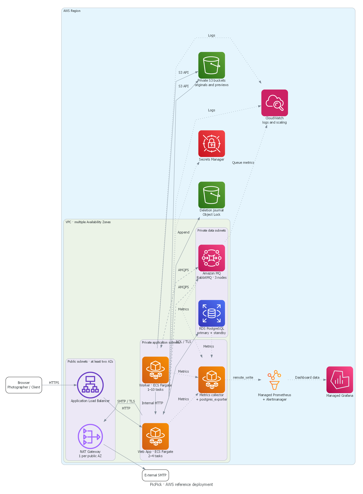

# П.10 Інфраструктура PicPick

AWS — еталонний варіант цільового розгортання за [ADR-003](../04-architecture/adr/003-cloud-serverless.md). Web App і Worker працюють у контейнерах, а базу, брокер і сховище обслуговують керовані сервіси. Розміри нижче — стартові припущення для тестового розгортання.



Суцільні стрілки показують синхронні виклики, штрихові — асинхронний обмін через RabbitMQ, крапкові — доступ до секретів і передавання метрик і журналів. Спільні налаштування ресурсів наведено в таблиці.

## Ресурси

| Ресурс | Тип | Для чого | Початкова конфігурація | Чому обрали |
|---|---|---|---|---|
| VPC і підмережі | Мережа | Ізоляція компонентів | Один регіон. Публічні підмережі щонайменше у двох AZ, приватні підмережі застосунку й даних, три AZ для брокера | Розподіл копій між зонами доступності |
| NAT Gateway і VPC endpoints | Мережа | Доступ до SMTP та AWS API | Один NAT Gateway на AZ із публічною підмережею, gateway endpoint для S3 і interface endpoints для сервісів нижче | Приватні задачі звертаються до AWS через приватну мережу |
| Security groups | Безпека | Обмеження мережевого доступу | ALB: 443 з інтернету. Web App: порт застосунку від ALB, внутрішній порт від Worker. Порти метрик Web App і Worker доступні збирачу. RDS: 5432 від Web App і `postgres_exporter`. Amazon MQ: 5671 від Web App і Worker, HTTPS метрик від збирача | Доступ лише для потрібних компонентів за TB-2 |
| Application Load Balancer і ACM | Мережа / безпека | Вхід браузерів і TLS | Один публічний ALB з HTTPS на 443, сертифікат ACM і перевірка готовності Web App | Спрямовує трафік на готові копії |
| Web App на ECS Fargate | Обчислення | Razor Pages, REST API, Identity, relay й очищення | 2–4 задачі, щонайменше дві в різних AZ, по 0,5 vCPU та 1 ГіБ для старту | Незалежне масштабування за HTTP-навантаженням |
| Worker на ECS Fargate | Обчислення | Обробка фото й створення прев’ю | 1–10 задач, по 1 vCPU і 2 ГіБ на задачу із запасом. За NFR-201 п.4 перевіряємо фактичне споживання до 1 ГБ | Обробка масштабується окремо від сайту |
| RDS for PostgreSQL | База | Акаунти, галереї, фото, вибір і outbox | PostgreSQL 16, Multi-AZ з одним primary та однією standby, стартовий диск 20 ГіБ | Сумісність з PostgreSQL і кероване перемикання при відмові |
| Amazon MQ for RabbitMQ | Черга | Черга задач і Черга подій | Приватний кластер RabbitMQ 4.2+ із трьох вузлів у трьох AZ, quorum queues з трьома репліками | Зберігає AMQP і схему підтверджень за CS-201 і CS-202 |
| Amazon S3 | Сховище | Оригінали й прев’ю | Два приватні бакети, Block Public Access, версіонування для відновлення | Сумісний S3 API для переходу з MinIO |
| S3-бакет ключів Data Protection | Сховище / безпека | Спільні ключі для cookie входу | Окремий приватний бакет із SSE-KMS та доступом для Web App | Ключі доступні всім копіям Web App після оновлення |
| S3-бакет журналу видалень | Сховище | Записи видалень акаунтів, галерей і фото | Окремий приватний бакет з Object Lock, щонайменше 31 доба. Web App лише додає записи | Пізніші видалення зберігаються під час відновлення RDS і бакетів фото |
| Amazon ECR | Сховище | Образи застосунку | По одному приватному репозиторію для Web App і Worker | Образи можна розгортати за digest і відкотити версію |
| Secrets Manager та IAM | Безпека | Секрети БД, брокера, SMTP і внутрішнього API | Окремі ролі задач Web App і Worker. Для S3 використовуємо права ролі задачі | Кожен компонент отримує лише потрібні йому секрети та дозволи |
| CloudWatch | Моніторинг | Журнали контейнерів і сигнал для автомасштабування | Журнали на 30 діб. Метрика Черги задач `MessageReadyCount`, окремі групи журналів Web App і Worker | Керовані сигнали AWS |
| Amazon Managed Service for Prometheus (AMP) і Amazon Managed Grafana | Моніторинг | Метрики Web App, Worker, PostgreSQL і брокера, дашборди й алерти | Один workspace AMP з Alertmanager, один workspace Grafana, один збирач на Fargate з `postgres_exporter` | Стек узгоджений із [п.12](../12-monitoring/webapp-db.md) |
| Зовнішній SMTP | Інтеграція | Підтвердження email | Один налаштований SMTP-сервіс із TLS | Доставка листів за Identity Management |

## Мережа й доступ

- Браузер підключається до публічного ALB через HTTPS. ALB передає запити на порт Web App у приватних підмережах. Внутрішній API обробки має окремий порт, відкритий лише Worker. PostgreSQL приймає з’єднання від Web App і `postgres_exporter`. RabbitMQ приймає AMQPS від Web App і Worker та HTTPS-запити метрик від збирача.
- S3 є регіональним сервісом поза підмережами VPC. Контейнери звертаються до нього через gateway endpoint. Файли браузеру видає Web App після перевірки власника або чинності ShareLink. Worker читає оригінали й записує прев’ю з окремими правами IAM.
- Приватні задачі звертаються до S3 через gateway endpoint, а до ECR (`ecr.api` і `ecr.dkr`), Secrets Manager, CloudWatch Logs, AMP (`aps-workspaces`) і регіонального STS — через interface endpoints. NAT Gateway використовується лише для вихідного SMTP. Публічні IP задачам не призначаються.

Збирач читає приватні endpoints метрик Web App, Worker і RabbitMQ. Статистику RDS надає `postgres_exporter` поруч зі збирачем. Збирач надсилає метрики до AMP через `remote_write` з підписом SigV4. Grafana читає AMP, а Alertmanager у AMP надсилає алерти. [Метрики Amazon MQ](https://docs.aws.amazon.com/amazon-mq/latest/developer-guide/rabbitmq-prometheus-metrics.html) · [Приватний доступ до AMP](https://docs.aws.amazon.com/prometheus/latest/userguide/AMP-and-interface-VPC.html)

## Масштабування, оновлення і копії

- Web App масштабується від 2 до 4 задач за кількістю HTTP-запитів на ціль ALB. Worker масштабується від 1 до 10 задач за кількістю готових повідомлень у Черзі задач за ADR-003. Перед зменшенням кількості Worker даємо активній спробі завершитися в межах часу зупинки. Непідтверджену задачу RabbitMQ доставить повторно, а чинність спроби визначить lease. Верхні межі задаємо за тестом навантаження, бюджетом з’єднань PostgreSQL і можливостями брокера.
- ECS оновлює Web App поетапно. ALB додає нову копію після перевірки готовності з доступом до БД, а старій дає завершити відкриті запити. ECS відкочує невдале розгортання. Міграції мають бути сумісними з обома версіями під час оновлення. Копії Web App використовують спільний набір ключів ASP.NET Core Data Protection у приватному S3-бакеті з SSE-KMS. Роль Web App має доступ до бакета й ключа KMS, щоб cookie входу працювали після перемикання між копіями.
- Для RDS передбачено автоматичні копії та відновлення до моменту часу з горизонтом 30 діб. Для S3 увімкнути версіонування й очищення старих версій за 30 діб. Після відновлення застосувати журнал видалень з окремого S3-бакета до відкриття доступу й перевірити, що рядки БД посилаються на доступні файли. [Політика зберігання](../07-data-model/retention-policy.md#6-резервні-копії)

## Локальний прототип

З кореня репозиторію створити `.env` за `.env.example` і виконати `docker compose up -d` або `podman-compose up -d`. Compose запускає PostgreSQL, RabbitMQ і MinIO на одній машині. Контейнер `minio-init` створює приватні бакети. Web App запускається через `dotnet run --project src/webapp`, Worker — через `python src/worker/main.py` після встановлення його залежностей. Докладні кроки є в [README проєкту](../../README.md).

Інфраструктурні порти прототипу доступні на localhost. Дані лежать у локальних томах, а сервіси мають по одній копії. Цільова схема використовує приватні мережі, реплікацію, резервні копії та автоматичне масштабування.

## Генерація діаграми

Встановити [Graphviz](https://graphviz.org/download/) і додати `dot` до PATH. З кореня репозиторію виконати:

```bash
python -m pip install diagrams==0.25.1
python docs/10-deployment/diagram.py
```

Скрипт [diagram.py](diagram.py) записує PNG у `img/aws-deployment.png`.

Джерела: [оновлення ECS](https://docs.aws.amazon.com/AmazonECS/latest/developerguide/deployment-type-ecs.html), [розгортання Amazon MQ](https://docs.aws.amazon.com/amazon-mq/latest/developer-guide/rabbitmq-broker-architecture.html), [метрики Amazon MQ](https://docs.aws.amazon.com/amazon-mq/latest/developer-guide/rabbitmq-logging-monitoring.html).
