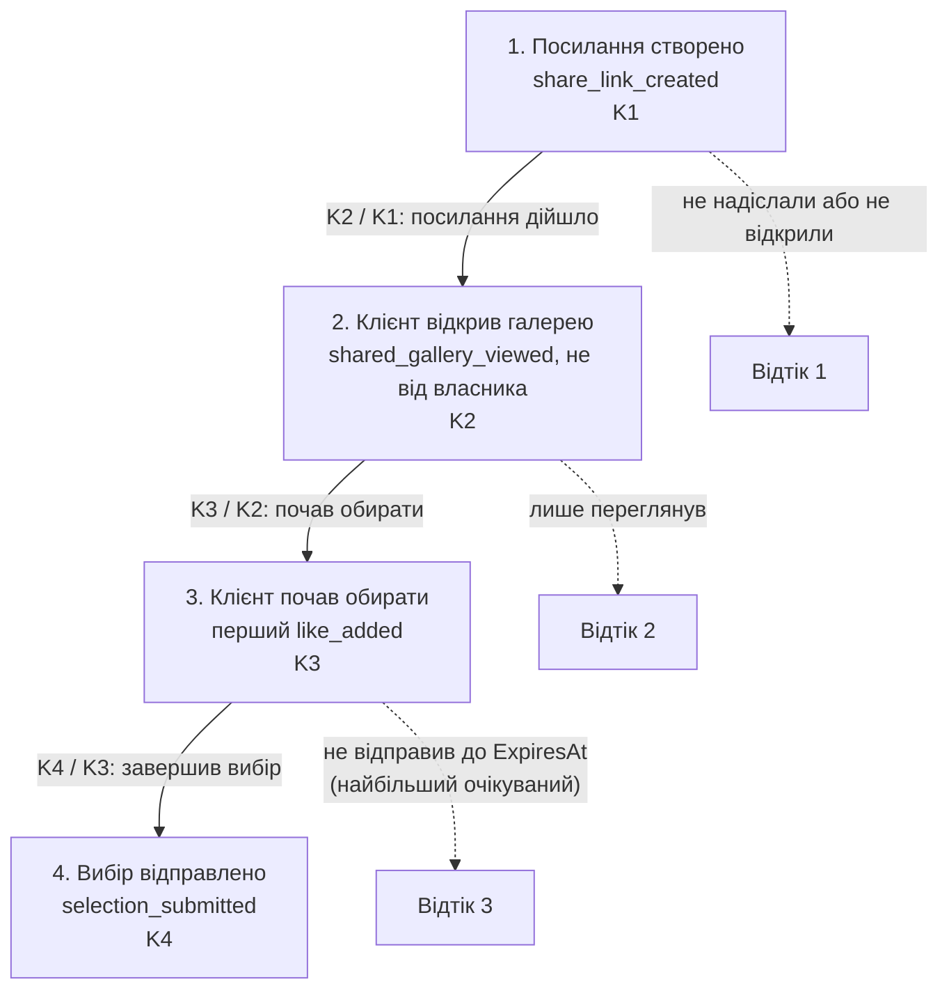

# Продуктові метрики зони C

Зона C охоплює доступ клієнта до галереї за посиланням, лайки й відправку вибору. Метрики відповідають на питання, чи доходять клієнти від посилання до відправленого вибору і що їм у цьому заважає. Технічні метрики серверів належать п.12.

Вимоги: [зона C](../03-srs/zone-c-client.md), [зона A](../03-srs/zone-a-accounts.md). Назви сутностей і статусів — за [глосарієм](../glossary.md). Метрики фотографа й першу воронку описано в [zone-a.md](zone-a.md).

## Правила підрахунку

- Діють [правила зони A](zone-a.md#правила-підрахунку): тижневий звітний період в UTC, когорти лише з завершеним вікном спостереження, «немає даних» за нульового знаменника, лише успішні дії, без тестових акаунтів і повторних доставок.
- **Одиниця підрахунку — галерея, а не клієнт.** Клієнт не має акаунта й cookie ([Identity Management](../03-srs/identity.md#клієнт)), тож «унікального клієнта» система не знає. Двоє людей з одним посиланням (наречена й наречений) — це одна галерея. Аналітичних cookie чи відбитків браузера, щоб розрізнити людей, не вводимо.
- **Вікно спостереження — до `ExpiresAt` галереї**, не довше 30 діб від першого посилання (FR-103), або раніше, якщо галерею фіналізовано чи видалено. До цього моменту клієнт ще може відправити вибір, після нього — вже ні. Когорту публікуємо, коли вікно завершилося для всіх її галерей.
- **Перегляди самого фотографа не рахуються.** Якщо запит за посиланням приходить із браузера, де є cookie власника цієї галереї, подія позначається `by_owner` і з метрик виключається. Фотограф, який перевіряє посилання перед надсиланням, інакше виглядав би як клієнт. Той самий фільтр застосовує крок 8 воронки [зони A](zone-a.md#воронка-фотографа-від-реєстрації-до-отримання-вибору).
- **Пристрій** визначається з `User-Agent` у момент події й зберігається лише як клас: `mobile`, `tablet`, `desktop`. Сам `User-Agent`, IP-адреса й токен не зберігаються.

## Метрики

| ID | Метрика | Як рахується | Виміри | Подія-джерело | FR | Яке рішення допомагає прийняти |
|---|---|---|---|---|---|---|
| M-301 | Частка посилань, відкритих клієнтом | 100% × галереї когорти, для яких до ранішої з двох меж — 7 діб від першого `ShareLink` або завершення вікна галереї — була хоча б одна подія `shared_gallery_viewed` не від власника, / усі галереї когорти з першим `ShareLink`. Нове посилання на заміну втраченого нової галереї в когорті не створює | Тиждень першого посилання. Клас пристрою тут не вимір: для галерей без відкриття він невідомий, тож знаменник не розділити. Розподіл перших відкриттів за пристроями дає M-304 | `share_link_created`, `shared_gallery_viewed` | FR-301, FR-303 | Чи відкривають галерею, поки в ній ще можна обирати. Метрика показує відкриття в межах вікна, але не те, чи клієнт узагалі отримав посилання: цього система не бачить. Низьке значення — сигнал перевірити, чи зрозуміло фотографу, як надіслати посилання (наприклад, кнопка «Скопіювати посилання» з підказкою) |
| M-302 | Час від першого відкриття до відправки вибору | Медіана й 75-й перцентиль годин між першим `shared_gallery_viewed` не від власника і `selection_submitted` для галерей когорти, де вибір відправлено до `ExpiresAt` | Тиждень першого відкриття; розмір галереї (кількість фото `Ready`: до 100, 101–300, 301–1000); клас пристрою відправки | `shared_gallery_viewed`, `selection_submitted` | FR-303, FR-305 | Скільки часу клієнтові потрібно на вибір і чи вистачає типового терміну посилання (14 діб, FR-301 п.2). Якщо 75-й перцентиль наближається до терміну, фотографам варто радити довший строк |
| M-303 | Розмір вибору | Медіана кількості обраних кадрів у відправленому `Selection` і медіана частки обраних від кількості показаних фото `Ready` | Тиждень відправки; розмір галереї | `selection_submitted` з кількістю кадрів | FR-304, FR-305 | Скільки кадрів обирають насправді (наприклад, 30–60 з 500 для альбому, як у персони). Якщо обирають більшість кадрів, клієнти використовують лайк не як вибір, і треба пояснити його сенс; якщо 1–2 кадри — перевірити, чи не відправляють вибір випадково |
| M-304 | Частка відкриттів зі смартфона | 100% × галереї тижня, перше відкриття яких за посиланням (не від власника, у межах вікна галереї) зроблено з `mobile`, / усі галереї, відкриті вперше за цей тиждень. Перші відкриття вже фіналізованих галерей сюди не входять: їх рахує окремий агрегат переглядів ([нижче](#підсумок-галереї-один-раз)). Окремо — та сама частка для відправки вибору | Тиждень; дія (перше відкриття / відправка); клас пристрою | `shared_gallery_viewed`, `selection_submitted` | FR-303, FR-305, NFR-302 | На яких пристроях пріоритетно тестувати й оптимізувати сторінку клієнта. Якщо смартфонів багато серед відкриттів, а серед відправок значно менше — клієнти відкладають вибір до комп'ютера або на телефоні їм незручно обирати |
| M-305 | Частка галерей без відправленого вибору | 100% × галереї з хоча б одним `ShareLink`, вікно яких завершилося за тиждень без `Selection.Status = Submitted`, / усі галереї з хоча б одним `ShareLink`, вікно яких завершилося за тиждень. Вікно галереї завершується в найраніший із моментів: `ExpiresAt`, фіналізація (FR-106) чи запит видалення (FR-107). Кожна галерея рахується один раз, незалежно від кількості посилань: якщо перше посилання спливло, а за новим вибір відправлено, це не втрата | Тиждень завершення; причина (`ExpiresAt` / фіналізація / видалення); найдальший досягнутий крок воронки (не відкрито / відкрито без лайка / був перший лайк) | Немає окремої події: завершення визначається з дат і статусів. Підсумок галереї фіксується за правилом [нижче](#підсумок-галереї-один-раз) | FR-108, FR-106, FR-304, FR-305 | Скільки галерей із посиланням так і не отримали вибору і на якому кроці їх загублено. Знаменник — усі галереї з посиланням, зокрема ті, які клієнт не відкривав, тому це не те саме, що відтік 3 → 4: його рахує воронка як (K3 − K4) / K3. Розріз за досягнутим кроком показує, де саме втрачено вибір; якщо переважає «був перший лайк» із причиною `ExpiresAt`, варто показувати клієнтові, скільки днів лишилося, а фотографу — що вибір ще не надіслано |

M-301 рахує відкриття за 7 діб, бо посилання зазвичай відкривають одразу після отримання. Довге вікно ховало б проблему «посилання не дійшло» серед пізніх відкриттів. Решта метрик чекає завершення вікна галереї. Прострочення окремого посилання, на заміну якому створено нове, втратою не вважається: важливо, чи галерея дійшла до відправки.

## Воронка клієнта: від посилання до відправленого вибору

Одиниця — **галерея**, початок — перше успішне створення `ShareLink` для неї. Усі кроки мають відбутися в цьому порядку до завершення вікна галереї — найранішого з `ExpiresAt`, фіналізації та запиту видалення, як у [правилах підрахунку](#правила-підрахунку). Кроки 2–4 рахуються лише за подіями не від власника. Клієнт може вперше відкрити вже фіналізовану галерею (FR-303 п.1), але лайкнути чи відправити вибір там уже не може, тож таке відкриття до кроку 2 не зараховується, а потрапляє в окремий тижневий агрегат переглядів фіналізованих галерей. Кожна галерея на кожному кроці рахується один раз; заміна посилання новою воронки не починає. Позначимо K1–K4 кількість галерей, що дійшли до кроку з усіма попередніми: K4 ≤ K3 ≤ K2 ≤ K1. **Відтік 3 → 4** = (K3 − K4) / K3. Ознака «почав обирати» (K3) — сама подія першого лайка, а не наявність лайків наприкінці: клієнт міг пізніше зняти всі лайки, але обирати він починав. Конверсії від кроку 2 можна розрізати за класом пристрою першого відкриття: для цих галерей він відомий. Для K2 / K1 такого розрізу немає з тієї самої причини, що й у M-301.

«Отримання посилання» клієнтом система не бачить: фотограф надсилає його поза PicPick, у месенджері чи листом. Тому перший крок — створення посилання, а перший доказ, що клієнт його отримав, — відкриття.

| Крок | Подія та умова | FR / метрика | Конверсія до наступного кроку |
|---|---|---|---|
| 1. Посилання створено | `share_link_created`: перший `ShareLink` галереї | FR-301; M-301 | 100% × K2 / K1 |
| 2. Клієнт відкрив галерею | `shared_gallery_viewed`: успішно показано сторінку за чинним посиланням, не від власника | FR-303; M-301, M-304 | 100% × K3 / K2 |
| 3. Клієнт почав обирати | `like_added`: перший успішний лайк, який створив `Selection` (FR-304 п.1) | FR-304 | 100% × K4 / K3 |
| 4. Вибір відправлено | `selection_submitted`: перший перехід `Selection.Status` у `Submitted` | FR-305; M-302, M-303 | Завершення; загальна конверсія 100% × K4 / K1 |

Галерея, яку фотограф фіналізував (FR-106), видалив чи в якої завершився термін до відправки, лишається в знаменнику: для клієнта вибір не відбувся. Що фотограф далі побачив вибір (FR-306), показує воронка [зони A](zone-a.md#воронка-фотографа-від-реєстрації-до-отримання-вибору); тут шлях клієнта закінчується відправкою.

**Де клієнти губляться найчастіше — гіпотези до збору даних:**

- **3 → 4, найбільший очікуваний відтік.** Обрати 30–60 кадрів із сотень — це не одна сесія: клієнт гортає галерею кілька разів, радиться з партнером і відкладає остаточне рішення. Діалог чесно попереджає, що змінити вибір після відправки не можна (FR-305 п.2), і це теж стримує натискання. Термін посилання тим часом спливає. Як перевірити: відтік (K3 − K4) / K3, розрізаний за причиною завершення вікна, і M-302 — якщо відтік великий, переважає причина `ExpiresAt`, а час до відправки в тих, хто встиг, близький до терміну, гіпотеза підтверджується. Що робити: показувати клієнтові, скільки днів лишилося, а фотографу — що вибір ще `Open` (FR-306 уже показує кількість лайків).
- **1 → 2.** Посилання створено, але не надіслано або загубилося в месенджері. Частину цього відтоку пояснює сам фотограф (створив заздалегідь, надішле пізніше). M-301 показує, чи було відкриття в межах вікна: низьке значення може означати і «не дійшло», і «відкриють пізніше чи вже після фіналізації». Чи клієнт узагалі отримав посилання, з неї не видно.
- **2 → 3.** Клієнт відкрив галерею, але не зрозумів, що треба лайкати, або відкрив на ходу зі смартфона й відклав. Перевірити за конверсією K3 / K2 окремо за класом пристрою першого відкриття, а не за M-304: смартфони можуть переважати серед відкриттів без лайків просто тому, що з них загалом частіше відкривають. Якщо K3 / K2 для `mobile` помітно нижча, ніж для `desktop`, варто перевірити зрозумілість лайка на малому екрані (NFR-302).

Конверсії ще не виміряні, цільових відсотків без даних не задаємо.

## Джерела подій і мінімальні дані

Події формує Web App після успішної дії: `share_link_created` і `selection_submitted` — після коміту транзакції, `like_added` — після коміту першого лайка в `Selection`, `shared_gallery_viewed` — після успішного показу сторінки галереї за посиланням (не для прев'ю, не для запитів синхронізації лайків і не для сторінки недійсного посилання). Повтори відсіюються так само, як у [зоні A](zone-a.md#джерела-подій-і-мінімальні-дані): повторна відправка вибору (FR-305 п.3) і повторний лайк того самого фото нових подій не створюють.

Подія містить лише тип, UTC-час, технічний id події, id галереї, клас пристрою, позначку `by_owner` і для `selection_submitted` — кількість обраних кадрів і кількість фото `Ready`. **Не збираємо:** токен чи повне посилання, `token_hash`, IP-адресу, повний `User-Agent`, ідентифікатори обраних фото, імена файлів, назву галереї, нікнейм. Лайки й вибір — персональні дані ([retention policy](../07-data-model/retention-policy.md#1-класи-даних)), тому аналітика бере з них лише кількості.

### Підсумок галереї один раз

Усі метрики M-301…M-305 і воронка рахуються з **підсумку галереї** — одного запису на галерею. Він містить:
- тиждень першого посилання (когорта M-301 і воронки) і ознаку «відкрито клієнтом до ранішої з меж: 7 діб або завершення вікна» (M-301);
- досягнуті кроки воронки 1–4, зокрема факт першого лайка, навіть якщо лайки потім знято (K3);
- час першого відкриття й відправки (M-302, тиждень для M-304);
- клас пристрою першого відкриття й клас пристрою відправки (M-304, розрізи воронки й M-302);
- кількість обраних кадрів і кількість фото `Ready` (M-303, розмір галереї);
- причину й момент завершення вікна (M-305).

**Проміжний стан.** Підсумок створюється разом із першим посиланням і оновлюється одразу під час кожної дії, а не наприкінці вікна. Кожне поле заповнюється один раз і лише дією, що сталася до завершення вікна: наприклад, `first_viewed_at = COALESCE(first_viewed_at, :t)`. Для дій, що змінюють стан, підсумок оновлюється **в тій самій транзакції, що й сама зміна**, а не з події після коміту:
- перше посилання — у транзакції створення `ShareLink`;
- перший лайк — у транзакції лайка, під тим самим блокуванням `selections`;
- відправка — у транзакції переходу `Selection` у `Submitted`.

Тому закомічена відправка завжди вже є в підсумку: якщо обробка події `selection_submitted` запізниться, фіксація не зарахує галерею як таку, що не отримала вибору. Перше відкриття оновлює підсумок у тому самому запиті, що показує сторінку. Події з розділу вище лишаються журналом для перевірки, але метрики з них не рахуються. Тому внесок події зберігається в підсумку в момент, коли вона відбулася, і 30-денне очищення подій нічого не губить, навіть якщо галерея живе всі 30 діб, а агрегація чи очищення [CS-102](../06-concurrency/cs-102-expired-gallery-cleanup.md) спрацюють уже після `ExpiresAt`.

**Фіксація один раз.** Коли вікно завершилося, підсумок фіксується умовним `UPDATE … SET final_at = now() WHERE gallery_id = :id AND final_at IS NULL`, і **в тій самій транзакції** його внесок додається до тижневих агрегатів. Це робить щоденна задача агрегації, а якщо очищення спрацювало раніше, то саме очищення перед видаленням рядків галереї. Умова `final_at IS NULL` пропускає лише перший прохід, тож галерея потрапляє в агрегати рівно один раз, а повторні проходи нічого не додають. Оновлення з дій теж мають умову `final_at IS NULL`, а фіксація й дія змінюють той самий рядок підсумку, тож блокування рядка виконує їх по черзі: відправка, закомічена до фіксації, у підсумок потрапляє. Після фіксації підсумок більше не змінюється.

**Перегляди фіналізованих галерей** у підсумок не потрапляють, бо після фіксації він незмінний. Щоб рахувати саме перше таке відкриття, а не кожне оновлення сторінки, Web App тримає тимчасову ознаку на рівні галереї — рядок із `gallery_id` (PK) і часом першого перегляду після фіналізації. Коли клієнт відкриває фіналізовану галерею (FR-303 п.1), Web App виконує `INSERT … ON CONFLICT (gallery_id) DO NOTHING` і **лише якщо рядок справді вставлено**, у тій самій транзакції збільшує тижневий лічильник «перших переглядів фіналізованих галерей» із розрізом за класом пристрою. Оновлення сторінки чи два одночасні відкриття знаходять наявний рядок і лічильник не збільшують. Ознака видаляється разом із галереєю. У M-304 і воронку такі відкриття не входять.

Зберігання — як запропоновано в [зоні A](zone-a.md#джерела-подій-і-мінімальні-дані): події не довше **30 діб**, зафіксовані підсумки — до 30 діб після фіксації, далі лише тижневі агрегати без ідентифікаторів галерей. Події, підсумок і ознака перегляду фіналізованої галереї видаляються разом із нею; на той момент їхній внесок уже є в агрегатах. Реалізація збору подій не входить до цієї задачі.
