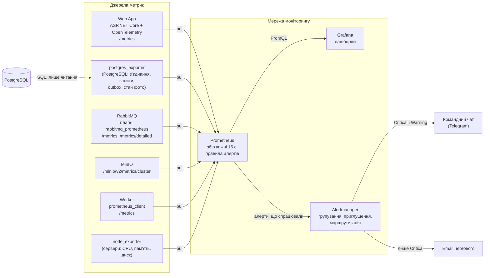

# П.12 Моніторинг

План моніторингу PicPick: які метрики збираємо, звідки, на які алерти реагує команда і куди вони надходять. Деталі, обґрунтування порогів і покрокові дії — у двох файлах:

- [webapp-db.md](webapp-db.md) — Web App і PostgreSQL (TM-1xx, AL-1xx);
- [processing.md](processing.md) — фонова обробка: Worker, RabbitMQ, MinIO й outbox (TM-2xx, AL-2xx).

Назви компонентів — за [High-level Architecture](../03-srs/high-level-architecture.md) і [глосарієм](../glossary.md).

## Стек і схема збору

Prometheus раз на 15 с забирає метрики з усіх джерел (pull) і з тим самим інтервалом перевіряє правила алертів. Grafana будує дашборди з Prometheus. Alertmanager отримує від Prometheus алерти, що спрацювали, групує їх і надсилає сповіщення.

Endpoint-и метрик і експортери доступні лише з мережі моніторингу; з Інтернету до них доступу немає, як і до самих Worker, RabbitMQ, PostgreSQL і MinIO ([модель загроз](../09-security/README.md)). У labels потрапляють лише контрольовані значення: маршрут-шаблон, черга, формат, результат із фіксованого переліку. Ідентифікатори фото, галерей і фотографів, email, IP, токени й тексти помилок не потрапляють (NFR-102). `node_exporter` дає базові метрики серверів для дашборда; окремих метрик і алертів на нього в цьому плані немає.

## Зведена таблиця метрик

| ID | Метрика | Тип | Виміри | Ресурс | Джерело | Навіщо |
|---|---|---|---|---|---|---|
| TM-101 | Доступність джерел і PostgreSQL | gauge | `job`, `instance`, середовище | Web App, PostgreSQL, Worker, RabbitMQ, MinIO | `up` для кожного очікуваного target, `pg_up` | Виявити недоступний сервіс чи збір метрик |
| TM-102 | Кількість завершених HTTP-запитів | counter | копія Web App, метод, шаблон маршруту, статус, клас `normal` / `upload` | Web App | OpenTelemetry | Навантаження й знаменник для часток помилок |
| TM-103 | Тривалість HTTP-запитів | histogram | ті самі, що TM-102 | Web App | OpenTelemetry | p95 сторінок і API за NFR-201 п.3 |
| TM-104 | Частка HTTP 5xx | gauge, обчислений | середовище, клас запиту, шаблон маршруту | Web App | з TM-102 | Помилки сервера й залежностей |
| TM-105 | Частка HTTP 429 | gauge, обчислений | середовище, клас запиту, шаблон маршруту | Web App | з TM-102 | Ліміти заважають або сплеск запитів |
| TM-106 | Використані з'єднання PostgreSQL | gauge | копія PostgreSQL, БД, стан з'єднання | PostgreSQL | `postgres_exporter` | Наближення до ліміту з'єднань |
| TM-107 | Запити PostgreSQL довші за 5 с | gauge | копія PostgreSQL, БД | PostgreSQL | `postgres_exporter` | Довгі запити й блокування |
| TM-201 | Кількість повідомлень у черзі | gauge | черга, стан `ready` / `unacked` | RabbitMQ | `rabbitmq_prometheus` | Накопичення роботи в Черзі задач, Черзі подій і DLQ |
| TM-202 | Вік найстарішого незавершеного елемента | gauge | етап `outbox` / `processing` | PostgreSQL (outbox, `photos`) | `postgres_exporter` | Наскрізний сигнал «фото не обробляється» |
| TM-203 | Повідомлення, перенесені в DLQ | counter | тип черги, стратегія dead-lettering | RabbitMQ | `rabbitmq_prometheus` | Задачі, що вичерпали ліміт доставок |
| TM-204 | Тривалість однієї спроби обробки | histogram | формат, результат | Worker | `prometheus_client` | Швидкість обробки за форматами, бюджет NFR-201 п.1 |
| TM-205 | Активні споживачі черги | gauge | черга | RabbitMQ | `rabbitmq_prometheus` | Чи є кому розбирати Чергу задач |
| TM-206 | Результати спроб обробки | counter | результат, причина | Worker | `prometheus_client` | Помилки файлів проти тимчасових збоїв, повторні доставки |
| TM-207 | Заповненість сховища MinIO | gauge, обчислений | середовище | MinIO | endpoint MinIO | Нестача місця для оригіналів і прев'ю |

Разом 14 метрик: 7 для Web App і PostgreSQL, 7 для обробки.

## Зведена таблиця алертів

«Допустимі значення» — межі, у яких метрика вважається нормальною (мінімум чи максимум); «Поріг» — умова, за якої алерт спрацьовує.

| ID | Алерт | Допустимі значення | Поріг | Критичність | Звідки поріг |
|---|---|---|---|---|---|
| AL-101 | Джерело чи PostgreSQL недоступні: Web App, експортер, Worker, RabbitMQ чи MinIO | Мін.: `up = 1` для кожного очікуваного target, `pg_up = 1` | `up = 0` чи втрата ряду будь-якого очікуваного target, або `pg_up = 0`, `for: 2m` | Critical | Компроміс між швидким виявленням і коротким перезапуском |
| AL-102 | Багато помилок 5xx | Макс.: 5% відповідей | TM-104 > 5%, `for: 5m`, ≥ 100 запитів за 5 хв | Critical | Початкове припущення: 1 із 20 запитів суттєво заважає роботі |
| AL-103 | Повільні сторінки й API | Макс.: p95 0,5 с для звичайних сторінок і API, без завантаження файлів | TM-103 p95 > 0,5 с для класу `normal`, `for: 5m`, ≥ 100 таких запитів за 5 хв | Warning | NFR-201 п.3, який виключає саме завантаження файлів |
| AL-104 | Багато відповідей 429 | Макс.: 10% відповідей окремо для `normal` і `upload` | TM-105 > 10% для `normal` або `upload`, `for: 10m`, ≥ 100 запитів відповідного класу за 5 хв | Warning | Початкове припущення, відсіює короткі сплески |
| AL-105 | Вичерпуються з'єднання PostgreSQL | Макс.: 80% доступного бюджету з'єднань | TM-106 > 80%, `for: 10m` | Warning | Резерв 20% для сплесків |
| AL-201 | Worker не розбирає Чергу задач | Мін.: 1 споживач Черги задач, коли в ній є задачі | TM-205 = 0 при TM-201 `ready` > 0, `for: 2m` | Critical | Як AL-101; NFR-202 дає 15 хв на завершення всіх фото |
| AL-202 | Фото довго чекає обробки | До 10 хв — норма; понад 10 і до 30 хв — зона Warning; понад 30 хв — зона Critical | TM-202 `processing` > 10 хв (`for: 5m`) / > 30 хв (`for: 2m`) | Warning / Critical | NFR-201 п.1: 10 хв на JPEG-набір; 25 хв на RAW-набір + 5 хв lease |
| AL-203 | Outbox не відправляється | Макс.: 60 с очікування запису | TM-202 `outbox` > 60 с, `for: 2m` | Warning | R-I4-1; relay публікує щосекунди |
| AL-204 | Задачі потрапляють у DLQ | Макс.: 0 нових повідомлень і порожня DLQ | приріст TM-203 за 15 хв > 0 або DLQ > 0, `for: 10m` | Warning | У нормі 0 (R-I5-2) |
| AL-205 | Сховище MinIO заповнюється | Макс.: 80% місця | TM-207 > 80%, `for: 15m` | Warning | R-I6-4 |

Разом 10 алертів, усі порогові. Покрокові дії для Critical-алертів (AL-101, AL-102, AL-201, AL-202 Critical) — у файлах зон.

## Куди надходять алерти

Сповіщення отримує команда, яка обслуговує систему. Alertmanager маршрутизує їх за label `severity`:

| Критичність | Куди | Коли | Повтор, поки не вирішено |
|---|---|---|---|
| Critical | Командний чат (Telegram-група, `telegram_configs`) і email чергового | Одразу після `for`, `group_wait: 30s` | Щогодини |
| Warning | Лише командний чат | Групується, `group_wait: 2m` | Раз на 4 год |

- **Групування** — за середовищем і назвою алерту (`group_by: [env, alertname]`), щоб збій кількох копій давав одне повідомлення, а не десяток. Повідомлення містить копію сервісу, поточне значення, посилання на дашборд Grafana і на розділ із діями.
- **Закриття.** Alertmanager надсилає `resolved`, коли умова перестала виконуватися, тож у чаті видно і початок, і кінець інциденту.
- **Приглушення (inhibition)** — щоб одна причина не давала кількох сповіщень:
  - AL-101 для Web App чи PostgreSQL приглушує AL-102 і AL-103: при недоступній БД помилки й затримки — наслідок, а не окрема проблема;
  - AL-201 і AL-202 Critical приглушують AL-202 Warning.
  Приглушені алерти лишаються на дашборді.
- **Тиша (silence)** на час планових робіт ставиться в Alertmanager вручну, з автором і строком.
- Токен бота й адреси зберігаються в секретах Alertmanager (`.env`), а не в репозиторії.

## Зв'язок з іншими розділами

- Пороги спираються на NFR з п.3: [NFR-201, NFR-202](../03-srs/zone-b-processing.md); ті, що не мають джерела у вимогах, позначено як стартові значення й уточнюються після навантажувального тесту.
- Метрики покривають колонку «Виявлення» RMA: [зона A](../08-resiliency/zone-a.md) — TM-101, TM-106, TM-107; [зона B](../08-resiliency/zone-b.md) — TM-201…TM-207. RMA зони C (I-3, I-7) ще не змерджено; для неї TM-101 і TM-207 дають для I-3 (Web App ↔ MinIO) сигнали про доступність збору метрик MinIO та його місткість, але не про помилки самих запитів Web App до MinIO (наприклад, через некоректні облікові дані). Для Черги подій (I-7) сигнали дають TM-201 (довжина черги) і TM-205 (споживачі). Після мерджу RMA зони C зіставлення треба звірити з її колонкою «Виявлення».
- Обмежені labels і закритий доступ до `/metrics` випливають із [моделі загроз](../09-security/README.md).
